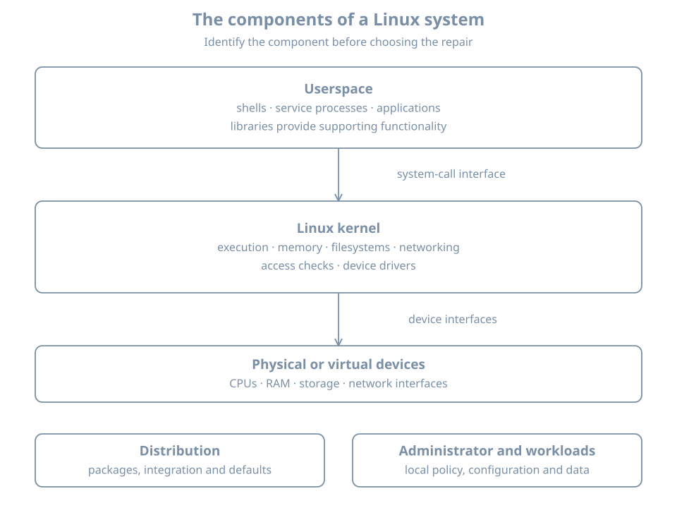

You log in to a Linux machine, run a command, and receive an answer. Several distinct components cooperated to make that happen: firmware started the machine, a kernel manages its resources, a shell interpreted your command, a program ran, and libraries helped that program request operating-system services. The files and policies around those components came from a distribution and from whoever configured this particular installation.

Learning administration begins by separating those responsibilities. Otherwise, every failure looks like “Linux is broken,” and every attempted fix becomes a guess about which component to restart, reinstall or replace.

By the end of this chapter, you should be able to distinguish a kernel from a distribution, a program from a process, and an installed system from the system currently running. You will also build a small evidence table about a machine without changing its configuration.

## A map of the system

{fig-alt="Applications, shells and service processes run in userspace with libraries. They request kernel services through system calls. The kernel manages execution, memory, filesystems, networking and drivers, which connect to physical or virtual devices. The distribution supplies packages and defaults; the administrator supplies local configuration and data."}

Think of an installed Linux system as three cooperating things:

1. **A mechanism for running and protecting work:** the kernel, its supported interfaces and its device support.
2. **A collection of software:** libraries, administrative tools, service managers and applications.
3. **A particular configured installation:** its identities, packages, settings, data and runtime state.

The [kernel project's introduction](https://www.kernel.org/linux.html) explicitly distinguishes the kernel from a complete distribution. That distinction becomes practical whenever the kernel version, operating-system release and application version tell different stories.

### The kernel

The **kernel** is the central privileged software managing the machine's resources. It schedules runnable work on processors, also called CPUs, manages memory, implements filesystem and networking facilities, and coordinates access to devices through drivers.

A **driver** is software that lets an operating system control a device or implement a device-facing interface. Some Linux drivers are built into the kernel image; others can be loaded as modules. You do not need to compile drivers to begin administration. You do need to recognize that a visible device, a loaded driver and a working application are different milestones.

The kernel is not your shell, graphical desktop, web server or package manager. Those programs can request its services, but each also has its own configuration and failure modes. A web server can have a syntax error while the kernel continues scheduling processes normally.

### Userspace

**Userspace** is the environment in which ordinary application and system-service code runs. It includes shells, editors, databases, login programs and many administrative daemons. A **daemon** is a program intended to provide background service; a **service** is an operational role that can involve one or several processes.

Root-owned programs are still userspace programs. Being a privileged user does not turn a process into part of the kernel. Privilege changes which operations it may request, subject to the host's other policies.

The separation provides a useful diagnostic question: did an application reject its own configuration, did a library fail to load, or did a kernel operation fail? All can prevent a command from completing, but they call for different investigations.

### Libraries and system calls

A **library** supplies reusable functionality to programs. A program might use a library to format text, look up a name, handle encryption or interact with the operating system. Libraries can be shared by many installed programs or incorporated into a program when it is built.

A **system call** is an interface through which userspace asks the kernel to perform an operation such as opening a file or creating a socket, a communication endpoint. Programs commonly reach it through library wrappers. A library function is not necessarily one system call: it might do all its work in userspace, make several calls, or use a different call on different architectures. The [Linux system-call reference](https://man7.org/linux/man-pages/man2/syscalls.2.html) describes this boundary.

For administration, the important idea is the contract. A program asks for an operation; the kernel applies the relevant mechanism and policy, then returns a result. A failed request is evidence. Reinstalling the requesting program does not necessarily change why the request was denied.

### The distribution

A **distribution** assembles a usable operating system from the kernel and other software. Its maintainers choose package versions, build options, update policies, installation tools, integration and defaults.

Ubuntu, Debian and Fedora can all run Linux while differing in package management and security policy. Two Ubuntu machines can also differ because they were installed from different images, upgraded along different paths or configured for different roles.

The distribution supplies a starting point. It does not make every installation identical. When a runbook says “the default configuration,” ask which release, image and installation path the author actually observed.

### The installation and its running state

An **installed system** is software and persistent state arranged on storage. A **running system** is the current execution of a kernel and its processes, with active mounts, interfaces and other live state.

Installing a new kernel package does not switch the running kernel to that version immediately. Editing a service configuration file does not guarantee the running service has read it. These are examples of a general distinction:

| Persistent state | Related runtime state |
|---|---|
| Kernel and boot files on disk | Kernel selected for this boot |
| Service unit and configuration files | Loaded manager configuration and running processes |
| Network configuration files | Addresses and routes active now |
| Account database entries | Identity and group information held by existing sessions |
| Filesystem table | Filesystems actually mounted |

Administration means understanding both sides and the operation that brings them into agreement.

## Follow one ordinary request

Suppose a shell runs:

```bash
cat /etc/os-release
```

The pathname names a file containing operating-system identification data. In an ordinary interactive session, the shell locates `cat` and arranges to run it. The resulting process opens the file, reads bytes and writes output to its standard output, which is connected to the terminal in this example.

That explanation crosses several ownership boundaries:

| Component | Responsibility in this example |
|---|---|
| Shell | Interpret the command and arrange program execution |
| `cat` program | Implement the requested read-and-copy behavior |
| Loader and libraries, where applicable | Prepare the executable and provide supporting functions |
| Kernel | Perform the requested file and output operations under the applicable policy |
| Filesystem and backing storage | Supply the file's content, possibly already cached in memory |
| Terminal environment | Present the output to the user |

Not every read reaches a disk. The content can already be cached. Not every program needs the same shared libraries. The table identifies responsibilities without assuming one low-level implementation for every executable.

If the file is absent, the executable is missing, or the output destination has failed, the same command line can fail for different reasons. Learn to preserve the actual error rather than translating all failures into “command does not work.”

## Worked example 1: identify the operating system and kernel separately

The following inspection commands can be run in an existing Linux environment. If you do not yet have a lab host, study the examples now and repeat them after the VM-building chapter. No installation is required to understand the model.

Input:

```bash
cat /etc/os-release
uname -s
uname -r
uname -m
```

Illustrative output, with unrelated release fields omitted:

```text
NAME="Ubuntu"
VERSION_ID="26.04"
ID=ubuntu

Linux
<running-kernel-release>
x86_64
```

Read the answers as four different facts. The release file describes the operating-system userspace in the filesystem view you are inspecting. `uname -s` identifies the kernel name. `uname -r` identifies the running kernel release. `uname -m` reports a machine architecture identifier for this execution environment.

The [os-release specification](https://www.freedesktop.org/software/systemd/man/latest/os-release.html) defines the release fields. Do not edit them to “upgrade” a system. Changing its label changes neither its packages nor the running kernel.

An application package can have yet another version. There is no expectation that an Ubuntu release number, Linux kernel release and web-server version should match numerically.

**What this does not prove:** which kernel will boot next, whether the installation is fully updated, or whether this filesystem view is the physical host's root. Record those as unanswered questions.

## Worked example 2: separate a command from the kernel it queries

Input in a Bash session:

```bash
command -v uname
uname --version
cat /proc/sys/kernel/osrelease
uname -r
```

Possible observations:

```text
/usr/bin/uname
<the installed implementation's version banner>
<running-kernel-release>
<running-kernel-release>
```

Why: `uname` is itself an installed userspace program. Its `--version` banner describes its implementation; its `-r` result describes the running kernel. An implementation without `--version` can reject that option while still providing the kernel query. Use the local manual rather than treating one vendor's options as universal.

The `/proc/sys/kernel/osrelease` interface supplies a second route to the kernel release. `/proc` is a kernel-provided filesystem view, not an ordinary directory of files copied onto a disk. Reading it is observation; writing to other writable kernel interfaces can change runtime behavior. Here we use only the documented read operation.

On a Debian-family installation, you can additionally ask who owns a known installed pathname:

```bash
dpkg-query -S /usr/bin/uname
```

This queries the local package database. The recorded path and package can differ with the installation's layout or implementation. A “no path found” result needs investigation; it is not proof that the kernel has disappeared. File ownership, runtime kernel identity and package availability answer different questions.

## Worked example 3: distinguish program, process and manager

A **program** is executable code and associated files. A **process** is an instance executing with a process ID, credentials, memory and open resources. Starting the same program twice usually produces distinct processes.

In Bash, input:

```bash
printf 'This shell PID: %s\n' "$$"
ps -p "$$" -o pid=,ppid=,comm=
ps -p 1 -o pid=,comm=,args=
```

Illustrative output:

```text
This shell PID: 1842
1842 1799 bash
1 systemd /sbin/init
```

Your shell is one process. PID 1 identifies the initial process in the PID namespace visible to you. On the reference system's ordinary host environment, it is normally the system manager. In a container, PID 1 can instead be the container's application or a small init program.

This is why finding a `systemctl` executable does not prove a systemd manager is running in the environment. Likewise, finding a server executable on disk does not prove the server has a running process or an active listening socket.

You will learn namespace details later. For now, record the boundary: a process listing describes the process view available to that command.

## Worked example 4: inspect one system call boundary

This is an optional observation exercise if `strace` is already available. It does not require writing a program or installing packages now. The [strace manual](https://man7.org/linux/man-pages/man1/strace.1.html) documents tracing a child command and selecting system calls.

```bash
strace -e trace=openat,read,write,close cat /etc/os-release
```

A successful trace might include lines with this shape:

```text
openat(AT_FDCWD, "/etc/os-release", O_RDONLY) = 3
read(3, "NAME=...", 131072) = <positive-byte-count>
write(1, "NAME=...", <byte-count>) = <byte-count>
close(3) = 0
```

These lines are schematic, not a byte-for-byte transcript. You can also see executable startup, libraries and locale files. The numeric file descriptor `3` is a handle chosen in this process, not a permanent identifier for the release file. Descriptor `1` is standard output by convention.

Now predict the result for a pathname you know does not exist. The open should fail, and there can be no successful read of that nonexistent file through the failed open. A trace is useful when it tests a prediction; a long trace alone is not an explanation.

Some restricted environments do not permit tracing even your own child process. Preserve that error as an observation about the environment. Do not alter host security policy merely to complete this optional first exercise.

## The same Linux label can describe different boundaries

You may encounter a physical installation, a full VM, a container, a live image or an offline filesystem exposed through a repair environment. Each can contain familiar Linux paths.

Ask two questions together:

- **Which kernel is answering?** Kernel queries describe the running execution environment.
- **Whose files am I reading?** A mounted installation or isolated filesystem view can supply userspace files from a different environment.

Consider an offline installation accessed from rescue media. Its release file belongs to the installed userspace. The rescue environment's running kernel still answers kernel queries. There is no inconsistency to fix simply because those versions differ.

This habit prevents a common repair mistake: building an installed artifact for the recovery kernel because a command returned the recovery environment's release. The full recovery procedure comes later, but the reasoning starts here.

## Break/fix: a package upgrade did not change the running kernel

**Symptom.** An administrator installs an updated kernel package, then reports that the update failed because `uname -r` still shows the previous release.

**Hypotheses.** The package could have failed to install; it could be installed but not selected by a boot entry; or no new boot has happened yet. These are different conditions.

**Diagnosis.** Record the running release, inspect the installed package result and identify which boot artifacts and entries exist. At this point in the book, the important observation is that package installation changes stored files, while `uname` queries current execution. Do not delete old kernels to force the two observations to agree.

**Resolution.** If installation and boot configuration are correct, the new kernel takes effect through a planned boot into that entry. Check its release afterward. If the host already rebooted into the old release, investigate selection and fallback rather than repeating the same install blindly. Later boot and update chapters provide the exact workflow.

**Success criterion.** You can explain both the installed state and the running state, including any intentional difference.

## Practice: build a component evidence table

Make the following table in your notes using the read-only examples above. If an interface is absent or a command is restricted, record that exact result.

| Question | Evidence source | Your observation | Remaining uncertainty |
|---|---|---|---|
| Which userspace release is visible? | `/etc/os-release` | | Is this the host, a guest or another filesystem view? |
| Which kernel is running? | `uname -r` | | Which kernel will boot next? |
| What architecture is reported? | `uname -m` | | Which hardware/virtualization layer exposes it? |
| What program is PID 1 here? | `ps -p 1` | | What is outside this process view? |
| Where is the query command? | `command -v uname` | | Which package or installation method supplied it? |

Then classify these statements:

1. “The package manager installed a new executable.” This is a claim about persistent software state.
2. “A process is still running the previous executable.” This is a claim about runtime state.
3. “The command exists, so its corresponding service must be healthy.” This conclusion is unsupported.
4. “The release file and kernel release have different numbering.” This can be normal; they identify different components.

The exercise is complete when you can explain the component behind each answer and one thing the answer does not establish. No configuration cleanup is needed because the inspection did not change system settings.

## Recall card

- Linux's kernel manages resources and supplies interfaces to userspace.
- Shells, service managers, libraries and applications are separate software components.
- A distribution integrates software, packages, policy and update practices.
- A program on disk and a running process are different objects.
- Installed files and current runtime state can intentionally differ.
- `os-release`, kernel queries and package queries identify different things.
- Record which environment supplied an answer before interpreting it.
- Diagnose the responsible component, then verify the specific claim you made.
