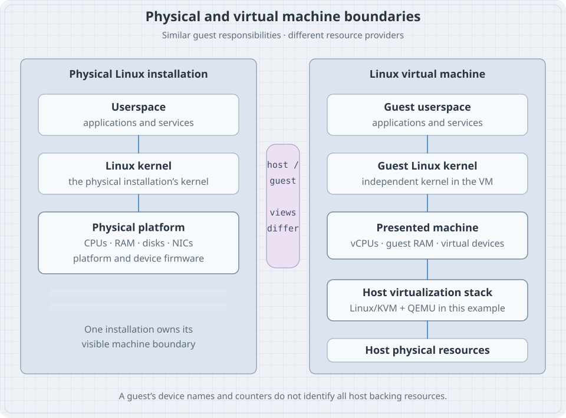

A Linux server can be a physical computer in a rack, a VM on your laptop, a cloud instance, or a guest nested inside another VM. Its administrative tools may show a CPU, memory, disks and interfaces in every case. The crucial difference is who supplies those resources and which layer you can actually control.

Before building the lab, learn to name these layers. This will explain why changing a VM's boot order can fix one startup problem, why installing a guest driver cannot create missing host storage, and why a four-vCPU guest does not necessarily own four physical CPU cores.

By the end of the chapter, you should be able to describe a machine from firmware through operating system, distinguish a VM from a container, and collect evidence about your execution environment without treating detection as proof of every underlying detail.

## Map: a machine can be physical or presented by another system

{fig-alt="The left stack shows Linux userspace and its kernel running on a physical machine with firmware and devices. The right stack shows guest userspace and a guest kernel using virtual CPUs, memory, disks and interfaces. A Linux host with KVM and QEMU presents those virtual resources using the host's physical machine. The guest and host are separate administrative boundaries."}

**Hardware** is the physical equipment: processors, memory, controllers, storage media, network interfaces and supporting components. **Firmware** is software associated with hardware or platform startup. A **virtual machine** is a presented machine model capable of running its own guest operating system.

The **host** provides the VM's execution environment. The **guest** runs inside the VM. A **hypervisor** implements or coordinates virtualization so guest execution and resources can be managed. These words identify relationships; they do not imply that every virtualization implementation is organized as the same software stack.

In our reference example, Linux's Kernel-based Virtual Machine (KVM) supplies virtualization facilities, QEMU supplies a machine/device model, and management software can coordinate VM definitions and lifecycle. The guest runs its own kernel. The [QEMU system introduction](https://www.qemu.org/docs/master/system/introduction.html) explains its machine model and virtualization accelerators.

## What firmware does before Linux is usable

On a typical general-purpose machine, platform firmware initializes enough of the machine to select and start a boot path. The Unified Extensible Firmware Interface (UEFI) is used on many current systems; older PC environments can use a legacy Basic Input/Output System (BIOS) path. Other architectures and devices can have different startup arrangements.

For the first mental model, separate these jobs:

| Stage | Responsibility | An example failure |
|---|---|---|
| Platform startup | Initialize the platform sufficiently to proceed | No usable console or memory initialization failure |
| Boot selection | Choose media or an executable boot entry | Wrong disk or installation image selected |
| Loader/kernel launch | Make the intended kernel and startup inputs available | Referenced kernel file is missing |
| Kernel initialization | Discover devices and establish core OS facilities | Required storage support is unavailable |
| Userspace startup | Reach the installed root and start its services | A required filesystem or service fails |

Some arrangements combine stages. A firmware entry can launch a kernel-containing artifact directly. The table is a model of responsibilities, not a promise that every machine executes five separate programs.

An administrator can therefore ask a more precise question than “will it boot?”: **which stage produced the last reliable evidence?** A boot menu proves something different from a successful login.

### Platform firmware and device firmware are related but distinct

A network card, SSD or other device can also have firmware of its own. Updating a platform's firmware does not necessarily update every device. Updating the Linux kernel is another separate operation.

Record which component an update targets, its version, compatibility requirements, activation procedure and recovery route. For a VM, there can also be virtual platform firmware files supplied by the host. Updating a package in the guest does not automatically update those host-provided files.

Detailed firmware updates and Secure Boot policy come later. At this stage, identify ownership before planning a change.

## What a virtual machine actually receives

A guest is presented with a set of resources and devices. These need not map one-to-one to physical parts.

| Guest-visible resource | Possible host-side implementation | Operational consequence |
|---|---|---|
| Virtual CPU, or vCPU | A schedulable guest execution context | The host can delay its execution while serving other work |
| Guest physical memory | Memory backed by host resources under virtualization policy | Guest and host memory pressure need separate evidence |
| Virtual disk | Image file, logical volume, physical device or remote storage | Free space and failure can exist at several layers |
| Virtual NIC | A virtual device attached to a host networking path | Guest link state alone cannot prove external connectivity |
| Console | A virtual display or serial channel | It can remain available when guest networking fails |
| Firmware and boot variables | Virtual firmware and persistent per-guest state | Firmware mode and saved settings are part of the guest definition |

The guest's view is real and useful: its kernel really schedules processes and mounts filesystems. It is simply not the complete view of the infrastructure underneath it.

### A disk image illustrates layered ownership

Imagine that guest `lab-01` sees `/dev/vda`, and that its host uses an image file called `lab-01.qcow2` as backing storage.

Inside the guest, an administrator might investigate partitions and filesystems on `/dev/vda`. On the host, another administrator might investigate the image, its backing chain and the filesystem storing it. The guest pathname does not name the host image file. The host file's size does not directly describe the guest filesystem's available space.

If the host filesystem becomes full, guest writes can fail even when the guest reports free filesystem space. If the guest filesystem becomes full, adding space to the host filesystem does not automatically enlarge the guest's virtual disk, partition and filesystem.

Write the complete path when troubleshooting: **application → guest filesystem → guest block device → virtual disk backend → host storage**. Each boundary has its own state and evidence.

### Virtual CPUs are not physical-core reservations

Giving a guest four vCPUs makes four guest CPU contexts available. It does not, by itself, reserve four physical cores exclusively for it. Host scheduling, placement, limits and competing workloads affect the resources delivered.

The guest may also see a synthetic CPU topology. Treat `lscpu` inside the guest as information about the presented environment; physical topology requires evidence from the host. Guest-visible instructions and features can be selected for compatibility or migration needs.

The advanced virtualization part will develop allocation and tuning policy. For now, avoid explaining poor performance solely by the number written in the VM settings dialog.

## Virtualization, emulation and containers

These terms solve different problems:

| Environment | Kernel used by the workload | What is presented or isolated? |
|---|---|---|
| Physical installation | The kernel booted on the physical system | Physical platform resources |
| Full VM | A guest kernel | A machine environment with guest CPUs, memory and devices |
| Container | The containing system's kernel | Selected filesystem, process, network and resource views |
| Software machine emulation | A guest kernel | Machine behavior implemented in software, possibly for another CPU architecture |

The rows can be combined. A container can run inside a VM. A VM can run on a host that is itself a VM. A virtual machine manager can use hardware-assisted execution or software CPU emulation where supported.

For the first lab, a full VM is valuable because you can practice the guest's own kernel startup, bootloader, storage and recovery without changing your personal system. A container alone does not provide an independent guest kernel boot sequence.

This explains why a container image's release file can name one distribution while `uname -r` reports the containing kernel's release. Neither observation needs to be falsified to make the labels agree.

## Worked example 1: establish what virtualization is detected

If these tools are available in your current Linux environment, input:

```bash
systemd-detect-virt
systemd-detect-virt --vm
systemd-detect-virt --container
```

Possible outputs from separate commands in one environment:

```text
kvm
kvm
none
```

The first query asks for a detected virtualization environment. The next two constrain detection to a VM or container. A detection command returns nonzero when it does not detect the requested type; that is a meaningful result, not necessarily a broken command. Do not run a simple collection script with unconditional exit-on-error and lose the rest of the inventory on this result.

The [detection manual](https://www.freedesktop.org/software/systemd/man/latest/systemd-detect-virt.html) documents the identifiers and return behavior. Detection is bounded by available signals. A `none` result does not establish exclusive physical access, and a nested environment can have layers the current query does not fully describe.

Record the command's exact result and its execution location: “inside lab-01,” “on its hypervisor,” or “inside this container.” Without that location, a correct observation can still lead to the wrong conclusion.

## Worked example 2: inspect the guest-visible machine

Input:

```bash
uname -m
lscpu
lsblk -o NAME,TYPE,SIZE,MODEL,MOUNTPOINTS
ip -brief link show
```

Illustrative findings on a small VM:

```text
Architecture:           x86_64
CPU(s):                2
Hypervisor vendor:     KVM

NAME   TYPE SIZE MODEL        MOUNTPOINTS
vda    disk  24G Virtio Block
├─vda1 part   1G              /boot/efi
└─vda2 part  23G              /

lo      UNKNOWN ...
enp1s0  UP      ...
```

The output combines selected fields from several commands. It is not a required installation layout or a promise that a tool will print these exact model strings. Your VM may use SCSI-style virtual disks, different network names and a separate `/boot`.

Why: each tool interrogates a different presented resource. Together they establish what the guest can see, not the physical machine's total capacity. Use the [lscpu documentation](https://man7.org/linux/man-pages/man1/lscpu.1.html) to distinguish presented CPU topology from host hardware.

Do not add or remove devices during this inventory. Device lifecycle operations belong to later controlled labs.

## Worked example 3: observe the firmware interface available here

Input:

```bash
if test -d /sys/firmware/efi; then
    printf 'An EFI firmware interface is visible here.\n'
else
    printf 'No EFI firmware interface is visible here.\n'
fi
```

Why: the result is an observation about the current kernel's exported view. On an ordinary Linux host, the interface is useful evidence about EFI startup. In a container, restricted environment or specialized boot setup, an absent directory is insufficient to describe every underlying firmware layer.

Suppose you are inside a VM with UEFI firmware. Its interface belongs to the guest's virtual platform. It says nothing by itself about whether the physical host booted with UEFI, or which physical firmware version the host uses.

The safe conclusion is narrow: **this execution environment exposes this interface**. Detailed boot verification later combines it with selected entries, artifacts and command-line evidence.

## Worked example 4: understand the KVM boundary without creating a VM

On a Linux host intended to provide KVM-based virtualization, input:

```bash
if test -e /dev/kvm; then
    ls -l /dev/kvm
else
    printf '/dev/kvm is not present in this device view.\n'
fi
```

The device node is an interface through which a virtual machine monitor can use KVM. The [KVM API documentation](https://docs.kernel.org/virt/kvm/api.html) distinguishes operations for the subsystem, VMs, virtual CPUs and devices.

Presence alone does not prove that your user can open it, that the needed capabilities are available, or that the proposed VM configuration will work. Absence inside a guest does not mean that guest is malfunctioning: nested virtualization may not be exposed or required at all.

Do not change device permissions or firmware settings for this observation exercise. During lab construction, the chosen host's prerequisites and authorized access are checked deliberately.

## Keep configuration, execution and saved state separate

A VM definition can describe its next boot while a running VM uses settings established when it started. Some virtualization tools support live changes; others require shutdown. Know whether an edit changed persistent configuration, active state or both.

The [libvirt domain format](https://www.libvirt.org/formatdomain.html) is one example of a definition that describes CPUs, memory, firmware and devices. The existence of a field in that format is not proof that a running guest already uses the edited value.

Also distinguish three useful but different recovery objects:

- **An installation image** supplies software for installing or booting a recovery environment.
- **A VM checkpoint or snapshot** records selected VM state under a particular storage/management implementation.
- **An independent backup** provides recoverable material outside the failure dependency being protected against.

A checkpoint that depends on the original image and host storage can be convenient for a lab experiment. It does not become independent merely because you gave it a reassuring name. Later backup chapters make independence and restore verification explicit.

## Break/fix: the guest returns to the installer after installation

**Symptom.** A VM's installation completes. After restart, the installation screen appears again instead of the installed system.

**First hypothesis.** The VM may still be booting its attached installation image. That is a boot-selection question, not yet evidence that the installation failed.

**Diagnosis path.** Use the VM console. Check the selected boot device and whether installation media remains attached. Confirm the intended virtual disk exists and that the firmware mode is the one used for installation. A disk installed for one firmware arrangement may not boot under an arbitrarily changed arrangement.

**Fix.** Select the installed disk or detach the installer as appropriate for the VM manager. Preserve the firmware configuration unless evidence requires a change. Do not reinstall or repartition merely because the installer appeared.

**Verification.** Boot the installed system, identify its mounted root and confirm the expected installed files. Keep the console available. Only then proceed to ordinary guest administration.

**Alternative result.** If selecting the disk produces a loader error, the investigation has advanced to a different boundary. Record that new error; it changes the next question.

## Practice: draw the ownership boundary

Choose a Linux environment you can inspect or use the illustrative VM above. Draw five boxes and fill them with facts or explicit unknowns:

1. The machine on which your current commands execute.
2. The kernel answering those commands.
3. Its firmware interface and presented devices.
4. The provider of its CPU, memory, disk and networking.
5. The console and recovery route available if networking stops.

For a VM, annotate at least one disk path twice: once as the guest sees it and once as the host or management system identifies its backing resource. If you lack host access, write “host backing unknown”; do not infer a host pathname from `/dev/vda`.

Then answer:

| Statement | Supported conclusion |
|---|---|
| “The guest has two vCPUs.” | It has two presented execution contexts, with allocation details still to establish |
| “The guest's disk has free space.” | This guest filesystem has reported capacity; host backing capacity remains a separate question |
| “Virtualization detection printed `none`.” | This query did not identify the requested virtualization type |
| “The guest has a console.” | There may be an access route independent of guest networking; test the actual management path |

The exercise succeeds when you can locate an observation and a proposed change on the correct side of the host/guest boundary. No VM changes are required in this chapter.

## Recall card

- Firmware, kernel startup and userspace startup are separate responsibilities.
- A VM has its own guest kernel and presented hardware resources.
- Host and guest inventories describe different administrative boundaries.
- Guest vCPUs and disks do not imply exclusive physical resources.
- Containers share their containing kernel; a full VM can practice independent boot.
- Detection results are evidence with limits, especially in nested environments.
- Configuration, active execution and saved/checkpoint state can differ.
- Keep a console and an independently understood recovery route for experiments.
