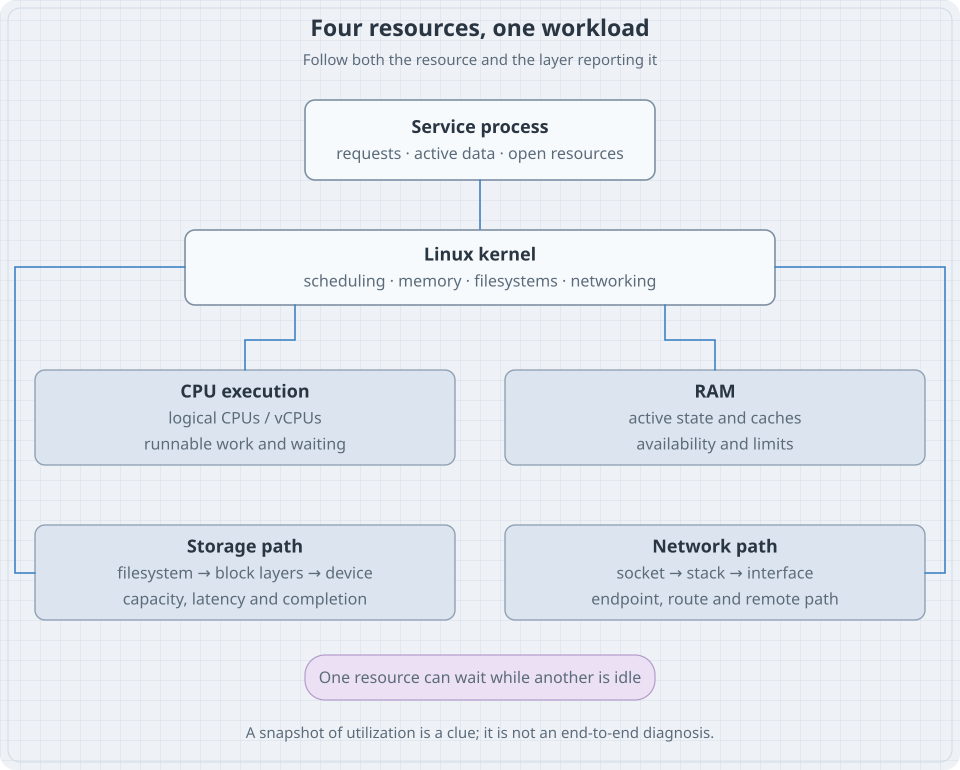
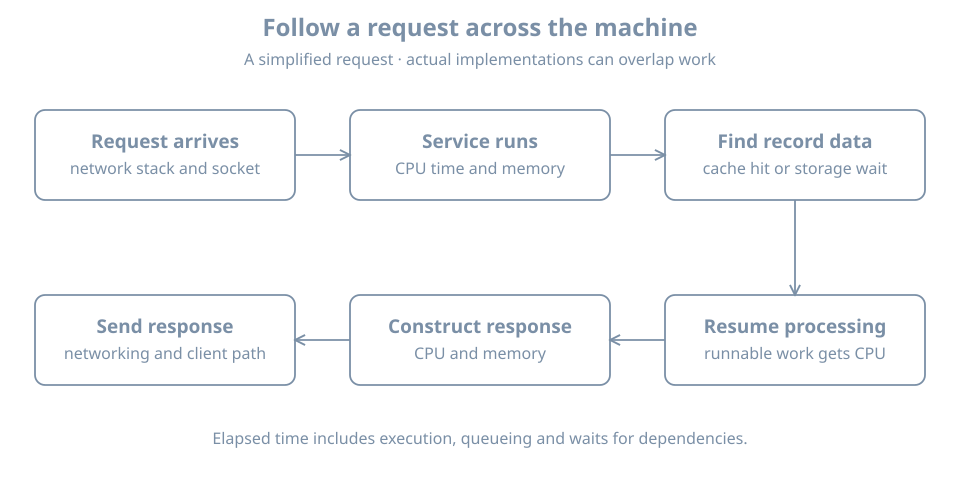

A service can be slow while its CPU is mostly idle. A machine can have little completely unused memory and still have room for new work. A filesystem can be full while the physical disk is healthy. A network interface can be up while no client can reach the service.

These are ordinary situations once you stop treating a machine as one number called “performance.” A running workload uses several resources, waits on dependencies, and moves through queues. The first task is to identify which resource a measurement describes and which part of the workload is actually waiting.

This chapter builds that working model. You will inventory CPU, memory, storage and interfaces; interpret several basic measurements; and follow a request across the system. Detailed tuning comes later. Here the goal is to explain observations before changing settings.

## Map: four resources, one workload

{fig-alt="A Linux service process is coordinated by the kernel, which schedules its work on CPU execution contexts, supplies RAM for active data and caches, reads and writes through a filesystem and block-device stack, and exchanges traffic through sockets and network interfaces. Waiting at one resource can leave another idle."}

Use this first model:

| Resource | What it supplies | Typical question |
|---|---|---|
| CPU | Execution of instructions | Can the work get execution time when it needs it? |
| RAM | Fast working storage for active state | Can required data remain available without excessive reclaim or waiting? |
| Persistent storage | Durable space and read/write service | Is there capacity, and can the stack complete I/O in time? |
| Networking | Communication between endpoints | Can the intended path carry useful traffic with acceptable delay and loss? |

Capacity, demand and delivered service are different quantities. A 24-GiB disk describes a size. Twenty milliseconds describes a delay. A thousand operations per second describes a rate. None is a substitute for the others.

## CPU: execution capacity and the need to wait

A **central processing unit (CPU)** executes instructions. A **CPU core** is a hardware execution resource. A **logical CPU** is an execution context exposed to the operating system. A core can expose more than one logical CPU through simultaneous multithreading; a VM can expose virtual CPUs supplied by its host.

A **thread** is an execution stream that the scheduler can arrange to run. A multithreaded process can have several such streams. A runnable thread needs a turn on an eligible CPU. A thread waiting for a timer, disk result or remote reply may not be runnable at all.

The **scheduler** is the kernel mechanism that selects runnable work for execution. You do not need its implementation details yet. You do need to distinguish **running**, **ready to run**, and **waiting for something else**.

### Two logical CPUs do not make every operation twice as fast

Suppose one request needs 20 milliseconds of CPU work and cannot execute that work in parallel. An otherwise idle second CPU does not halve that request's CPU time. The extra context may allow another independent request to execute concurrently, subject to actual hardware and allocation.

For a simple capacity estimate, 100 requests per second at 20 milliseconds of CPU work each require:

```text
100 requests/s × 0.020 CPU-seconds/request = 2 CPU-seconds/s
```

That already consumes the nominal two-CPU execution budget of a two-vCPU guest, before overhead and other processes. It is a starting model, not a benchmark result. Shared host capacity, affinity, quotas, cache behavior and simultaneous multithreading can change delivered work.

This is why adding a service without considering its workload can overload a host whose installation requirements looked small.

### Worked example 1: inventory CPU topology

Input:

```bash
lscpu
lscpu -e=CPU,ONLINE,SOCKET,CORE,NODE
```

Illustrative table:

```text
CPU ONLINE SOCKET CORE NODE
  0    yes      0    0    0
  1    yes      0    1    0
```

Here, two logical CPUs are online in the presented topology. A **socket** is a processor-package grouping in this view; a **NUMA node** groups memory/CPU locality information. On a VM these can be virtual arrangements. On another architecture some columns can be absent or unavailable. The [lscpu manual](https://man7.org/linux/man-pages/man1/lscpu.1.html) describes the inventory sources and output options.

Record the environment with the table. Do not multiply a count twice because both a summary and a per-CPU table display the same resources. Also distinguish “online” from “available to this particular workload”: affinity, resource policy and host scheduling can impose additional limits.

### Worked example 2: elapsed time is not CPU time

In Bash, input:

```bash
time sleep 1
```

One possible result:

```text
real    0m1.002s
user    0m0.001s
sys     0m0.001s
```

Why: approximately one second passed, but the command spent very little time executing. It was mostly waiting for its timer. `user` accounts for execution in userspace; `sys` accounts for kernel execution charged to the command. Exact timing varies.

A slow network request or a blocked disk read can exhibit the same broad pattern: long elapsed time with little CPU execution. The correct question is then “what was it waiting for?” rather than “why is the CPU not busy?”

### Load average is a demand clue

Input:

```bash
cat /proc/loadavg
```

The first three values describe load averages over different time windows. Linux includes runnable work and tasks in uninterruptible sleep in this accounting; it is not simply a percentage of CPU time. The [load-average interface](https://man7.org/linux/man-pages/man5/proc_loadavg.5.html) documents the fields.

A rising load with idle CPU can lead you toward waiting tasks and I/O. A low average does not prove a latency-sensitive request never waited. Time windows and sampling can hide short events. Treat this as a lead to investigate, not a verdict about the bottleneck.

## Memory: active state, cache and limits

**Random-access memory (RAM)** holds active program state, kernel data and caches. It is usually volatile: a power loss removes its contents. Persistent storage supplies durability through a different path.

A process normally accesses a **virtual address space**, an arrangement of addresses mapped and protected by the kernel and processor. The amount of address space described for a process is not automatically the amount of physical RAM it occupies. Some regions may not have been touched; some mappings refer to files; some pages are shared.

The kernel's [memory concepts overview](https://docs.kernel.org/admin-guide/mm/concepts.html) introduces virtual memory, protection and controlled sharing. Our practical task is to ask which memory is actively needed, what can be reclaimed, and which limits govern the workload.

### Used RAM can be useful cache

Linux can retain file data in RAM so later reads avoid slower storage. This **page cache** uses memory, but some cached pages can be reclaimed for other work. Dirty pages, which contain changes not yet written back as required, have different constraints from clean cache pages.

Therefore, “almost no completely unused RAM” does not by itself mean the machine is out of memory. Conversely, a large cache is not a guarantee that a particular workload will fit: active demand, writeback and configured limits matter.

**Swap** supplies backing storage for some memory that can be moved out of RAM. It is not equivalent to additional RAM with the same access cost. A little swap use alone does not prove current thrashing. Sustained pressure and the workload's waiting behavior provide stronger evidence.

### Worked example 3: read a small set of memory facts

Input:

```bash
free -h
awk '/^(MemTotal|MemFree|MemAvailable|Cached|SwapTotal|SwapFree):/ {print}' \
    /proc/meminfo
```

Illustrative selected fields:

```text
MemTotal:        4096000 kB
MemFree:          180000 kB
MemAvailable:    2400000 kB
Cached:          2100000 kB
SwapTotal:       1048576 kB
SwapFree:        1048576 kB
```

Why: this machine has little entirely free RAM but a much larger estimate of memory available for new work. The estimate accounts for more than simply adding two fields. Do not independently sum overlapping accounting categories and present the sum as additional capacity.

`MemTotal` is usable memory reported by the kernel, so it need not match the exact number entered in a VM configuration or printed on a RAM module. The [meminfo reference](https://man7.org/linux/man-pages/man5/proc_meminfo.5.html) defines these fields, and [free](https://man7.org/linux/man-pages/man1/free.1.html) presents a summary of them.

In a container or other constrained workload, host-style totals may not express the limit governing that process. A **cgroup** is a kernel grouping used to account for and control resources; a workload can hit its group limit while the whole host still has available memory. The [cgroup v2 documentation](https://docs.kernel.org/admin-guide/cgroup-v2.html) provides the underlying hierarchy and controller model. We will configure it in the resource-administration part.

**What this snapshot cannot show:** how long pressure lasted, which allocation failed, whether swap traffic is currently intense, or whether a service's own internal limit was reached. Keep the scope of the measurement with its value.

## Storage: a device, a filesystem and a path are different objects

A **block device** exposes addressable storage blocks. A **partition** describes a region of a partitioned device. A **filesystem** organizes data and metadata. A **mount** attaches a filesystem view at a location in the directory tree.

The relationships can be simple:

```text
virtual disk → partition → ext4 filesystem → mounted at /
```

Or layered:

```text
physical storage → encryption mapping → logical volume → filesystem → /srv/data
```

Those are examples, not universal ordering rules. An installation may use RAID, several devices, datasets, network storage or a different arrangement of layers. Always inspect the actual stack.

A **pathname** such as `/srv/data/report.txt` names an object through the current filesystem view. It does not tell you which physical disk supplies the data. A mount can change which filesystem serves that same pathname.

### Worked example 4: connect a path to mounted storage

Input:

```bash
lsblk -o NAME,TYPE,SIZE,FSTYPE,MOUNTPOINTS
findmnt --target / -o TARGET,SOURCE,FSTYPE,OPTIONS
df -h /
df -i /
```

An illustrative device tree:

```text
NAME   TYPE SIZE FSTYPE MOUNTPOINTS
vda    disk  24G
├─vda1 part   1G vfat   /boot/efi
└─vda2 part  23G ext4   /
```

`lsblk` describes visible block devices and related filesystem information. `findmnt` identifies the mounted filesystem serving a path. `df` asks about that filesystem's space or inode accounting. An **inode** holds a filesystem object's metadata; inode exhaustion can prevent new files even when byte capacity remains.

The [lsblk manual](https://man7.org/linux/man-pages/man8/lsblk.8.html) explains why explicit output columns and many-to-many storage relationships matter. The [findmnt manual](https://man7.org/linux/man-pages/man8/findmnt.8.html) distinguishes asking about a path from asking whether the path itself is a mountpoint.

If this is a container, `/` might be an overlay filesystem with backing storage outside your current view. Its source need not appear as a simple partition in `lsblk`. Record the visible relationship without inventing an unseen physical device.

### File size and allocated storage can differ

A **sparse file** can represent a logical range without allocating blocks for every byte in that range. Compressed filesystems, snapshots and shared extents introduce other differences between logical size and physical allocation.

Optional experiment in an ordinary writable lab filesystem:

```bash
workdir=$(mktemp -d)
printf 'Experiment directory: %s\n' "$workdir"
truncate -s 64M "$workdir/sparse.bin"
ls -lh "$workdir/sparse.bin"
du -h "$workdir/sparse.bin"
```

On a filesystem supporting the expected sparse-file behavior, the listed logical size is 64 MiB while the allocated space reported by `du` can be much smaller. This does not mean that storing 64 MiB of actual new data is free. Allocation occurs as data is written, subject to the filesystem's behavior. The [du documentation](https://man7.org/linux/man-pages/man1/du.1.html) distinguishes allocated storage from apparent size.

Cleanup only the file created for this experiment:

```bash
rm -- "$workdir/sparse.bin"
rmdir -- "$workdir"
```

No partitioning, formatting or privileged disk operation is needed. Avoid carrying a pathname from this example into unrelated cleanup commands.

### Capacity and I/O performance are separate

A device can have ample space but poor response time. A fast device can still be full. Workloads also differ: many small random reads stress a different path from a large sequential write.

Useful dimensions include:

- **Latency:** time for an operation or request to complete.
- **Throughput:** amount of useful data or work completed per unit time.
- **IOPS:** storage operations completed per second, meaningful alongside operation size and workload.
- **Queue depth:** operations outstanding at a particular point in the stack.

A queue can absorb short bursts. Sustained arrival faster than completion causes waiting and eventually pressure or failure. More queueing is not automatically more performance, particularly when the user cares about response time.

## Networking: an interface is one part of a service path

A Linux **network interface** is an object through which traffic can enter or leave a network stack. It can correspond to a physical network interface controller (NIC), virtual NIC, bridge, tunnel or another software interface. The **loopback** interface supports communication within the local network stack.

An IP address belongs to an interface or networking context under configuration policy. A **route** selects a next path for a destination. A **socket** is an operating-system communication endpoint used by a program. A server listening on a socket still depends on routing, filtering and the remote client path.

Later chapters will configure these facilities and their services. For now, keep four questions distinct:

1. Is the interface present and usable at the link layer?
2. Is addressing and routing suitable for the intended destination?
3. Is the service listening at the address and port the client uses?
4. Does the end-to-end application operation succeed?

### Worked example 5: inventory interfaces and listening endpoints

Input:

```bash
ip -brief link show
ip -brief address show
ip route show
ss -lnt
```

Illustrative observations:

```text
lo      UNKNOWN ...
enp1s0  UP      ...

LISTEN 0 128 127.0.0.1:8080 0.0.0.0:*
```

Why: the interface exists and appears up, while the example TCP listener is bound to loopback. A remote client cannot reach that loopback-only listener by using the server's LAN address. That is an endpoint configuration issue to investigate before blaming a physical cable.

`ss -lnt` lists listening TCP sockets with numeric addresses. Other transport types need the corresponding query. See the [socket inspection manual](https://man7.org/linux/man-pages/man8/ss.8.html). The output reflects the network namespace in which the command runs; another container or VM can have a different view.

### Worked example 6: look at counters without overinterpreting them

First choose an interface name from your inventory. For an interface named `enp1s0`:

```bash
ip -s link show dev enp1s0
```

This is an example name; replace it if the host uses another. The counters describe traffic and selected errors or drops at this reporting interface. The [kernel's interface-statistics documentation](https://www.kernel.org/doc/html/latest/networking/statistics.html) explains the available reporting paths.

One cumulative counter cannot establish the current rate. If received bytes increase by 10,000,000 over 10 seconds, the observed average is:

```text
10,000,000 bytes ÷ 10 seconds = 1,000,000 bytes/s = 8,000,000 bits/s
```

Use consistent units. A nominal 1-Gbit/s link corresponds to 125 million bytes per second before protocol and implementation overhead. It is not 1 gigabyte per second, and it does not guarantee that rate for an application.

Counter interpretation also needs timing, reset/wrap awareness and the relevant interface. Traffic can pass through several virtual interfaces; summing every counter along the same path can count the same work repeatedly.

## Follow a request through all four resources

{fig-alt="A client request arrives through networking, is processed by a scheduled service thread using memory, may read data from cache or storage, and produces a response. A waiting phase does not require continuous CPU execution; multiple requests can overlap and contend for the same resources."}

Imagine a small catalog service returning a file-backed record:

1. Traffic reaches the host's network stack and the appropriate socket.
2. The service becomes runnable and receives CPU time.
3. It parses the request and accesses in-memory state.
4. It needs record data. A cached result may be available in RAM; otherwise the path can require storage I/O.
5. While waiting for necessary I/O, the thread need not consume CPU execution time.
6. The service becomes runnable again, constructs its response and submits output.
7. Networking carries the result toward the client.

The exact implementation might be asynchronous or use several threads, but the resource questions remain. End-to-end delay can include several waits. A snapshot showing idle CPU cannot identify which wait occurred.

For an invented request, suppose total elapsed time is 100 milliseconds, with 8 milliseconds of CPU execution. There are approximately 92 milliseconds left to explain in that accounting model. Possible contributors include scheduling delay, storage, locks, a connection pool or a remote dependency. The missing time is a question, not evidence for whichever subsystem you happen to know best.

## Break/fix: “the VM has resources, but the service is slow”

**Symptom.** A two-vCPU VM has free disk capacity and some available memory. Requests still slow down badly during a scheduled backup.

**Initial claim to reject.** “There is unused CPU, so the guest must need a kernel tuning change.” The evidence does not support that conclusion.

**Investigation.** Compare a baseline period and the backup period. Record request latency and rate, CPU execution, memory pressure, storage completion behavior, interface traffic and the backup schedule. Keep guest and host evidence separate. The backup may compete for guest I/O, host storage, network capacity or another shared dependency.

**Bounded action.** If evidence identifies backup contention, change its schedule or resource policy in the lab and repeat the same workload. If the cause is elsewhere, the prediction should fail and the hypothesis should change. Do not disable backups permanently as a performance fix.

**Success criterion.** The service meets its measured objective and the backup still completes within its required window. A lower utilization percentage alone is not the goal.

## Practice: inventory and explain before tuning

Build a small worksheet from the examples:

| Resource | Inventory | Current observation | What remains unknown? |
|---|---|---|---|
| CPU | Online logical CPUs and topology | Load and a small timing observation | Workload eligibility, quotas and host contention |
| Memory | Usable RAM and swap | Available estimate and current state | Demand over time and workload-specific limits |
| Storage | Device → filesystem → mount | Byte/inode capacity | Latency, backing layers and failure behavior |
| Network | Interfaces, addresses and routes | Listener bindings and counters | Remote path and application success |

Do not change configuration to make your worksheet match the illustrative output. Different values and device names are expected. If you are reading before building the VM, complete the worksheet from the examples and mark the values as illustrative, then repeat on the lab host later.

Finally, explain these cases in a sentence each:

1. **A command took one second but used almost no CPU.** It can spend elapsed time waiting.
2. **Free memory is small but available memory is much larger.** Some current uses can potentially be reclaimed; inspect pressure and limits before declaring exhaustion.
3. **`lsblk` shows 24 GiB but a filesystem is smaller.** Devices, partitions and filesystem capacity are different layers.
4. **The interface is up but a service listens only on loopback.** Link availability does not establish the desired remote endpoint.
5. **A guest has free space but its host storage is full.** The write path contains several independent capacity boundaries.

The exercise is complete when each conclusion identifies both its evidence and its limits. Clean up the optional sparse-file experiment if you ran it; all other commands in this chapter inspect state.

## Recall card

- Separate capacity, utilization, pressure, latency and throughput.
- CPU execution, runnable demand and waiting are different states.
- Virtual CPU counts and topology describe the presented environment.
- Available memory, caches and workload limits need separate interpretation.
- A device, filesystem, mount and pathname describe different storage objects.
- Interface state, routes, listeners and client success are separate networking observations.
- A request crosses resources and can spend most of its time waiting.
- Measure a baseline, form a testable hypothesis, and verify an operational result.
