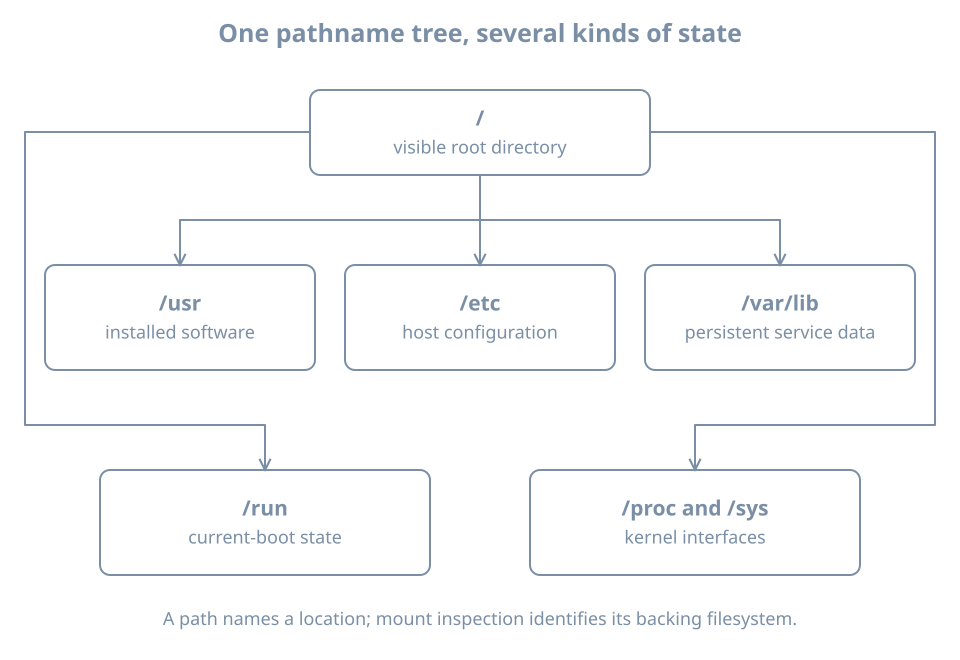

A service works until the machine reboots. An administrator recreates a directory, but the service still cannot find its database. A configuration file contains the intended value, but requests use the old setting. These incidents share a missing distinction: a pathname, stored data, and the state a running program uses are different things.

This chapter gives you a map for finding the right object before changing it. You will distinguish directories from mounts, persistent data from temporary state, and configuration on disk from effective configuration. The examples assume the terminal skills used in the preceding chapters. Inspection commands do not require administrator privileges; the small writing experiment uses only a new directory inside your home directory.

## One tree, several sources

An **absolute pathname** begins at `/`, the root of the pathname tree. A **relative pathname** is interpreted from a process's current working directory. `/etc/hosts` and `etc/hosts` can therefore identify different objects. The account called `root`, its home directory `/root`, and the root directory `/` are three separate concepts.

A directory associates names with filesystem objects. A **filesystem** supplies the rules and structures used to represent files, directories and their metadata. Some filesystems store data on disks. Others expose information maintained by the kernel or keep their contents in memory.

A **mount** attaches a filesystem, or another view of existing filesystem content, at a location in the visible tree. That location is the **mount point**. Walking from `/` into `/home` does not tell you whether you crossed into a separate filesystem. The directory names alone cannot answer that question.

{fig-alt="The visible root directory branches into system software under usr, configuration under etc, persistent service data under var/lib, volatile state under run, and kernel interfaces under proc and sys. Mount inspection is needed to identify what backs each path."}

Imagine a machine with one filesystem for `/` and another mounted at `/srv/archive`. Before the second filesystem is mounted, `/srv/archive` is an ordinary directory in the root filesystem. Once mounted, looking inside that path shows the mounted filesystem's contents. Existing files in the underlying directory are hidden by the mount; mounting does not automatically copy or delete them.

This explains a common storage incident. A backup job writes into `/srv/archive` while its intended storage is absent. The files consume space on `/`. When the expected storage is mounted later, those files seem to vanish. The correct investigation starts with the mount, not with a claim that the backup application deleted data. Later storage chapters develop guarded mounts and recovery procedures; do not unmount a working service's storage just to explore this behavior.

### Worked example: identify the backing filesystem

Run:

```bash
findmnt --target / --output TARGET,SOURCE,FSTYPE,OPTIONS
findmnt --target /etc --output TARGET,SOURCE,FSTYPE
findmnt --target /run --output TARGET,SOURCE,FSTYPE
findmnt --target /proc --output TARGET,SOURCE,FSTYPE
```

Illustrative results for the last two commands:

```text
TARGET SOURCE FSTYPE
/run   tmpfs  tmpfs

TARGET SOURCE FSTYPE
/proc  proc   proc
```

`--target` locates the filesystem containing the requested path. It also works when that path is not itself a mount point. A result with `TARGET` equal to `/` for `/etc` means that `/etc` is on the root mount in this view. It does not mean `/etc` is missing. The [findmnt manual](https://man7.org/linux/man-pages/man8/findmnt.8.html) documents the distinction between a containing target and an exact mount point.

`tmpfs` is memory-backed storage that can use swap; it is not a promise that every byte stays in physical RAM. `proc` exposes process and kernel information. Reading `/proc/meminfo` retrieves a kernel-generated view rather than a report saved by someone into a disk file.

These results belong to the environment where you ran the command. A container can see a different mount arrangement from its host. A service can also run with a restricted filesystem view. For now, record whether you inspected the VM, its host, or a container; later isolation chapters explain why those views differ.

## Directories express responsibility

The following map is a starting guide to conventional Linux layouts. An installed application may use additional paths, and distribution policy can refine them.

| Path | Usual responsibility | Question to ask |
|---|---|---|
| `/usr` | Installed system programs, libraries and shared resources | Which package or image supplies this? |
| `/etc` | Host configuration | Who owns the intended setting? |
| `/var/lib` | Persistent application and service state | How is this backed up and restored? |
| `/var/log` | Logs stored as files | What is the retention policy? |
| `/var/cache` | Data intended to be reconstructible | Can this application actually regenerate it? |
| `/run` | State used during the current boot | Which process recreates it? |
| `/tmp` | Temporary working files | When can cleanup remove them? |
| `/home` | Ordinary users' home directories | Is this local, mounted or managed elsewhere? |
| `/dev` | Device interfaces | What kernel device does this represent? |
| `/proc`, `/sys` | Kernel-maintained interfaces | Am I reading information or changing a kernel setting? |
| `/boot` | Boot-related artifacts | Which boot tooling owns these files? |

The [Linux filesystem hierarchy specification](https://uapi-group.org/specifications/specs/linux_file_system_hierarchy/) describes these roles in more detail. Use the table to choose an investigation, not as permission to remove an unfamiliar directory.

For example, a database beneath `/var/lib` is not disposable merely because the path begins with `var`. “Variable” describes data that changes, not data you can discard. Similarly, a cache may be reconstructible in principle but expensive or impossible to rebuild while its upstream source is unavailable.

On merged-`/usr` installations, names such as `/bin` can be symbolic links into `/usr`. A **symbolic link** is a filesystem object that points to another pathname. Inspect the machine instead of assuming two visible names imply two independent copies:

```bash
ls -ld /bin /sbin /lib
readlink -f /bin
```

An illustrative result for the second command is `/usr/bin`. That is pathname resolution, not evidence that a program was moved while you were looking. Package ownership, links and compatibility names matter when interpreting installation instructions.

## Persistence is a property to verify

**Persistent state** is intended to survive the relevant lifecycle boundary, often a reboot. **Runtime state** describes a live instance: processes, open connections, current locks and similar working information. Some runtime information is represented by files, but the presence of a file does not make it durable.

Consider a fictional service called `catalog`:

| Object | Example | Intended lifecycle |
|---|---|---|
| Program | `/usr/bin/catalogd` | Replaced by software installation or upgrade |
| Configuration | `/etc/catalog/catalog.conf` | Retained until an authorized configuration change |
| Business data | `/var/lib/catalog/items.db` | Preserved across process restarts and host reboots |
| Runtime socket | `/run/catalog/control.sock` | Created for a live service instance |
| Working cache | `/var/cache/catalog/` | Reconstructed according to application behavior |

These are explanatory paths, not a package to install. A socket is an endpoint through which processes can communicate; its pathname is not the database it serves.

Reboot is only one boundary. A file can survive a guest reboot yet disappear when that VM is deleted. A file in a container's writable layer can survive a process restart but disappear when the container is replaced. A VM snapshot can return storage to an earlier state without providing an independent backup. Always complete the sentence: “This survives **which event**?”

Do not use `/tmp` or `/run` for the only copy of important data. Cleanup schedules and mount choices vary. Conversely, do not assume everything under `/var/log` is recorded forever: retention, rotation, storage limits and logging configuration determine what remains available.

Persistence also does not guarantee durability at every instant. A successful application write can still be buffered before reaching persistent storage. Databases coordinate writes and recovery using their own mechanisms. Backup and storage chapters will separate application consistency, filesystem behavior and device durability; at this stage, recognize that copying a live database file is not automatically a valid backup.

## Configuration has an owner and an activation path

A **configuration source** expresses intended behavior. **Effective configuration** is what the running component actually uses. Between them may sit include files, defaults, generators, environment variables, command-line arguments and activation steps.

Use four questions whenever you find a promising file:

1. Is it an input owned by an administrator, or an output generated by another tool?
2. What other sources can override or supplement it?
3. How does the application validate the combined configuration?
4. When does the running application read it?

Suppose `catalog.conf` specifies `listen_port=8080`, but the running process still listens on its old port. Several explanations remain possible: the process has not reread the file, it uses a different file, an override takes precedence, or the edit failed validation. Repeatedly editing the same line does not distinguish these hypotheses.

The useful evidence chain is:

```text
intended setting → authoritative input → validation
                 → activation → observation of live behavior
```

A **reload** asks a component to reread supported settings without a full stop/start. A **restart** replaces its running instance. Neither is a generic guarantee that every intended change becomes effective. Some settings require restart, and some applications cannot reload at all. Read that application's instructions before choosing an operation.

Generated files deserve special attention. If a network tool writes a runtime resolver file, manually editing that output may appear to work and then be overwritten. The durable fix belongs in the tool's input configuration. The ownership question prevents a cycle of repeatedly “repairing” the generated result.

## Worked experiment: a file changes before its consumer does

This experiment models an application that reads a setting once. It does not edit system configuration. Run the commands in one Bash terminal:

```bash
state_lab_dir=$(mktemp -d "$HOME/boring-state.XXXXXX")
printf 'blue\n' > "$state_lab_dir/setting"
read -r loaded_setting < "$state_lab_dir/setting"
printf 'green\n' > "$state_lab_dir/setting"
printf 'Loaded value: %s\n' "$loaded_setting"
printf 'File value: '
cat "$state_lab_dir/setting"
```

Expected result:

```text
Loaded value: blue
File value: green
```

`mktemp -d` creates a uniquely named directory; the variable holds its actual path. `read` copies one line into the shell's memory. Replacing the file does not change that already loaded variable. This deliberately small model reproduces the distinction between stored configuration and a running consumer's state without touching a service.

Now simulate rereading:

```bash
read -r loaded_setting < "$state_lab_dir/setting"
printf 'Loaded after reread: %s\n' "$loaded_setting"
```

The result should be `green`. This is not an implementation of a service reload protocol. It illustrates why an activation step exists at all.

Clean up only the file and directory created above:

```bash
rm -- "$state_lab_dir/setting"
rmdir -- "$state_lab_dir"
unset state_lab_dir loaded_setting
```

If you closed the terminal, do not guess the variable's old value. Locate your named experiment directory and inspect it before removing anything.

## Diagnosis: three failures that look like missing files

### The directory exists, but the data is wrong

A path can exist on the wrong filesystem. Inspect its backing mount and compare it with the expected storage before creating more data there. Preserve observations of the path, mount source and service error. Creating an empty replacement database can make recovery harder by mixing new state with the incident.

### The data returns after reboot, but access fails

The file may be persistent while the runtime directory or socket through which a client reaches it has not been recreated. Investigate the service that owns that runtime object. Copying yesterday's socket pathname from a backup does not recreate a listening process.

### The administrator can read it, but the service cannot

The service may run under a different identity or see a restricted filesystem tree. “It exists in my shell” establishes only one observer's view. Capture the service identity and its error before changing permissions. Making a file readable by everyone can expose data while leaving the real view or path problem unresolved.

## Practice: classify before changing

On your lab VM, select `/etc/hosts`, `/var/lib`, `/run`, `/proc/meminfo` and your home directory. For each, record the intended role, the backing filesystem reported by `findmnt`, the likely owner, and the lifecycle event that could remove its contents. You do not need to read other users' files or list service secrets.

Then answer these scenarios:

1. A service stores its only customer records in `/run`. What failure should you expect after reboot?
2. A mounted archive is absent and a job writes to the mount-point directory. Which filesystem receives the writes?
3. A file contains the new value but the running application behaves as before. What evidence is missing?

Success means you can explain the answers in terms of lifecycle, mount attachment and activation. The first design loses its intended persistence; the second uses the containing filesystem; the third needs the actual configuration sources and live consumer state checked.

## Recall card

- A pathname identifies an object through a visible tree; it does not identify the backing storage by itself.
- A mount can hide a directory's previous contents without deleting them.
- Classify data by responsibility and lifecycle before editing, deleting or backing it up.
- Persistent across reboot does not mean protected from replacement, corruption or loss.
- A configuration change is complete only after validation, activation and a behavior check.
- Identify who generates a file before treating it as the authoritative input.
