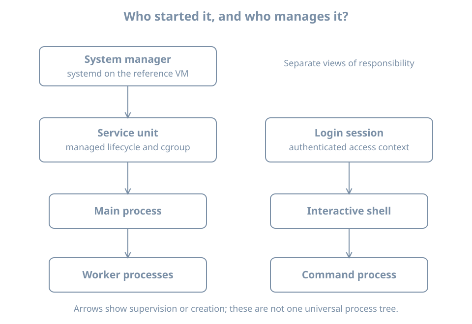

A machine can contain an installed server package without running its server. It can run a server process without making that server reachable. It can accept connections while still returning an application error. Administration becomes much clearer when these are treated as separate observations.

This chapter connects the files from the previous chapter to the work a machine is doing now. You will observe a process, relate it to its parent and identity, inspect a service manager, and distinguish a login session from a long-lived service. The reference environment is a systemd-based Linux VM. The process exercise works in an ordinary Bash terminal; manager and login commands require the corresponding facilities to be running.

## Program, process, service: three different objects

A **program** is executable code. Its file can exist while no instance of it is running. A **process** is a running instance with an identity, execution state, memory and references to resources such as open files. Multiple processes can execute the same program. A program can also create workers, so one application's activity need not fit into one process.

A **process identifier**, or **PID**, identifies a process within a PID namespace. A namespace is a mechanism that gives a group of processes a particular view of a resource; for this chapter, the practical consequence is that a container's process numbering may differ from the host's. A **parent PID**, or **PPID**, identifies the parent in that view. Parentage helps explain how work was started, but it is not a complete inventory of responsibility.

A **service** is an operational function managed across a lifecycle: start, readiness, ongoing work, failure and stop. A service manager can start the program, track its processes, collect exit results and apply a restart policy. Some services perform a short task and exit. Others keep several worker processes running.

{fig-alt="A system manager supervises a service and its main and worker processes. Separately, a login session contains a shell and a command. Parent relationships explain execution ancestry, while service and session groupings explain lifecycle responsibility."}

The **system manager** is the system-wide manager. On the reference VM, systemd runs as PID 1. A **user manager** can separately manage services for an individual user. The fact that both are controlled with `systemctl` does not make them the same manager: `systemctl --user` selects the user manager instead of the system manager.

A container or a minimal recovery environment may have another program at PID 1. If `systemctl` reports that systemd is not running as the system manager, first identify where you are. Installing more service files does not change the identity of the already running PID 1.

## Inspect a process without guessing from its name

Start with a small, explicit view:

```bash
ps -p 1 -o pid,ppid,user,stat,comm
ps -p "$$" -o pid,ppid,user,stat,etime,args
```

In Bash, `$$` expands to the shell's PID. `ps` selects that process and displays the requested columns. `ETIME` is elapsed time since process start. `ARGS` presents command arguments, while `COMM` is a shorter command-name view. Neither name alone proves which package supplied the executable or what the process is doing.

An illustrative shell row is:

```text
    PID    PPID USER     STAT     ELAPSED COMMAND
   2410    2409 learner  Ss         08:14 -bash
```

Treat PIDs and times in examples as placeholders for observations, never as values to paste into a later termination command. PIDs are reused after processes exit. A number written in an old incident note might identify unrelated work now.

The first letter of `STAT` describes a scheduling or lifecycle state. Common letters are `R` for running or runnable, `S` for interruptible sleep, `D` for uninterruptible sleep, `T` for stopped and `Z` for a zombie. Additional letters describe other properties; the lowercase `s` above indicates a session leader. A zombie has exited but still has exit information awaiting collection by its parent. It is not doing useful computation that can be stopped again. The [ps manual](https://man7.org/linux/man-pages/man1/ps.1.html) defines the fields and state codes.

Most healthy idle processes spend time sleeping. A sleeping process is not necessarily broken; it may be waiting for a timer or request. Conversely, a runnable process is not proof that useful work is completing. Combine state with elapsed behavior and the task the process is meant to perform.

Command arguments can contain sensitive information. Do not paste an unrestricted process listing into a public bug report without reviewing it. For a first inventory, select the processes and columns that answer your question.

## Worked experiment: create, observe and finish one process

Run this in one interactive Bash terminal. It creates only a short-lived timer process:

```bash
sleep 300 &
observed_pid=$!
printf 'Child PID: %s\n' "$observed_pid"
ps -p "$observed_pid" -o pid,ppid,user,stat,etime,args
jobs -l
```

`&` asks the shell to run the command in the background. `$!` is the PID of its most recently started background job. `jobs` shows work tracked by this shell, not every process on the host.

A typical `ps` row looks like:

```text
    PID    PPID USER     STAT     ELAPSED COMMAND
   2581    2410 learner  S          00:03 sleep 300
```

The parent is the shell observed earlier. The process is sleeping because its job is to wait for a timer. It is still a real process with an owner and lifecycle.

Finish the experiment promptly, while this terminal and job are still present:

```bash
kill -TERM "$observed_pid"
wait "$observed_pid"
printf 'Wait status: %s\n' "$?"
unset observed_pid
```

`TERM` requests termination. In this example, Bash commonly reports status `143`, meaning termination by signal 15. If the timer had already finished, the result differs; do not interpret a missing process as a failure to create it. The shell's `wait` collects the child's completion result. This exercise is for an interactive shell without a strict `set -e` policy, which could stop a script at a nonzero `wait` result.

Do not repeat the `kill` command later using a copied PID. Also do not generalize the example into killing any process whose name looks similar. For a managed service, operate on the service through its manager; a policy may otherwise start a replacement process immediately.

A **signal** is a notification delivered to a process. Some signals can be handled by the application; `SIGKILL` cannot. Immediate forced termination gives an application no opportunity to finish its own shutdown work. The right response to a stuck service begins with evidence and its documented lifecycle, not an automatic escalation to force.

## Services give processes an operational boundary

Systemd represents managed objects using **units**. A `.service` unit describes a service, but units also describe sockets, timers, mounts and other objects. This is why a list of all units is not just a list of daemons. The [systemd.unit reference](https://www.freedesktop.org/software/systemd/man/latest/systemd.unit.html) describes their types and common configuration.

Inspect the manager without changing its state:

```bash
systemctl list-units --type=service --all --no-pager
systemctl list-unit-files --type=service --no-pager
systemctl --failed --no-pager
```

The first view concerns service units loaded in the manager. The second concerns installed unit files and their enablement state. A machine can have many installed definitions that are not currently running. `--failed` narrows attention to recorded failed units; it is not a complete application-health test.

On the reference VM, inspect the journal service:

```bash
systemctl status systemd-journald.service --no-pager
systemctl show systemd-journald.service \
  -p LoadState -p ActiveState -p SubState -p MainPID -p FragmentPath
```

`status` is a human-oriented summary. `show` selects named properties. `FragmentPath` identifies the unit's main definition file; it is not necessarily the whole configuration because additional settings may exist. A denied or partial log view can reflect your account's access rights.

For these inspection commands and the loaded-versus-installed distinction, consult the [systemctl manual](https://www.freedesktop.org/software/systemd/man/latest/systemctl.html). This chapter uses long-established operations; the installed manual remains the reference for your specific version.

### Running now and starting later are independent questions

**Active state** concerns the current lifecycle. **Enablement** concerns installation of activation relationships, commonly used to arrange startup through a target. A target groups related units or marks a system state. An enabled service is not automatically healthy, and a disabled service is not automatically stopped.

A service might have been started manually or activated by a dependency. A socket can trigger service activation when traffic arrives. A timer can activate work on a schedule. Units marked `static` generally lack installation instructions for direct enablement but can still be activated by other units.

Keep two columns in your notes: “what it is doing now” and “how it is intended to be activated.” Conflating them leads to repairs that work until reboot, or changes that affect future boots while leaving today's incident untouched.

### Active does not always mean a process is still running

An `active (running)` service usually has continuing work. An `active (exited)` service can represent a completed setup action whose unit remains active. For example, a one-shot task may establish state and then exit; `RemainAfterExit=yes` allows its unit to retain an active state after successful completion. There may then be no main process to inspect. Service type and configuration explain the state, as described in [systemd.service](https://www.freedesktop.org/software/systemd/man/latest/systemd.service.html).

The **main PID** is useful but not the entire workload. A service can have workers. Systemd uses **control groups**, or **cgroups**, to group processes for management and resource accounting. Parent ancestry and cgroup membership are different relationships: one explains creation, the other helps express management membership. Resource-control chapters develop those mechanisms later.

## A session is a user's access context

A login session represents an authenticated interaction such as a local console login, graphical login or remote login. It can contain several processes. The login session is not identical to the shell, and a shell is not required to be an interactive login shell.

On a VM with systemd-logind, use:

```bash
loginctl list-sessions
loginctl session-status
```

The first command lists sessions known to the login manager. With no ID, the second asks about the caller's session. Some environments, including terminals launched outside a registered login session, have no suitable session to report. That is a limitation of the context, not evidence that your shell has no process. See the [loginctl manual](https://www.freedesktop.org/software/systemd/man/latest/loginctl.html).

A shell job, a login session and a user service have different owners of their lifecycle. Closing a terminal can affect jobs through hangup handling and session policy. A user service can have another lifecycle, with details depending on the user manager and system policy. Merely adding `&` is not a reliable way to create an unattended server that must survive logout and reboot.

Suppose an administrator starts a development server from an SSH terminal. It responds during the demonstration but disappears after logout. Before looking for a network fault, ask who was responsible for maintaining that process. Was it a shell job, a user service or a system service? The permanent design needs an explicit lifecycle, logging and restart behavior. Later service chapters build that design rather than relying on a terminal remaining connected.

## Observe from the client back toward the process

For a fictional inventory service, the useful chain is:

```text
package present → unit definition present → process started
                → application ready → endpoint reachable
                → intended operation succeeds
```

Each arrow requires evidence. The chain is a diagnostic model, not a guarantee that every service has a network endpoint. A scheduled backup job, for example, is verified by its completion result and a usable restore rather than by a listening port.

Consider three reports:

| Report | What it establishes | Next question |
|---|---|---|
| “The package is installed.” | Software files were installed | What starts the intended function? |
| “The service is active.” | The manager reports an active unit | What does active mean for this unit type? |
| “A TCP connection succeeds.” | A network endpoint accepted a connection | Can an authorized client complete the real operation? |

A process can remain alive while its database is unavailable. A network path can work while authentication fails. A manager's restart policy can replace a crashing process often enough that one snapshot catches it running. Repeated observations, logs and a meaningful client operation make these cases distinguishable.

## First failure investigation

When a service does not behave as expected, write the symptom as an operation: “the local client cannot obtain the inventory list,” rather than “Linux is broken.” Then identify the service and record the time and environment.

For the journal service used above, a bounded log inspection is:

```bash
journalctl -b -u systemd-journald.service -n 30 --no-pager
```

`-b` selects the current boot, `-u` selects a unit and `-n 30` limits the tail. Missing records may reflect access, retention or the absence of messages. Do not treat an empty log view as proof of successful operation.

For another service, substitute its verified unit name. Capture the manager state, error and recent relevant records before restarting. A restart can restore service while discarding evidence about the original failure. After an authorized repair, repeat the client operation that originally failed; a new PID alone is insufficient.

Do not stop the journal service, login manager or remote-access service as a beginner exercise. The timer experiment already provides a process lifecycle you can observe safely. Later disposable-VM labs introduce deliberately broken services with defined recovery steps.

## Practice: build an evidence table

Record your shell PID, its parent, the owner and one observed state. Run the timer exercise and explain why its state is consistent with its purpose. Then select one service already present on your VM and record its active state, enablement state, main PID if any, and the useful operation it provides.

Answer these questions:

1. If a PID changes after a service failure, does that prove the application recovered?
2. Can a disabled unit still be active?
3. Can a healthy service have no continuing process?
4. Does `jobs` show work started by another user's shell?

The answers are no, yes, yes and no. Explain the reason for each: process identity differs from behavior; activation has multiple paths; completed one-shot work can retain active state; job control belongs to a particular shell.

## Recall card

- Program files, process instances and managed services are different objects.
- A PID is temporary evidence, not a permanent identity.
- Process ancestry, service membership and login sessions describe different relationships.
- Check both current activity and intended activation.
- Interpret service state using the unit's purpose and lifecycle.
- Verify the useful operation after a repair, not just the existence of a process.
