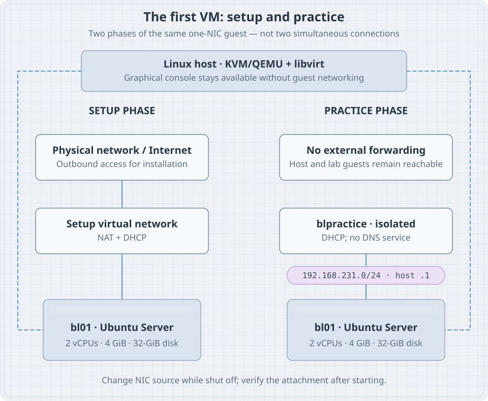
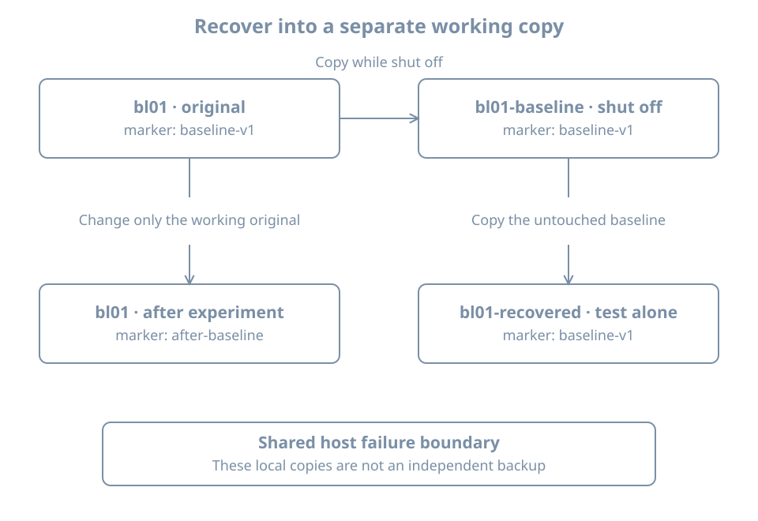

The first six chapters gave you a way to describe a Linux machine. Now build a machine you can restart, disconnect and recover without risking the system you use every day. The result is more than a successful installation: it is a named lab with a known console, a controlled network and a demonstrated return to a baseline.

This chapter uses a local **x86-64 Linux host**, hardware-assisted virtualization, KVM/QEMU, libvirt and the Virtual Machine Manager graphical application. Host preparation commands are for an Ubuntu host; the guest is Ubuntu Server 26.04 LTS. If the host uses another distribution, install its supported KVM/libvirt and virt-manager packages, then join the walkthrough at the host validation step. Do not run Ubuntu package commands on an unrelated host distribution.

An ARM host requires a matching guest architecture, firmware and virtualization setup. Cross-architecture emulation is a different performance and compatibility exercise. A managed work computer also needs permission to install a hypervisor and create virtual networks. A remote server without a graphical session needs a remote console workflow; that is outside this first local-host path.

## Define the lab before opening the installer

Use the following identifiers consistently. The hypervisor's VM name and the guest's hostname are separate settings, even when both initially say `bl01`.

| Item | First-lab choice |
|---|---|
| VM name | `bl01` |
| Guest hostname | `bl01` |
| Guest login | `learner`, with a unique lab password |
| CPU | 2 vCPUs |
| Guest memory | 4096 MiB |
| System disk | One new 32-GiB qcow2 disk |
| Firmware | UEFI, selected before installation |
| Initial network | A libvirt NAT network for installation and updates |
| Practice network | `blpractice`, isolated, with host address `192.168.231.1/24` |
| Console | Virtual Machine Manager's graphical display |
| Baseline | Powered-off full clone `bl01-baseline` |
| Recovery rehearsal | Another clone, `bl01-recovered`, started alone |

These are a teaching budget, not a minimum specification for every Linux workload. Leave several GiB of RAM and adequate CPU capacity for the host. Budget roughly 100 GiB of free host storage for the guest, two full-size copies, installation media and headroom. Sparse images initially consume less than their virtual capacity; that is not a guarantee they will stay small. If the host cannot accommodate the budget, reduce the scope or use another lab host before running out of space during a copy.

A **qcow2 image** is a QEMU disk-image format with metadata and optional features such as backing files. Our first disk is a standalone image with no backing file. Do not attach a physical disk, personal home directory, shared clipboard secrets, USB security key or host filesystem share to this lab. They are unnecessary dependencies for the opening exercises.

## Understand the two network phases

{fig-alt="A Linux host provides a graphical console and runs bl01. During setup, the guest uses a NAT network for outbound access. During practice, its single NIC moves to the isolated blpractice network at 192.168.231.0/24, with the host at .1 and guest addresses allocated by DHCP. The practice network has no forwarding path configured to the physical LAN. The graphical console remains available in either phase."}

**Network address translation**, or **NAT**, allows guest traffic to use a host-side outbound path. It is convenient for downloading packages. It is not complete isolation: the guest may reach services on the host, the local network and the Internet according to routing and policy. Do not run intentionally vulnerable network services during this setup phase.

An **isolated libvirt network** lacks an external forwarding configuration. It can still connect the host and guests on that virtual network. It is therefore suitable for controlled beginner practice, not a sandbox for hostile code. Avoid attaching a second NIC that silently provides another route out. Do not bridge the practice network to the physical LAN or configure the host to route it elsewhere.

A **subnet** describes a group of IP addresses sharing a network prefix. Here `/24` corresponds to the mask `255.255.255.0`. Our chosen prefix must not conflict with the host's LAN, VPN or existing virtual networks. **DHCP** automatically supplies addresses and related network information; the first guest does not need a manually assigned static address.

## Prepare and validate the host

**On an Ubuntu host**, install the supported tools:

```bash
sudo apt update
sudo apt install qemu-kvm libvirt-daemon-system libvirt-clients \
  virt-manager virt-install ovmf
```

`ovmf` supplies virtual UEFI firmware on this x86-64 path. The management tools coordinate the guest definition, storage and networking. The [Ubuntu libvirt guide](https://ubuntu.com/server/docs/how-to/virtualisation/libvirt/) explains the base host setup and authorization. These commands change the host, not the guest.

Validate before allocating a disk:

```bash
virt-host-validate qemu
sudo virsh --connect qemu:///system list --all
sudo virsh --connect qemu:///system net-list --all
```

`qemu:///system` explicitly selects the system libvirt connection. A per-user connection is a different inventory; checking one and creating the VM in the other produces confusing “missing VM” reports. The `sudo` prefix makes the scope of host management explicit. Virtual Machine Manager can use the desktop's authorization prompt for the same system connection.

Read validation failures individually. Lack of usable hardware virtualization is relevant to this lab; an unavailable optional passthrough facility may not be. If `/dev/kvm` is unavailable, check host capability and firmware settings. If the host is itself a VM, its provider must expose nested virtualization. Installing more guest packages will not supply a missing host capability.

Open Virtual Machine Manager from the desktop. Confirm that its connection is **QEMU/KVM, system**, and that it connects successfully. Do not run the graphical application through `sudo` merely to bypass a connection problem; use the intended desktop authorization or the distribution's documented group setup. VM-management privileges grant considerable control over the host.

### Inspect the setup network

Many libvirt installations define a network named `default`. Its presence, activation and subnet are observations, not assumptions:

```bash
sudo virsh --connect qemu:///system net-info default
sudo virsh --connect qemu:///system net-dumpxml default
```

Check that its XML contains a NAT forwarding mode and a subnet that does not conflict with the host's networks. If that existing network is suitable but inactive, start it:

```bash
sudo virsh --connect qemu:///system net-start default
```

If it is absent, create a NAT virtual network through the connection's **Virtual Networks** settings in Virtual Machine Manager. Give it a distinct name such as `blsetup`, select an unused IPv4 subnet, enable DHCP and select NAT forwarding. Start it and record its actual name and subnet. Use that name wherever the walkthrough asks for the setup network. Do not replace another workload's network to make a screenshot match.

This book uses the graphical creation flow for that optional setup network because existing host networking varies. The isolated network below has an exact definition you can inspect and reproduce.

## Obtain the installer and verify what you downloaded

Use the official [Ubuntu Server download page](https://ubuntu.com/download/server) to select the **26.04 LTS** server image for **amd64**, meaning the x86-64 architecture. A newer point release within the 26.04 series is appropriate. Record the actual filename and download date; do not substitute an interim release just because it appears first on a page.

Download the matching `SHA256SUMS` and `SHA256SUMS.gpg` files from the same release directory. A checksum detects a mismatch; a verified signature connects the checksum list to a trusted signing key. Keep the ISO and those files in a dedicated download directory.

On the host, obtain the Ubuntu image-signing key according to the current official verification instructions, and compare its **full fingerprint** with Ubuntu's published fingerprint through a trusted channel. A key's display name alone is insufficient. Then, from the directory containing the downloaded files:

```bash
gpg --verify SHA256SUMS.gpg SHA256SUMS
sha256sum --ignore-missing -c SHA256SUMS
```

Proceed only when the signature is valid for the expected signing key and the exact ISO you downloaded reports `OK`. Do not hide failures by filtering the output to successful lines. `--ignore-missing` permits other images named in the checksum list to be absent; it does not excuse a mismatch for your image. The [Ubuntu verification procedure](https://ubuntu.com/tutorials/how-to-verify-ubuntu) supplies the key-distribution and fingerprint details. Part 02 develops this trust chain further.

The installer ISO is bootable virtual optical media. You do not need to write it onto the host's physical disk or a USB drive for this lab.

## Create the virtual hardware

In Virtual Machine Manager, select **Create a new virtual machine** on the system connection. Choose local installation media and browse to the verified ISO. Confirm a suitable Ubuntu operating-system profile. If automatic detection fails, select an appropriate Ubuntu Linux profile rather than changing the guest architecture.

Set 4096 MiB memory, 2 CPUs and one **new** 32-GiB disk. Name the VM `bl01`. Select the inspected NAT setup network. Before finishing, choose the option to customize the configuration before installation.

Review the hardware details:

1. Select UEFI firmware before the first installation. Record the selected variant. Do not enable TPM-backed disk encryption for this initial lab; it introduces additional state that the simple clone exercise does not cover.
2. Confirm the disk is a new qcow2 image in the intended libvirt storage pool. Record its host pathname and virtual capacity. Use the VirtIO disk bus where available.
3. Confirm there is exactly one NIC, using the selected setup network and a VirtIO model where available.
4. Confirm a graphical display and video device are present. Open that display to interact with firmware and the installer.
5. Confirm that the bootable ISO is attached as optical media. Check the boot order if the installer does not start.

Labels vary slightly between application versions. The invariant is the resulting hardware: one guest disk, one NIC, a known firmware mode and a usable console. A **storage pool** is libvirt's managed location for storage volumes; a pool name is not a guest filesystem mount point.

If libvirt cannot read an ISO inside a private host home directory, use its storage browser to place the verified file in a libvirt-accessible media location. Do not make your whole home directory world-readable. The error concerns host-side file access, not an installer driver.

## Install the guest through its console

Start installation from the graphical display. This is a deliberately simple first installation; Part 02 revisits partitioning, encryption, authentication choices and reproducible provisioning.

Select the keyboard layout you actually use, Ubuntu Server, automatic networking on the one NIC, no proxy unless your environment requires one, and a reachable distribution mirror. For storage, choose guided use of the **new 32-GiB virtual disk**. Leave optional disk encryption off for this disposable introductory guest. Read the final storage summary and confirm its target before accepting it.

Create hostname `bl01` and account `learner`. Use a unique password and record it in your password manager. Skip optional software bundles and optional remote-access installation for now. Complete installation, reboot when prompted and detach the ISO when the installer requests it. Ubuntu's [basic installation tutorial](https://ubuntu.com/server/docs/tutorial/basic-installation/) describes the installer flow.

If the VM returns to the installer, inspect optical-media attachment and boot order. Do not immediately reinstall over the disk. If you see a login prompt, log in through the graphical console and establish which environment you reached:

```bash
hostnamectl
cat /etc/os-release
uname -r
findmnt --target / --output TARGET,SOURCE,FSTYPE
lsblk -o NAME,SIZE,TYPE,FSTYPE,MOUNTPOINTS
```

The root source should be installed storage rather than the live installer environment. Device and logical-volume names depend on the selected storage layout. A firmware check is:

```bash
test -d /sys/firmware/efi && printf 'Guest booted with UEFI\n'
```

No output means the test did not find that directory; investigate the firmware mode rather than claiming UEFI was used merely because the host has it.

While still on the setup network, update the fresh guest:

```bash
sudo apt update
sudo apt upgrade
sudo reboot
```

Read the package plan before accepting it. A failed metadata refresh must be resolved before treating the package inventory as current. After reboot, log in through the graphical console again. This demonstrates that your access route survives guest shutdown and startup.

## Create the isolated practice network

**On the host**, inspect existing addresses, routes and virtual networks:

```bash
ip -brief address
ip route show table all
sudo virsh --connect qemu:///system net-list --all
```

Check VPN and other active network prefixes too. If `192.168.231.0/24` overlaps an existing route, choose another unused private subnet and substitute it consistently below and in your notes. Do not remove an existing route to make room.

Save the following as `blpractice.xml` in a host working directory:

```xml
<network>
  <name>blpractice</name>
  <bridge name='virbr-blp' stp='on' delay='0'/>
  <dns enable='no'/>
  <ip address='192.168.231.1' netmask='255.255.255.0'>
    <dhcp>
      <range start='192.168.231.100' end='192.168.231.199'/>
    </dhcp>
  </ip>
</network>
```

There is no `<forward>` element. The bridge connects the host-side address and attached guests; DHCP supplies addresses in the stated range. DNS service is disabled for this first isolated network so it is not used as a host-provided external resolver. The [libvirt network-format reference](https://libvirt.org/formatnetwork.html) explains these elements and isolated-network behavior.

Confirm that both the network name and bridge name are unused. Then define and start this new network:

```bash
sudo virsh --connect qemu:///system net-define blpractice.xml
sudo virsh --connect qemu:///system net-start blpractice
sudo virsh --connect qemu:///system net-autostart blpractice
sudo virsh --connect qemu:///system net-dumpxml blpractice
```

Definition makes the network persistent; starting activates it now; autostart requests activation with the host's libvirt network service. If definition or activation fails, read the error before continuing. Do not redefine another network or rename its bridge as an improvised repair.

**In the guest**, shut down cleanly with `sudo poweroff`. Wait until Virtual Machine Manager shows it shut off. In the guest's NIC hardware settings, change the network source from the setup network to `blpractice`. Retain a single NIC. Apply the change, start `bl01`, and log in through the same graphical console.

Inspect the resulting guest view:

```bash
ip -brief address
ip route
```

The NIC should acquire a `192.168.231.100`–`192.168.231.199` address if you kept the example range. Record the actual address and interface name. Do not hard-code an interface name from someone else's screenshot. External package downloads are no longer an expected operation in this phase. A displayed default route alone would not prove that external forwarding works; inspect the host network definition as well as the guest route.

On the host, confirm attachment with:

```bash
sudo virsh --connect qemu:///system domiflist bl01
sudo virsh --connect qemu:///system net-dhcp-leases blpractice
```

The source must be `blpractice`. An absent lease might reflect timing or a guest DHCP problem; use the console to inspect the guest. Failure of one ping is not proof of isolation, because packet filtering can block a probe for unrelated reasons. Isolation evidence here is the one-NIC attachment, no forwarding configuration, no extra host bridge or routing setup, and the observed guest configuration.

## Establish a baseline you can actually use

A **checkpoint** is a known state you intend to return to. A **snapshot** is one implementation mechanism, often dependent on other images and the same host storage. For this first lab, use a full powered-off clone rather than relying on a snapshot feature whose support depends on disk, firmware and manager versions.

In the guest, create a harmless baseline marker:

```bash
printf 'baseline-v1\n' > "$HOME/lab-baseline.txt"
sudo poweroff
```

On the host, confirm the VM is shut off, not paused or saved with suspended memory:

```bash
sudo virsh --connect qemu:///system domstate bl01
sudo virsh --connect qemu:///system domblklist bl01 --details
```

The following clone recipe assumes the single writable disk created above, no shared writable disks, no backing chain and no TPM state. The destination filenames and VM names must be new. Check free space before copying, then run:

```bash
sudo virt-clone --connect qemu:///system \
  --original bl01 --name bl01-baseline \
  --file /var/lib/libvirt/images/bl01-baseline.qcow2
```

The clone receives a distinct libvirt identity and network MAC address. For a UEFI guest, verify that its definition also references a distinct NVRAM file, which holds persistent firmware variables:

```bash
sudo virsh --connect qemu:///system dumpxml bl01
sudo virsh --connect qemu:///system dumpxml bl01-baseline
```

Compare disk source paths and the `<nvram>` entries. Keep the baseline shut off, with no autostart enabled. The [virt-clone manual](https://manpages.ubuntu.com/manpages/resolute/man1/virt-clone.1.html) documents disk-copy behavior and generated NVRAM paths. Do not use `--preserve-data` or `--skip-copy`: those options do not create the independent disk copy intended here.

The guest's own hostname, machine ID, credentials and application identity are copied too. The clone is a recovery artifact, not yet a prepared second server. Keep only one copy running during this exercise. Later provisioning chapters handle identity changes for concurrently deployed clones.

{fig-alt="The original guest is cloned while shut off. Its working state then changes, while the baseline remains untouched. A separate recovery clone boots with the old marker. All copies still share the host failure boundary."}

### Prove recovery with a visible change

Start the original `bl01`. In its guest console, replace the marker:

```bash
printf 'after-baseline\n' > "$HOME/lab-baseline.txt"
cat "$HOME/lab-baseline.txt"
sudo poweroff
```

Leave both original and baseline shut off. **On the host**, create a working recovery copy from the untouched baseline:

```bash
sudo virt-clone --connect qemu:///system \
  --original bl01-baseline --name bl01-recovered \
  --file /var/lib/libvirt/images/bl01-recovered.qcow2
```

Inspect its disk, NVRAM and NIC source as before. Start only `bl01-recovered` and open its graphical console. The guest hostname can still be `bl01`; the console window's VM identity tells you which copy you are testing. Read the marker:

```bash
cat "$HOME/lab-baseline.txt"
```

Success is `baseline-v1`, a successful login, and an expected isolated-network configuration. This proves that the baseline's earlier filesystem state can boot as a separate recovery copy. It does not prove that every future workload, multi-disk database or external service can be recovered by the same procedure.

Shut down the recovery copy after the test and resume the original `bl01` for normal work. Keep the baseline unchanged. The recovery copy can be retained shut off or removed later through the manager after verifying its unique disk path. Do not select shared media or the original VM's disk for deletion.

### A local clone is not an independent backup

All three copies can disappear if their host storage fails. A backup plan needs independent storage, an inventory of required state, retention and a demonstrated restore. Firmware variables, VM configuration, disk dependencies, encryption material and application consistency can all matter. Never copy or modify a live image with an offline image utility; QEMU's [image-tool documentation](https://www.qemu.org/docs/master/tools/qemu-img.html) explains that restriction.

The baseline is valuable for returning from an experiment. It is not protection against losing the entire lab host. Keep your lab notes outside the guest so they remain available when a guest cannot boot.

## Diagnose the layer that failed

| Symptom | First evidence | Likely investigation boundary |
|---|---|---|
| VM cannot start | Host manager error and available resources | Host virtualization or storage |
| Firmware says no boot device | Attached ISO/disk and boot order | Presented hardware and firmware |
| Installer cannot reach a mirror | NIC source, guest address and route | Setup-network path |
| Installed VM reopens installer | Optical media and boot selection | Boot configuration |
| Console works but package downloads fail in practice | NIC source is `blpractice` | Expected isolated-network behavior |
| Clone does not contain the marker | Exact source VM, disk paths and shutdown sequence | Baseline selection or copying |

Do not solve a console issue by exposing SSH to the physical LAN. Recover the management path you designed first. Do not solve a full host filesystem by deleting an unfamiliar qcow2 image; it may be another VM's only disk or a backing dependency.

## Completion record and recall card

Before moving on, write down the VM and guest names, firmware mode, CPU/RAM allocation, image path, NIC source, guest address, installer filename and verification result. Record how to open the console while networking is unavailable. Record the baseline creation time and recovery-test result.

You are ready for the next chapter when you can shut down and start the guest, log in without SSH, explain its current network boundary, and show the earlier marker in the separate recovery copy.

- Host commands manage virtual hardware; guest commands administer the installed Linux system.
- NAT is a setup convenience, not complete isolation.
- A console independent of guest networking is part of the recovery design.
- A powered-off clone has a limited, explicit consistency boundary.
- Cloning hardware identities does not automatically regenerate identities inside the guest.
- A baseline becomes useful evidence only after a recovery rehearsal.
