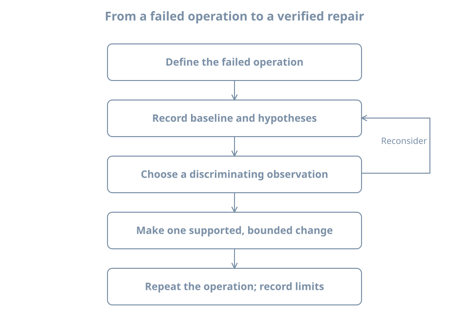

A useful inventory explains what a machine is, what it is meant to do and how to reach it when something fails. A useful incident record explains what was observed, what was inferred and what changed. Neither requires collecting every possible command output.

Use the disposable `bl01` VM from the preceding chapter. Keep its graphical console available, and keep your baseline clone shut off. The inspection examples run inside the guest unless marked **host**. The worked failure creates one temporary user service and one private directory; it does not break login, networking or system services.

By the end of the chapter you will have a baseline inventory, a change note, an evidence-led repair and an explicit record of what your checks do not prove.

## Start with an operational question

“The server is broken” does not identify a test. “After today's change, the console user cannot read the report that was available yesterday” gives an operation, observer and time boundary. A good symptom statement includes:

- The intended operation and the result that would count as success.
- Who or what attempted it, from which environment.
- The actual result, including the exact error when available.
- The first known failure time and last known success.
- The scope: one user, one service, one VM or several machines.

Avoid turning a hypothesis into the symptom. “The firewall is blocking the application” already assumes a cause. “The client times out when connecting to the configured endpoint” leaves routing, filtering, listener and application behavior open for investigation.

{fig-alt="The investigation starts by defining a failed operation and recording a baseline. Competing hypotheses lead to a discriminating observation. A bounded change is followed by repeating the original operation, checking side effects and recording the result. If the observation contradicts the hypothesis, return to the hypotheses before changing the system."}

A **hypothesis** is a proposed explanation that evidence can support or contradict. A **discriminating check** is one whose possible outcomes separate competing explanations. A command is useful because of the question it answers, not because it appears in a long troubleshooting checklist.

For example, if a service reports that it cannot open `/srv/report/current.txt`, checking the configured pathname and mount can separate “wrong path” from “missing storage.” Rebooting may change both the process and mount state without explaining either.

## Build an inventory with purpose and scope

Create a lab record outside the guest, alongside the baseline and console instructions from the VM chapter. Record the following categories. Some values come from the host manager; others come from the guest. Label that boundary explicitly.

| Category | Useful fields | Why it belongs |
|---|---|---|
| Purpose | Lab role, owner, expected operations | Defines what healthy means |
| Host-side identity | VM name, connection, disk paths, firmware | Locates the managed machine and its dependencies |
| Guest identity | Hostname, distribution, kernel, architecture | Matches instructions and runtime evidence |
| Resources | vCPUs, RAM, disks and filesystem capacity | Establishes expected limits |
| Network | NIC source, address, route, resolver context | Explains intended reachability |
| Access | Console route, login method, privilege boundary | Makes recovery possible |
| Service state | Expected services and known failures | Distinguishes baseline from regression |
| Recovery | Baseline date, scope, test result | States what can actually be restored |
| Maintenance | Update/source status and outstanding actions | Prevents a stale baseline from appearing current |

Do not record passwords, private keys or authentication tokens in this document. A recovery record can identify the password-manager entry without copying its contents.

The inventory is not frozen truth. Include collection time and the environment from which each observation was made. An IP address can change after DHCP renewal; a kernel version can change after reboot; a disk image can move while the guest filesystem remains the same.

### Worked inventory: identity, time and boot

**In the guest**, run:

```bash
date --iso-8601=seconds
hostnamectl
cat /etc/os-release
uname -r
uname -m
uptime
cat /proc/sys/kernel/random/boot_id
```

The **boot ID** identifies this kernel boot and helps distinguish records separated by a reboot. A PID alone cannot do that. The wall-clock time needs context too: a disconnected VM can have a different clock from the host. Record the offset or uncertainty rather than silently aligning events by an inaccurate timestamp.

For an event timeline within one boot, monotonic timestamps can be useful because they describe elapsed time from a boot-related origin rather than calendar time. For events spanning machines, synchronized wall clocks and timezone information matter. Later time-service chapters explain synchronization; for now, do not claim second-by-second ordering across unsynchronized machines.

### Worked inventory: resources and storage

```bash
lscpu
free -h
lsblk -o NAME,SIZE,TYPE,FSTYPE,MOUNTPOINTS
findmnt --target / --output TARGET,SOURCE,FSTYPE,OPTIONS
df -h /
df -i /
```

`lsblk` describes block devices and their relationships; `findmnt` locates mounts. Their explicit columns make the intended observation clearer than relying on changing default displays. The [lsblk manual](https://man7.org/linux/man-pages/man8/lsblk.8.html) describes its device information and column selection.

`df -h /` asks about filesystem space for `/`; `df -i /` asks about inode usage where the filesystem reports it. An **inode** represents filesystem metadata for an object. On filesystems with a finite inode supply, many small files can exhaust object capacity while data blocks remain available. The [df manual](https://man7.org/linux/man-pages/man1/df.1.html) distinguishes these reports.

Illustrative interpretation:

```text
Filesystem     Size  Used Avail Use% Mounted on
/dev/vda2       30G  5.0G   23G  18% /
```

This describes a guest filesystem at one instant. It does not show the host filesystem's free space or prove that a database can write under its own account. Filesystem reservation, quotas, permissions and a read-only mount can produce different application results. Record this evidence as “root filesystem reported available blocks,” not “storage is healthy.”

On the **host**, separately record the free capacity of the filesystem containing the VM images and baseline copies. A guest's free-space report cannot detect every host-side capacity problem.

### Worked inventory: networking and listeners

```bash
ip -brief address
ip route
ss -lnt
```

A **listener** is an endpoint prepared to accept incoming communication. `ss -lnt` selects listening TCP sockets, using numeric addresses and ports. It does not cover UDP services, outbound-only applications or all communication mechanisms. The [ss manual](https://man7.org/linux/man-pages/man8/ss.8.html) describes these filters.

An address of `127.0.0.1` belongs to IPv4 loopback, usable inside the same network namespace. A listener bound only there is not automatically reachable through the guest's external NIC. An unspecified address such as `0.0.0.0` has a wider local binding scope, but does not prove that a route or firewall permits a client connection.

On our isolated practice network, failure to fetch Internet packages is expected. Do not switch to the NAT network simply because a generic checklist says an external ping must work. Compare the observation with the documented role and phase of the lab.

If you need to understand which route Linux would select for an address, `ip route get ADDRESS` performs a route lookup; it is not a packet-delivery test. Replace `ADDRESS` with the actual destination under investigation. The [ip-route manual](https://man7.org/linux/man-pages/man8/ip-route.8.html) explains this distinction.

### Worked inventory: service state and bounded logs

```bash
systemctl --failed --no-pager
systemctl list-units --type=service --state=running --no-pager
journalctl --list-boots --no-pager
journalctl -b -p warning -n 30 --no-pager
```

A failed-unit list is a starting clue. A healthy application can have dependencies not represented there, and a failed optional unit might not explain the reported operation. Similarly, selecting warning-priority records can omit the informational event that caused the incident.

The journal commands show retained boots and a bounded view of current-boot warnings. Retention and your account's access rights limit what is available. The [journalctl reference](https://www.freedesktop.org/software/systemd/man/latest/journalctl.html) documents boot, priority, unit and time filters. If a query reports insufficient access, record that limitation before deciding whether a privileged read is warranted.

Do not dump all logs into a public issue. Logs can contain usernames, addresses, request details and credentials accidentally emitted by software. Retain original evidence privately, and create a separately reviewed excerpt when sharing.

## Save a small evidence bundle

For this exercise, create a private directory in the guest and collect a few explicitly selected reports. Run the commands in one Bash terminal:

```bash
umask 077
evidence_dir=$(mktemp -d "$HOME/bl-evidence.XXXXXX")
date --iso-8601=seconds > "$evidence_dir/collected-at.txt"
cat /proc/sys/kernel/random/boot_id > "$evidence_dir/boot-id.txt"
cat /etc/os-release > "$evidence_dir/os-release.txt"
uname -r > "$evidence_dir/kernel.txt"
findmnt --target / --output TARGET,SOURCE,FSTYPE,OPTIONS \
  > "$evidence_dir/root-mount.txt" 2>&1
ip -brief address > "$evidence_dir/addresses.txt" 2>&1
systemctl --failed --no-pager > "$evidence_dir/failed-units.txt" 2>&1
printf 'Evidence directory: %s\n' "$evidence_dir"
```

`umask 077` restricts permissions for newly created files and remains in effect for this shell. `mktemp -d` avoids overwriting an older evidence set. `2>&1` saves error output with ordinary output, so an unavailable command or denied query does not look like an empty successful report.

Read the saved files. The existence of a file is not proof that the command succeeded. Keep the directory path in your notes, and copy reviewed evidence to storage outside the VM when it matters for recovery. An evidence bundle only inside the guest can be lost when you revert that guest.

This small bundle is not a backup. It does not contain the VM disk, service databases or every configuration input. Its purpose is to preserve the context for a bounded investigation.

## Separate facts, interpretations and actions

Use a table like this while investigating:

| Kind | Example |
|---|---|
| Observation | Unit log says `/home/learner/.../expected.txt` cannot be opened |
| Interpretation | The configured input may not exist at that path |
| Alternative | The parent directory may be inaccessible to the service user |
| Discriminating check | Inspect the exact configured path and parent directory as the same user |
| Planned change | Place the intended file at that path, if the evidence confirms a naming mismatch |
| Verification | Repeat the same unit invocation and inspect its result |

An observation can still be incomplete or stale. Its value comes from a recorded source, time and scope. An interpretation should be revisable when new evidence appears.

Change one relevant variable at a time when practical. If you change the pathname, account, permissions and startup command together, a successful retry will not tell you which change mattered. In a real outage, restoring service may take priority over a perfect experiment, but record that uncertainty rather than inventing a definitive root cause afterward.

## Worked failure: a service reads the wrong pathname

This experiment uses a **transient user service**: a unit created through the manager for this session of work rather than installed as a persistent system configuration file. It runs under your ordinary account. No `sudo` is needed.

Check that the user manager is reachable:

```bash
systemctl --user list-units --type=service --no-pager
```

If it reports that it cannot connect, use a normal local login in the reference VM's console. Do not change system authentication or the login manager just to run the exercise. A shell in an unrelated container or recovery environment may not have a user manager.

Use the unit name `bl-reading-probe.service` only if it is not already in use. An old attempt should be inspected and cleaned up before reusing the name. Create the input directory and the deliberately differently named file:

```bash
probe_dir=$(mktemp -d "$HOME/bl-reading-probe.XXXXXX")
printf 'inventory-ready\n' > "$probe_dir/actual.txt"
printf 'Experiment directory: %s\n' "$probe_dir"
systemd-run --user --unit=bl-reading-probe \
  --property=Type=oneshot --property=RemainAfterExit=yes \
  /usr/bin/cat "$probe_dir/expected.txt"
```

Run interactively; do not wrap this expected failure in a script that exits immediately on any nonzero result. `Type=oneshot` makes this a finite task. `RemainAfterExit=yes` keeps the successful unit active after its process exits, making the final state easy to inspect. Do not add `--wait`: combining waiting for deactivation with a unit intentionally left active is inappropriate here. The [systemd-run manual](https://www.freedesktop.org/software/systemd/man/latest/systemd-run.html) describes transient-unit creation and its execution options.

The command requests a file that you did not create. It should fail. Record the symptom precisely: “the user unit cannot read its configured input.” Do not call this a disk failure or a permission failure yet.

### Observe without repairing

```bash
systemctl --user status bl-reading-probe.service --no-pager
systemctl --user show bl-reading-probe.service \
  -p ActiveState -p SubState -p Result -p ExecMainStatus
systemctl --user cat bl-reading-probe.service
journalctl --user -b -u bl-reading-probe.service -n 20 --no-pager
ls -ld "$probe_dir"
ls -l "$probe_dir"
```

The unit's executed command should contain the exact `expected.txt` pathname. The directory listing should contain `actual.txt` instead. The log normally reports a missing file; wording depends on locale and software version. A nonzero status from a status-query command can reflect the failed unit being observed, rather than a broken query tool.

There are now several mutually supporting observations: the requested name, the actual name, and the failure at that path. Permissions remain worth understanding, but broad permission changes would not create the missing name. The isolated network is irrelevant because this command reads a local file.

### Make the smallest supported correction

Move the intended input to the requested name, then start the same unit again:

```bash
mv -- "$probe_dir/actual.txt" "$probe_dir/expected.txt"
systemctl --user start bl-reading-probe.service
systemctl --user show bl-reading-probe.service \
  -p ActiveState -p SubState -p Result -p ExecMainStatus
journalctl --user -b -u bl-reading-probe.service -n 20 --no-pager
```

Expected properties include `ActiveState=active`, `SubState=exited`, `Result=success` and `ExecMainStatus=0`. The journal should include `inventory-ready` from the successful read. It may still contain the earlier failure; logs preserve history rather than becoming uniformly successful after a repair. Compare the timestamps and invocation order.

This is a direct example of an active service without a continuing main process. The useful operation was the file read, and its evidence is successful completion plus the expected content. Do not diagnose the absence of a running `cat` process as a new failure.

### Clean up the experiment

Save the relevant output in your notes first. Then stop the transient unit and remove only the file and directory you created:

```bash
systemctl --user stop bl-reading-probe.service
rm -- "$probe_dir/expected.txt"
rmdir -- "$probe_dir"
unset probe_dir
```

A stopped transient unit can be unloaded by the manager. A later status query may report that it is not found; that is expected after cleanup. If an interrupted attempt remains failed, inspect it and use `systemctl --user reset-failed bl-reading-probe.service` before creating a new attempt. Do not reset all failed units and erase unrelated failure state.

The journal can retain the experiment's records after cleanup. Removing the input directory is not a request to erase that historical evidence.

## Write the change note before forgetting the reason

A compact note for this experiment might read:

```text
Purpose: restore the user probe's expected file read.
Environment: bl01 guest, local console, learner user manager.
Baseline: probe input directory contains actual.txt only.
Symptom: bl-reading-probe.service exits unsuccessfully.
Evidence: ExecStart requests expected.txt; listing shows actual.txt.
Hypothesis: the intended input has the wrong pathname.
Change: rename actual.txt to expected.txt in the experiment directory.
Rollback: rename it back while the probe is stopped.
Verification: same unit starts successfully; result=success;
              journal contains inventory-ready.
Cleanup: stop transient unit; remove experiment input and directory.
Limit: proves this local read, not general storage or service health.
```

Add actual timestamps and the boot ID to your real note. For a production change, also record the authorized scope, affected users, maintenance constraints and recovery decision. The shape is the same: purpose, evidence, bounded action, verification and limits.

## A second investigation: connectivity changed as designed

After moving `bl01` from NAT to `blpractice`, an update attempt cannot contact its repositories. List three hypotheses before changing anything:

1. The guest has no usable NIC or address.
2. The guest is deliberately attached to a network without an external path.
3. The package configuration refers to an unavailable repository.

A discriminating sequence is to inspect the guest address, check the host-side NIC source, and compare it with the lab's documented phase. If the guest has a practice address and the source is `blpractice`, external download failure agrees with the intended design. Replacing repository URLs would change an unrelated component.

If a later exercise needs updates, plan a brief return to the setup network while the guest is shut down, perform the maintenance, and return to the isolated network. Record both attachment changes and verify the final state. Do not silently leave an extra NAT NIC attached after the task.

This example matters because successful troubleshooting sometimes concludes that the system is behaving correctly and the expectation must change. Every failure message is evidence about an attempted operation; not every failed operation indicates a defect.

## Practice: produce an evidence-led handoff

Give another learner a short handoff containing the VM inventory, the last known healthy state, the probe failure's evidence, the repair and verification, and the recovery route. They should be able to identify the correct VM without guessing from its hostname alone.

Answer these questions in the handoff:

1. What did the successful probe prove, and what did it leave untested?
2. Which evidence would be lost if you reverted the guest before copying your notes out?
3. Why would changing permissions on the input directory not have fixed the original naming mismatch?
4. Why is an external ping failure insufficient proof that a VM is isolated?
5. How would you distinguish an old failure in the journal from the latest invocation's result?

Success means you can trace each conclusion to a specific observation. The probe proved one read under one account and manager context; it did not validate an entire storage stack. Guest-local notes can vanish on rollback. Missing names and permissions are different causes. Network probes have several failure modes. Invocation timing and current result properties separate historical errors from a completed repair.

## Recall card

- Define the failed operation before selecting commands.
- Record time, boot and observer context with evidence.
- Distinguish observations from explanations and proposed actions.
- Choose checks that separate plausible causes.
- Preserve evidence before a restart or rollback changes it.
- Verify the original operation and relevant side effects after a bounded change.
- A useful handoff includes what remains uncertain.

You now have a working lab and an investigative method. Part 02 returns to installation choices in depth: media trust, firmware and storage planning, manual layouts, first-boot verification and reproducible provisioning.
