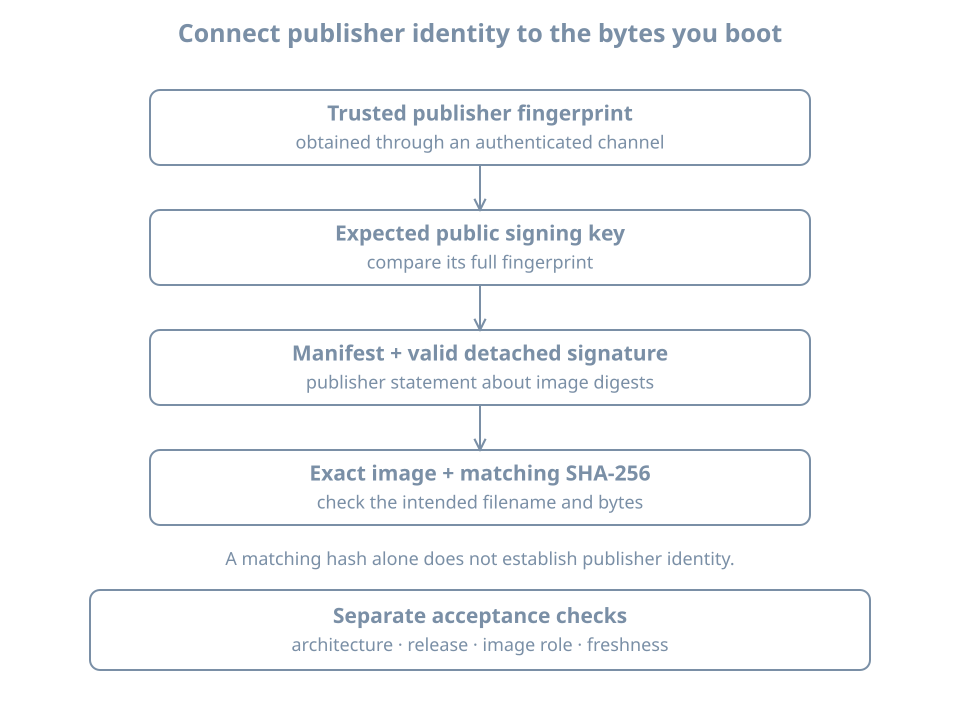

An installer starts with unusually broad authority. It can replace partitions, create administrator accounts and supply the first software the machine trusts. Before giving it that authority, establish which artifact you have and why you trust it.

Part 01 used a verified Ubuntu Server ISO to establish a lab. This chapter develops the verification process rather than treating it as a download-page ritual. You will select an image for a particular machine, distinguish integrity from authenticity, verify a signed checksum manifest, and keep a record that identifies the bytes actually used.

Run the download and verification steps on the **Linux host**, before attaching media to a new guest. The worked example uses Ubuntu Server 26.04 LTS for an x86-64 VM. No physical disk needs to be written. Preserve the existing `bl01` lab and its baseline; later chapters create a separate installation target named `bl02`.

## Choose the kind of artifact before its filename

An **installation image** supplies an environment that installs an operating system onto target storage. A **preinstalled disk image** supplies storage that already contains an operating system, usually expecting further initialization. A **container image** supplies a userspace filesystem and metadata for a container runtime; it does not by itself provide the independent guest kernel and firmware path used in our VM lab.

| Artifact | Typical use | Question before downloading |
|---|---|---|
| Server installer ISO | Interactive or automated installation onto new storage | Does it support this architecture and boot environment? |
| Desktop live/installer ISO | Try or install a graphical workstation | Is its package and interface selection appropriate? |
| Cloud disk image | Provision an instance from a prepared disk | What initializes credentials, networking and instance identity? |
| Network-boot artifacts | Start an installer through network infrastructure | Where will the remaining installer and package data come from? |
| Container image | Start isolated userspace on a host kernel | Which runtime and image trust policy apply? |

An ISO is a disk-image format commonly used for virtual optical media. The suffix alone does not establish its operating system, architecture or trustworthiness. Likewise, a `.qcow2` file identifies a storage format, not a guarantee of a bootable, authenticated or correctly configured guest.

The official [Ubuntu release directory](https://releases.ubuntu.com/26.04/) distinguishes server and desktop installation media and publishes checksum files. The separate [Ubuntu Cloud Images site](https://cloud-images.ubuntu.com/) distributes images tailored for cloud and virtualization environments. Downloading a cloud image and then expecting the interactive server installer is a mismatch of workflow, not a failed bootloader.

### Architecture names describe compatibility

For this lab, the host and presented guest machine are x86-64. Ubuntu names this architecture `amd64`; the name also applies to compatible Intel CPUs. It does not mean that only AMD-branded processors work. `arm64` describes a different instruction-set family.

A VM manager can present different machine types and device models, but hardware-assisted execution normally depends on a compatible host/guest architecture. Software emulation can bridge some architecture differences at another performance cost. Select the intended architecture deliberately rather than assuming that the largest or newest image is suitable.

Also distinguish the release series from the image build. Two artifacts can both belong to Ubuntu 26.04 LTS and contain different package revisions or installer updates. Record the exact filename and digest, not just “Ubuntu LTS.” A URL that always points to the newest build is convenient for acquisition but insufficient as a permanent identifier.

## Four separate claims about a download

**Integrity** asks whether the bytes match an expected value. A cryptographic hash such as SHA-256 computes a fixed-size digest from the complete file. A changed byte will, for practical verification purposes, produce a different digest.

**Authenticity** asks whether the expected value or artifact came from the authority you intended to trust. A signature can authenticate a checksum manifest to a signing key. You still have to establish that the key belongs to the intended publisher.

**Suitability** asks whether the authentic artifact is appropriate for this machine and task. A valid signature on an ARM image does not make it the right image for our x86-64 installation.

**Freshness** asks whether the artifact and its maintenance state are acceptable now. A correctly signed older image remains an older image. Its signature does not install later security fixes or promise that its release is still supported.

{fig-alt="A publisher fingerprint obtained through a trusted channel identifies the signing key. That key verifies a signature on the checksum manifest. The selected image's computed digest is compared with its manifest entry. Architecture, release suitability and maintenance status are checked separately."}

These checks are complementary. HTTPS protects communication with the site you reached, subject to its certificate trust. A signed manifest can remain verifiable after copying through a mirror or offline storage. Neither eliminates the need to know which publisher and artifact you intended to use.

A checksum copied from the same untrusted page as a malicious image can match perfectly. The attacker could replace both. The hash calculation would be correct, but the trust decision would be unsupported.

## Collect a matched verification set

Create a new host directory for one release/build verification. Keeping each set separate prevents a checksum file from one release being confused with another:

```bash
umask 077
media_dir=$(mktemp -d "$HOME/bl-install-media.XXXXXX")
printf 'Media directory: %s\n' "$media_dir"
```

Download the selected server ISO, `SHA256SUMS`, and `SHA256SUMS.gpg` into this directory from the same official release listing. Use the browser's save location or move the three completed downloads there. Avoid using an incomplete `.part` download or an automatically renamed duplicate without checking which file you selected.

`SHA256SUMS` is the manifest: a list of filenames and expected hashes. `SHA256SUMS.gpg` is a detached signature over that manifest. “Detached” means the signature is stored separately from the signed content.

Enter the directory and inspect the manifest:

```bash
cd "$media_dir"
ls -lh
cat SHA256SUMS
```

Identify the exact server ISO entry for the intended architecture. A different filename may be legitimate after a point release, but it must correspond to your downloaded image. Do not edit the manifest to force a match; that would change the signed object.

If a moving release directory changes during your download, the ISO and manifest may legitimately belong to different publication states. A mismatch remains a reason to stop. Acquire a consistent set from the publisher instead of assuming the signature or checksum tool is being overly strict.

## Establish the signing key's identity

A public signing key can be distributed widely. Its availability on a keyserver does not by itself prove whose key it is. A **fingerprint** is a compact identifier derived from the key material. Compare the full expected fingerprint using the publisher's authenticated documentation or another trusted organizational distribution channel.

Ubuntu's [download-verification instructions](https://ubuntu.com/tutorials/how-to-verify-ubuntu) publish its image-signing key information. The documented 2012 image-signing key has this fingerprint:

```text
8439 38DF 228D 22F7 B374 2BC0 D94A A3F0 EFE2 1092
```

Verify that Ubuntu still identifies the relevant key for your selected image when you perform the exercise. A future key rotation should lead you to verify the new publisher guidance, not accept an arbitrary key just because it makes an error disappear.

Use a dedicated verification key directory so this experiment is separate from your normal keyring:

```bash
verify_key_dir=$(mktemp -d "$media_dir/keys.XXXXXX")
expected_fingerprint=843938DF228D22F7B3742BC0D94AA3F0EFE21092
gpg --homedir "$verify_key_dir" \
  --keyserver hkps://keyserver.ubuntu.com \
  --recv-keys "$expected_fingerprint"
gpg --homedir "$verify_key_dir" \
  --fingerprint "$expected_fingerprint"
```

Compare the displayed full fingerprint with the trusted publisher record. `hkps` requests a TLS-protected keyserver connection. The requested fingerprint narrows the key retrieval; a matching user-ID name or email address alone is not enough. The [GnuPG manual](https://www.gnupg.org/documentation/manuals/gnupg26/gpg.1.html) documents key retrieval, fingerprints and verification operations.

These commands import public verification material. They do not create a private signing key or require you to certify the publisher's key as universally trusted. Keep the scope of the decision narrow: this is the key authorized to verify the selected distribution's manifest.

If key retrieval fails because the host cannot reach the keyserver, diagnose that acquisition failure. An approved offline copy of the public key can be imported and checked against the same trusted fingerprint. Do not disable artifact verification to compensate for a network problem.

## Verify the manifest, then verify the image

First check the detached signature against the manifest:

```bash
gpg --homedir "$verify_key_dir" \
  --verify SHA256SUMS.gpg SHA256SUMS
```

Read the complete result. You need successful cryptographic verification using the expected publisher key. A message about an unknown local trust level can occur when a newly imported key has not been certified in your personal trust database. That is a different question from a bad signature. Resolve key ownership through the fingerprint check; do not treat every warning as equivalent or blindly suppress warnings.

A valid signature binds the manifest bytes to the signing key. It does not yet say that your ISO matches an entry. Perform that second check:

```bash
sha256sum --check --ignore-missing SHA256SUMS
```

Require the **exact downloaded ISO filename** to report `OK`, and check that the command reports no failed verification for it. `--ignore-missing` permits other files listed in the release manifest to be absent locally. It does not prove that the file you meant to test was present. A successful check of a desktop ISO in the same directory does not validate a server ISO that was never downloaded.

The GNU [Coreutils manual](https://www.gnu.org/s/coreutils/manual/coreutils.pdf) documents checksum-checking behavior. For this exercise, use a directory containing only the intended artifact set and read the output without filtering it. In particular, do not pipe the result to a search for `OK` and mistake the search command's success for the verifier's complete result.

A completed record should now connect these facts:

```text
Trusted publisher fingerprint
    → valid signature on this manifest
    → matching digest for this exact ISO
    → intended release, architecture and installation role
```

If any link is missing, label the artifact unverified and do not attach it as trusted installation media.

## Worked experiment: matching bytes are not trusted bytes

This small exercise uses ordinary text, not an installer. It demonstrates why a checksum must come from a trusted source. Run it in one Bash terminal:

```bash
hash_demo_dir=$(mktemp -d "$HOME/bl-hash-demo.XXXXXX")
printf 'approved-content\n' > "$hash_demo_dir/sample.txt"
(
  cd "$hash_demo_dir" || exit
  sha256sum sample.txt > checksums.txt
  sha256sum --check checksums.txt
)
```

The result should include `sample.txt: OK`. Now alter the data but retain the old manifest:

```bash
printf 'changed-content\n' > "$hash_demo_dir/sample.txt"
(
  cd "$hash_demo_dir" || exit
  sha256sum --check checksums.txt
)
```

Expect `FAILED` and a nonzero result. Run this interactively; a shell configured to exit on any nonzero command could stop at this expected failure. The mismatch means the data no longer agrees with the saved digest. It does not identify whether the cause was malicious, accidental or an intentional edit.

Now replace the manifest too:

```bash
(
  cd "$hash_demo_dir" || exit
  sha256sum sample.txt > checksums.txt
  sha256sum --check checksums.txt
)
```

The changed content reports `OK`. Nothing about the hash algorithm was defeated: you simply changed the expected value. A publisher signature prevents you from silently treating a modified manifest as the publisher's original statement, provided the verification key itself is trusted.

Remove only this exercise's files:

```bash
rm -- "$hash_demo_dir/sample.txt" "$hash_demo_dir/checksums.txt"
rmdir -- "$hash_demo_dir"
unset hash_demo_dir
```

Keep the real installer verification set and its record for the installation lab. They serve a different purpose from these temporary files.

## Carry the verification across the copy boundary

The verified file must be the file the VM actually boots. If you copy the ISO to a libvirt-accessible media directory, compare its SHA-256 digest with the verified source or verify the destination against the authenticated manifest. Record the destination path in the VM's installation plan.

A recognizable basename is not sufficient: two directories can contain different files with the same name. The VM manager's optical-media path establishes which one is attached. If an administrator downloads a replacement into that path later, your old record no longer proves the attached bytes are unchanged.

For this VM exercise, attach the ISO as read-only virtual optical media. Writing it onto a physical USB device is a separate operation with a destructive target-selection step. There is no reason to use a raw disk-writing command on the host's physical drives to create this guest.

Store these fields outside the guest:

| Field | Purpose |
|---|---|
| Official source and retrieval time | Identifies the publication context |
| Exact filename, size and SHA-256 | Identifies the verified bytes |
| Manifest and detached signature | Preserves the publisher's signed statement |
| Expected signing-key fingerprint and its trusted source | Records the trust decision |
| Verification outcome | Records both signature and image checks |
| Attached-media path | Connects verification to the installer actually booted |
| Release/architecture and intended role | Records suitability |

This record can reproduce an acquisition decision, but it is not a claim that the resulting host is permanently secure. Package updates, installer refreshes, later configuration and workload software all add new state.

## Diagnose verification failures precisely

| Observation | What it establishes | Next action |
|---|---|---|
| Public key unavailable | Verification cannot yet identify a usable key | Acquire the intended key and check its fingerprint |
| Bad signature | Manifest/signature pair does not verify | Stop; reacquire a matching official set |
| Valid signature from an unexpected key | A signature exists, but publisher authorization is unresolved | Check the publisher's current signing policy |
| ISO hash mismatch | Downloaded bytes differ from the authenticated manifest entry | Check build pairing and reacquire the image |
| No exact ISO entry checked | The intended artifact has not been validated | Check filenames, directory and manifest coverage |
| Valid image for the wrong architecture | Authenticity does not solve suitability | Obtain the correct artifact |

Retain diagnostic output before deleting a failed download if you need to investigate the cause. Repeated mismatches after clean downloads warrant examination of storage, transfer paths and publication state; they do not justify bypassing the check.

## Practice and recall

Verify the server image you will use for `bl02`, then have another learner trace your record from the trusted fingerprint to the optical-media path. They should not need to infer which of several downloads was used. Complete the text-file experiment and explain why replacing both file and unsigned manifest produces a successful checksum result.

You are ready to proceed when the signature, exact ISO digest, architecture, release series and attached path are all accounted for.

- Integrity compares bytes with an expected value; authenticity establishes who supplied that value.
- A keyserver distributes keys; it does not replace the publisher-identity check.
- Verify the manifest before using its digest as trusted evidence.
- Require the exact intended artifact to be checked.
- A valid signature does not establish suitability, freshness or a secure final configuration.
- Preserve enough evidence to identify the bytes actually booted.
