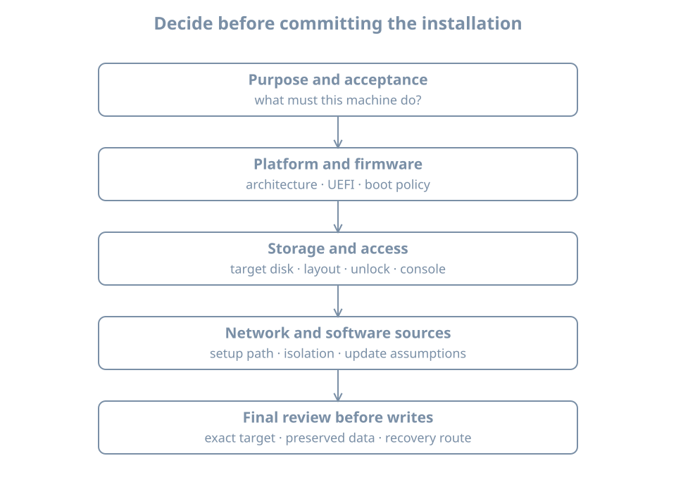

An installation plan turns “install Linux” into a set of decisions that can be reviewed before storage is changed. The installer can create a working system with defaults, but it cannot know which data you must preserve, who will recover an encrypted machine, or whether a DHCP address is acceptable for its future service.

This chapter plans a second lab VM, `bl02`, while preserving `bl01`. The two machines will be comparable without needing to be identical. Their differences will become evidence about installation choices rather than accidents you discover later.

The outcome is a short installation record with a clear target, resource budget, access path, network phase, storage policy and acceptance checks. Planning does not require predicting every future workload. It does require identifying which assumptions are temporary and what will trigger a review.

## Write the purpose before choosing the layout

For this pass, use this purpose statement:

> Install a second disposable Ubuntu Server VM, inspect the guided LVM storage layout, and compare its installed state with the original lab VM. Preserve the original VM and all baseline copies. Use graphical console access and isolated networking after setup.

This purpose rules out several unnecessary choices. There is no production database to migrate, no need for shared host files, and no requirement for remote login during installation. It also defines a useful comparison: the distribution, virtual resources and network phase can be held similar while the storage plan is examined deliberately.

**Provisioning** is the broader process of making a usable machine ready for its role. Operating-system installation is one part. Identity, credentials, networking, updates, services, monitoring and recovery also belong to provisioning. A successful installer does not automatically satisfy all of those responsibilities.

{fig-alt="Purpose determines platform and firmware requirements. Those requirements feed storage and access decisions, which feed network and software-source choices. A final review checks the exact destructive target and defines acceptance and recovery before installation begins."}

## Separate the host, virtual machine and guest identities

The host is the physical Linux system that runs libvirt. The VM definition describes presented hardware. The installed guest has its own operating-system identity. Keep all three in the plan:

| Layer | Example identifier | What it identifies |
|---|---|---|
| Host | Your lab workstation's actual name | The resource and management provider |
| Libvirt connection | `qemu:///system` | The VM inventory and management scope |
| VM definition | `bl02` | The new presented machine |
| Guest hostname | `bl02` | The installed operating system's chosen name |
| Guest user | `learner` | An account inside the new guest |
| System disk | New 32-GiB image, recorded host path | The storage that may be overwritten |

A familiar hostname in a console prompt is not enough to identify a destructive target. A clone can retain the original guest hostname. Check the VM manager's selected guest and the attached disk inventory before proceeding.

For our comparison, create `bl02` from new installation media and a new disk. Do not clone `bl01` as a substitute for performing the installation: that would reproduce its existing layout and identity rather than show the installer's decisions.

## Choose firmware before installing

**UEFI** is the selected virtual firmware interface for this lab. The installed system will need a compatible boot path, including an **EFI System Partition**, or **ESP**, for firmware-readable boot artifacts. The partition table and the firmware mode are related choices, but they are not the same object.

A **partition table** divides a block device into named ranges of sectors. **GPT**, the GUID Partition Table, is the partition-table format used for this guided UEFI example. GPT does not mean that the guest definitely booted through UEFI; confirm the actual mode from the installer and installed guest.

An ESP is typically formatted using a FAT filesystem and mounted at `/boot/efi` in the installed system. A separate `/boot` filesystem, if the installer creates one, serves a different role. It can hold kernels and initial boot files without being the firmware-readable ESP. The next part examines the complete boot chain; here, distinguish these locations so you can review the installer's proposed layout.

**Secure Boot** adds signature-based policy to the boot path. It is not the same as checking the ISO signature, and it is not disk encryption. These mechanisms address different boundaries:

| Mechanism | Main question |
|---|---|
| Installer-image verification | Are these the installation bytes authorized by the publisher? |
| Secure Boot policy | Are boot components accepted by the platform's configured trust policy? |
| Disk encryption | Is stored data protected when the required unlock material is unavailable? |
| Login authentication | Is this user allowed to access the running system? |

For `bl02`, select UEFI before the first boot, retain the manager's supported Ubuntu-compatible firmware settings, and record whether Secure Boot is enabled. Do not switch between legacy BIOS and UEFI mid-install to work around an unexplained error. Such a switch can change which boot artifacts and entries are required.

Also record the guest's persistent firmware-variable storage. A UEFI VM can have a host-side NVRAM file as well as a disk image. A recovery plan that saves only the disk should explain how firmware state will be reconstructed or restored.

## Plan capacity at more than one layer

Use the same basic teaching allocation as `bl01`: two vCPUs, 4096 MiB of RAM and a 32-GiB virtual system disk. These numbers make comparison straightforward. They are not sizing advice for a production application.

The new VM consumes additional host resources. Keep `bl01-baseline` and recovery copies shut off, and avoid running more guests than the host can support comfortably. If you run `bl01` and `bl02` together, their nominal RAM allocation alone totals 8 GiB, before host and virtualization overhead.

Storage requires a separate budget. A 32-GiB virtual disk is a limit presented to the guest. A sparse host image may consume less space now and more later. A future baseline copy adds another allocation. Host free space must cover the anticipated combined growth rather than just today's image-file size.

Inside the guest, the full disk is also not identical to usable root-filesystem space. Space can belong to partition metadata, the ESP, `/boot`, volume-manager metadata, unallocated volume-group capacity and filesystem overhead. The next chapter measures those layers instead of expecting `df /` to equal the VM manager's disk capacity.

A practical capacity note might say:

```text
Guest: 2 vCPUs, 4096 MiB RAM, one 32-GiB system disk.
Host: enough free space for the new disk and one future full copy.
Concurrency: run only the guests needed for the current exercise.
Growth review: before adding data services or storage experiments.
```

Use your measured host free-space value in the real record. Do not copy a fictional number into a capacity decision.

## Choose a storage policy, not just a checkbox

For the guided installation exercise, use the entire **new guest disk**, enable LVM if offered, and leave encryption off. This is a controlled disposable lab choice. It keeps the first inspection focused on the relationship between disk, partitions, volumes and filesystems.

**Logical Volume Manager**, or **LVM**, groups storage into allocatable volumes. Its introductory vocabulary is:

- A **physical volume** is a block device prepared for LVM use, often a partition.
- A **volume group** is a pool built from one or more physical volumes.
- A **logical volume** is an allocated block device drawn from that pool.
- A filesystem can be created on a logical volume and mounted at a path such as `/`.

These layers let storage allocation change without treating each filesystem as permanently tied to a fixed disk partition. They also introduce additional state to inspect. LVM by itself does not provide independent backup or guarantee tolerance of a disk failure.

The [Subiquity storage guide](https://canonical-subiquity.readthedocs-hosted.com/en/latest/howto/configure-storage.html) describes guided use of a disk and the storage objects the installer can create. “Use an entire disk” authorizes replacing that disk's previous layout; it does not mean every byte must become part of the root filesystem.

### Reserved growth space can be intentional

The installer may leave free capacity in the volume group. That capacity can support later allocations or extension. It is different from free blocks inside an existing filesystem. A root filesystem can be nearly full while the volume group still has unallocated capacity; using that capacity requires an explicit allocation and filesystem-growth operation.

For the first guided pass, retain the proposed allocation after reviewing it, and record what was left free. Do not enlarge everything simply to make two displayed numbers agree. The goal is to understand the layout before changing it.

### Encryption requires an access and recovery decision

On a real portable or sensitive system, leaving storage unencrypted can expose data if the device is lost. Encryption policy belongs in the installation decision because introducing it later may require migration or reinstallation.

An encrypted installation also needs an unlock method. Ask who supplies it after an unattended reboot, whether a console is available, where recovery material is stored, and what happens when relevant hardware or firmware changes. Hardware-backed unlock and a typed passphrase have different operational dependencies.

Do not put an encryption passphrase into the installation worksheet. Record the responsible person and the protected location of the recovery material. A backup of encrypted bytes is unusable without the necessary keys; a running unlocked machine still needs access controls. The next installation chapter on manual choices will treat encryption and swap directly, and later storage/security parts deepen those mechanisms.

### Separate filesystems express separate policies

A separate filesystem for application data can make capacity limits, mount options and recovery procedures clearer. It also creates another mount whose absence or failure can affect boot and services. A separate `/home` is useful in some workstation workflows but is not a universal requirement for servers.

For `bl02`, do not invent separate filesystems for every directory. Use the guided layout as a measured baseline. Later exercises add a spare disk and explicit data mounts with a clear reason. Keep that future spare disk detached during this installation, reducing the number of possible destructive targets.

## Plan account access before the first reboot

Create the guest account `learner` with a unique lab password. The same username on `bl01` and `bl02` does not imply that the accounts share identity state or credentials. A local numeric user ID also has meaning within its account database; matching numbers across machines do not automatically establish a shared identity service.

For this pass, the graphical console is the primary access path. Do not enable remote login merely because an installer offers it. Remote access later requires its own authentication and exposure decisions.

After installation, acceptance will include logging in through that console and checking the account's administrative authorization. A privilege check is more useful than assuming the first account must be configured exactly as expected. Preserve recovery access until the intended login path has been tested after reboot.

Choose a hostname that reflects the lab role and is not easily confused with the host workstation. Record the difference between a hostname and a DNS record: setting `bl02` inside the guest does not automatically make every other machine resolve that name.

## Make networking assumptions explicit

During installation, attach `bl02` to the already inspected setup NAT network from Part 01. Use one NIC and DHCP for this initial pass. Later, while shut down, move that NIC to `blpractice` and verify the change. Do not attach both networks as a shortcut.

The plan should distinguish four functions:

| Function | What it supplies | Evidence to collect |
|---|---|---|
| Address configuration | An address and prefix on the guest interface | Guest interface report |
| Routing | A next-hop/path choice for nonlocal traffic | Route table and intended destination |
| Name resolution | Names mapped to usable addresses | Resolver configuration and a relevant lookup |
| Software source access | Actual access to installer/package services | Installer mirror test or package operation |

Success in one row does not prove success in the next. A DHCP lease does not prove that a mirror is reachable. A mirror failure can come from DNS, routing, proxy requirements, clock problems or the remote service.

Record whether the environment requires a proxy. A proxy is an intermediary for selected network requests, not another name for the default gateway. Do not enter a router address into the proxy field unless that router actually runs the required proxy service. If the network requires authentication or inspection that the lab cannot satisfy, resolve the host/network prerequisites before committing an installation dependent on remote sources.

For an offline installation, record exactly which installation and package artifacts are available locally and which setup actions must wait. Do not promise that a full update will complete while the VM is deliberately isolated from its repositories.

## Decide what may change during installation

An installer can offer to refresh itself. Package repositories also change over time. Two installations from the same ISO can therefore produce different final versions if one refreshes the installer or retrieves newer packages.

For this lab, accept supported installer updates when connectivity allows, and record the choice. Then record installed versions after boot. Reproducibility here means you can explain and repeat the essential design choices, not that two disks must be byte-for-byte identical.

The distinction becomes important in automation. Repeating “use the latest image and all updates” repeats a policy but may not reproduce the same artifacts. Exact reconstruction needs retained artifacts or controlled repositories, together with configuration and secrets management. Later provisioning chapters introduce those controls after you understand an interactive installation.

## Review the destructive boundary

Before accepting storage changes, compare the installer's proposed target with the host-side record. The authorized destructive scope is one new disk attached only to `bl02`.

Use at least two independent identifiers where available: the guest-visible size and device/model/serial information, and the host manager's disk source associated with the selected VM. If the installer unexpectedly lists several writable disks, stop and inspect attachments. Do not infer that the smallest one is safe or that `/dev/vda` always names the intended target.

The installer may show device names such as `/dev/vda`, `/dev/sda` or `/dev/nvme0n1` according to the presented controller. These names describe an observed enumeration. They are not labels saying “this disk is disposable.”

A review record should explicitly say:

```text
May replace: the new bl02 system disk recorded in this plan.
Must preserve: bl01, baseline/recovery copies, host disks and shared data.
Unexpected disk or size: stop and reconcile the VM definition.
Recovery if this install fails: recreate only bl02's disposable target;
                                keep verification records and notes.
```

This is not a request to make every administrative action bureaucratic. It is a way to catch an expensive class of mistake before the irreversible write begins.

## Completed plan for the guided lab

Fill in the measured fields rather than leaving them as assumptions:

| Decision | Planned value or required record |
|---|---|
| Purpose | Inspect a second installation and its guided LVM layout |
| VM/guest name | `bl02` / `bl02` |
| Artifact | Verified 26.04 LTS amd64 server ISO; exact filename and digest |
| Firmware | UEFI; actual Secure Boot setting recorded |
| Resources | 2 vCPUs, 4096 MiB, new 32-GiB disk |
| Storage | Guided whole-disk LVM; encryption off for this lab |
| Disk target | Actual host image path and guest-visible identifiers |
| Access | Graphical console; local `learner` account |
| Setup network | Actual inspected NAT network name |
| Practice network | `blpractice`, one NIC, no external forwarding |
| Software choices | Standard server selection; no optional bundles |
| Expected changes | Installer refresh decision and package retrieval recorded |
| Acceptance | Installed boot, login, storage map, privilege check, network-phase check |
| Recovery | Preserve `bl01`; recreate only the disposable `bl02` target if necessary |

## Practice: explain a change before approving it

Review three hypothetical changes to the plan:

1. The guest needs to restart unattended while its owner is away, and encrypted root storage is required. What unlock and recovery decisions are missing?
2. The VM manager shows a 32-GiB disk, but the installer lists two writable disks of that size. What must be reconciled before continuing?
3. The installation must be repeatable in six months without Internet access. Which artifact and repository assumptions need to change?

A good answer names the dependency rather than simply selecting another checkbox. The first needs an approved unattended-unlock design and recovery route. The second needs exact attachment/target identification. The third needs retained media, required packages and initialization inputs, plus a way to validate their provenance and applicability later.

## Recall card

- Define the machine's role and acceptance checks before selecting defaults.
- Keep host, VM and guest identities separate.
- Firmware mode, partition layout, Secure Boot and encryption solve different problems.
- Plan capacity at host, virtual-disk, volume and filesystem layers.
- Record access and recovery requirements before committing storage changes.
- The exact destructive target must be identifiable, not merely familiar-looking.
- Repeating a policy and reproducing exact artifacts are different goals.
