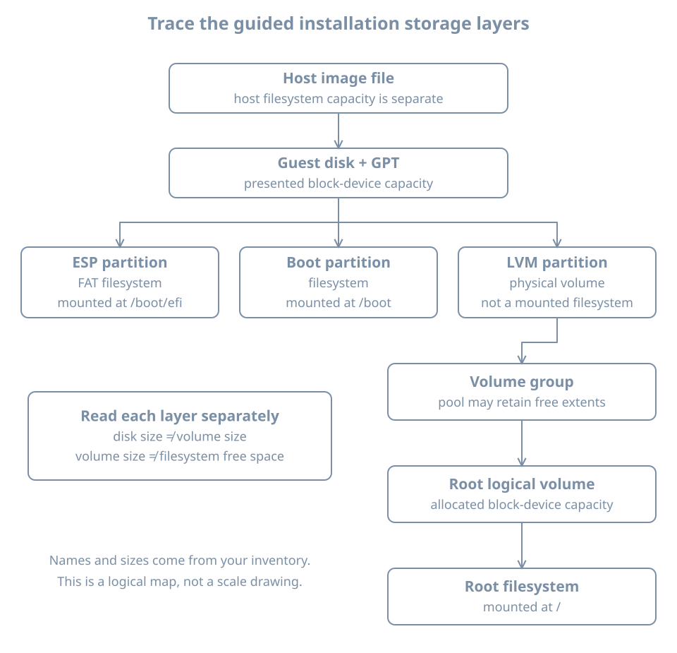

The installer says it will use the entire disk. After the first boot, the root filesystem appears much smaller than that disk. Before changing anything, trace where the capacity went. Partitions, volume-manager allocations and filesystems answer different questions about the same storage.

This chapter installs `bl02` using the plan from the previous chapter, then follows the resulting path from the host's disk image to the guest's mounted root. You will inspect the boot partitions, LVM objects, filesystem mounts and swap state, and compare the result with `bl01`.

Use the verified Ubuntu Server 26.04 LTS amd64 ISO, a new 32-GiB VM disk, UEFI, two vCPUs, 4096 MiB RAM and the setup NAT network. Keep the original lab and its baseline untouched. The installer changes `bl02`'s new disk; the post-install commands in this chapter inspect the resulting layout rather than resize or repartition it.

## Create the target and reconcile its identity

In Virtual Machine Manager's system QEMU/KVM connection, create a **new** VM from the verified local ISO. Set the planned resources, a new qcow2 disk, the name `bl02` and the inspected setup network. Choose to review hardware before beginning installation.

Confirm UEFI, the selected Secure Boot setting, one writable disk and one NIC. Check that no original lab disk, host filesystem share or spare experiment disk was accidentally attached. Record the new disk's actual host path and the ISO path. A VM name alone is not proof that the storage is new.

On the host, you can inspect the definition through libvirt:

```bash
sudo virsh --connect qemu:///system domblklist bl02 --details
sudo virsh --connect qemu:///system domiflist bl02
```

An optical device is separate from the writable system disk. If the VM manager is still at a pre-creation wizard stage, complete creation first and inspect before accepting destructive storage changes in the installer. The important boundary is the disk-write confirmation, not whether the GUI has already opened a display.

Open the graphical console and boot the installer. If the console displays an existing login prompt before you have installed anything, investigate the selected VM and disk instead of assuming the image completed an unattended installation.

## Turn installer screens into recorded decisions

The [Subiquity installer walkthrough](https://canonical-subiquity.readthedocs-hosted.com/en/latest/tutorial/screen-by-screen.html) describes the supported screen sequence. Labels and optional screens can vary with the image and installer refresh. Follow the intended decisions below and record the actual result rather than relying on an exact screenshot.

Select the appropriate language and keyboard layout. If an installer refresh is offered, make the decision recorded in your plan and note whether it occurred. Select the standard server installation for this pass. Verify DHCP on the one setup NIC, enter a proxy only if required, and let the installer test the chosen mirror.

Do not treat a failed mirror test as permission to make unrelated storage changes first. Resolve required source access or explicitly choose a supported offline path with its limitations recorded. A progress indicator does not replace the final operation result.

### Review the proposed storage map

Choose guided use of the entire **new 32-GiB disk**, select LVM if offered, and leave encryption off for this introductory comparison. Before accepting the storage summary, identify:

- The exact disk whose partitions will be replaced.
- The ESP and its intended mount point.
- Any separate `/boot` filesystem.
- The partition or device that will become an LVM physical volume.
- The volume group and root logical volume.
- The filesystem mounted at `/` and any capacity left unallocated.

The terms were introduced in the planning chapter; the table below connects them to review questions.

| Proposed object | Review question |
|---|---|
| Disk/partition table | Is this the disposable disk recorded for `bl02`? |
| ESP | Is there a firmware-readable boot partition for the selected UEFI path? |
| `/boot` | Is this separate from root, and what size is proposed? |
| LVM physical volume | Which partition supplies the pool? |
| Volume group | How much capacity will it contain? |
| Root logical volume | How much of the pool is allocated to root? |
| Root filesystem | What type and mount point will be created? |

Save a transcription or screenshot of the summary outside the guest. This becomes evidence to compare with the installed state. Do not publish an installer screen containing passwords or other secrets.

Only accept the destructive confirmation when the map matches the plan. Once confirmed, installation can begin writing in the background while later questions are answered. Closing the console is not an undo operation. The detailed [storage guide](https://canonical-subiquity.readthedocs-hosted.com/en/latest/howto/configure-storage.html) explains guided disk selection and supported storage objects.

### Finish identity and software selection

Set hostname `bl02` and create the planned `learner` account with its unique password. Keep the graphical console as the access method for this pass. Skip optional SSH installation and optional software bundles so the initial comparison has a small, deliberate scope.

Read the installation result and any failed steps. If installation completes, reboot when offered and detach the ISO when requested. Keep the virtual system disk attached. The intended next boot is from installed storage, not another run through the installer.

If a later screen fails after storage was committed, assume the disk may be partially installed. Preserve the relevant error and plan before deciding whether to recreate this disposable target. Do not describe a partially completed installer as though no change occurred.

## Prove that the installed guest booted

Log in through the `bl02` graphical console. Record identity and the root mount:

```bash
hostnamectl
cat /etc/os-release
uname -r
findmnt --target / --output TARGET,SOURCE,FSTYPE,OPTIONS
```

The observed hostname should match the plan. The root mount should be the installed filesystem rather than the installer's temporary live environment. A hostname alone is insufficient because it can be duplicated; combine it with the manager's selected VM and the storage evidence.

Check the firmware context:

```bash
if test -d /sys/firmware/efi; then
  printf 'This guest boot used UEFI\n'
else
  printf 'No EFI firmware interface found; reconcile the boot mode\n'
fi
```

If available, inspect the guest firmware boot entries without changing them:

```bash
sudo efibootmgr -v
```

`efibootmgr` reports UEFI boot-manager information when the required firmware-variable interface is available. Its [manual](https://manpages.ubuntu.com/manpages/resolute/man8/efibootmgr.8.html) also documents mutation options; none are needed here. Record `BootCurrent`, the boot order and relevant entry paths if reported. An entry in the list is evidence of configuration, not a guarantee that every fallback path has been tested.

If the utility is absent, record that fact and continue with the available firmware and filesystem observations. Do not modify boot order or delete entries just to make output resemble an example.

## Draw the storage stack from observations

{fig-alt="A host image backs the guest disk. The guest GPT divides it into an EFI System Partition mounted at boot/efi, a separate boot partition, and an LVM physical-volume partition. The physical volume supplies a volume group containing the root logical volume and possibly free extents. The root filesystem is mounted at slash. Sizes and names must be observed rather than assumed."}

Start with the guest block-device tree:

```bash
lsblk -o NAME,SIZE,TYPE,FSTYPE,MOUNTPOINTS
```

The [lsblk manual](https://man7.org/linux/man-pages/man8/lsblk.8.html) explains these columns. A deliberately simplified, illustrative result is:

```text
NAME                      SIZE TYPE FSTYPE      MOUNTPOINTS
vda                        32G disk
├─vda1                      1G part vfat        /boot/efi
├─vda2                      2G part ext4        /boot
└─vda3                     29G part LVM2_member
  └─ubuntu--vg-ubuntu--lv 14.5G lvm  ext4        /
```

This is a teaching example, not a promise of the installer's exact defaults. Names, sizes, partition numbers and filesystem choices can differ. Rounded sizes also hide partition alignment and metadata overhead. Use your own output in the installation record.

Read the tree from the outside inward:

1. `vda` is the disk presented to the guest.
2. `vda1`, `vda2` and `vda3` are partitions on that disk.
3. `vda1` contains the FAT-family ESP filesystem mounted at `/boot/efi`.
4. `vda2` contains a separate filesystem mounted at `/boot`.
5. `vda3` is used by LVM rather than directly mounted as a filesystem.
6. The LVM logical volume provides the block device on which the root filesystem lives.

The doubled hyphens in a device-mapper name can be an escaping representation of hyphens in LVM names. Do not decode a complex name by guesswork when the LVM tools can report the volume-group and logical-volume names explicitly.

If your output shows root directly on a partition rather than on an LVM logical volume, compare it with the storage summary you accepted. That may be a different valid layout, but it does not match this chapter's intended LVM experiment. Record the deviation; do not run LVM creation commands over a mounted root in an attempt to retrofit the example.

## Distinguish three kinds of free space

Inside this one VM, “free space” can mean at least three different things:

| Location | Meaning | Typical observer |
|---|---|---|
| Outside partitions | Disk sectors not assigned to a partition | Partition-layout inspection |
| Inside a volume group, outside logical volumes | LVM extents available for allocation | `vgs`, `pvs` |
| Inside a filesystem | Filesystem capacity available for file data/metadata | `df` |

There is also free space on the **host filesystem** containing the qcow2 image. It belongs to a different administrative layer.

An **extent** is an allocation unit used by LVM. The volume group can have free extents even while the root filesystem has no free blocks left. The [Subiquity storage-layout reference](https://canonical-subiquity.readthedocs-hosted.com/en/latest/reference/autoinstall-reference.html) explains that its LVM layout can reserve capacity for later use rather than allocating all of it to root immediately.

Inspect the three LVM views:

```bash
sudo pvs -o pv_name,vg_name,pv_size,pv_free
sudo vgs -o vg_name,vg_size,vg_free
sudo lvs -o lv_name,vg_name,lv_size,lv_path
```

`pvs` reports physical volumes, `vgs` volume groups, and `lvs` logical volumes. The respective [pvs](https://man7.org/linux/man-pages/man8/pvs.8.html), [vgs](https://man7.org/linux/man-pages/man8/vgs.8.html) and [lvs](https://man7.org/linux/man-pages/man8/lvs.8.html) manuals define their report fields. These are inventory commands; they do not ask LVM to resize anything.

Suppose your measured volume group is roughly 29 GiB and its root logical volume is roughly 14.5 GiB. A report of roughly 14.5 GiB unallocated in the group would account for the difference. Those extents are not automatically usable as files under `/`; allocation and filesystem growth would be separate changes.

Now inspect the mounted filesystem:

```bash
df -h /
df -i /
```

The filesystem's displayed capacity can be smaller than the logical volume because the filesystem uses some space for its own structures and may reserve capacity. Unit conventions and rounding also affect displayed values. Do not add figures from different layers as if they were independent disks.

### Worked diagnosis: “the installer lost half my disk”

The report is that a 32-GiB VM has a root filesystem around half that size. Competing explanations include a deliberately smaller root logical volume, another partition consuming capacity, an unexpectedly smaller virtual disk, or an inspection of the wrong mount.

A discriminating sequence is:

1. Confirm the VM manager's selected guest and virtual capacity.
2. Check `lsblk` for the guest disk and partition tree.
3. Use `findmnt --target /` to identify the actual root source.
4. Use `vgs` and `lvs` to compare group capacity with logical-volume allocations.
5. Use `df /` only after identifying the filesystem being measured.

If the difference is free volume-group capacity, the explanation is reserved allocation, not lost storage. Whether to extend root depends on workload requirements and the intended use of that reserve. This chapter stops at a supported explanation; later storage work performs growth with prerequisites and verification.

## Connect persistent mount intent to current mounts

A filesystem has an on-disk identity as well as a current device pathname. A **UUID** is an identifier commonly used to refer to a filesystem independently of a changing enumeration name. A partition can have its own **PARTUUID**, which is a different identifier.

Inspect both types and the installed mount configuration:

```bash
lsblk -o NAME,FSTYPE,UUID,PARTUUID,MOUNTPOINTS
cat /etc/fstab
findmnt --target /boot --output TARGET,SOURCE,FSTYPE,OPTIONS
findmnt --target /boot/efi --output TARGET,SOURCE,FSTYPE,OPTIONS
```

`/etc/fstab` describes persistent mount and swap configuration. A typical filesystem entry includes a source, mount point, type and options, followed by fields used by maintenance tools. The [fstab manual](https://man7.org/linux/man-pages/man5/fstab.5.html) defines those fields. Do not paste UUIDs from an example into your installed configuration: they belong to specific objects.

Compare intent with observation. An fstab entry shows a requested persistent configuration; `findmnt` shows the current mount view. The [findmnt manual](https://man7.org/linux/man-pages/man8/findmnt.8.html) distinguishes finding the filesystem containing a target path from querying an exact mount point.

This distinction matters for `/boot`. If it is not a separate mount, `findmnt --target /boot` can report the root filesystem that contains that directory. That is not an error by itself. It is evidence about the chosen layout. For our illustrative guided layout, expect separate mount results and reconcile any difference with the installer summary.

Do not edit fstab during this inspection. A wrong persistent mount reference can become a boot problem after the next restart, even while the current mount still works. The boot and storage parts provide deliberate exercises for those changes.

## Observe swap without assuming its form

**Swap** supplies a location where selected memory pages can be stored outside ordinary RAM management. It may be backed by a partition, a file or another supported arrangement. An installed swap file is not necessarily visible as a separate block-device row in `lsblk`.

Inspect active swap:

```bash
swapon --show
free -h
```

The reporting form of `swapon` lists active areas; it does not activate a new one. Its [manual](https://man7.org/linux/man-pages/man8/swapon.8.html) distinguishes reporting from configuration operations. Record what is actually active, including an empty result if no swap is enabled.

An fstab entry and an active swap report answer different questions, just as they do for mounts. Also separate swap capacity from application memory requirements: swap does not make a small VM equivalent to one with enough RAM for its working set. Later memory and storage chapters examine reclaim behavior, encryption and performance implications.

## Verify access and compare the two installations

Before calling the installation complete, confirm that the planned account can log in after a reboot and that administrative authorization is as intended:

```bash
id
sudo -l
```

`sudo -l` reports allowed commands according to the account's policy and may request authentication. Do not publish its output if it exposes sensitive local policy. An unexpected restriction or broad grant belongs in the acceptance record, not in a silent workaround using another account.

Make a comparison table using observations from each guest:

| Property | `bl01` | `bl02` | Explanation of difference |
|---|---|---|---|
| Exact installer/build record | Your value | Your value | Media or installer refresh |
| Running kernel | Your value | Your value | Installed/activated updates |
| Firmware mode | Your value | Your value | Selected virtual firmware |
| Root source and filesystem | Your value | Your value | Storage choice |
| Volume-group free capacity | Your value or not applicable | Your value | Allocation policy |
| `/boot` and ESP | Your values | Your values | Boot layout |
| Active swap | Your value | Your value | Installer/configuration choice |
| Console login and privilege check | Observed result | Observed result | Account policy |
| Current NIC source | Host observation | Host observation | Lab phase |

Do not fill the table from memory of the settings you clicked. Use the installed evidence. Intended configuration and resulting configuration are separate columns in a good installation record.

After completing any required setup-network maintenance, shut down `bl02`, move its one NIC to `blpractice`, and restart it through the console. Verify its address, route and host-side NIC source as in Part 01. The loss of external repository access is expected in the isolated phase.

If `bl01` and `bl02` run together, they are separate installations with distinct guest identities. This differs from starting two unprepared copies of the same disk image. Keep the old baseline and recovery clones shut off.

## Diagnose installation failures at the correct stage

| Symptom | Evidence to collect before retrying |
|---|---|
| Installer never starts | Verified attached media, guest architecture, firmware selection and console message |
| Storage target differs from the plan | Host disk attachments, guest disk sizes and installer summary |
| Mirror or package step fails | Exact source, network phase, address/route and installer error |
| Installation completes but no bootable disk is found | Firmware mode, optical-media state, boot entries and installed disk attachment |
| Login succeeds but root layout differs | Accepted storage summary, block tree, LVM reports and current mounts |
| Root seems smaller than the virtual disk | Partition, volume-group, logical-volume and filesystem capacities |

Keep a failure record before recreating the target. For this disposable VM, reinstalling may be reasonable, but it should test a changed hypothesis rather than repeat the same unknown failure. A failed install on a real machine with existing data would require a different recovery plan; do not transfer the lab's permission to recreate a disk into another environment.

## Practice and completion criteria

Draw your own storage map from the host image path to the guest root mount. Label the ESP, any separate `/boot`, physical volume, volume group, root logical volume, filesystem and free allocation at the relevant layers. Explain any difference from the illustration.

Then answer:

1. Why can whole-disk guided installation leave free volume-group capacity?
2. Why does a root-filesystem free-space report not establish free space on the host?
3. What does an fstab entry establish that a current mount report does not, and vice versa?
4. What evidence proves you booted the installed guest rather than the live installer?

Completion means a successful installed boot and login, a storage map derived from commands, a reconciled comparison with the installer summary, and a documented final network phase. Keep the resulting record outside the guest before creating a new baseline.

## Recall card

- The storage confirmation is a destructive boundary; review the exact target first.
- Trace capacity through disk, partition, volume and filesystem layers.
- Whole-disk selection does not imply whole-disk allocation to root.
- UUIDs, device names and mount paths describe different identities and relationships.
- Persistent configuration and current activation require separate observations.
- A successful installation is a verified result against a plan, not only a completed progress bar.
