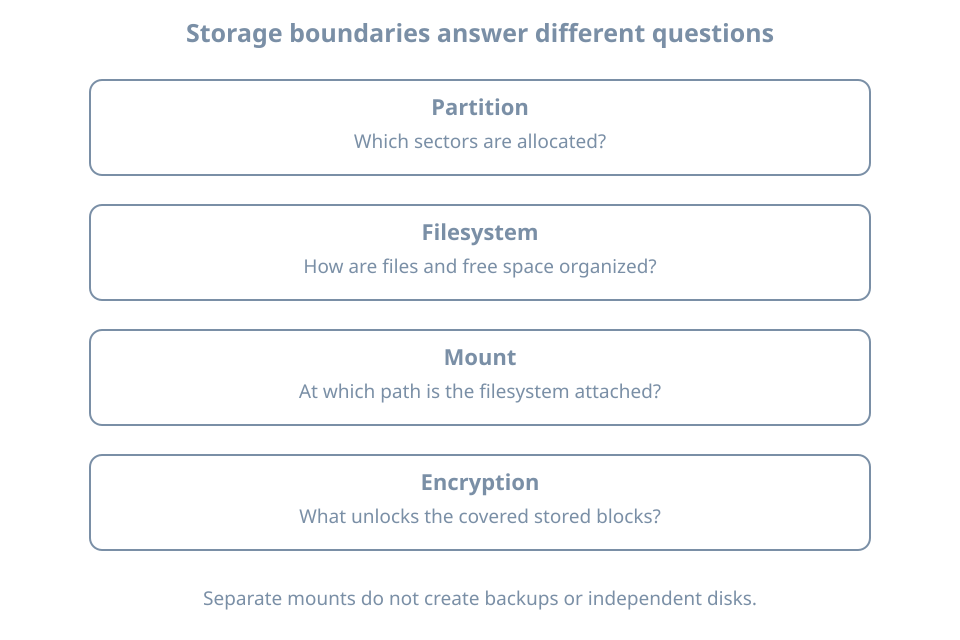

A storage layout is a set of promises: where the machine will find boot files, how much space each workload can consume, what an offline reader can recover, and what the administrator must supply after a restart. The installer can create those objects, but it cannot decide whether the promises suit your workload.

This chapter designs a custom installation on a new disposable guest, `bl02-manual`. Keep `bl01` and the guided `bl02` installation intact. Use the same verified Ubuntu Server 26.04 amd64 media, UEFI settings, two vCPUs, 4096 MiB RAM and setup NAT network as before, with a **new 40-GiB system disk**. Only this guest needs to run during the exercise. Allow host disk capacity for the additional image to grow; a sparse image's small initial file size is not its eventual requirement.

The main lab uses plain partitions so each allocation is visible. Encryption is a separate optional installation experiment, with its own recovery conditions. Do not attempt to convert the existing guided root filesystem in place.

## Start with mount responsibilities

A partition describes a region of a disk. A filesystem gives that region a structure for files. A mount attaches a filesystem to a path in the running system. These three decisions are related but different: naming a directory `/srv` does not create a partition, reserve capacity, or encrypt its contents.

For this exercise, `/srv` will hold a small demonstration file representing future service data. No real service is installed yet. Use this teaching layout:

| Object | Allocation | Purpose |
|---|---|---|
| EFI System Partition | Installer-created; record actual size | UEFI boot files; mounted at `/boot/efi` |
| Root partition | 24 GiB, ext4, mounted at `/` | Operating system, home directory and logs |
| Service-data partition | 8 GiB, ext4, mounted at `/srv` | A separately measurable data filesystem |
| Swap partition | 2 GiB, swap use | A small disk-backed swap area for this lab |
| Unallocated space | Remainder | Visible reserve for a future storage exercise |

The sizes are a lab budget, not a production sizing formula. Account for the ESP, partition-table metadata and alignment before expecting the remainder to equal a particular number. Check how the installer interprets its size units and record the displayed result.

This unencrypted design keeps `/boot` as a directory on the root filesystem. The ESP is still a separate filesystem. A separate `/boot` is useful or necessary for some other boot/storage arrangements; it is not synonymous with the ESP.

### Why separate service data?

A separate filesystem makes its capacity boundary easy to see. If `/srv` fills, it does not consume the free blocks in the root filesystem. However, application logs or temporary files elsewhere can still fill root. Separation also introduces another mount that must succeed and another allocation that can be badly sized.

Consider two imagined workloads:

- A small learning VM with little persistent data benefits from a simple layout and few failure points.
- A server storing growing application data benefits from an explicit data budget, but needs monitoring and a growth/restore plan for that budget.

Neither layout creates redundancy. Both partitions in this lab depend on the same virtual disk and host storage. Deleting that image loses both filesystems.

{fig-alt="Four distinct boundaries: a partition allocates sectors, a filesystem organizes files and free space, a mount attaches that filesystem to a path, and encryption controls access to stored blocks. A separate mount does not imply a separate disk, backup or encryption."}

## Build the custom layout

In Virtual Machine Manager, create `bl02-manual` with the specified resources and fresh disk. Before accepting any installer storage changes, inspect the guest definition on the host:

```bash
sudo virsh --connect qemu:///system domblklist bl02-manual --details
```

Confirm that its writable image is different from both existing guests. Keep only the new disk and installation ISO attached. Record the image path outside the guest, together with the intended layout.

Boot the installer in UEFI mode. At storage selection choose **Custom storage layout**. On the new disk select the boot-device action, inspect the ESP the installer creates, then add the root and `/srv` GPT partitions with the sizes, filesystems and mounts above. Add a 2-GiB partition with swap use. Leave the remainder unallocated. Canonical documents these controls and the automatic ESP creation in its [Subiquity storage guide](https://canonical-subiquity.readthedocs-hosted.com/en/latest/howto/configure-storage.html).

Screen wording can vary with the installer build or refresh. If an action differs, inspect its summary before proceeding. Do not substitute shell formatting commands against a guessed `/dev/vda` to force agreement with the lesson.

Before the final disk-write confirmation, reconcile all four intended objects. There must be exactly one root mount, the intended ESP mount, one `/srv` filesystem, and the selected swap area. Check that the remaining capacity is genuinely unallocated rather than silently absorbed into the last partition. Save the summary outside the guest.

Complete installation with hostname `bl02-manual`, the planned `learner` account and no optional SSH server or software bundles. Detach the ISO at the requested stage and boot from the new disk.

## Verify boundaries rather than partition numbers

In the installed guest:

```bash
hostnamectl
lsblk -o NAME,SIZE,TYPE,FSTYPE,UUID,MOUNTPOINTS
findmnt --mountpoint / --output TARGET,SOURCE,FSTYPE,OPTIONS
findmnt --mountpoint /srv --output TARGET,SOURCE,FSTYPE,OPTIONS
findmnt --mountpoint /boot/efi --output TARGET,SOURCE,FSTYPE,OPTIONS
findmnt --target /boot --output TARGET,SOURCE,FSTYPE,OPTIONS
swapon --show
cat /etc/fstab
```

`--mountpoint` asks for an exact mount. `--target` asks which mounted filesystem contains a path. Thus this design should return a distinct `/srv` mount, while `/boot` should resolve to the root mount. The [findmnt manual](https://man7.org/linux/man-pages/man8/findmnt.8.html) explains the distinction. A missing `/srv` result needs investigation even if the directory exists.

Use your observed device names and UUIDs; partition numbering is not an acceptance criterion. Record the actual swap arrangement too. If the installer also configured a swap file, explain that deviation and its capacity rather than silently claiming the partition is the only active swap.

Compare capacity at the filesystem layer:

```bash
df -h / /srv
df -i / /srv
```

Expect two different filesystem sources. The formatted capacity will differ from the requested partition size. `df -i` counts inodes, the filesystem records needed to represent files; running out of these can prevent creation even with free data blocks.

Create a small acceptance marker only after confirming the exact `/srv` mount:

```bash
printf 'bl02-manual storage acceptance\n' | sudo tee /srv/installation-check.txt
sudo cat /srv/installation-check.txt
```

The shell pipe sends the text to `tee`, which writes it using administrative privilege. There is no need to make all of `/srv` writable by every user.

Reboot through the console, log in again, repeat the exact mount check and read the marker. Persistence of the text proves little by itself: a file accidentally written beneath an absent mount can also survive a reboot. The file and its filesystem source together are the evidence.

## Choose encryption by the recovery requirement

**Block-device encryption** transforms stored blocks so that unlocking material is required to interpret their contents. Linux installations commonly use LUKS, a format that manages encrypted-volume metadata and key slots, together with the kernel's device-mapper encryption facility. An unlocked mapping presents a usable block device to the layers above it.

For an installation using encrypted LVM, a possible data path is:

```text
partition → LUKS container → unlocked mapping → LVM → filesystem → mount
```

Observe the actual order rather than assuming every encrypted system uses this one. Encryption and volume management answer different questions: access to stored blocks versus allocation of capacity.

A passphrase prompt creates an operational dependency. Who can supply it after a power failure? Can that person reach the virtual console? Where is the recovery material stored if the VM or its host is unavailable? Record the answers before installing an encrypted root.

Encryption protects covered data while locked. It does not prevent an authorized process on the running, unlocked system from reading that data. Boot partitions may remain outside that coverage. A host administrator who controls the running VM also occupies a different trust position from someone holding only a powered-off disk image.

### Optional encrypted installation comparison

Use another disposable guest, `bl02-crypt`, with a fresh 40-GiB disk and the same remaining hardware budget. Shut down the other guests if host RAM is limited. In guided storage select LVM and its passphrase encryption option. This is a separate comparison, not a requirement to reproduce the manual partition scheme inside encryption. The [installer storage documentation](https://canonical-subiquity.readthedocs-hosted.com/en/latest/howto/configure-storage.html) describes this guided choice.

Store the unique unlock passphrase in a trusted password manager outside the guest. Do not put it in screenshots, command history or the installation record. Record only where authorized operators retrieve it.

After installation, perform a full shutdown and start through the VM manager. A saved-memory resume does not test an unlock from cold boot. Observe the unlock prompt, supply the passphrase and verify console login. Then inspect:

```bash
lsblk -o NAME,TYPE,FSTYPE,MOUNTPOINTS
sudo cat /etc/crypttab
findmnt --target / --output TARGET,SOURCE,FSTYPE
swapon --show
```

`/etc/crypttab` describes encrypted devices to establish at boot; its fields include the mapping name, source device, key specification and options. It is not a listing of mounted filesystems. See the [crypttab manual](https://man7.org/linux/man-pages/man5/crypttab.5.html). Treat the configuration as sensitive inventory and do not publish any referenced key material.

Draw the root device's ancestry from the observed tree. Identify the unencrypted boot objects separately. This exercise proves the tested passphrase and boot path work; it does not prove recovery from damaged encryption metadata. Keep this guest disposable until a separate backup and recovery design exists.

## Swap is part of the data-protection decision

Swap can contain information from process memory. An encrypted root does not establish that every swap location is encrypted. Trace each active area: a swap file inside a covered filesystem has a different storage path from an independent unencrypted swap partition.

For the main manual lab, the swap partition is deliberately unencrypted and the guest holds no sensitive workload. For the optional encrypted guest, record whether swap is present and where its backing storage sits relative to the encryption layer. Do not assume a swapfile will appear as its own block-device row.

The 2-GiB allocation is simply a bounded lab choice. Production swap sizing depends on workload, memory pressure, storage latency and recovery policy. Hibernation adds requirements for saving and resuming memory state; it is not part of this server VM exercise. No universal multiplier of RAM substitutes for those decisions.

## Diagnose a layout mismatch

| Symptom | Distinguishing evidence | Appropriate next action |
|---|---|---|
| `/srv` exists but exact mount lookup is empty | Compare fstab, UUIDs and current mounts | Preserve evidence; do not start writing service data there |
| `/srv` and `/` show the same source | Exact mount query versus containing-filesystem query | Reconcile the installed layout with the recorded summary |
| Swap report is empty | Compare active state with installer summary and fstab | Record missing activation; avoid inventing a device path |
| Encrypted guest never reaches login unattended | Console shows an unlock prompt | Supply the planned credential; evaluate unattended-boot needs separately |
| Unlock fails after restart | Keyboard layout, selected guest and stored credential | Check identity and input; formatting is not a password-recovery action |
| Partition budget differs | Installer units, ESP allocation, rounding and remaining space | Explain the arithmetic before resizing anything |

An accidentally omitted `/srv` mount can hide a further trap. Files written into the underlying root directory become hidden when another filesystem is later mounted there. They are not automatically transferred into the mounted filesystem. Capture the current state and plan recovery before adding or removing a mount over existing data.

For an installation mistake on this empty teaching guest, recreating its verified disposable disk and reinstalling is a valid reset. First preserve the evidence explaining the mistake. On a populated server, preserving and restoring data comes before repartitioning.

## Practice and acceptance record

1. Install the manual guest and record the accepted storage summary.
2. Explain which objects share the same failure domain despite having separate mounts.
3. Prove `/srv` is a distinct filesystem before and after reboot, and confirm the marker's contents.
4. Record active swap, root free space and the unallocated reserve at their respective layers.
5. If you completed the encryption extension, demonstrate a cold-boot unlock and identify what remains outside encryption.

Keep the manual guest powered off as comparison evidence, or retire it using the VM manager after saving the record. Before deleting any image, verify its path is the one assigned to this guest. Continue the next chapter on the guided `bl02` installation.

## Recall card

- A path, a mount, a filesystem and a partition are different objects.
- Separate capacity is useful only when its size and mount lifecycle fit the workload.
- Encryption adds an unlock and recovery dependency; it does not create a backup.
- Swap protection follows its backing storage, not the hostname's security label.
- Accept the installed layout using observed sources and a reboot, not installer intent alone.
