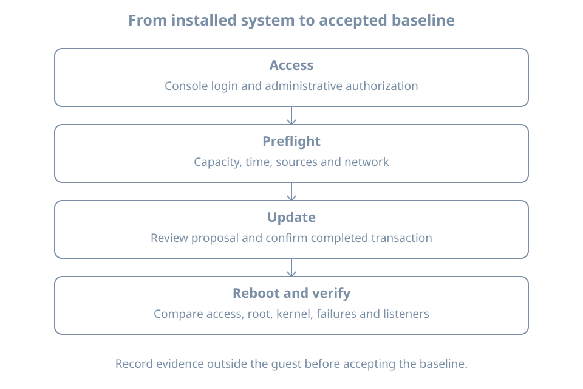

An installation can reach a login prompt while still lacking a working update path, carrying a failed service, or exposing an unintended listener. First-boot administration turns “it starts” into a small set of demonstrated operating conditions.

Return to the guided `bl02` guest from Installation Foundations. Keep console access, the recorded disk identity and the setup NAT network. This chapter updates that disposable guest and reboots it. Keep `bl01` and its baseline unchanged. The manual-storage comparison guest can remain powered off.

The result will be an acceptance record: working administrative access, a reviewed package transaction, a verified reboot and an explained service/listener inventory. Detailed account policy and package management come later; this chapter supplies the steps needed to establish the initial host.

## Prove access before changing software

Open the VM console and log in as `learner`. Confirm identity:

```bash
hostnamectl
cat /etc/os-release
id
sudo -l
sudo id -u
```

The hostname should be `bl02`. `id` describes the current account and groups; `sudo -l` reports its permitted administrative commands. The final command should print `0` if policy allows it, demonstrating that this invocation ran with root's numeric user ID. Group membership by itself is not a complete policy test.

If authentication or authorization fails, stop the update workflow. Check the selected guest, username and keyboard layout first. Preserve the exact error. Use a separately established administrator or the documented lab recovery route if available. Do not weaken policy globally to obtain a successful-looking test. On this fresh disposable guest, a documented reinstall is preferable to improvising an untracked privilege bypass.

Create a private notes directory in the guest:

```bash
umask 077
mkdir -p "$HOME/first-boot-record"
date -Is > "$HOME/first-boot-record/started.txt"
uname -r > "$HOME/first-boot-record/kernel-before.txt"
cat /proc/sys/kernel/random/boot_id > "$HOME/first-boot-record/boot-id-before.txt"
```

`umask 077` restricts permissions on newly created files and directories in this shell. It does not repair permissions on pre-existing files. The boot ID identifies this boot instance; it is different from the installed machine's persistent identity. Copy the final notes outside the guest using the lab's established evidence procedure. A record only on the failed disk is a poor recovery aid.

## Establish an update preflight

Check the resources and dependencies the package transaction needs:

```bash
df -h / /boot /boot/efi
df -i /
ip -brief address
ip route
timedatectl status
```

The filesystem checks identify available capacity and inode pressure. The network commands show interface addresses and routes, not proof that a repository is reachable. `timedatectl` reports the clock and available synchronization status. An obviously wrong clock can affect validation and confuse the evidence timeline; establish correct time before interpreting expiry errors.

Inspect configured APT sources without changing them:

```bash
ls -l /etc/apt/sources.list.d
sudo cat /etc/apt/sources.list.d/ubuntu.sources
```

If this file is absent, inspect the actual source files listed in that directory and `/etc/apt/sources.list` if present. Newer installations commonly use deb822 `.sources` files; imported configurations can use `.list` entries. Record the configured release suites and repository locations. A suite is a named collection of packages, such as a release's main or update collection. Do not paste an example from another Ubuntu release into this guest.

The [Ubuntu package-management guide](https://ubuntu.com/server/docs/how-to/software/package-management/) describes source configuration and package administration. Review local source content before sharing it: private mirror URLs or proxy configuration may disclose internal information.

{fig-alt="The first-boot workflow moves through proven console and administrator access, storage/network/time preflight, reviewed package updates, and a normal reboot. Final checks compare access, running kernel, failures and listeners before recording an accepted baseline."}

## Refresh metadata and review the transaction

Run these commands one at a time and read each result:

```bash
sudo apt update
apt list --upgradable
sudo apt --simulate upgrade
```

`apt update` refreshes repository metadata; it does not install upgrades. If it reports failed downloads or validation errors, do not treat a partial refresh as a clean result. Keep the error and investigate before proceeding.

The simulation previews proposed package changes without applying them. Review package names, download size, disk-space impact and any packages left unchanged. A simulation is a plan against the current state, not a reservation: another package job can change that state before the real transaction.

When the plan is understood, run:

```bash
sudo apt upgrade
```

Read the actual confirmation before accepting. This command can install new dependencies but does not remove installed packages to satisfy an upgrade. `full-upgrade` has different removal behavior; do not switch to it simply to make a pending count disappear. These distinctions are documented in Ubuntu's [apt manual](https://manpages.ubuntu.com/manpages/resolute/man8/apt.8.html).

Allow the command to complete. Package hooks can update boot artifacts or restart services. If a configuration-file question appears, inspect the proposed difference and record your decision; there is no universal answer that fits both a fresh file and a deliberately customized one.

Review the final result and package history:

```bash
sudo tail -n 80 /var/log/apt/history.log
sudo tail -n 80 /var/log/apt/term.log
sudo dpkg --audit
```

History records package operations; the terminal log supplies transaction detail. The [dpkg manual](https://manpages.ubuntu.com/manpages/resolute/man1/dpkg.1.html) defines the audit of package-database consistency and partial installation state. A clean audit normally produces no output, but that alone does not prove every application works. Keep both the transaction result and the post-reboot checks.

### An automatic update may already be running

A fresh host can have background package activity. Inspect it before assuming a lock is stale:

```bash
systemctl list-timers --all --no-pager
systemctl status apt-daily.service apt-daily-upgrade.service --no-pager
sudo journalctl -b -u apt-daily.service -u apt-daily-upgrade.service --no-pager
```

A scheduled timer, an active job and a completed update are different observations. A lock error should lead to identifying the current package process and waiting for legitimate work to complete. Deleting a lock file or killing an updater can turn harmless serialization into damaged state. If work appears stuck, preserve its status and logs before choosing recovery.

Inspect the installed automatic-update configuration separately:

```bash
apt-config dump | grep -E 'APT::Periodic|Unattended-Upgrade'
```

No matching lines is an observation, not a reason to invent defaults. Canonical's [automatic-updates guide](https://ubuntu.com/server/docs/how-to/software/automatic-updates/) describes the settings and logging. Record whether unattended installation and automatic reboot are configured; an enabled update timer does not alone establish either policy. This first-boot pass leaves policy changes for the dedicated package chapter.

## Inventory what the machine is running

Collect four views before reboot:

```bash
systemctl --failed --no-pager
systemctl list-units --type=service --state=running --no-pager
systemctl list-unit-files --type=service --no-pager
sudo ss -lntup
```

These views answer different questions:

| View | Question |
|---|---|
| Failed units | What has entered a failed state? |
| Running services | Which service units are currently running? |
| Service unit files | What service definitions and enablement states exist? |
| Listening sockets | Which TCP listeners and UDP endpoints are bound? |

Enabled does not mean running. An inactive service may be started on demand; a successful one-shot job can finish without remaining running. The [systemctl manual](https://www.freedesktop.org/software/systemd/man/latest/systemctl.html) defines these states and listings. Do not enable every inactive unit or clear failure records merely to make the inventory look healthy.

In `ss`, `-l` selects listening sockets, `-n` keeps numeric addresses and ports, `-t` and `-u` select TCP and UDP, and `-p` requests process details. Root privilege helps reveal ownership. A loopback address such as `127.0.0.1` limits that binding to local access; a wildcard address can accept traffic on more interfaces, subject to routing and policy. A socket listing is not a remote reachability test. The [ss manual](https://man7.org/linux/man-pages/man8/ss.8.html) documents the filters and process reporting.

For this console-only installation, an SSH listener is an unexpected finding to explain. Check package/service choices and any socket activation rather than assuming a port number alone identifies the application. NAT does not make every guest listener irrelevant to other guests or the host.

For each unexpected item, record its name, purpose, owner and evidence before deciding whether to change it. This avoids disabling a service that provides the network or other dependency used by the current investigation.

## Reboot and repeat the acceptance checks

Inspect Ubuntu's reboot-request marker if present:

```bash
if test -f /run/reboot-required; then
  cat /run/reboot-required
  if test -f /run/reboot-required.pkgs; then
    cat /run/reboot-required.pkgs
  fi
fi
uname -r
```

An installed kernel package and the running kernel are different states. The marker is a useful package-maintenance signal, not a complete certification that no restart is needed when absent. For this lab, perform one planned reboot after the successful update transaction regardless, with the console open:

```bash
sudo systemctl reboot
```

Wait for normal startup and log in again. Then inspect:

```bash
hostnamectl
sudo id -u
uname -r
cat /proc/sys/kernel/random/boot_id
findmnt --target / --output TARGET,SOURCE,FSTYPE,OPTIONS
systemctl --failed --no-pager
sudo ss -lntup
```

Compare the boot ID with the saved value: it should have changed. Compare the kernel with `kernel-before.txt`: it may remain the same if this transaction installed no different kernel. Do not invent an expected version number. Root must still resolve to the intended installed storage, administrative access must work, and any new failures or listeners need explanation.

## Worked diagnosis: repository refresh fails

Suppose the console works but `apt update` reports a name-resolution failure. The evidence points to an update dependency before any package upgrade has started.

1. Preserve the exact repository hostname and error from the output.
2. Inspect the guest NIC and default route using the preflight commands.
3. Run `getent hosts` followed by that **actual hostname**, without the URL scheme or path. This asks the configured host-lookup system for its addresses.
4. Check the VM manager's network attachment against the recorded setup NAT network.
5. If the guest was deliberately moved to the isolated network, restore the planned setup attachment and repeat the checks.

A successful lookup only narrows the problem: proxies, transport access, repository availability and signature validation can still fail. A signature error with successful network access calls for checking time, source identity and trust configuration, not disabling authentication. After correcting the identified cause, repeat `apt update` and require a clean result before reviewing an upgrade.

For a failed reboot, keep the console message and identify whether firmware, the bootloader, early startup or the normal service manager is visible. Avoid repeated forced resets. Use the known baseline to restore this disposable lab if necessary, recording that updates applied after that baseline will need to be repeated. A checkpoint restores captured state; it is not equivalent to a package-by-package downgrade.

## Practice and acceptance record

Complete a table with observed results:

| Acceptance item | Evidence to retain |
|---|---|
| Correct guest and administrator | Hostname, selected VM, successful policy test |
| Update prerequisites | Capacity, time, network attachment and sources |
| Package change | Reviewed proposal, completion result and history |
| Normal restart | New boot ID and observed console login |
| Intended root | Mounted source and filesystem |
| Services and endpoints | Explained failed units and listeners |
| Recovery | Location of baseline and notes outside the guest |

An unresolved failure belongs in an open-issues entry, not in an accepted baseline. Once checks pass, shut down normally and use the checkpoint method established in the lab chapter to label this state `bl02-first-boot-accepted`. Retain the earlier baseline until the new one has been verified. Keep credentials out of the label and notes.

As a bounded exercise, disconnect the setup NIC in the VM manager while retaining console access. Observe the changed address/route state and failed repository access, then restore the same attachment and verify a clean metadata refresh. Do not start an upgrade while connectivity is intentionally broken. The success criterion is a documented fault, its discriminating evidence and demonstrated restoration.

## Recall card

- Test administrative access before making changes that depend on it.
- Metadata refresh, package installation and activation after reboot are separate steps.
- Review update errors and lock ownership before attempting repair.
- Running, enabled, listening and remotely reachable are different claims.
- Accept the baseline only after a normal reboot and repeated checks.
