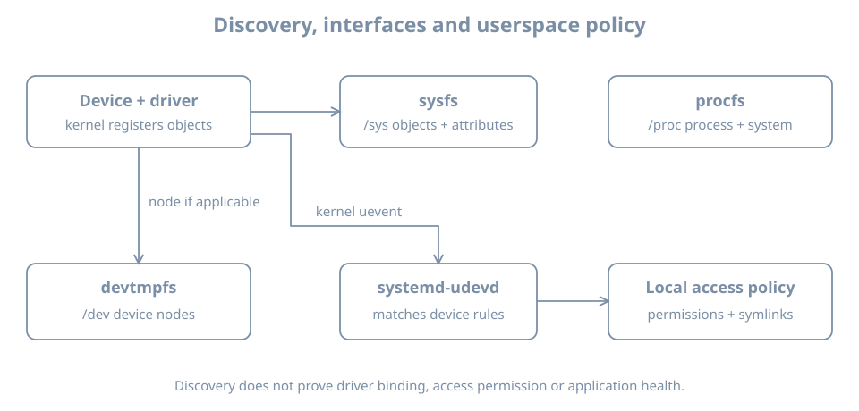

A network interface is missing after installation. Is the virtual NIC absent from the guest, present but unsupported, waiting for firmware, or working without the expected network configuration? Those are different failures. Start with the boundary at which the evidence stops, then investigate that boundary.

This chapter follows a device from its presentation to Linux through driver binding and the interface visible to an administrator. The main lab adds and removes a **second virtual NIC** on the disposable `bl02` guest, using its graphical console for access. It does not disconnect the original NIC, change the system disk or install third-party drivers. You need the first-boot acceptance record, the isolated `blpractice` network from the lab setup, and enough host memory to run `bl02` alone. The optional firmware investigation uses evidence from whatever hardware is available; the virtual NIC is not expected to require a downloadable firmware file.

## From presentation to usable interface

A physical bus exposes devices and identifying information to the kernel. In a VM, the hypervisor presents virtual hardware according to the guest definition. A virtual NIC may be backed by a host network, but the guest sees the virtual device model, not necessarily the physical NIC in the host. A **driver** is kernel code that knows how to operate a device. Driver binding associates a discovered device with a suitable driver; the driver probes and initializes it. The [kernel driver-model documentation](https://www.kernel.org/doc/html/latest/driver-api/driver-model/binding.html) explains matching and binding.

After successful initialization, the kernel can expose an interface such as a network device or a block device. `/sys` gives a view of kernel objects and their relationships. Device events can reach `systemd-udevd`, which applies userspace rules and stores properties. Some devices also have nodes under `/dev`; network interfaces normally do not need a `/dev` node. The [udevadm manual](https://manpages.ubuntu.com/manpages/resolute/man8/udevadm.8.html) describes querying the udev database.

{fig-alt="Kernel device and driver objects appear in sysfs. For applicable devices, devtmpfs supplies device nodes; kernel events reach systemd-udevd, which can apply local permissions and symbolic links. Procfs supplies a separate process and system view. A discovered object does not by itself prove the device or its application works."}

There is no guarantee that each step succeeds. A device can appear on a bus with no bound driver, bind while failing a later function, or provide a working interface whose network configuration is wrong. A readable device node does not prove its application-level use is correct.

## Establish what the guest sees

Start `bl02` with its original setup NIC and open its console. Confirm the guest and running kernel:

```bash
hostnamectl
uname -r
ip -brief link
ip -brief address
lsblk -o NAME,SIZE,TYPE,FSTYPE,MOUNTPOINTS
```

Record the original interface name and hardware address from `ip -brief link`. The address here is the link-layer MAC address, not the IP address. Record the root disk and current mounts from `lsblk`, but do not assume a particular `/dev/vdX` name or change any disk.

For PCI devices, use these commands if `lspci` is installed:

```bash
lspci -nn
lspci -nnk
```

`-nn` shows numeric vendor and device identifiers as well as names where available; `-k` adds driver information. The [Ubuntu lspci manual](https://manpages.ubuntu.com/manpages/resolute/man8/lspci.8.html) defines the options. A missing utility means this view is unavailable, not that no PCI devices exist. If the lab has a working setup network, you can inspect the package proposal with `apt show pciutils` and `sudo apt --simulate install pciutils`, then install `pciutils` with `sudo apt install pciutils` after reviewing it. If the network is unavailable, continue with the views already present and record that limitation.

In `lspci -nnk`, **Kernel driver in use** is evidence of a bound driver for the listed PCI function. **Kernel modules** lists candidates, not a promise that each candidate is active. A built-in driver may be in use without appearing in `lsmod`; `lsmod` lists loaded modules, not all code built into the running kernel.

For USB devices, `lsusb`, when available, supplies another bus view. A USB device will not necessarily appear in the PCI listing. Conversely, a virtual NIC can appear behind a virtual transport and have additional objects in the kernel hierarchy. Select the bus relevant to the actual device instead of treating one command as an inventory of everything.

## Connect an interface to its kernel and udev records

Substitute the actual original interface name for `INTERFACE` below. `lo` is the local loopback interface and is not the virtual NIC in this exercise. Use the selected name as one shell variable so the commands inspect the same object:

```bash
IFACE=INTERFACE
ip -details link show dev "$IFACE"
readlink -f "/sys/class/net/$IFACE/device"
udevadm info --query=property --path="/sys/class/net/$IFACE"
```

For example, replace `IFACE=INTERFACE` with `IFACE=enp1s0` only if that is the name actually observed. The link details show the interface's current state and MAC address. The sysfs link points towards its underlying device hierarchy; the resulting path depends on the driver and transport. `udevadm info` reports properties known to udev. An absent property or path is evidence to investigate, not proof that every device on the bus is missing.

If available, inspect the driver associated with the network interface:

```bash
ethtool -i "$IFACE"
```

`ethtool` may not be installed; record that and use the sysfs and PCI views. On a layered virtual device, the network interface's driver can differ from the driver shown for its parent PCI function. Follow the sysfs path instead of declaring a contradiction from two different layers. The reported driver version or firmware version can be empty or uninformative on virtual devices.

Check the kernel messages for the current boot:

```bash
sudo journalctl -k -b --no-pager | grep -Ei 'firmware|virtio|network|error|fail'
```

This filtered view is a starting point, not a complete diagnostic. It can return no lines or unrelated warnings. The pipeline's exit status can be nonzero when `grep` finds no matches. Look at the surrounding unfiltered journal for the actual device and time before attributing a line to your interface. Keep the complete relevant messages, including device identifiers, when saving evidence.

## Distinguish driver code from device firmware

**System firmware**, such as UEFI, starts the machine and participates in boot. **Device firmware** can be code or data that a driver requests for a device after the kernel starts. The [kernel firmware documentation](https://docs.kernel.org/driver-api/firmware/introduction.html) describes these requests, which can include optional data as well as required firmware.

A missing-firmware message does not automatically mean that the missing file caused the symptom. Establish the exact filename, device, driver and whether the subsequent initialization failed. Some drivers request alternatives or optional files. Conversely, no matching log line does not prove that all firmware dependencies are satisfied.

On Ubuntu, investigate the installed files and package ownership before changing anything:

```bash
dpkg-query -W linux-firmware
apt-cache policy linux-firmware
```

If the package query reports that the package is absent, record that rather than assuming all devices need it. Package availability and versions depend on enabled sources and updates. For a filename actually reported in the log, inspect the path and ownership **after** identifying the file on the host. For example, with the observed absolute path substituted for `/actual/path/to/file`:

```bash
ls -l /actual/path/to/file
dpkg-query -S /actual/path/to/file
```

The owner query can identify an installed package providing an existing path; a missing path has no installed owner to report. Do not copy an arbitrary binary from a forum or change module policy just to suppress a message. Check the distribution's package, the hardware/vendor documentation and the running kernel's support for that exact device. Package installation is a change: review its source and proposed transaction, retain console access and plan the required restart if the documented remedy calls for one.

For a boot-critical storage device, missing support can prevent reaching the installed root at all. That is a different recovery context from a missing secondary network interface: preserve the boot console message, use known-good recovery media and avoid changing the only working boot path during this lab.

## Lab: add a second virtual NIC and observe its lifecycle

The experiment tests **presentation and enumeration**, not Internet connectivity. It needs no packet exchange and does not require configuring the new interface. The original NIC remains attached as recorded; the second NIC connects only to `blpractice`, the host-local practice network. That network includes the host and any attached guests; it is not an Internet connection and does not protect against a compromised host.

1. Save the initial `ip -brief link` output. On the host run `sudo virsh --connect qemu:///system domiflist bl02` and save its output. Ensure the accepted `bl02` baseline is available and the console works.
2. Shut `bl02` down cleanly. In Virtual Machine Manager, add a **second** network interface using the `blpractice` virtual network. Select a model supported by your installation, such as virtio, if the manager offers it. Do not edit the original NIC, system disk, firmware or boot order. Apply the change while the guest is off.
3. On the host inspect the persistent guest definition and record both MAC addresses, models and network sources:

```bash
sudo virsh --connect qemu:///system dumpxml --inactive bl02
```

Find the two `<interface>` elements; identify the added one by its `blpractice` source and MAC address. Domain XML can contain host paths and other local details, so redact before sharing. Do not run both cloned guests at once merely to compare them: their guest identities were copied.

4. Start `bl02`, log in through the graphical console and inspect:

```bash
ip -brief link
ip -brief address
lspci -nnk
sudo journalctl -k -b --no-pager | grep -Ei 'virtio|network|firmware|fail'
```

Omit `lspci` if the utility is unavailable and note the missing view. Match the new guest interface to the recorded MAC address. Names and PCI addresses can vary. The interface can be administratively down and have no IP address; either is compatible with successful enumeration. If it has an address, record it, but do not infer that it has an Internet route.

5. Substitute the **new** interface name in the `IFACE` commands from the earlier section. Record its sysfs path, udev properties and, if available, `ethtool -i` driver. Compare the two interfaces by MAC address rather than by guessed names. If the new MAC is not visible, use the diagnosis table before making changes.
6. Shut down the guest, remove only the added NIC in Virtual Machine Manager, and apply the change. Inspect the inactive XML again to verify the original NIC and its original network source remain. Restart and confirm the original console login and NIC, and that the added MAC no longer appears in `ip -brief link`. Do not remove a disk or delete a network definition during cleanup.

The success record has a before/after MAC list, the second interface's observed driver or a stated observation limit, and a cleanup check. Rebooting after removal tests the persistent guest definition. If the original guest configuration has been altered unexpectedly, stop and reconcile it with the accepted baseline before proceeding.

### A worked diagnosis: the new NIC is not in `ip link`

Suppose the manager shows an added NIC, but the guest lists only the original one and loopback. First compare the host's **inactive** definition with the configuration you intended and check that the VM was restarted after applying the change. A pending persistent change is not evidence that the currently running guest has received it; the live definition can be inspected with `sudo virsh --connect qemu:///system dumpxml bl02` while running.

If the NIC is present in the running definition, inspect `lspci -nnk`, the kernel journal and sysfs. A new PCI function without a driver suggests a different next investigation from no new bus object at all. If there is a bus object and a driver but no expected interface, inspect probe messages and the actual device hierarchy. If the interface appears with a different name, the recorded MAC resolves the identity without changing network settings.

A driver binding is still not an end-to-end network test. A bound NIC with no IP address may simply lack configuration or a reachable address server. Configuration, routing and network services have their own evidence and are developed later.

## Common observations and next questions

| Observation | What it supports | Next question |
|---|---|---|
| Device absent from guest bus inventory | No matching object in that particular view | Is it present in the running VM definition, and is this the correct bus? |
| PCI device listed without driver in use | Enumeration occurred; binding is not shown | Does the running kernel support the numeric ID, and what does the journal report? |
| Firmware request failed | A driver requested a file | Was the file required, and did initialization of this device fail? |
| Interface exists but no IP address | The network interface was registered | Is it up and configured, and is the intended network available? |
| Device appears only after restart | Persistent configuration differed from running state | Was the intended hardware change applied to the live guest? |
| Device works but a user cannot open it | Kernel registration alone is insufficient | Which node, permissions and process identity apply to this device? |

Avoid testing by unbinding a root-disk driver, removing a production NIC, or repeatedly loading random modules. Record the observed boundary, form a specific hypothesis and choose a reversible test that does not cut off the recovery path.

## Acceptance and recall

Save the host definition evidence and guest observations outside the VM, redacting MAC addresses, serial numbers or host paths before sharing as appropriate. The original NIC should be restored and usable, the added NIC removed, and the original root disk still mounted. Note any unresolved driver or firmware question rather than marking it fixed from a package name alone.

- A VM exposes its configured virtual hardware; host hardware inventory is a different view.
- Enumeration, driver binding, device initialization and working configuration are separate claims.
- `/sys`, udev, bus listings and the journal show different evidence about the same device.
- A firmware request must be tied to an actual device and failure before choosing a remedy.
- Use a MAC address and before/after observations to identify the experimental NIC and verify cleanup.
