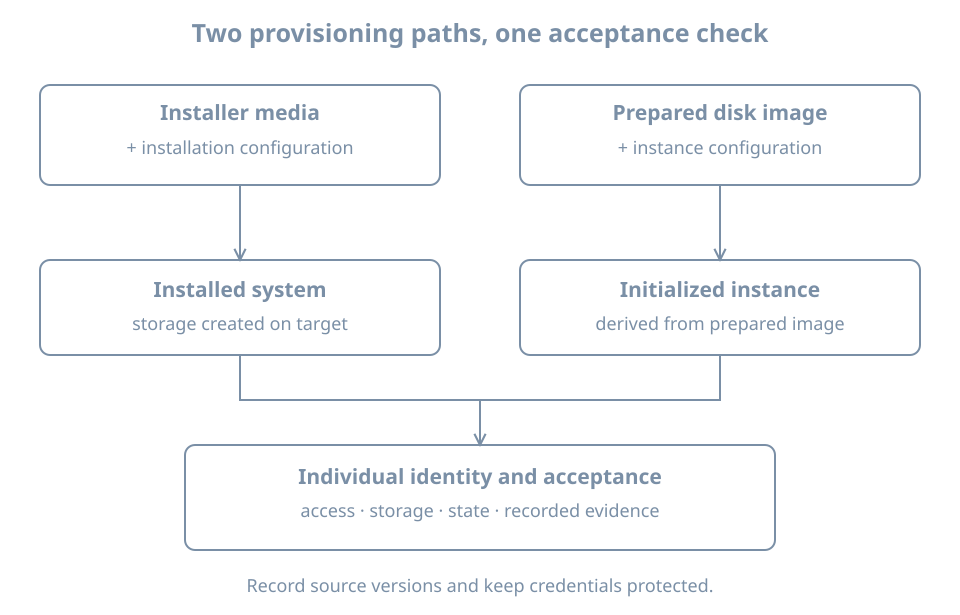

A manual installation records decisions in a person's actions. A reproducible installation records them in inputs that can be reviewed, delivered to the right machine and checked against the resulting system. Automation makes repetition easier, but also repeats mistakes quickly: a configuration that selects the wrong disk can destroy the wrong system just as consistently.

This chapter compares a prepared image with an unattended installer. Then you will create a local configuration seed for the Ubuntu Server installer and apply it to a **new disposable** VM, `bl02-auto`. The example intentionally retains the installer's destructive-action confirmation. It automates the installation choices while keeping a human at the disk-write boundary.

You need the verified Ubuntu Server 26.04 amd64 installer ISO used earlier, working console access, a setup NAT network, host space for another 32-GiB virtual disk and a small seed ISO, and the ability to create a VM in Virtual Machine Manager. Use two vCPUs and 4096 MiB RAM, as for `bl02`. Keep `bl01`, `bl02` and their baseline disks untouched. Only the new guest needs to run during this exercise.

## Two ways to produce a machine

An **installation image** contains an installer and a source from which an operating system can be assembled onto a target. An **autoinstall configuration** answers installer questions about that target. The installer still creates partitions, installs files and configures the system. The input file is not itself an installed disk.

A **prebuilt machine image**, in contrast, already contains an operating-system filesystem and boot configuration in a disk image. A provisioning system creates an instance from that image and applies instance-specific information such as hostname, credentials and network settings on first boot. The image must match the platform, architecture and boot method; merely copying the installer ISO does not make it a bootable installed disk.

| Decision | Installer with configuration | Prebuilt machine image |
|---|---|---|
| Base | Installer media and package sources | Prepared filesystem and bootable disk |
| Target storage | Created during installation | A new disk or copy derived from the image |
| Host-specific inputs | Installer configuration and, optionally, later first boot | Instance metadata and first-boot configuration |
| Evidence | Installer result, logs and installed state | Image provenance, initialization result and instance state |
| Recovery concern | Reproduce inputs and preserve data before reinstalling | Keep a trusted base and separate persistent data/identity |

An image can speed up deployment, but image age matters: an old image still requires a patch and acceptance process. An installation that uses a live repository may resolve different package versions on different dates even when its configuration is unchanged. Reproducibility requires recording media, configuration, sources and results, not just retaining one YAML file.

{fig-alt="One path combines installer media and installation configuration to create an installed system. Another starts with a prepared disk image and instance configuration. Both paths require a unique host identity, first-boot checks and a recorded acceptance result."}

## Identity is not the same as a disk copy

The recovery clone in the first lab deliberately copied an existing machine, including its guest identity and credentials. It was kept powered off and used one copy at a time. A machine intended to run as an independent instance needs its own hostname, machine identity, credentials, network attachment and, when used, SSH host keys. A distinct VM name or MAC address does not by itself replace everything stored inside the guest disk.

Cloud images commonly use **cloud-init**, which reads an instance's configuration from a datasource and runs initialization stages. Its [first-boot explanation](https://docs.cloud-init.io/en/latest/explanation/first_boot.html) describes how cached state and instance IDs influence whether per-instance configuration runs. Copying an initialized disk and simply changing a name is not a complete image-preparation procedure. Do not run `cloud-init clean` on the existing lab hosts as a shortcut; it changes state and must be part of a deliberate image lifecycle.

An installer has its own context. Cloud-init can deliver data **to the live installer**, while Subiquity interprets the nested `autoinstall` configuration; cloud-init on the eventual installed system has its own first-boot role. Canonical's [interaction guide](https://canonical-subiquity.readthedocs-hosted.com/en/latest/explanation/cloudinit-autoinstall-interaction.html) explains the distinction. A successful installer-data read alone is not proof that every target-side initialization step succeeded.

## Prepare a local installer seed

A **seed** is a small source of provisioning data. This lab uses a local NoCloud seed ISO, attached separately from the verified server installer ISO. It avoids depending on a configuration web server. The seed contains a password hash, so keep its files and disk image private; a hash is still sensitive because an attacker can attempt offline guesses.

On the **host**, in a private shell session, create a working directory and check for the required utilities:

```bash
umask 077
mkdir -p "$HOME/bl02-auto-seed"
cd "$HOME/bl02-auto-seed"
command -v cloud-localds
command -v openssl
```

If `cloud-localds` is unavailable on an Ubuntu host, inspect `apt show cloud-image-utils` and `sudo apt --simulate install cloud-image-utils`, then install it with `sudo apt install cloud-image-utils` after reviewing the proposal. On another host distribution use its package documentation or prepare the seed on a trusted Linux machine. `openssl` must also be available. Do not put the seed on a shared web server.

Create a **unique lab password** and keep it in your password manager. In the terminal run:

```bash
openssl passwd -6
```

Enter the password at the prompts; this generates a salted SHA-512 password hash without placing the plaintext on the command line. The terminal will display the hash. Do not use a production password, paste the hash into a public issue, or record it in shell history. Keep console scrollback private as well.

Create `user-data` in your editor with the following content. Replace the entire `REPLACE_WITH_HASH` string with the generated hash, keeping the single quotes around it. Do not include the plaintext password.

```yaml
#cloud-config
autoinstall:
  version: 1
  identity:
    hostname: bl02-auto
    username: learner
    password: 'REPLACE_WITH_HASH'
  storage:
    layout:
      name: direct
  ssh:
    install-server: false
  shutdown: poweroff
```

The first line marks cloud-config data. `autoinstall` contains the installer's instructions; indentation is significant. The `identity` section establishes the initial account. The direct storage layout installs to the selected disk without the guided LVM layer used on `bl02`. It **replaces data on that disk**. The SSH server is not requested by this configuration; verify actual listeners later. The completion action asks the installer to power off so the media can be detached before the next boot. These settings are described in the [autoinstall reference](https://canonical-subiquity.readthedocs-hosted.com/en/latest/reference/autoinstall-reference.html).

Create the required metadata file and the seed image:

```bash
printf 'instance-id: bl02-auto-installer-01\n' > meta-data
cloud-localds seed.iso user-data meta-data
ls -l user-data meta-data seed.iso
```

The `instance-id` labels this installer instance's seed. It is not a substitute for the installed system's machine ID or a universal identity-reset mechanism. If repeating the exercise on a new target, use a distinct seed instance ID and hostname. The [NoCloud datasource reference](https://docs.cloud-init.io/en/latest/reference/datasources/nocloud.html) describes the local data source, and the [installer quick start](https://canonical-subiquity.readthedocs-hosted.com/en/latest/howto/autoinstall-quickstart.html) demonstrates `cloud-localds` for installer data.

Run these commands in the private directory. `umask` affects files created in the current shell; if the directory or files existed already, inspect their permissions explicitly. Any user who can read `seed.iso` can extract its configuration. Restrict directory traversal and grant the libvirt/QEMU process only the access needed for this lab; the exact file permissions and access-control rules depend on the host. If the VM manager cannot open the file, use a suitable private libvirt storage location or its documented access controls rather than making the directory world-readable. Record the seed path, but not its contents or hash in shared notes.

### Review before allowing writes

Check the exact `user-data` file in your editor for the header, indentation, hostname, username, quoted hash, direct layout and poweroff. Check there is no remaining placeholder. If you have a matching Subiquity source checkout and its validator dependencies, Canonical provides [pre-validation instructions](https://canonical-subiquity.readthedocs-hosted.com/en/latest/howto/autoinstall-validation.html). A schema check cannot prove that the intended disk is attached or that runtime installation will succeed. Never execute an unfamiliar installer configuration or its commands without reviewing them.

This minimal configuration omits explicit network, mirror, locale and keyboard settings. Installer defaults and network access can affect the result. Record the installer image/build, network and source observations; do not claim byte-identical reproduction across different runs. The chapter's scope is an introductory seed, not a fleet policy.

## Install on a new, single-disk guest

In Virtual Machine Manager create `bl02-auto` with UEFI, the resource budget above, one **new 32-GiB writable system disk**, the verified server installer ISO and the setup NAT network. Choose to review hardware before installation. Add `seed.iso` as a second read-only CD-ROM. Both optical images are sources; neither is the writable target disk. If your manager cannot add a second optical device, follow Canonical's local-seed workflow using a supported virtual-machine interface and keep the same disk isolation conditions.

Before booting, inspect the selected VM on the host:

```bash
sudo virsh --connect qemu:///system domblklist bl02-auto --details
sudo virsh --connect qemu:///system domiflist bl02-auto
```

Confirm exactly one writable guest system disk, its new host path, both intended optical sources and the expected NIC source. Verify that no disk from `bl01`, `bl02`, a baseline or your host filesystem is attached. A new VM name is not evidence of a new disk. If the seed cannot be read because of host permissions, fix access to the intended file and recheck the definition; do not select a different disk as a workaround.

Boot the **server installer ISO** through the graphical console, leaving the seed attached. Do **not** add the `autoinstall` kernel parameter in this exercise. With the local configuration detected, the installer should ask for confirmation before modifying a disk; this behavior is described in the [local-volume quick start](https://canonical-subiquity.readthedocs-hosted.com/en/latest/howto/autoinstall-quickstart.html). The parameter suppresses that confirmation, so it is deliberately omitted.

At the confirmation, stop and reconcile the actual target with the host-side single-disk record. The direct layout's default selects the largest eligible disk. With only one writable system disk this is bounded, but “largest” is unsafe as a general selection rule on a multi-disk machine. If the target is ambiguous, cancel and investigate; validation of the YAML does not validate the target. After confirming the disposable target, allow installation to continue and observe its outcome.

If the usual full interactive installation screens appear instead of an autoinstall confirmation, the installer may not have received the seed. Stop and investigate the seed attachment and format before making storage changes. If installation fails after confirmation, the disk may already be partially written. Preserve the relevant error and treat the target as changed.

## Detach sources and verify the result

After the installer reports completion and powers off, remove both the installer ISO and seed ISO from this guest's virtual optical devices, leaving its system disk and NIC in place. Inspect `domblklist` again, then boot the installed disk. Log in at the console as `learner` with the lab password.

Collect the following evidence inside `bl02-auto`:

```bash
hostnamectl
cat /etc/os-release
uname -r
id
sudo -l
sudo id -u
lsblk -o NAME,SIZE,TYPE,FSTYPE,MOUNTPOINTS
findmnt --target / --output TARGET,SOURCE,FSTYPE,OPTIONS
systemctl --failed --no-pager
sudo ss -lntup
```

The hostname should be `bl02-auto`; administrative access should work according to the intended policy; root should be on the newly installed disk. Compare the actual partition and filesystem layout with the direct-layout intent and with `bl02`'s recorded LVM layout. Names and sizes are observations, not fixed strings to copy from this book. Investigate unexpected failures or listeners before accepting the host.

If `cloud-init` is installed on the target, inspect its own status and logs without assuming that they are the installer's logs:

```bash
cloud-init status --long
sudo journalctl -b -u cloud-init-local.service -u cloud-init.service -u cloud-config.service -u cloud-final.service --no-pager
```

Service names or available output can differ; record unavailable views. A status indicating completion does not prove all application requirements. The installer's own records are typically under `/var/log/installer/` on an installed Ubuntu system. Inspect filenames before reading them; generated installation records can contain credential hashes, network details or other sensitive inputs. Restrict access and redact before sharing.

Perform the first-boot update and reboot checks established earlier when this guest is going to be kept. Keep the acceptance record outside the VM. Detaching the seed prevents accidental reuse at the next boot; it does not securely erase the seed or any installer logs copied into the guest.

## Diagnose by stage

| Observation | Check | Recovery direction |
|---|---|---|
| Installer starts interactively | Both optical sources, seed contents, `#cloud-config` header and `autoinstall` indentation | Correct the seed, rebuild it and boot the disposable target again |
| Cannot attach seed | Host file path and QEMU access permissions | Grant appropriate access to the intended seed; do not expose it publicly |
| Configuration rejected | Installer error and schema validation | Fix the reported field; validate again and retain the failure record |
| No safe target is evident | Host disk list and installer's selected disk | Stop before confirmation; detach unrelated writable disks |
| Installer fails after disk confirmation | Installer console and logs | Treat target as partially modified; recreate only the verified disposable target |
| Login fails on installed guest | Selected guest, username, keyboard and password-hash substitution | Preserve evidence; use the lab recovery/reinstall plan rather than copying a shared password |
| Guest re-enters installer | Optical attachments and boot source | Shut down, detach installation media and boot the installed disk |

When a seed was modified after `cloud-localds` ran, the already-created ISO still contains the earlier data. Rebuild it from the corrected files before booting again. If access to installer logs is needed during a failed run, use the installer console's reported log location and capture only the relevant, redacted evidence.

## Practice and cleanup

Create an acceptance record containing the installer ISO identification, VM/disk and seed paths, seed instance ID, selected storage intent, observed root source, console login and `sudo` result, failed-unit/listener review, and media-detachment check. Keep the password and hash out of the record.

As a thought experiment, plan a second instance: list which values must differ and which can remain shared. A real second run needs a new disk, hostname, instance ID and unique credentials; it must also have separate guest identity and an explicit network role. Compare installed results as observations rather than assuming a matching input implies an identical system.

To finish, power off the guest if it will not be used. Retain or retire its dedicated disk only after checking the exact VM and host path. Delete the private seed files and ISO when they are no longer needed, according to your host's data-handling practice; ordinary deletion is not a guarantee of secure erasure. Do not remove the verified installer ISO or any other guest's disk. If preserving the guest, keep its account recovery method and separately protected record.

## Recall card

- An installer plus configuration creates a target; a prebuilt machine image already contains a system.
- A provisioning seed is both a configuration input and a potential secret-bearing artifact.
- Installer data and installed-system first-boot data operate in different contexts.
- Review the target disk at the write boundary; a schema-valid file can still select the wrong device.
- Accept a host only after confirming its identity, access, storage and operating state.
