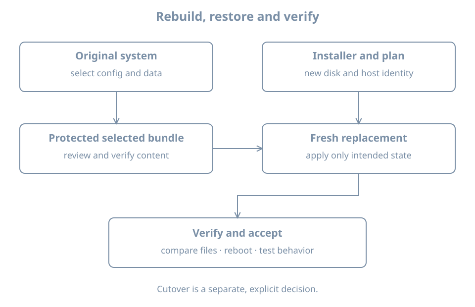

A server's disk fails. Installing Linux again gets you an operating system, but does it get you the configuration, data, credentials and dependencies that made the old host useful? Recovery succeeds only when the intended behavior is restored and checked from the appropriate point of view.

This chapter rebuilds a small **demonstration workload** on a separate replacement VM. It exports two selected files from `bl02`, preserves a copy on the host, installs a fresh `bl02-recovery`, and verifies the restored files on that guest. No real application is installed: the files make the selection and verification process observable before later service and backup chapters add more complex consistency requirements.

You need the working `bl02` from earlier chapters, its graphical console and first-boot baseline, the verified Ubuntu Server installer ISO, and host space for a new 32-GiB guest disk and a small handoff file. The host must support libguestfs tools and the existing libvirt system connection. Both guests will be shut down while their disks are accessed from the host. Do not attach either guest's disk to the other, overwrite `bl02`, or use a personal workstation as the target.

The host-side copy in this exercise is a **handoff artifact** outside the guest. It still shares the physical host's failure domain and is not a complete disaster-recovery backup. The full backup and independent-restore design comes later.

## Decide what recovery means

A repair attempts to return the existing installation to working order. A **reinstallation** creates an operating system again on a target disk. **Reprovisioning** builds a replacement from specified inputs and configuration. A restore brings selected prior state back from a saved copy. An incident can require more than one of these actions.

Before changing a failed machine, ask what must survive and what should be regenerated. A replacement guest used alongside the original has a distinct identity; a replacement that takes over the original's role needs an explicit cutover that prevents duplicate identities and conflicting access. This exercise stops before cutover and uses a new hostname.

| Category | Example | Decision in this exercise |
|---|---|---|
| Reproducible base | Installer, packages and updates | Install a fresh base and verify it |
| Host-specific configuration | An explicitly chosen demonstration config | Copy, review and restore this one file |
| Workload data | A small demonstration data file | Restore and compare its content |
| Machine identity | Hostname and `/etc/machine-id` | Keep the replacement's newly created identity |
| Secrets and trust | Passwords, SSH host keys, service certificates | Do not include them in this lab bundle |
| Hardware-dependent state | Filesystem UUIDs, network interface names, firmware variables | Observe the replacement and configure against its own values |
| External dependencies | DNS, upstream services, data stores | Record dependencies; this demonstration has none |

A machine ID is confidential, should normally be unique, and is not a file to copy casually from one running host to another. The [Ubuntu machine-id manual](https://manpages.ubuntu.com/manpages/resolute/man5/machine-id.5.html) explains its role. SSH host keys and certificates also have lifecycles of their own: preserving an identity may be required for some migrations, while unplanned duplication or replacement can break trust. Treat that as a deliberate service-specific decision.

{fig-alt="An original system supplies a selected configuration and data bundle, while installation media and provisioning choices create a fresh replacement. The bundle is reviewed and applied to the replacement, which retains its own identity. Verification and a recorded acceptance result follow; the original remains available until a separate cutover decision."}

## Define a small recovery contract

For this lab, success means:

1. The original `bl02` remains intact and shut down during offline export.
2. A fresh guest called `bl02-recovery` boots from its own disk and has working console and administrator access.
3. The selected configuration and data files are restored from the host-side bundle.
4. Both restored files match their source copies byte for byte and remain present after reboot.
5. The replacement retains its own hostname and disk identities; no automatic network cutover occurs.

The two demonstration files are not a real application's configuration format. They represent an operator-controlled setting and a small persistent data record. Their values contain no passwords or personal data.

### Identify what would be needed for a real host

Before reinstalling a real service, inventory its packages and versions, configuration ownership, service units, data locations, mount sources, users and numeric ownership, certificates, keys, network addresses, external dependencies and restore order. Also record which software or configuration is generated and which authoritative system owns it.

A blanket copy of `/etc` can overwrite fresh network settings, account databases, filesystem references or machine identity with values from different hardware. Old `/etc/fstab` UUIDs can point nowhere or to the wrong device; old interface names can refer to a different adapter. A package list does not include application data, and a data directory copied while a database is writing may not be a consistent backup. Select and validate each component for its owner and recovery method.

## Prepare the demonstration on `bl02`

Start the original guest and log in through its console. Confirm that this is the intended system:

```bash
hostnamectl
findmnt --target / --output TARGET,SOURCE,FSTYPE
sudo id -u
```

The hostname should be `bl02`, root should match its recorded installation, and the administrative check should return `0`. If any value is unexpected, stop and reconcile the selected VM and disk with your lab record.

Create the two **lab-only** files. Stop if either directory already exists: it may contain a previous experiment that you should preserve rather than overwrite.

```bash
sudo test ! -e /etc/bl-recovery-demo
sudo test ! -e /var/lib/bl-recovery-demo
```

Both commands must finish successfully with no output. If either fails, do not run the following creation commands; inspect and choose a fresh lab name instead. Otherwise:

```bash
sudo install -d -m 0755 /etc/bl-recovery-demo /var/lib/bl-recovery-demo
printf 'mode=observe\n' | sudo tee /etc/bl-recovery-demo/settings.conf
printf 'inventory-record=alpha\n' | sudo tee /var/lib/bl-recovery-demo/record.txt
```

Record the paths and their purpose in your change notes. In this demonstration both files are nonsecret and readable by the local learner. Real configuration and workload data can have stricter permissions and may require application-specific backup tools.

### Assemble and inspect a selected bundle

As `learner` inside `bl02`, create a new private staging directory. This command fails if the directory already exists; choose a new name rather than mixing old and new contents.

```bash
umask 077
mkdir "$HOME/bl-recovery-export"
mkdir "$HOME/bl-recovery-export/config" "$HOME/bl-recovery-export/data"
cp /etc/bl-recovery-demo/settings.conf "$HOME/bl-recovery-export/config/"
cp /var/lib/bl-recovery-demo/record.txt "$HOME/bl-recovery-export/data/"
cd "$HOME/bl-recovery-export"
sha256sum config/settings.conf data/record.txt > SHA256SUMS
sha256sum -c SHA256SUMS
```

Both lines should report `OK`. The checksum records the bytes selected at export; it does not establish provenance or prove that a running application was consistent. This tiny demonstration has no writer and no application transaction. For a real workload, use the application's quiescing or backup method and test its restore.

Create an archive in the home directory, then inspect its members and hash:

```bash
cd "$HOME"
tar -cf bl-recovery-demo.tar bl-recovery-export
tar -tf bl-recovery-demo.tar
sha256sum bl-recovery-demo.tar
```

The archive should contain only the staging directory, its two subdirectories, the two files and `SHA256SUMS`. Record the archive hash in your private lab notes outside the VM. A checksum comparison detects unintended changes when the expected hash is protected separately; it is not a signature or a substitute for trusted handling.

Shut the guest down cleanly:

```bash
sudo poweroff
```

On the host, confirm that the **system** libvirt domain is actually shut off:

```bash
sudo virsh --connect qemu:///system domstate bl02
sudo virsh --connect qemu:///system domblklist bl02 --details
```

Proceed only when it reports `shut off` and the disk matches your record. Paused or saved-memory state is not a clean shutdown. Leave it off until the offline read is complete.

## Export the bundle to the host

The following workflow uses `guestfish`, a libguestfs tool that can inspect a shut-down guest filesystem. On an Ubuntu host, its package is `guestfish`; inspect the proposed installation with `apt show guestfish` and `sudo apt --simulate install guestfish` before using `sudo apt install guestfish` if needed. Other distributions package the tooling differently. The [guestfish manual](https://manpages.ubuntu.com/manpages/resolute/man1/guestfish.1.html) documents `--ro`, automatic inspection (`-i`) and the libvirt connection option. If automatic inspection cannot open the installation, stop and use a separately documented export method; do not guess block-device paths or write to the original disk.

On the **host**, create a new private handoff directory. This intentionally fails if the name already exists, so old recovery material is not silently replaced:

```bash
sudo mkdir -m 0700 /var/tmp/bl02-recovery-handoff
sudo guestfish --ro -i -c qemu:///system -d bl02 \
  download /home/learner/bl-recovery-demo.tar \
  /var/tmp/bl02-recovery-handoff/bl-recovery-demo.tar
sudo sha256sum /var/tmp/bl02-recovery-handoff/bl-recovery-demo.tar
```

Compare the host hash with the separately recorded guest hash. Both must match before proceeding. The absolute source path assumes the `learner` home created in the installation lab; if your actual home differs, use the observed path. The host directory belongs to root and is a staging location, not encrypted storage. Real archives may contain sensitive data and need protected access, encrypted storage and a separate failure domain.

The host copy and the original guest disk are distinct files but reside on the same host in this lab. Loss of the host or its storage can destroy both. If a truly independent backup is required, transfer the verified artifact to separately managed storage and demonstrate retrieval; this exercise does not claim to have done so.

## Install a replacement without touching the original

Create a new VM named `bl02-recovery` with a new 32-GiB disk, UEFI, two vCPUs, 4096 MiB RAM and the setup NAT network. Attach the verified Ubuntu Server installer ISO. Use the guided-install workflow from earlier, with hostname `bl02-recovery` and a new unique `learner` password. It is acceptable for this fresh installation to have a different storage layout from `bl02` because the two demonstration files will be restored by path, not by copying a filesystem image.

Before accepting disk writes in the installer, inspect the **host** definition:

```bash
sudo virsh --connect qemu:///system domblklist bl02-recovery --details
```

Confirm the system disk path differs from `bl02` and all baseline disks, and that no old writable disk is attached. After installation, detach the ISO and boot from the new disk. Verify hostname, root mount, console login and `sudo id -u`. Update the new system using the first-boot procedure as appropriate; record its installed and running versions. Shut it down cleanly before the host writes the handoff file into it.

## Deliver and inspect the bundle on the replacement

On the host confirm both guests are off and identify the replacement disk:

```bash
sudo virsh --connect qemu:///system domstate bl02
sudo virsh --connect qemu:///system domstate bl02-recovery
sudo virsh --connect qemu:///system domblklist bl02-recovery --details
```

Both states should be `shut off`, and the destination disk should be the new replacement disk. Do not proceed if a domain is running or if another tool is editing either disk. The [virt-copy-in manual](https://manpages.ubuntu.com/manpages/resolute/man1/virt-copy-in.1.html) warns that writing into a live guest disk can corrupt it.

Copy the archive into the replacement's existing `/var/tmp` directory:

```bash
sudo virt-copy-in -c qemu:///system -d bl02-recovery \
  /var/tmp/bl02-recovery-handoff/bl-recovery-demo.tar /var/tmp
```

`virt-copy-in` is also supplied by the Ubuntu `guestfish` package. This is a write to the **replacement** disk; `-d bl02-recovery` is the destination identity, not the source. If the tool cannot inspect the target, stop rather than trying other domains. Leave `bl02` shut down, start `bl02-recovery`, and log in through its console.

Compare the replacement copy against the recorded archive hash:

```bash
sudo sha256sum /var/tmp/bl-recovery-demo.tar
sudo tar -tf /var/tmp/bl-recovery-demo.tar
```

Require the expected hash and the exact member list from the source before extracting. Only extract the archive you created and controlled in this lab. Archive extraction from untrusted sources requires additional path, link and provenance checks; do not apply an unfamiliar archive to system directories.

Create a fresh private restore workspace, extract there, then verify the contents:

```bash
umask 077
mkdir "$HOME/bl-recovery-restore"
sudo install -m 0600 -o "$(id -u)" -g "$(id -g)" \
  /var/tmp/bl-recovery-demo.tar "$HOME/bl-recovery-restore/bundle.tar"
tar -xf "$HOME/bl-recovery-restore/bundle.tar" -C "$HOME/bl-recovery-restore"
cd "$HOME/bl-recovery-restore/bl-recovery-export"
sha256sum -c SHA256SUMS
```

Both checks must say `OK`. A failure is a stop condition: preserve the failing copy and compare the source and host hashes before retrying. The archive and checksums can be changed together by an attacker, so the independently recorded archive hash and trusted transfer still matter. The `install` step makes a private working copy owned by the logged-in user, so extraction does not require root. Ownership and access controls must be explicitly checked for real data.

## Apply selected files, then prove the result

First ensure the destination paths do not already exist:

```bash
sudo test ! -e /etc/bl-recovery-demo
sudo test ! -e /var/lib/bl-recovery-demo
```

Only if both checks succeed, create the directories and install the reviewed files from the restore workspace:

```bash
sudo install -d -m 0755 /etc/bl-recovery-demo /var/lib/bl-recovery-demo
sudo install -m 0644 config/settings.conf /etc/bl-recovery-demo/settings.conf
sudo install -m 0644 data/record.txt /var/lib/bl-recovery-demo/record.txt
cmp config/settings.conf /etc/bl-recovery-demo/settings.conf
cmp data/record.txt /var/lib/bl-recovery-demo/record.txt
```

`cmp` prints nothing and exits successfully when each pair of files matches. The explicit `install` commands establish the destination mode; they do not recreate arbitrary ownership, ACLs, extended attributes or application state. Those are deliberate limitations of this demonstration, not a complete backup method.

Reboot `bl02-recovery`, log in again, and repeat the comparison from the restore workspace:

```bash
cd "$HOME/bl-recovery-restore/bl-recovery-export"
cmp config/settings.conf /etc/bl-recovery-demo/settings.conf
cmp data/record.txt /var/lib/bl-recovery-demo/record.txt
hostnamectl
findmnt --target / --output TARGET,SOURCE,FSTYPE
sudo id -u
```

Success is two silent, successful comparisons, the replacement hostname, the expected root filesystem and working administrative access. Check exit status for each `cmp` before running the next command if it is unclear; a later successful command does not erase an earlier failure. The payload's presence alone does not prove a real service consumes it. For an actual workload, add the service's own configuration validation, startup, client request, data integrity and access-control tests.

## Worked diagnosis: restored configuration points to an old device

Suppose a recovered config refers to the old guest's filesystem UUID, but the replacement has a freshly created filesystem. The file can match the saved copy perfectly and still be wrong for the new machine.

1. Keep the old file in the restore workspace as evidence; do not apply it blindly to `/etc/fstab`.
2. Identify the intended role of the mount and use `lsblk -o NAME,FSTYPE,UUID,MOUNTPOINTS` and `findmnt` to observe the replacement's actual storage.
3. Determine whether the required data filesystem was restored or needs to be attached separately. A new root UUID alone is not proof that the old data exists.
4. Plan a configuration change using the replacement's verified object and a recovery route. Test it with the appropriate mount and service checks before accepting the change.

This separates **faithful file recovery** from **correct behavior on new hardware**. A copied UUID, interface name, IP address or certificate may need adaptation, reissuance or an explicit cutover depending on the service.

## Record, reset and retain

Save an acceptance record outside the guests: original and replacement VM/disk identities, the selected file paths, the archive hash, extraction and `cmp` results, reboot check, and any unresolved differences. Keep machine IDs, passwords, host keys and sensitive configuration out of shared notes.

Leave `bl02` powered off until the offline-copy operations have finished. It can then be started for later work. The replacement is a separate teaching guest; shut it down when finished. Retain the host bundle only as long as needed and remove the temporary guest archive and workspaces using the exact recorded paths when they are no longer needed. Ordinary file deletion is not assured secure erasure. Do not delete either VM disk or any baseline as part of this cleanup.

The original's two demonstration files can remain as documented lab state, or be removed later after verifying their exact paths and that no later experiment depends on them. A real host retirement additionally needs service cutover, data retention, credential revocation and an independently verified recovery plan.

## Recall card

- Reinstallation creates a base; restoring selected configuration and data completes only part of a service recovery.
- Preserve identity, regenerate it or migrate it only by an explicit service-specific plan.
- Work on shut-down guest disks for offline writes and verify the selected source and destination.
- Checksums compare bytes; they do not establish trusted provenance or application consistency.
- Prove recovery after reboot and test the behavior a user or dependent service actually needs.
