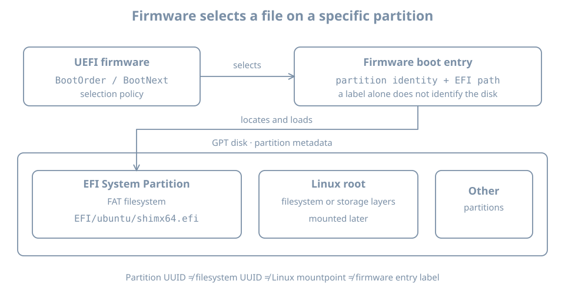

A VM powers on and reports that no bootable device is available. The operating system may still be intact on disk: the firmware first needs to find and execute a suitable boot program. To diagnose this boundary, distinguish the firmware's boot selection, the disk's partition map, the EFI System Partition and the files stored on it.

This chapter follows one successful UEFI boot on the existing `bl02` guest. Its commands inspect the running system and the VM definition; they do not change firmware variables, partition tables or boot files. You need the console, the first-boot record and the known recovery baseline established earlier. Keep `bl01` and the other guests unchanged. Have the original verified installer ISO available as recovery media, but do not boot it or attach extra writable disks for this exercise.

The examples use an Ubuntu Server amd64 VM with UEFI and a GPT disk. Physical systems and other architectures can expose different firmware interfaces, device names and boot paths. Record what your own machine reports instead of substituting example identifiers.

## The first handoff

When a machine starts, firmware initializes enough of the platform to select something to execute. In a VM, the hypervisor supplies virtual firmware, virtual devices and persistent firmware-variable storage. The UEFI boot manager can use configured boot options to locate an EFI application on a device. On this lab guest, an installed Ubuntu boot path normally starts from an EFI executable on disk, then continues through a bootloader and Linux startup.

A simplified sequence is:

```text
power on → UEFI boot manager → EFI executable → bootloader → kernel
```

This is a map, not proof that every machine uses exactly the same executables. Booting from a network or removable medium introduces other paths. Linux also supports other firmware and boot arrangements; GPT alone does not prove the current boot used UEFI, and a UEFI interface does not prove that a particular disk uses GPT.

The [UEFI boot-manager specification](https://uefi.org/specs/UEFI/2.11/03_Boot_Manager.html) describes firmware boot options and their ordering. The later chapters follow the bootloader, kernel and early userspace; here the boundary ends at identifying the EFI application selected by firmware.

{fig-alt="Firmware boot-order or one-time selection references a boot option containing a partition identity and an EFI file path. The illustrated GPT disk has an EFI System Partition with a FAT filesystem, separate Linux root storage, and other possible partitions. The Ubuntu shim filename is an example; actual entries, partition identities and paths must be observed."}

## Establish firmware and guest identity

Open the `bl02` graphical console and log in. Check the selected VM in the manager as well as the guest hostname:

```bash
hostnamectl
cat /etc/os-release
uname -r
if test -d /sys/firmware/efi; then
  printf 'This running system exposes the EFI firmware interface\n'
else
  printf 'EFI firmware interface is not available in this boot\n'
fi
```

On this UEFI lab guest, expect the interface to be present. If it is absent, check that you are in the intended installed guest rather than a different VM or a live installer, then inspect the guest's firmware settings on the host. Do not switch firmware modes on the existing VM simply to force a match; the installed boot path and stored firmware variables depend on that choice.

The directory is evidence about the **current boot environment**. It does not by itself identify the exact firmware entry or prove that the next boot will use the same path.

On the host, inspect the configured virtual machine and its disks:

```bash
sudo virsh --connect qemu:///system domblklist bl02 --details
sudo virsh --connect qemu:///system dumpxml bl02
```

Find the system disk and the firmware loader and NVRAM-related settings in the XML, if present. The domain definition describes the configured virtual hardware; it is not a transcript of the firmware's last decision. A live and persistent definition can differ after hardware changes. If necessary, `sudo virsh --connect qemu:///system dumpxml --inactive bl02` shows the persistent definition. Protect the XML before sharing: it can contain host paths, MAC addresses and other local details.

UEFI variables for a guest may live in a separate virtual NVRAM file, while its ESP is inside the virtual disk. A VM disk copy and a firmware-variable copy therefore need to be considered separately in a recovery plan. Verify the actual XML and storage for your VM; do not assume two clones have the same or different NVRAM files from their names alone.

## Read the firmware's boot options

If `efibootmgr` is available in the guest, request a verbose listing:

```bash
sudo efibootmgr -v
```

This form reads the boot variables; it does not alter boot order. If the tool is absent, record that and continue with disk inspection. On the setup network you may review `apt show efibootmgr` and `sudo apt --simulate install efibootmgr`, then install it with `sudo apt install efibootmgr` after reviewing the transaction. If access to EFI variables is unavailable, preserve the error and check the current firmware mode and permissions. An installed tool cannot manufacture firmware services for a non-UEFI boot.

A deliberately shortened, illustrative result might look like:

```text
BootCurrent: 0003
BootOrder: 0003,0001
Boot0001* UEFI Virtual DVD ...
Boot0003* ubuntu HD(1,GPT,11111111-2222-3333-4444-555555555555,...)/File(\EFI\ubuntu\shimx64.efi)
```

Read this as follows:

| Field | Meaning and limit |
|---|---|
| `Boot0003` | One firmware boot option numbered `0003`; its label is `ubuntu` |
| `*` | The option is marked active in this display |
| `BootOrder` | The ordered list of options normally considered by firmware |
| `BootCurrent` | The option reported for the current boot, when firmware provides it |
| `HD(...,GPT,...)` | A device-path component referring to a GPT partition; the GUID identifies that partition |
| `File(...)` | An EFI file path on the selected filesystem, using firmware-style backslashes |

`BootNext`, when present, requests an option for the next boot once; it is not the same as the persistent `BootOrder`. The UEFI boot manager can also offer a boot menu or follow platform-specific recovery behavior. A listed option is configuration evidence, not proof that its device and file are currently usable. `BootCurrent` is stronger evidence about the selected entry for this boot, but does not prove what the bootloader did afterwards or guarantee the next attempt.

Labels and numbers are not portable identities. Another VM can have a `Boot0003` named `ubuntu` that points to a different disk. The sample GUID and path above are invented; never copy them into a repair command.

If the current option refers to removable media, network boot or an unexpected entry, reconcile it with the VM manager and console history before assuming the installed disk was selected. Do not use `efibootmgr` mutation options in this chapter. Changing or deleting firmware variables can affect future boots and belongs in a planned recovery exercise.

### Where variables are exposed

Linux can expose UEFI variables through `efivarfs`. Inspect whether that filesystem is mounted:

```bash
findmnt --mountpoint /sys/firmware/efi/efivars \
  --output TARGET,SOURCE,FSTYPE,OPTIONS
```

An empty result means that exact mount was not found in the current mount namespace; it does not by itself explain why. The [kernel efivarfs documentation](https://www.kernel.org/doc/html/latest/filesystems/efivarfs.html) explains that variables can be modified through this interface. Treat it as live firmware state. Do not delete, edit or clear files there to make a diagnostic command work.

## Identify the partition map

In the guest, inspect the disk and its partitions:

```bash
lsblk -o NAME,PATH,TYPE,SIZE,PTTYPE,PARTTYPE,PARTUUID,FSTYPE,UUID,MOUNTPOINTS
```

If the output wraps on a narrow console, widen the display or run separate commands with fewer columns. The [lsblk manual](https://manpages.ubuntu.com/manpages/resolute/man8/lsblk.8.html) explains that this is a view assembled from system information and that relationships can be more complex than a single tree.

Read the columns at their own layers:

- `PTTYPE` identifies the partition-table type on a disk, such as `gpt`.
- `PARTTYPE` describes a GPT partition's **type**: a category, not the identity of this particular partition.
- `PARTUUID` identifies the individual partition in the partition table.
- `FSTYPE` and `UUID` identify a filesystem and its filesystem identifier, when present.
- `MOUNTPOINTS` reports current mount locations; it is not a firmware boot option.

The GPT type GUID for an EFI System Partition is `c12a7328-f81f-11d2-ba4b-00a0c93ec93b`. Several ESPs can share that type; their partition UUIDs should distinguish the individual partitions. Compare identifiers case-insensitively where tools display a different letter case. The [GPT specification](https://uefi.org/specs/UEFI/2.10/05_GUID_Partition_Table_Format.html) describes partition types, unique GUIDs and the primary and backup tables. A backup partition table helps detect or recover certain metadata problems; it is not a backup of the files inside the partitions.

A filesystem UUID and a partition UUID can both be called “UUID” in conversation. They are not interchangeable. For the GPT hard-drive device path shown in the example above, compare its partition GUID with `PARTUUID`, not with the FAT filesystem's `UUID`. `lsblk` may show additional layers such as LVM below another partition; do not expect the root filesystem to be a direct partition on every host.

## Inspect the EFI System Partition

An **EFI System Partition** (ESP) is a partition intended to hold EFI boot-related files in a firmware-readable filesystem. The guided Ubuntu UEFI installation normally mounts one ESP at `/boot/efi`. That path is Linux's mount location after boot; firmware uses its device path and EFI file path independently of that Linux mountpoint. Canonical's [storage guide](https://canonical-subiquity.readthedocs-hosted.com/en/latest/howto/configure-storage.html) describes the installer's UEFI boot-device setup.

First ask for an **exact** mount at the expected lab location:

```bash
findmnt --mountpoint /boot/efi --output TARGET,SOURCE,FSTYPE,OPTIONS
```

If the command produces a row, compare its source with the partition's `PARTUUID`, filesystem type and disk in the `lsblk` output. Do not assume the ESP is mounted just because the `/boot/efi` directory exists. If there is no exact mount, stop before listing files at that path: a directory on root can otherwise look like an empty ESP. Investigate the installed layout and persistent mount intent first:

```bash
cat /etc/fstab
findmnt --target /boot/efi --output TARGET,SOURCE,FSTYPE
```

The `--target` query identifies the filesystem containing a path and may therefore report `/` when `/boot/efi` is not mounted. An fstab entry represents mount intent, while `findmnt` reports current mounts. An ESP can also be mounted elsewhere on another system. Do not add a guessed fstab entry or format a partition to reproduce the example.

After confirming the exact ESP mount on the intended guest, list its EFI directory:

```bash
sudo ls -la /boot/efi/EFI
```

If the firmware entry refers to `\EFI\ubuntu\shimx64.efi`, and the matched ESP is the one mounted at `/boot/efi`, the corresponding Linux path in this example is `/boot/efi/EFI/ubuntu/shimx64.efi`. Inspect the actual directory and file named by **your** entry; filenames, capitalization and paths vary. A file with a plausible name is evidence of presence, not proof of signature validity or that it can boot the current system.

Some systems also place a removable-media fallback executable at an architecture-specific path such as `EFI/BOOT/BOOTX64.EFI` for x86-64. Its presence does not prove that the firmware will use it for a particular failure. Secure Boot and signed components are examined later; do not remove or replace EFI files during this inspection.

## Lab: build a boot-path evidence table

Collect observations in a private record and reconcile them in this order:

| Question | Evidence | Your observation |
|---|---|---|
| Which guest and disk? | VM manager, domain disk list and `hostnamectl` | Record name and host disk path |
| Which firmware context? | VM definition and `/sys/firmware/efi` | UEFI for this running boot, or an explained difference |
| Which boot option? | `efibootmgr -v`, if available | `BootCurrent`, relevant option and path |
| Which partition? | GPT device path and `lsblk PARTUUID` | Matching partition on the intended disk |
| Which mounted filesystem? | Exact `findmnt` result and `lsblk` | ESP source, filesystem type and mountpoint |
| Which file? | Listed path on the matched ESP | Actual EFI file, or an explained mismatch |
| What is the recovery route? | Existing baseline, console and installer record | Location and limitations of those resources |

For a simple local-disk GPT entry, the device-path partition GUID should match the observed ESP's `PARTUUID`. If it does not, do not declare the boot broken immediately: the boot option may point to another ESP, or you may be examining a different boot entry or mount. Identify the actual objects first. A network or removable-media boot may not offer the same GPT comparison at all.

When a link is unavailable, mark the record **unresolved**. For example, the guest can run with an inaccessible variable interface; record the disk and mount evidence and the missing `efibootmgr` result separately. Do not invent a `BootCurrent` value.

Save the record outside the guest using the established lab evidence procedure. Redact device identifiers, host paths and firmware details before sharing outside your trusted environment. There is no need to publish a complete variable dump.

## Worked diagnosis: “the ESP is empty”

Suppose `ls /boot/efi` appears empty even though the system booted successfully. Candidate explanations include an ESP that was not mounted after boot, an ESP mounted at another location, a different boot disk, or genuinely missing files.

1. Confirm the selected guest and current boot context.
2. Run the exact mount query. If it is absent, inspect the containing filesystem and `/etc/fstab` rather than assuming the directory is the ESP.
3. Inspect `lsblk` for candidate ESP partition types and their individual identifiers.
4. If firmware variables are available, compare the actual selected boot option's device path with the candidate partition UUIDs.
5. Once the correct ESP is mounted through a documented recovery procedure, inspect its actual EFI path and record the result.

This is an evidence sequence, not an instruction to mount or repair the ESP now. Do not mount or format a guessed device while the identity is unresolved. A successful past boot does not prove the relevant file still exists; the disk could have changed after firmware loaded it.

For a guest that cannot boot at all, preserve the console message, its VM definition and storage identity. Keep the existing disks untouched, use the verified recovery media and known baseline as the starting point, and determine whether the failure is firmware selection, loader, kernel, early root or later startup. Later chapters develop offline inspection and repair. A powered-off clone is a recovery aid with its own disk and NVRAM assumptions, not an independent backup against host loss.

## Practice and recall

On `bl02`, complete the evidence table and explain how the partition GUID in an observed GPT boot path relates to `PARTUUID`, while the filesystem UUID describes a different object. Identify one conclusion that would remain unproven if `efibootmgr` were unavailable. Compare your record with the installation chapter's stored layout; explain any change before accepting the baseline.

- Firmware chooses an EFI boot option before the Linux root filesystem is mounted.
- Boot option number, partition type, partition UUID, filesystem UUID and mountpoint are different identifiers.
- `BootCurrent` describes a reported current-boot selection; `BootOrder` describes configured priority.
- A directory at `/boot/efi` is not evidence that an ESP is mounted there.
- Preserve boot evidence and a recovery route before changing firmware variables or disk metadata.
