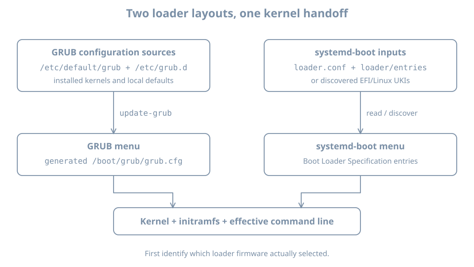

Firmware has selected an EFI executable. Which operating-system entry does that executable select, and where does its configuration come from? Firmware boot options and bootloader menu entries are separate layers. Changing one does not automatically change the other.

This chapter identifies the loader used by the Ubuntu `bl02` installation, explains the configuration ownership of GRUB and systemd-boot, and changes a GRUB menu timeout on a disposable clone. You need the previous chapter's firmware and ESP observations, VM console access and the verified recovery baseline. The lab assumes the single-disk UEFI `bl02` setup without shared writable disks, a backing chain or TPM state. If yours differs, do not use the clone recipe until its storage and firmware state have their own safe copy procedure.

## Two decisions before Linux runs

UEFI selects an EFI executable through a firmware boot option or another firmware boot path. That executable can be a bootloader, an intermediary such as shim, or another EFI application. A bootloader can then present its **own** menu and choose a kernel, initial RAM filesystem and command line. The first decision is made by firmware; the second is made by the selected boot software.

{fig-alt="GRUB commonly generates its menu from defaults, scripts and installed kernels into grub.cfg. systemd-boot reads Boot Loader Specification entries or discovers unified kernel images. The selected loader then supplies kernel boot inputs; firmware selection is a separate preceding decision."}

On a typical Ubuntu UEFI installation, firmware may load `shimx64.efi`, which participates in loading GRUB. The actual path depends on installation, architecture and security configuration. On other systems firmware may load systemd-boot directly. The presence of files for both loaders is not enough to establish which one was selected.

Inspect the previously recorded `BootCurrent` and its path with `sudo efibootmgr -v` if the tool and EFI variable interface are available. On systems supporting the relevant interface, `bootctl status` can report additional loader information:

```bash
sudo efibootmgr -v
bootctl status
```

A missing command, unavailable variable or incomplete `bootctl` report is an observation limit. In particular, `bootctl` provides more detailed selected-loader information when the loader implements its interface; a GRUB system need not report everything a systemd-boot system would. See the [bootctl documentation](https://www.freedesktop.org/software/systemd/man/latest/bootctl.html). Compare the firmware entry, mounted ESP and actual console boot behavior; do not install a different loader to make the report match an example.

## How an Ubuntu GRUB menu is produced

GRUB is a bootloader with its own configuration language and menu. On the Ubuntu installation used here, commonly inspected inputs include `/etc/default/grub`, optional local defaults under `/etc/default/grub.d/`, scripts under `/etc/grub.d/`, and the installed kernel artifacts they discover. The generated menu is usually `/boot/grub/grub.cfg`.

Inspect the actual host before assuming those paths or a particular value:

```bash
sudo cat /etc/default/grub
sudo ls -la /etc/default/grub.d /etc/grub.d
sudo ls -l /boot/grub/grub.cfg
sudo grep -E '^[[:space:]]*(menuentry|submenu) ' /boot/grub/grub.cfg
```

A missing optional directory can produce an error; inspect the paths that actually exist. The final command is a quick view, not a parser for all GRUB syntax or conditional behavior. Menu titles and submenus can change when installed kernels change. A displayed menu entry or generated configuration does not prove that its referenced files are readable at boot.

Ubuntu's [`update-grub` manual](https://manpages.ubuntu.com/manpages/resolute/man8/update-grub.8.html) identifies it as the wrapper that generates `/boot/grub/grub.cfg` using `grub-mkconfig`. Treat that file as generated output: a hand edit can be overwritten by the next generation. Inspect configuration inputs and package-owned scripts before modifying them. Files in `/etc/default/grub.d/` can override assignments from the main file, so reconcile their order and actual contents on your installation instead of assuming a single line controls the outcome.

In the [GNU GRUB configuration reference](https://www.gnu.org/software/grub/manual/grub/grub.html), `GRUB_TIMEOUT_STYLE=menu` requests a visible menu, while `GRUB_TIMEOUT` controls the wait in seconds under normal menu behavior. Generated code can include conditional paths, for example after a recorded boot failure. A value in the source file is intent; generated output and the next boot provide additional evidence.

## Prepare a disposable GRUB test guest

The exercise changes local configuration and reboots. Use a **full powered-off clone**, not the original. In `bl02`, shut down cleanly. On the host:

```bash
sudo virsh --connect qemu:///system domstate bl02
sudo virsh --connect qemu:///system domblklist bl02 --details
```

Require `shut off` and reconcile the single system disk with the earlier record. Ensure there is enough host space for a full copy. The destination VM name and disk path in the following command must not already exist:

```bash
sudo virt-clone --connect qemu:///system \
  --original bl02 --name bl03-loader-lab \
  --file /var/lib/libvirt/images/bl03-loader-lab.qcow2
```

This follows the powered-off clone method established in Part 01. Inspect the original and clone with `domblklist --details` and `dumpxml`, using the same `qemu:///system` connection. Confirm distinct disk paths and distinct UEFI NVRAM files. If the definition has extra disks, shared state, a backing chain or TPM state, stop; those require a different copy and recovery plan. Keep `bl02` shut off throughout the test because the clone also contains the original guest's hostname, machine ID and credentials. In the manager, attach the clone's NIC to the isolated `blpractice` network while it is shut down. The graphical console supplies access and no package download is needed.

Start only `bl03-loader-lab`. The login hostname can still say `bl02`; use the console window's VM identity and the host-side disk record to distinguish the clone. Verify administrative access, root mount and the GRUB paths. If this is not a GRUB installation with `/etc/default/grub` and `/boot/grub/grub.cfg`, stop this GRUB-specific exercise. Do not install GRUB over the existing boot path merely to continue.

## Change a menu timeout and roll it back

In the clone, first record the original configuration and inspect any local overrides:

```bash
sudo cat /etc/default/grub
sudo ls -la /etc/default/grub.d
sudo grep -nE '^[[:space:]]*GRUB_(TIMEOUT|TIMEOUT_STYLE)=' \
  /etc/default/grub /etc/default/grub.d/*.cfg
```

If the optional directory or matching files do not exist, the glob can produce an error. Record that and inspect any files that do exist. If local overrides or a management system own these settings, stop and plan with those inputs instead of relying on the simple edit below.

Create a private backup of the source file under a new name:

```bash
sudo test ! -e /etc/default/grub.bl03-original
sudo cp -a /etc/default/grub /etc/default/grub.bl03-original
```

Proceed with the copy only if the first command succeeds. Record that backup's path. Using your editor as administrator, edit `/etc/default/grub` so its effective assignments for these two variables are:

```text
GRUB_TIMEOUT_STYLE=menu
GRUB_TIMEOUT=5
```

Change existing assignments rather than leaving conflicting duplicates. Do not change the default boot entry, kernel arguments, firmware variables or other settings. Review the diff and regenerate:

```bash
sudo diff -u /etc/default/grub.bl03-original /etc/default/grub
sudo update-grub
sudo grub-script-check /boot/grub/grub.cfg
```

`diff` normally exits with status 1 when it finds differences; here that is expected if only the intended lines changed. Stop if the diff shows unintended edits. Run the generation and syntax check only after reviewing it. Record the output and exit status of each; a syntax check does not prove that a boot entry points to working files.

If generation or validation fails, **do not reboot**. Preserve the error and restore the original source, then regenerate and check again:

```bash
sudo cp -a /etc/default/grub.bl03-original /etc/default/grub
sudo update-grub
sudo grub-script-check /boot/grub/grub.cfg
```

If rollback generation or validation also fails, leave the clone running, keep the console and evidence, and use the separate baseline/recovery route. Do not keep editing generated configuration at random.

After successful generation and validation, reboot the clone with the console open. Observe whether the menu is visible and approximately how long the countdown waits without a keypress. Boot the default entry and verify login and `uname -r`. A console or firmware timing difference can hide a menu; if the expected behavior is absent, compare the actual generated configuration, overrides and selected loader before concluding the edit failed.

Restore the source file using the rollback commands above. Confirm the source matches the backup with `sudo cmp /etc/default/grub.bl03-original /etc/default/grub`, then reboot and observe the restored behavior. A pre-existing hidden or zero-timeout menu may not be visible; a successful login and the restored source plus successful generation are distinct pieces of evidence. Shut down the clone. Leave its disk available for inspection or retire it only after verifying its unique path. The untouched original can then be started for later chapters.

## What changes for systemd-boot?

systemd-boot is a UEFI boot manager that discovers entries from the ESP and, where configured, the Extended Boot Loader partition (XBOOTLDR). It can read Boot Loader Specification Type #1 entry files and discover Type #2 unified kernel images. Its [documentation](https://www.freedesktop.org/software/systemd/man/latest/systemd-boot.html) describes the locations and features. This is a comparison, not a recommendation to replace Ubuntu's existing loader.

On a system already using systemd-boot, first identify the actual ESP and optional XBOOTLDR mount. Then inspect, where present, `loader/loader.conf`, `loader/entries/` and `EFI/Linux/` on those filesystems. `bootctl status` reports available status; `bootctl list` lists entries it knows how to discover. A list can include discoverable entries even when another loader was used to boot. Absence of a particular directory is not proof of failure if another supported entry mechanism is in use.

Unlike the Ubuntu GRUB workflow, `update-grub` does not generate systemd-boot entries. Configuration and entry ownership may belong to a distribution package, `kernel-install`, an image builder or an administrator. Find that owner before editing. Runtime EFI variables can affect selection too; a file alone may not describe the effective next boot. Use the installed version's manual and distribution procedure for any change and provide a console and rollback before applying it.

## Diagnose the correct selection layer

| Symptom | First distinction | Evidence |
|---|---|---|
| Firmware reports no boot option | Firmware selection versus loader menu | `BootOrder`, selected device and ESP path from the prior chapter |
| GRUB appears but expected kernel is absent | Loader configuration versus installed artifacts | Generated menu, inputs and `/boot` inventory |
| GRUB source changed but behavior did not | Input versus generated output versus selected loader | Overrides, generation result, console and active boot path |
| systemd-boot list differs from current boot | Discoverable entries versus selected loader | `bootctl status`, firmware selection and relevant mounts |
| A menu entry appears but fails after selection | Menu existence versus working kernel/root | Preserve console error and identify the next failed stage |

For the original host, preserve a known working boot choice and console access before any persistent change. Do not use a one-time firmware choice, a loader's one-time selection and a permanent default as interchangeable operations. Recovery of a deliberately broken boot entry is developed after the remaining boot stages are understood.

## Practice and recall

Record the selected firmware path, loader evidence, configuration owner, generated or discovered entries, and the clone's before/change/rollback observations. Explain which settings can persist after reboot and which observation applies only to the current boot.

- Firmware selects an EFI application; a loader selects its own boot entry.
- GRUB's source configuration and generated menu have different owners and lifecycles.
- systemd-boot discovers entries from its supported boot partitions and formats.
- A valid menu file and an existing menu entry do not prove a successful boot.
- Test persistent configuration changes on a recoverable clone and verify rollback.
