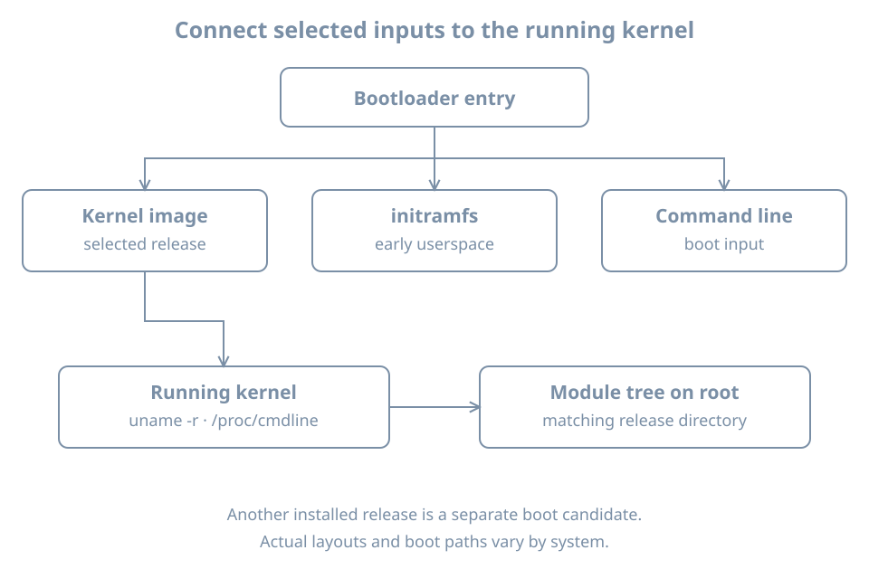

A package update installs a new kernel, but `uname -r` still reports the old one. That can be normal: installed files and the kernel currently executing are different states. A boot entry must select a coherent set of artifacts, and the next reboot determines which kernel actually runs.

This chapter inventories the guided Ubuntu `bl02` guest and relates its running kernel to the installed image, initramfs, module tree and boot command line. The exercise is read-only. It does not remove kernels, regenerate initramfs images or change boot arguments. You need console access and the bootloader evidence from the previous chapters. Leave the GRUB test clone shut down and work in the original guest.

## A versioned boot set

A **kernel image** is the executable kernel selected for boot. An **initramfs** is an initial filesystem image supplied to the kernel for early userspace; it can contain tools, configuration and modules needed before the real root filesystem is available. A **kernel module** is code that can be loaded into a running kernel when needed. Some functionality is built into the kernel instead and is not a separately loaded module.

For a common Ubuntu installation, versioned artifacts have names resembling:

```text
/boot/vmlinuz-<release>
/boot/initrd.img-<release>
/lib/modules/<release>/
```

Here `<release>` stands for the **complete** kernel release string, including distribution and flavor suffixes. Do not type the angle-bracket placeholders as paths. Other distributions, boot mechanisms, architectures and unified kernel images may arrange artifacts differently. The following inspection is specific to the current Ubuntu lab layout.

{fig-alt="A bootloader entry selects a kernel image, a matching initramfs and a command line. The booted kernel reports its release and uses a corresponding versioned module tree on the real root. Installed artifacts for another release are a separate candidate, not necessarily the running kernel."}

A loader can pass a command line alongside the selected image. Early userspace and the kernel use some of its arguments at different stages. For example, a `root=` value may help identify the intended root device, but it is not by itself proof of the filesystem ultimately mounted there.

## Identify the running kernel and root

Log in to the original `bl02` console and confirm the host and root:

```bash
hostnamectl
uname -r
cat /proc/cmdline
findmnt --target / --output TARGET,SOURCE,FSTYPE,OPTIONS
```

`uname -r` reports the release of the running kernel. `/proc/cmdline` reports the command line exposed by this boot; it is stronger evidence of effective input than a default value in an ungenerated configuration file. `findmnt` shows the current mounted root source and filesystem.

An illustrative output might include:

```text
6.x.y-example-generic
BOOT_IMAGE=/vmlinuz-6.x.y-example-generic root=/dev/mapper/example--vg-root ro
```

These are fictional values. Actual releases, paths and arguments will differ. `BOOT_IMAGE` can be supplied by the bootloader as a hint, and its pathname is interpreted in the bootloader's context; it is not guaranteed to be a directly usable Linux path. Compare it with the loader's configuration and mounted `/boot` rather than mechanically prepending a directory.

`ro` on the initial command line can request an initially read-only root. A later mount operation can make the live root read-write, so inspect current mount options rather than concluding that the current root is read-only from the command line alone. Avoid placing passwords or other secrets on a kernel command line: it is visible to processes through `/proc/cmdline` on typical systems and may be retained in logs.

The [kernel parameter documentation](https://docs.kernel.org/admin-guide/kernel-parameters.html) describes many kernel-recognized arguments and notes that other arguments can be passed to init. An argument's presence is not proof that a particular component recognized or applied it. Confirm the relevant component's documentation and observed behavior.

## Inventory files for the running release

Set a shell variable from the actual running kernel and inspect the matching conventional paths:

```bash
KREL=$(uname -r)
printf 'Running release: %s\n' "$KREL"
ls -l "/boot/vmlinuz-$KREL" "/boot/initrd.img-$KREL"
ls -ld "/lib/modules/$KREL"
findmnt --target /boot --output TARGET,SOURCE,FSTYPE,OPTIONS
```

For the reference installation, the image, initramfs and module directory should normally exist for the running release. If a path is missing, preserve the error and investigate how this particular kernel was booted and packaged. A missing conventional on-disk initramfs does not prove the system never booted: the booted image may have been supplied from another location or the file could have changed after startup.

The `/boot` query reports the filesystem **containing** `/boot`. It may be root or a separate mount. If the prior installation record expects a separate `/boot`, check it with `findmnt --mountpoint /boot` as well. Looking at an unmounted directory on root can make a healthy separate boot filesystem appear empty.

List candidates without assuming that the highest-looking filename is the current one:

```bash
ls -lh /boot/vmlinuz-* /boot/initrd.img-*
ls -1 /lib/modules
```

A shell glob with no matches can produce an error; record it instead of treating the literal pattern as a file. Names usually associate a kernel image and initramfs by their full release string. Multiple releases can coexist. A newer installed release is an available candidate only if its files, loader entry and boot dependencies are correct; installation does not itself switch the already running kernel.

Package metadata supplies another view:

```bash
dpkg-query -W -f='${db:Status-Abbrev} ${binary:Package} ${Version}\n' \
  'linux-image-*' 'linux-modules-*'
```

Rows can include package states other than installed. Read the status abbreviations and actual versions rather than counting every row as an active kernel. If no packages match one pattern, `dpkg-query` may report that fact. Package inventory, files on disk and the running release answer related but different questions.

## Follow a module without loading it

The running kernel's module directory contains modules and metadata associated with its release. `lsmod` shows modules currently loaded into the kernel:

```bash
lsmod | head -20
```

This is a snapshot of loaded modules, not a complete inventory of built-in drivers, available modules or working devices. Earlier device discovery showed how to relate a network interface to its actual driver. If that driver is named `virtio_net` and `modinfo` is available, inspect it without loading or unloading anything:

```bash
modinfo -k "$(uname -r)" virtio_net
```

Use your observed driver name if different. `modinfo` can report a module's filename, aliases, dependencies, supported parameters and other metadata; fields vary. A built-in driver may be represented as built-in or may lack a separate module file. A module file's existence does not prove that it is loaded, bound to the intended device, compatible with the running kernel or permitted by the host's module-signing policy. The [modinfo manual](https://manpages.ubuntu.com/manpages/resolute/man8/modinfo.8.html) describes lookup by kernel release.

The exact version string matters. Copying an arbitrary `.ko` file into a different release directory does not establish compatibility. An out-of-tree driver may need a build for each kernel and may also need to satisfy signing policy. Diagnose its package, build and signing evidence before changing anything; do not disable security checks or unload a working disk or network driver during this lab.

## Distinguish planned arguments from this boot

For the GRUB installation, compare current observations with the configuration sources and generated output:

```bash
cat /proc/cmdline
sudo grep -nE '^GRUB_CMDLINE_LINUX(_DEFAULT)?=' /etc/default/grub
sudo grep -nE '^[[:space:]]*(linux|initrd)[[:space:]]' /boot/grub/grub.cfg
```

The source assignments express defaults used when configuration is generated. Drop-ins, scripts, menu selection, one-time edits and conditional logic can alter the resulting choice. The generated `linux` and `initrd` lines are candidates; several entries can be present. Do not assume the first line printed is the one that booted. Reconcile the selected menu entry with the console record and `/proc/cmdline`; if the exact selection was not captured, mark it uncertain.

GRUB can use paths relative to a filesystem it selects, while Linux presents mounted paths after boot. A line mentioning `/vmlinuz-...` can refer to a file on a separately mounted `/boot` filesystem. Determine the preceding GRUB search/root commands and the partition map before comparing paths. The command-line arguments are not a safe place to improvise boot fixes on the original host.

## Worked diagnosis: new kernel installed, old one running

Suppose package inventory shows releases A and B, but `uname -r` shows A after an update. Ask whether a reboot was expected and whether B was actually selected:

1. Compare the update record and current boot time; do not infer a reboot from package installation.
2. Verify the B image, initramfs and module directory using the **observed** complete B release string, without removing A.
3. Inspect the loader's available entries and console selection. A generated entry does not prove it was successfully booted.
4. Check the current `/proc/cmdline`, `uname -r` and root mount after any planned reboot.
5. If B fails while A works, retain the failure message and the working entry. Investigate the failing stage and matching artifacts before attempting repair.

If an update left no B initramfs or module tree, that is an inconsistency to investigate with package and installation logs. Rebuilding initramfs or repairing a package is a change with prerequisites; the next chapter explains early userspace and its construction. Do not delete a working older kernel merely because the newer one is installed.

## Practice and acceptance

Create a table with the current release, current command line, root mount, filesystem containing `/boot`, matching image/initramfs/module paths, and any other installed candidate. Record whether each observation is runtime evidence, an on-disk artifact or configuration intent. Explain one reason these views could differ without implying corruption.

If you have no second installed kernel, use the fictional A/B scenario above as a reasoning exercise. Do not install or remove kernels just to manufacture one. Keep the record outside the guest and redact sensitive path or identity details before sharing.

## Recall card

- Installing a kernel and running it are different events.
- Compare the full release across image, initramfs and module tree; layouts can vary.
- `/proc/cmdline` is current-boot input, while loader configuration describes choices.
- A module on disk, a loaded module and a driver bound to a device are different states.
- Preserve a known working boot path while investigating a failed update.
