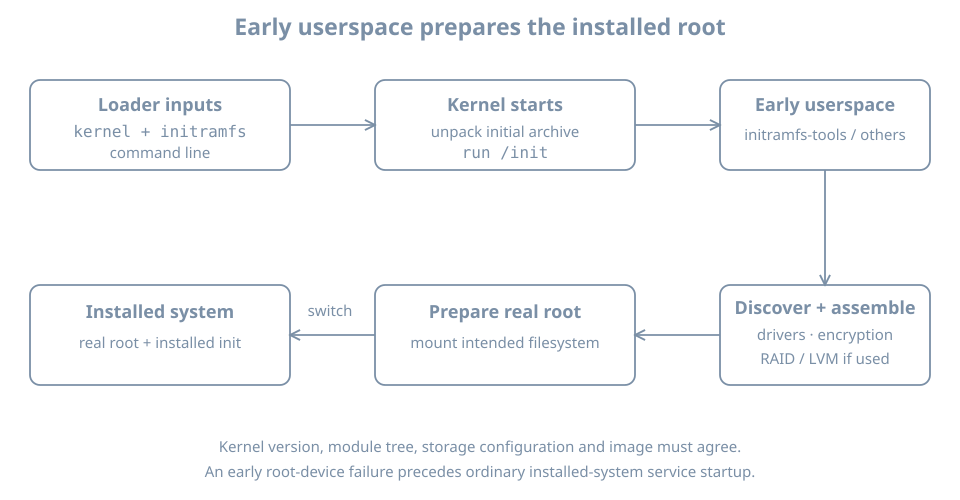

The kernel has started, but the installed root filesystem is on an LVM logical volume whose disk has not yet been discovered. The kernel cannot run the installed system's programs from a filesystem it cannot reach. Early userspace bridges that gap: it provides a small temporary environment that can find devices, assemble storage and mount the intended root.

This chapter follows the Ubuntu `bl02` installation. You need its storage and boot records, console access and the full powered-off clone method from earlier. The main inspection is read-only. An optional rebuild runs only on a disposable clone, after checking its recovery path and free space.

## From boot image to installed root

The loader supplies a kernel, command line and, in this installation, an initramfs image. The kernel unpacks the initial filesystem into memory and runs its initial program. That early program and its tools discover the devices needed for root, possibly unlock encryption or activate LVM, mount the real root, and hand control to the installed system's init program.

{fig-alt="The bootloader supplies a kernel, initramfs and command line. The kernel runs an initial program. Early userspace discovers devices, assembles any required storage layers and mounts the real root before handing control to the installed system."}

An initramfs is an archive used to populate an in-memory filesystem. The familiar Ubuntu filename `initrd.img-<release>` is historical terminology; it does not imply that every machine uses the older block-device initrd mechanism. Systems can use different early-userspace implementations, or boot without a separate initramfs where their design permits it. The [systemd boot overview](https://www.freedesktop.org/software/systemd/man/latest/bootup.html) describes the general stages.

For our guided LVM guest, the dependency chain is approximately virtual disk → partition → physical volume → volume group → root logical volume → root filesystem. An encrypted installation can add an unlock dependency before the volume group. This is a dependency map, not a claim about the exact order of every script on every image.

## Inspect the installed image and its inputs

On `bl02`, confirm the current release, root and boot filesystem:

```bash
hostnamectl
uname -r
cat /proc/cmdline
findmnt --target / --output TARGET,SOURCE,FSTYPE,OPTIONS
findmnt --target /boot --output TARGET,SOURCE,FSTYPE,OPTIONS
lsblk -o NAME,TYPE,FSTYPE,UUID,MOUNTPOINTS
```

Match the root source with the observed storage tree. A `root=` argument is an input to early boot, while `findmnt` describes the current mount. It is possible for a command line and a mounted source to use different names for the same object. Resolve identifiers before declaring them inconsistent.

On Ubuntu systems using `initramfs-tools`, inspect the configuration and the image associated with the running release:

```bash
KREL=$(uname -r)
ls -l "/boot/initrd.img-$KREL"
ls -la /etc/initramfs-tools
cat /etc/initramfs-tools/initramfs.conf
sudo lsinitramfs "/boot/initrd.img-$KREL" > "$HOME/bl-initramfs-list.txt"
head -40 "$HOME/bl-initramfs-list.txt"
```

`lsinitramfs` lists archive members; it does not execute them. Check that the listing command succeeded before interpreting the file. If the image or utility is missing, determine the host's actual boot method and packaging rather than creating an empty image. The [lsinitramfs manual](https://manpages.ubuntu.com/manpages/resolute/man8/lsinitramfs.8.html) describes supported image listing and its limitations with multi-segment images.

Look for evidence related to the actual storage stack, for example:

```bash
grep -Ei '(^|/)(init|lvm|cryptsetup)(/|$|\.)' "$HOME/bl-initramfs-list.txt"
```

No match is not a complete diagnosis: names, packaging, compressed module filenames, built-in drivers and implementations differ. A matching filename establishes presence, not that a script ran successfully or that a device was unlocked. The [initramfs-tools documentation](https://manpages.ubuntu.com/manpages/resolute/man7/initramfs-tools.7.html) separates image-building hooks from boot-time scripts.

## Construction and dependencies

A generated initramfs is a snapshot of selected files, scripts and configuration. Changes to early-boot inputs may require regeneration; editing the live root's configuration does not retroactively edit an existing image. Package installation can also trigger generation. The output is tied to a particular kernel release and may contain selected modules for that release.

Keep four questions distinct:

| Question | Evidence |
|---|---|
| What input is configured? | `/etc/initramfs-tools` and the installed package's hooks |
| What is in the generated image? | `lsinitramfs` for the identified image |
| Which image did the loader select? | Bootloader entry and console/boot record |
| Did early userspace reach root? | Successful current root mount and boot evidence |

A successful normal boot does not prove that every installed fallback image works. Nor does it prove the image currently on disk is byte-for-byte the one loaded earlier if it was replaced after boot.

## Optional lab: rebuild one image on a clone

This exercise writes a boot artifact and reboots. First shut down `bl02`, confirm it is `shut off` and inspect its system disk using the host-side `virsh` procedure from the loader chapter. This clone method applies only to the documented single writable disk, no backing chain, no shared writable disk and no TPM state. Confirm sufficient host space and that the destination name and disk path are new. On the host:

```bash
sudo virt-clone --connect qemu:///system \
  --original bl02 --name bl03-initramfs-lab \
  --file /var/lib/libvirt/images/bl03-initramfs-lab.qcow2
```

Inspect original and clone disk paths and distinct UEFI NVRAM files in their domain definitions as in the loader chapter. Keep the original off, attach the clone to `blpractice`, and use the graphical console. The clone still reports hostname `bl02`; identify it by the manager's VM name and unique disk.

On the clone, confirm the running release and existing image, and inspect free space:

```bash
KREL=$(uname -r)
ls -l "/boot/initrd.img-$KREL"
findmnt --target /boot --output TARGET,SOURCE,FSTYPE
df -h /boot /
```

Stop if `/boot` is not the expected filesystem, the image is absent, capacity is insufficient, the root stack differs from the record, or the clone's recovery path is uncertain. Do not remove old kernels to make room. Save the image's pre-change hash and a list of its contents outside the guest using the established evidence procedure:

```bash
sudo sha256sum "/boot/initrd.img-$KREL"
sudo lsinitramfs "/boot/initrd.img-$KREL" > "$HOME/bl-initramfs-before.txt"
```

With the clone's console and original baseline available, update the **existing** image for the currently running release:

```bash
sudo update-initramfs -u -k "$KREL"
sudo lsinitramfs "/boot/initrd.img-$KREL" > "$HOME/bl-initramfs-after.txt"
sudo sha256sum "/boot/initrd.img-$KREL"
```

Run each command only after the previous one succeeds. `-u` updates an existing image; `-k` selects the release. Consult the locally installed `man update-initramfs` for the version in use. Hashes and member ordering may change even without an intentional configuration change, so equality is not the success criterion. Compare relevant members, retain the command result, and verify that the bootloader still refers to the intended image.

If generation or inspection fails, do not reboot. Preserve the error and keep the original guest and baseline intact; investigate the clone or discard and recreate it after verifying its unique disk path. After a successful rebuild, reboot the clone through its console and verify login, `uname -r`, the expected root source and `systemctl --failed`. This demonstrates the tested boot path, not every fallback path. Shut down the clone before restarting the original.

## Diagnose an early-root failure

Suppose the console reports that the root device cannot be found and offers an early shell. Candidate causes include a wrong root identifier, missing storage driver, incomplete LVM activation, a failed encryption unlock, missing device, or an initramfs that lacks required components.

1. Preserve the exact console error, boot entry, kernel release and time.
2. Identify the expected storage chain from the installation record and compare it with the VM's attached disk.
3. Determine whether the failure is before the real root mount; ordinary service logs may not yet exist on that root.
4. Use a known-good entry or verified recovery media according to the established recovery plan. Inspect the relevant image and configuration offline before changing them.
5. After a justified repair, perform a normal boot and check the root source and dependent services.

An early shell may have different tools and device names from the installed system. Do not format, recreate a volume group, or paste another machine's UUID just to leave the shell. Detailed external-media and offline repair procedures follow later in this part.

## Practice and recall

Record the running release, selected image evidence, root storage chain and at least one limitation of the archive listing. If you used the clone, retain the rebuild result and post-reboot root check.

- Early userspace prepares the real root before the installed manager can run.
- Build inputs, archive contents, selected image and successful execution are different observations.
- An image must fit the kernel release and the actual storage dependencies.
- Test rebuilds and recovery on a disposable copy before changing a working boot path.
