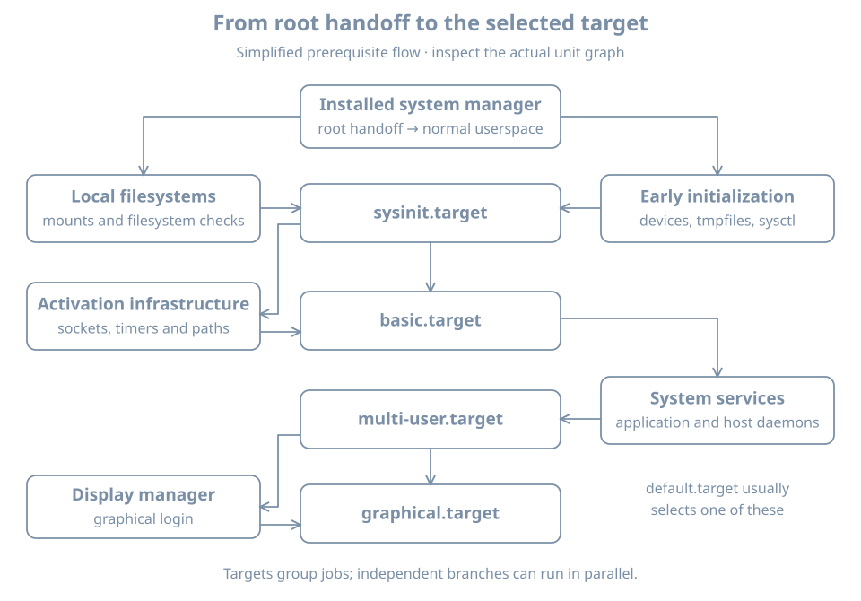

The real root is mounted, yet the machine is not necessarily ready for a login or a workload. The installed system manager must coordinate mounts, device events and services. A successful root handoff is one milestone, not the end of startup.

Use the running `bl02` guest and console. This chapter observes the installed systemd manager and its current boot; it does not create or modify units. The preceding initramfs chapter supplies the early-root model.

## From temporary root to installed manager

Early userspace prepares the real root and hands over execution to an init program on it. On the reference Ubuntu installation, that installed system manager is systemd. PID 1 is the first userspace process and has special responsibilities, including adopting orphaned processes and coordinating the system's lifecycle. The handoff mechanism and whether systemd also runs in the initramfs depend on the early-userspace implementation; do not assume every initramfs is a systemd initrd.

{fig-alt="After the root handoff, the installed system manager coordinates early initialization and local mounts, then activation infrastructure and ordinary services. Multi-user and graphical targets are possible destinations. The arrows summarize prerequisites, not every literal dependency."}

A **unit** is an object managed by systemd: service, mount, socket, device, target and other types. A **job** is an operation such as starting or stopping a unit. Starting a target can pull other units into a transaction, and systemd orders applicable jobs according to dependency rules. Many jobs can proceed concurrently. The [bootup overview](https://www.freedesktop.org/software/systemd/man/latest/bootup.html) describes the major targets and the parallel nature of startup.

## Observe PID 1 and this boot

In the guest console:

```bash
ps -p 1 -o pid,comm,args
readlink -f /proc/1/exe
systemctl is-system-running
systemctl --failed --no-pager
findmnt --target / --output TARGET,SOURCE,FSTYPE,OPTIONS
```

On the reference host, PID 1 should identify systemd. `is-system-running` may report `running`, `degraded`, `starting` or another state; a nonzero exit status for a state such as `degraded` is diagnostic information, not a command to reset failures. A degraded system can be usable while one unit has failed. The root mount is runtime evidence, not a complete history of how it was found.

Inspect boot messages:

```bash
journalctl --list-boots --no-pager
sudo journalctl -b -p warning --no-pager
sudo journalctl -b -u systemd-remount-fs.service --no-pager
```

`-b` selects the current boot and `-p warning` selects warning priority and more severe messages. A unit may not exist, may have completed successfully without much output, or may not be responsible for the symptom. An empty query is an observation. Journal persistence and access depend on configuration; the previous boot may not be retained after a reboot. Do not assume the system journal captures all firmware or early-initramfs messages.

## Requirement and ordering are different

A dependency can express that one unit wants or requires another. Ordering expresses which job should precede another **when both jobs are present**. `After=` alone does not pull a unit into the transaction. `Wants=` or `Requires=` alone does not by itself specify a start order. `Requires=` has stronger failure relationships than `Wants=`, but it is not a general substitute for an application-level health check.

For an imaginary service `report.service` using `data.mount`:

| Relationship | Effect to reason about |
|---|---|
| `Wants=data.mount` | Attempt to include the mount without the same failure coupling as a requirement |
| `Requires=data.mount` | Express a stronger requirement, with documented failure and stop behavior |
| `After=data.mount` | If both start jobs are present, order the service after the mount job |

A real filesystem dependency can be expressed through appropriate mount-related mechanisms; the example isolates the concepts rather than prescribing a unit. The [systemd unit reference](https://www.freedesktop.org/software/systemd/man/latest/systemd.unit.html) defines the detailed semantics.

Inspect relationships of a unit present on your host:

```bash
systemctl list-dependencies --all multi-user.target
systemctl show multi-user.target -p Wants -p Requires -p After -p Before
systemctl list-jobs
```

The dependency tree is not a timeline, and `list-jobs` is only a snapshot of jobs currently queued. Empty output after boot is normal. Properties include implicit as well as explicit relationships; use `systemctl cat UNIT` with an actual unit name to inspect its definitions and drop-ins. A static list cannot prove the service's client-facing behavior.

## A transaction can succeed partially

Suppose `multi-user.target` is active while a nonessential service failed. The target's state, the failed unit and the service's client test answer different questions. Find the failed unit with `systemctl --failed`, inspect `systemctl status UNIT` and `journalctl -b -u UNIT` using its actual name, then determine its role and dependencies. Do not clear the failed state as the first step; doing so removes a useful signal without repairing the cause.

An error involving the root filesystem before the installed manager starts belongs to the earlier boot boundary. A failed service after login belongs to the installed manager or application boundary. If uncertain, use the console's last visible message and timestamps to establish the boundary before changing configuration.

## Practice and recall

Record PID 1, current root, system state, failed units and one target's `Wants`, `Requires` and `After` properties. Choose one observed relationship and explain why it does or does not establish ordering. Compare that static relationship with current job state and the journal.

- Root handoff starts the installed system's work; it does not establish workload readiness.
- Units represent managed objects; jobs are operations on them.
- Requirement and ordering answer different questions.
- A reached target and an empty job queue are not complete health checks.
