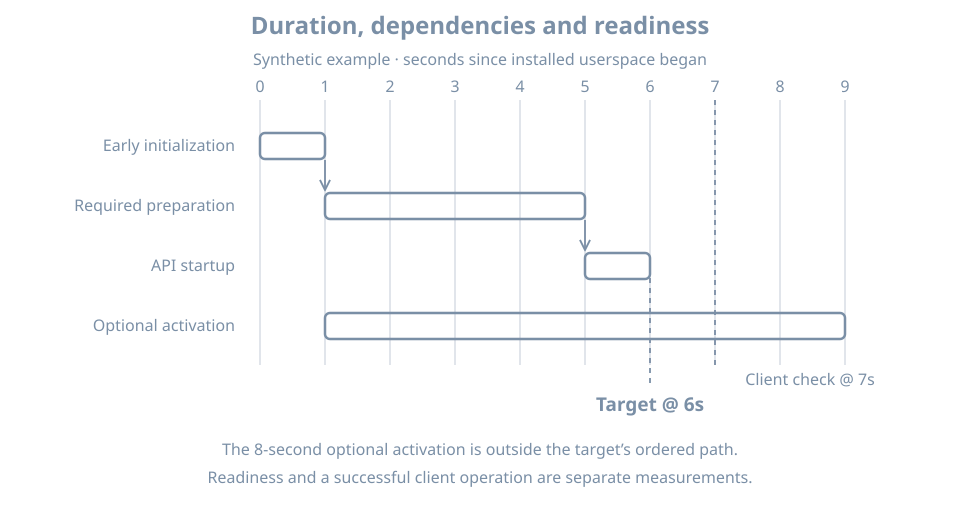

A dashboard says the system reached `multi-user.target` in twelve seconds, yet a client request fails for another ten seconds. The two observations can both be correct. A target is a synchronization point in the manager's unit graph; application readiness is a claim that must be checked at the application's boundary.

Use the running `bl02` console and the boot record from the preceding chapter. The commands below inspect state and timing. They do not change the default target or disable any service.

## What a target tells you

A target is a systemd unit that groups or orders other units. On a conventional system, `default.target` commonly resolves to `multi-user.target` for a non-graphical host or `graphical.target` for a graphical one. The actual alias and dependencies are configuration, not a universal promise. The [systemd special-unit reference](https://www.freedesktop.org/software/systemd/man/latest/systemd.special.html) documents common targets.

Inspect the default and current target state:

```bash
systemctl get-default
systemctl list-units --type=target --all --no-pager
systemctl status multi-user.target --no-pager
systemctl --failed --no-pager
```

`get-default` reports the configured default for normal boot. Active targets describe current manager state. A target can be active while a wanted service has failed, while an application is still warming up, or while a service that will be started on demand has not yet been invoked. A graphical target can also include the multi-user target; the two labels do not represent mutually exclusive running modes.

`network.target` and `network-online.target` are especially easy to overread. A reached target is not a guarantee that DNS, a particular remote endpoint or the Internet is reachable. Whether a wait service is configured and what it considers online depend on the network manager and local configuration. Inspect the actual units, then test the dependency your application needs.

## Activation and readiness are separate

Some services start during boot. Others are activated by a socket, path, timer, device or an explicit request. A listening socket can exist before the service process, and a service can remain inactive until its first request. The system manager may consider a service started at different points according to its `Type=` and implementation.

For `Type=simple`, manager activation does not wait for a service-specific ready notification. A `Type=notify` service can send a readiness notification, but that signal's usefulness depends on what the service actually checks. A `Type=oneshot` service may complete successfully and exit. The [systemd service reference](https://www.freedesktop.org/software/systemd/man/latest/systemd.service.html) defines the service types and their lifecycle semantics.

| Observation | What it supports | What remains to test |
|---|---|---|
| Unit is active | Manager considers the unit active | The actual application operation |
| Socket is listening | A local socket is bound | Whether a request is served correctly |
| Target is reached | Its activation transaction reached that milestone | Independent or later work and external dependencies |
| Client check succeeds | The tested operation worked at that time | Other operations, clients and failure modes |

Design a readiness check around an expected operation: for example, a query returning a known record, or an HTTP response containing an expected value. Name the client location, credentials, timeout and success condition. A process existing is weaker evidence than the operation it is meant to provide.

{fig-alt="A synthetic boot timeline has one second of initialization, four seconds of required preparation and one second of API startup. A target arrives at six seconds, an optional activation ends at nine seconds, and a client check at seven seconds is a separate observation."}

## Read timing without assigning blame too quickly

Run:

```bash
systemd-analyze time
systemd-analyze blame
systemd-analyze critical-chain
```

The reported phases and available timestamps depend on the firmware, loader and initramfs. `blame` reports unit activation durations, not the complete reason the machine was slow. A long duration can include waiting for a dependency; some unit types do not provide a meaningful activation duration. `critical-chain` is a view of a time-critical ordering chain, not a complete trace of all concurrent work or timed-out jobs. The [Ubuntu systemd-analyze manual](https://manpages.ubuntu.com/manpages/resolute/man1/systemd-analyze.1.html) documents these limits.

If a unit appears slow, inspect its actual status and current-boot log, substituting its observed name:

```bash
systemctl status UNIT --no-pager
sudo journalctl -b -u UNIT --no-pager
systemctl show UNIT -p Type -p After -p Wants -p Requires
```

Replace `UNIT` with the full unit name; it is a placeholder, not a unit to create. Compare timestamps and ask what the unit was waiting for. A network wait service taking time can reflect a missing link or an intentional network policy. Disabling it may shorten a graph while breaking a service that relies on it.

### Worked example

A synthetic timeline shows `multi-user.target` at six seconds and an optional activation finishing at nine. A client request at seven seconds succeeds. It would be wrong to add all unit durations together to claim a fifteen-second boot, or to say that the nine-second unit blocked that client without a dependency and request trace. The target time, optional activation and client test are separate evidence.

For a real incident, define a user-visible start and finish, collect several comparable boots, and control for cache, updates, workload and network conditions. Use a client probe that checks the actual expected response; record failures as well as the first success. More detailed performance methods come later.

## Practice and recall

Record the default target, current active targets, system state, `time`, and one entry from `critical-chain`. For that unit, identify one plausible dependency and inspect its log. Explain which observation would prove a particular client operation works and why it is not supplied by the target name alone. Do not change a target or service as part of this inspection.

- A target is a manager milestone, not a complete application health test.
- Activation can be boot-driven or triggered later by another event.
- Service type affects when the manager considers startup complete.
- Timing output is evidence for a question, not a list of services to disable.
