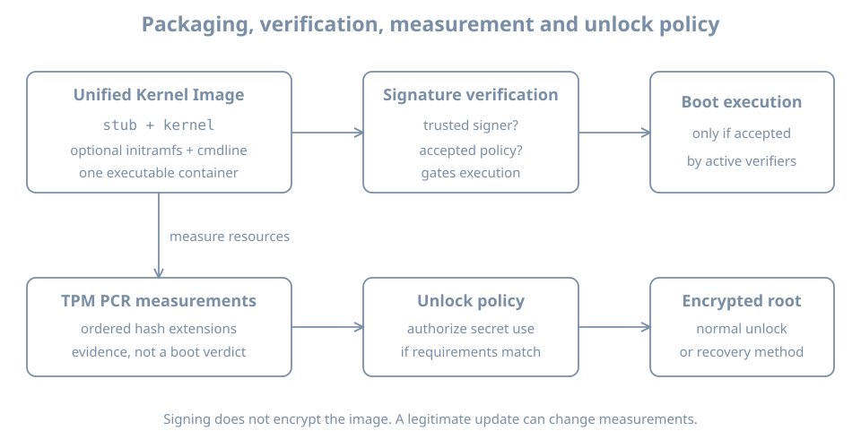

A kernel update installs successfully, but a host no longer unlocks its encrypted root automatically. A change can be authorized for execution while still changing measured state used by an unlock policy. To diagnose that situation, separate four questions: what is packaged, what is verified, what is measured, and what policy releases a secret.

This chapter builds the operational model and performs read-only inspection. Use `bl02` and its recorded firmware, bootloader, kernel and storage observations. The original lab does not require Secure Boot, a TPM, a unified kernel image or TPM-backed encryption. An absent feature is a valid observation. Do not change firmware keys, enroll a token, reseal a volume or remove an existing recovery credential in this exercise.

## Four related mechanisms

| Mechanism | Operational question | What it does not establish by itself |
|---|---|---|
| A unified kernel image (UKI) | Which boot resources are packaged in one EFI executable? | That it is signed, trusted or selected |
| Secure Boot verification | Will a verifier accept the next executable under its configured trust policy? | That every later file and runtime action is protected |
| Measured boot | What measurements were recorded or extended during boot? | That the measured state was automatically judged trustworthy |
| TPM-bound unlock policy | Under what conditions can a protected secret be released? | That a recovery credential exists or that all boots will satisfy the policy |

{fig-alt="A unified kernel image packages boot resources. Secure Boot verification may accept an executable according to trust policy. Measurements extend TPM PCR values. A separate policy may authorize release of a secret used to unlock encrypted root; a recovery route is needed if policy is not satisfied."}

These mechanisms can be combined, but none implies all the others. Secure Boot without encrypted storage does not make an offline disk confidential. Encryption does not prove that the booted software was authorized. A measurement is evidence of a state, not an access decision unless another component evaluates it.

## Secure Boot and a chain of trust

UEFI Secure Boot applies firmware trust policy to EFI executables. In the Ubuntu UEFI path, firmware can load a signed shim, which participates in the verification chain for subsequent boot components; the actual chain depends on installed software and configuration. Canonical's [Secure Boot documentation](https://documentation.ubuntu.com/security/security-features/platform-protections/secure-boot/) describes Ubuntu's implementation and key handling.

A signature is useful only with a verifier, trusted key or certificate, and policy. Trust databases and revocation state matter as well as the file's signature. A file's presence on the ESP does not establish that it is signed, accepted by current firmware, selected on the next boot, or the same file that ran earlier.

Secure Boot is not a general guarantee that every byte read after boot is authenticated. Coverage depends on the boot chain, configuration and mechanisms in use. Module-signing enforcement is a related but distinct kernel policy; an out-of-tree module can fail to load even when the kernel booted successfully. Diagnose the exact rejected component and policy rather than disabling verification as a generic repair.

### Inspect without changing trust

In the guest:

```bash
hostnamectl
if test -d /sys/firmware/efi; then
  printf 'EFI firmware interface is present\n'
else
  printf 'EFI firmware interface is unavailable in this boot\n'
fi
if command -v mokutil >/dev/null; then
  mokutil --sb-state
else
  printf 'mokutil is not installed; Secure Boot state was not checked\n'
fi
```

`mokutil --sb-state` reports the state available through the tool on a supported EFI system; record its output or error. An absent tool is not evidence that Secure Boot is disabled. If the guest firmware was created without Secure Boot support, or the relevant variable interface is unavailable, investigate the actual VM firmware configuration. Do not change the firmware mode or key database to obtain a particular answer.

Record the previously observed `BootCurrent` and EFI path if available. That is the firmware's reported selection for this boot, not a complete proof of every verification step. If a verification failure prevents boot, the firmware or loader console is often more useful than a journal on an inaccessible root.

## What a UKI packages

A **unified kernel image** is a UEFI executable containing a boot stub and Linux kernel, optionally an initrd and additional resources such as command-line data. The [UKI specification](https://uapi-group.org/specifications/specs/unified_kernel_image/) defines its structure. An actual UKI can be started by firmware directly or through a suitable bootloader.

Packaging can simplify distributing and signing a coherent set of boot inputs. It does not mean that every command-line source or external resource is covered by the same signature: that depends on the stub, loader, platform security state and policy. It also does not imply that every initramfs file on an Ubuntu host is inside a UKI. The separate `/boot/vmlinuz-*` and `/boot/initrd.img-*` files inspected earlier are one valid layout.

On a host already using systemd-boot, `bootctl status` and `bootctl list` may help identify its ESP and discoverable entries. Those commands do not prove that a discoverable UKI was the image selected for this boot. Compare firmware selection, loader evidence and the actual boot record. Do not install systemd-boot or create a UKI merely to complete this inspection.

## Measurements and policy

A **Trusted Platform Module** (TPM) can maintain platform configuration registers, or PCRs. Measurements are extended into PCRs in sequence: the resulting value depends on both earlier state and the new measurement. A verifier can compare measurements or evaluate a signed policy, and a local unlock mechanism can require an approved state before releasing a secret.

The chosen PCRs, event log, banks, firmware and policy determine what a measurement means. A PCR value without its measurement context is not a complete explanation of what booted. A legitimate firmware, bootloader, configuration or kernel update can change a policy-relevant measurement. A failed automatic unlock therefore calls for investigating the selected policy and update history; it does not automatically establish compromise.

For LUKS2, a TPM-backed enrollment can be one of several unlock methods. The [systemd-cryptenroll reference](https://www.freedesktop.org/software/systemd/man/latest/systemd-cryptenroll.html) describes both TPM policy options and recovery keys. Such an enrollment is a change to a real encrypted volume and is **not** part of this lab. A separately protected, tested recovery credential and documented recovery procedure are essential before an operator depends on automated unlock.

### Read-only availability check

If the guest has a TPM device exposed, Linux commonly shows an entry under `/sys/class/tpm`:

```bash
if test -d /sys/class/tpm; then
  ls -la /sys/class/tpm
else
  printf 'No TPM class directory is exposed\n'
fi
```

An empty or missing directory is an observation about this environment, not proof about the physical host's hardware. A virtual TPM, if configured, is a separate virtual device with its own persistent state and recovery implications. Do not attach a new TPM to the existing lab or assume the ordinary VM disk clone includes its state.

On a system whose installed `systemd-analyze` supports it, the following can provide additional TPM availability information:

```bash
systemd-analyze has-tpm2
```

Record the output **and exit status**; the command can report limited support or return nonzero. If the subcommand is unavailable, use the installed manual and record the limitation. TPM availability does not prove that Secure Boot is enabled, that a PCR policy exists or that disk unlock uses it.

## Worked diagnosis: update followed by an unlock prompt

A host normally unlocks automatically; after an update it requests a recovery credential. The administrator should:

1. Preserve the console message and identify the host and encrypted volume without exposing the credential.
2. Use the established recovery credential through the trusted console, if the recovery plan authorizes it. A prompt is not a reason to reformat the disk.
3. Record what changed: firmware, trust databases, loader, kernel, initramfs, UKI or unlock policy. Confirm which components actually booted.
4. Inspect the existing enrollment and policy using the platform's documented tools and authorized procedure. Compare relevant measurement evidence with the expected policy; do not assume a universal PCR set.
5. Plan and test a policy update with a retained recovery path and an explicitly verified subsequent boot.

A valid recovery unlock demonstrates access through that credential; it does not by itself prove why the automatic policy failed. Policy changes, key rotation and signed artifacts require the actual platform's procedures and are developed with storage and security operations later.

## Practice and recall

Record the guest's EFI interface, `mokutil` result or observation limit, boot path evidence, TPM availability result and whether this lab actually uses encrypted root. For each item state what it proves and one thing it does not. Keep firmware-variable dumps, device identifiers and recovery material out of shared notes.

- A UKI packages resources; trust depends on the verifier and policy.
- Secure Boot verifies selected executables, while measured boot records state for later evaluation.
- TPM availability does not establish an unlock policy.
- A legitimate update can change measurements; keep a tested recovery path before relying on automatic unlock.
- Inspect the rejected stage and preserve evidence before changing trust or encryption settings.
