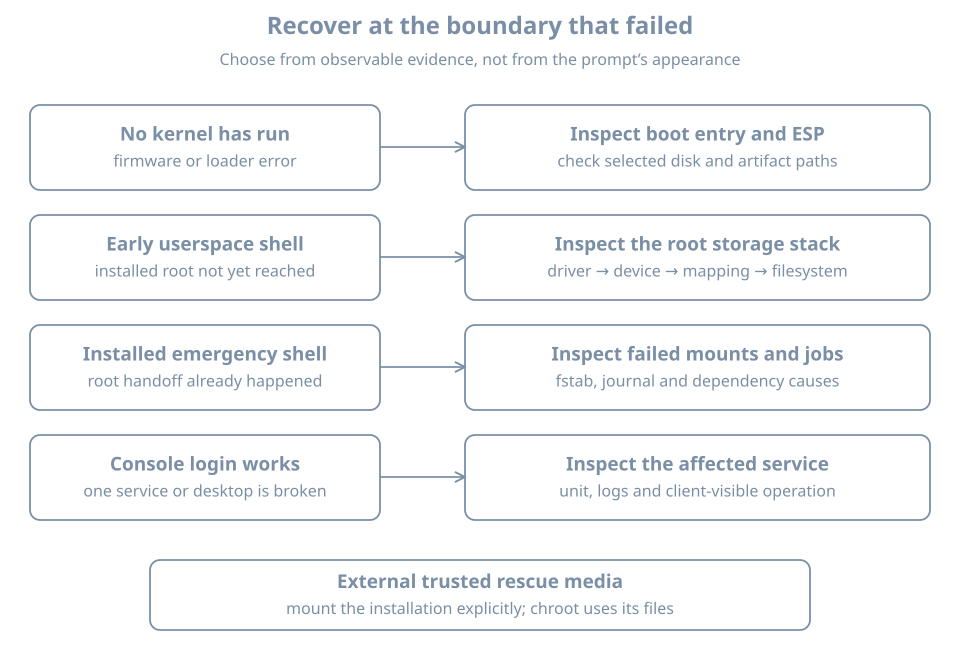

A host stops during boot and offers a shell. Before typing a repair command, identify **which system is running** and **which stage failed**. A shell in an initramfs, a systemd emergency shell and a shell from external installation media can have different roots, tools, credentials and access to the installed disk.

This chapter chooses a recovery environment from the observed failure and prepares a disposable guest for the next chapter's controlled repair. You need `bl02`'s firmware and storage record, a verified Ubuntu Server 26.04 installer ISO, console access, and enough host space for a full clone. Keep the original guest and its recovery baseline unchanged. This is an exercise on a clone only; a real incident may require preserving additional evidence before any write.

## Identify the failed boundary

{fig-alt="Firmware or loader selection, early root discovery, installed-system mounts, and individual service startup are separate observed boundaries. Trusted external media can provide a separate environment to inspect the installed system when its own recovery path is unavailable."}

| Last reliable observation | Likely boundary to investigate | Useful evidence |
|---|---|---|
| Firmware cannot find a boot option | Firmware, device or EFI path | VM disk attachment, boot entry, ESP identity |
| Bootloader appears but cannot load an image | Loader configuration or boot filesystem | Selected menu entry and exact error |
| Kernel starts but root cannot be found | initramfs, device discovery or storage stack | Console message, root argument, storage record |
| Installed manager reports a failed required mount | Installed root, mount intent or device | Console, fstab and actual filesystem identity |
| Login works but a service fails | Service or later dependency | Unit status, logs and client test |

This table narrows an investigation; a single message does not prove a root cause. Preserve the exact wording, selected VM, timestamp, recent changes and boot entry. A retry or forced reset can hide the first failure. Never format a disk, reset encryption, rewrite all boot variables or disable verification to silence a symptom.

## Know which root and manager you are using

**Rescue mode** is a reduced installed-system environment intended for maintenance; **emergency mode** is more minimal and can be reached when essential startup work fails. Their exact mounts and available authentication depend on the failure and distribution. The [systemd special-unit reference](https://www.freedesktop.org/software/systemd/man/latest/systemd.special.html) describes the targets. An Ubuntu installation may have a locked root password, so an emergency login prompt is not necessarily usable with the ordinary `learner` password. Plan an external route rather than assuming a shell will be granted.

An **initramfs shell** appears earlier, before the installed root has necessarily been mounted. It uses the early environment's tools and device view. An **external live environment** boots its own kernel and root from trusted media; the installed system is a separate disk to identify and mount. `uname -r` in that environment describes the live kernel, not the installed kernel.

A shell prompt does not prove that `/` is the installed root, that it is writable, or that its separate `/boot` and ESP are mounted. Establish that explicitly with `findmnt`, `lsblk`, the VM definition and the installation record. A chroot changes the root path used by a process; it does not boot the installed kernel or give it an independent service manager.

## Prepare the controlled fault

On the host, shut down `bl02` cleanly and verify its disk and state using `virsh` as in the prior clone exercises. The following assumes one writable system disk, no backing chain, shared writable storage or TPM state. Verify adequate host space and that both destination names are unused:

```bash
sudo virsh --connect qemu:///system domstate bl02
sudo virsh --connect qemu:///system domblklist bl02 --details
sudo virt-clone --connect qemu:///system \
  --original bl02 --name bl03-rescue-lab \
  --file /var/lib/libvirt/images/bl03-rescue-lab.qcow2
```

Only clone after the state reports `shut off`. Compare the original and clone domain XML and disk paths, including distinct UEFI NVRAM files. Attach the clone's NIC to `blpractice` while it is off; no network access is required for the fault. Keep the original off because the cloned guest retains its internal hostname, machine ID and credentials. Use the manager's `bl03-rescue-lab` console and confirm its disk path before proceeding.

Inside the clone, ensure the reserved lab directory and backup file do not exist:

```bash
sudo test ! -e /mnt/bl-fault && sudo test ! -e /etc/fstab.bl03-before
```

The combined check must succeed. If either fails, stop and inspect rather than overwriting prior work. Choose a deliberately nonexistent filesystem UUID and verify no matching filesystem is reported:

```bash
sudo blkid -t UUID=11111111-2222-4333-8444-555555555555
```

No output with exit status 2 means `blkid` found no matching device in this view. Any matching output or another error means stop and choose a new unused UUID after checking it. This check does not make the string a general-purpose identifier; it merely bounds this one guest's exercise.

Create the empty mountpoint and a preserved copy of the current configuration:

```bash
sudo mkdir /mnt/bl-fault
sudo cp -a /etc/fstab /etc/fstab.bl03-before
sudo cmp /etc/fstab /etc/fstab.bl03-before
```

Proceed only after the comparison succeeds. Append exactly one required mount entry with a short device wait:

```bash
printf '%s\n' 'UUID=11111111-2222-4333-8444-555555555555 /mnt/bl-fault ext4 defaults,x-systemd.device-timeout=15s 0 2' | sudo tee -a /etc/fstab
```

Review `sudo tail -n 3 /etc/fstab` and compare it with the backup. The intended difference is one new line; the system's existing root and boot entries must remain unchanged. The line requests a filesystem that does not exist, and deliberately omits `nofail`. The `x-systemd.device-timeout=` option controls the device wait when interpreted by systemd's fstab generator; see the [systemd mount documentation](https://www.freedesktop.org/software/systemd/man/latest/systemd.mount.html). The directory contains no useful data and is not a root or boot filesystem.

If the file differs in any other way, restore the backup **while the clone is still running**, verify it and stop. Do not run `mount -a`: the intended experiment is the next boot, and mounting all configured filesystems is broader than necessary.

## Observe the fault and choose recovery

With the clone console open, reboot normally. Allow time for the device timeout and observe the exact message and resulting mode. A typical systemd installation enters emergency handling for the missing required mount, but distribution policy and boot configuration can differ. Record the result instead of assuming the prompt is usable. Do not enter credentials into an unidentified environment.

If the host reaches an ordinary login instead, inspect `systemctl --failed`, `findmnt --mountpoint /mnt/bl-fault`, and the current-boot journal from the clone. Reconcile the actual behavior with the appended line. In either case, the next chapter repairs the clone using verified external media, so a locked root account is not a blocker.

After recording the failure, shut down the clone through its available normal controls if possible. If it cannot respond to a normal shutdown, the disposable clone's manager power-off may be used as a last resort after recording that fact; never apply that step to another guest. Wait for `shut off`. Leave its disk attached and keep `bl02` off. The next chapter continues from this stopped, deliberately faulty guest.

## Practice and recall

Record the selected clone and disk, the saved fstab path, the fault line, the observed console boundary and whether a normal shutdown succeeded. Explain why the installed root password might not open an emergency shell and why external media can still offer a separate recovery environment.

- Identify firmware, loader, early root, installed mounts and service failures separately.
- A rescue shell's root and kernel depend on where it came from.
- Preserve the fault and recovery evidence before making further changes.
- Keep a known-good original and a verified external route when testing boot failures.
