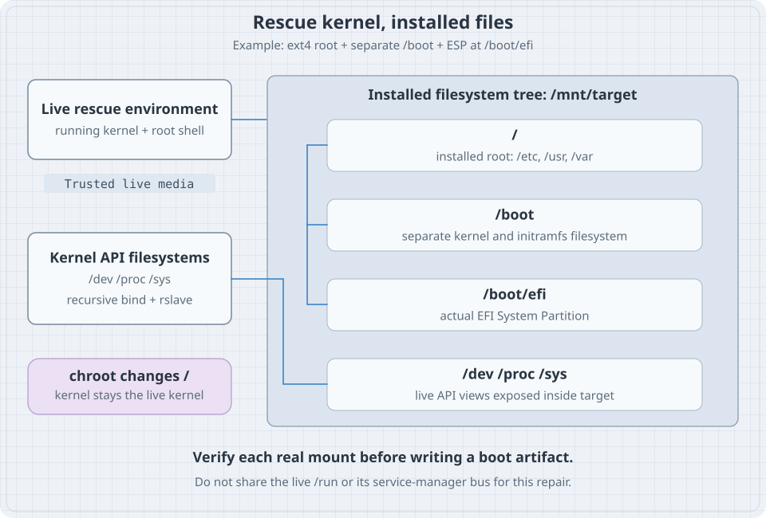

The previous exercise added a nonexistent required mount to `bl03-rescue-lab`. The installed root may be intact even if its boot stops at emergency handling. This chapter boots trusted external media, identifies the clone's installed root, restores the saved fstab inside a limited chroot, and verifies the next normal boot.

Only the deliberately faulty clone is a repair target. The original `bl02` stays shut down. You need its storage record, the clone's unique disk path and NVRAM record, the verified Ubuntu Server 26.04 amd64 ISO, VM console access and the fault record. This lab assumes the unencrypted, single-disk guided LVM root from Part 02. If your clone has another layout, use its own documented recovery procedure rather than guessing devices or passwords.

## Boot a separate environment

Confirm on the host that the clone is off and that its writable disk is the recorded clone disk:

```bash
sudo virsh --connect qemu:///system domstate bl03-rescue-lab
sudo virsh --connect qemu:///system domblklist bl03-rescue-lab --details
```

Attach the verified installer ISO as a read-only optical device to this clone. Keep the single system disk attached. Boot the ISO using the VM manager's one-time boot selection and open the console. Do not begin a new installation or accept storage formatting. On Ubuntu Server's live installer, switch to an available installer shell according to its console instructions. The shell runs the live system, not the installed guest. If the ISO or console is not the verified one, stop.

In the live shell inspect:

```bash
cat /etc/os-release
uname -r
findmnt --target / --output TARGET,SOURCE,FSTYPE
lsblk -o NAME,PATH,SIZE,TYPE,FSTYPE,UUID,MOUNTPOINTS
sudo pvs
sudo vgs
sudo lvs -o lv_name,vg_name,lv_path,lv_size
```

The live kernel release and live `/` do not describe the installed guest's running kernel or root. Match the disk size, volume-group and logical-volume names to the recorded clone. If the expected LVM tools or logical volume are unavailable, or multiple volumes make the target ambiguous, stop. Activation of a volume group is a separate operation. If the recorded root LV is present but inactive, and only the verified clone disk is attached, identify its exact volume-group name in `vgs`. Set `VG_NAME` to that observed name in the live shell and activate only that group:

```bash
printf '%s\n' "$VG_NAME"
test -n "$VG_NAME" && sudo vgchange -ay "$VG_NAME" &&
  sudo lvs -o lv_name,vg_name,lv_path,lv_attr
```

Stop if the name is empty or ambiguous, duplicate volume groups are present, or the activation fails. Do not activate every volume group indiscriminately.

## Mount the verified installed root

The goal is to restore one known fstab backup on the root filesystem. No separate `/boot`, ESP or pseudo-filesystem mount is needed for this specific repair.

First ensure `/mnt/bl-target` does not already exist in the live environment:

```bash
sudo test ! -e /mnt/bl-target
sudo mkdir /mnt/bl-target
```

Run `mkdir` only if the test succeeds. From `lvs`, select the **actual** root LV path that matches the lab record. Assign that observed absolute path to `ROOT_DEVICE` in the live shell; for example, `ROOT_DEVICE=/dev/mapper/observed-name` is only a shape, not a value to copy. Check it before mounting:

```bash
printf '%s\n' "$ROOT_DEVICE"
test -b "$ROOT_DEVICE"
sudo lsblk -f "$ROOT_DEVICE"
```

Stop if the variable is empty, the device check fails or its identity is not the recorded clone's root. The mount below is intentionally writable because the next step repairs the clone:

```bash
sudo mount "$ROOT_DEVICE" /mnt/bl-target
findmnt --mountpoint /mnt/bl-target --output TARGET,SOURCE,FSTYPE,OPTIONS
sudo cat /mnt/bl-target/etc/os-release
sudo tail -n 4 /mnt/bl-target/etc/fstab
sudo ls -l /mnt/bl-target/etc/fstab.bl03-before
```

Require an exact mount of the intended device, the expected Ubuntu installation and the deliberate fault line plus backup file. If the evidence differs, unmount and investigate; do not restore a file into a directory on the live root by mistake. If inspection alone is needed in a real incident, use an appropriate read-only procedure first and account for filesystem-specific recovery behavior. This planned lab write is not a general instruction to mount damaged production filesystems read-write.

{fig-alt="The live environment supplies the running kernel and mounts an installed system under a target directory. A complete boot repair may additionally require the installed boot filesystem, ESP and live kernel interfaces; this single fstab repair needs only the verified root mount. A chroot changes path resolution but still uses the live kernel."}

## Repair the specific file

Review the saved backup and fault:

```bash
sudo diff -u /mnt/bl-target/etc/fstab.bl03-before /mnt/bl-target/etc/fstab
```

The expected difference is the one deliberately appended mount line. `diff` exits with status 1 for differences. If unrelated changes appear, stop and understand them; restoring an old copy could discard legitimate configuration.

Enter a chroot rooted at the mounted clone:

```bash
sudo chroot /mnt/bl-target /bin/bash
```

The shell now resolves `/etc/fstab` within the installed filesystem, but uses the **live kernel**. It has not booted the installed system, and normal systemd service operations are not available merely because paths changed. The [chroot manual](https://manpages.ubuntu.com/manpages/resolute/man8/chroot.8.html) describes this changed root directory.

Inside the chroot, verify the fault and backup once more, then restore the lab's saved file:

```bash
hostname
cat /etc/fstab
ls -l /etc/fstab.bl03-before
cp -a /etc/fstab.bl03-before /etc/fstab
cmp /etc/fstab.bl03-before /etc/fstab
exit
```

The `hostname` command reports the live kernel's hostname, not authoritative proof of the installed guest's hostname. The exact mounted source and inspected files were the target checks. `cp -a` restores the saved file and its attributes; `cmp` should be silent and successful. `exit` returns to the live shell. Do not continue into package, GRUB or initramfs repair: those require additional correctly mounted filesystems and a different plan.

Outside the chroot, verify the target mount and repaired file again:

```bash
findmnt --mountpoint /mnt/bl-target --output TARGET,SOURCE,FSTYPE
sudo cmp /mnt/bl-target/etc/fstab.bl03-before /mnt/bl-target/etc/fstab &&
  sudo umount /mnt/bl-target
```

Unmount only after leaving the chroot and ensuring no process is using that tree. If unmount fails, inspect the busy mount and processes; do not detach the disk or force a shutdown while writes may still be in progress. The [findmnt manual](https://manpages.ubuntu.com/manpages/resolute/man8/findmnt.8.html) distinguishes an exact mountpoint from the filesystem containing a path.

## What a broader chroot repair would require

A bootloader or initramfs repair may need the installed `/boot`, ESP and kernel interfaces such as `/dev`, `/proc` and `/sys` mounted in the right places. Each must be identified and mounted deliberately; bind-mount propagation, cleanup order, architecture, installed kernel version, package ownership and EFI variables all matter. Do not use the live kernel's `uname -r` as the installed release. Do not share the live `/run` blindly. Firmware variables exposed to the live environment are those of this VM and can be changed by repair tools.

The diagram shows those possible relationships, not an instruction to mount all of them for the fstab exercise. Chroot is not a security boundary or an independently running VM. Restore from a known-good copy when that is the selected plan; use a separate verified backup if the original storage may be damaged. Recovery media and VM clones on the same host do not constitute an independent backup.

## Boot normally and verify

Shut down the live environment cleanly. In the VM manager detach the installer ISO, retain the clone disk and restore its normal disk boot selection. Confirm the original `bl02` remains off. Start `bl03-rescue-lab`, log in through its console and inspect:

```bash
hostnamectl
findmnt --target / --output TARGET,SOURCE,FSTYPE,OPTIONS
systemctl --failed --no-pager
sudo cmp /etc/fstab.bl03-before /etc/fstab
findmnt --mountpoint /mnt/bl-fault
```

The hostname may still say `bl02` because this is a clone. The manager's name and disk path distinguish it. Success requires normal login, the recorded root source, a successful `cmp`, no unexplained failed units, and **no exact mount** at `/mnt/bl-fault`. The last command normally returns no output and a nonzero status when no such mount exists; that is expected here. Also inspect the current-boot journal if a failure remains. A repaired file alone is not proof that the normal boot path works.

Remove the now-unused empty `/mnt/bl-fault` directory from the clone with `sudo rmdir /mnt/bl-fault` only after confirming it is not a mount and contains no files. Retain the backup and notes until the exercise is reviewed. Shut down the clone before starting the original. Do not delete or reformat a disk as part of cleanup.

## Recall card

- External media runs its own kernel and root; identify the installed disk separately.
- A writable mount is a deliberate repair action, not proof that a filesystem is healthy.
- Chroot changes path resolution; it does not boot the target system.
- Mount only the components needed for the planned repair and unmount them cleanly.
- The acceptance test is the next normal boot plus the expected root and service state.
