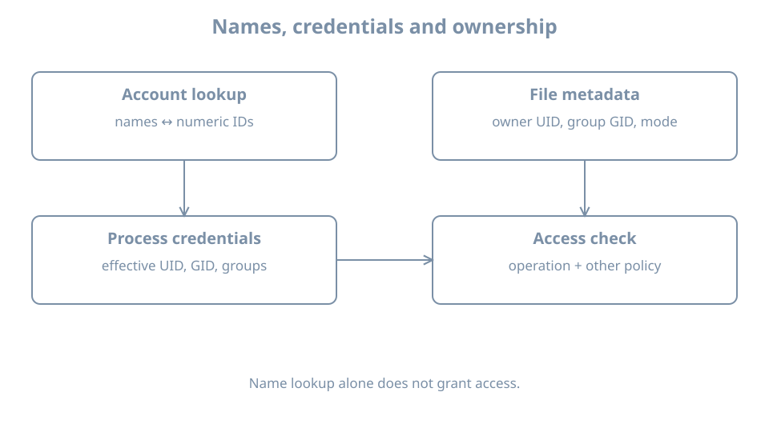

A file is owned by `learner`, but another process cannot read it. The name printed by a tool is only one part of the answer. Linux checks numeric process credentials against numeric file ownership and permission rules. To explain an access decision, identify the process, the file, its containing directories and the operation being attempted.

This chapter starts the local identity model using the `bl02` console. Its lab creates a small private directory in the current user's home; it does not change other accounts or system files. You need a working `learner` login and the ability to inspect files and run commands.

## Names describe numeric identities

A **user ID** (UID) identifies a user to the kernel. A **group ID** (GID) identifies a group. Files record an owner UID and group GID; processes have user and group credentials used in access checks. Tools commonly translate the numbers into names for display. If a name lookup is unavailable, the number can still exist on the file.

The special UID 0 has extensive administrative privilege, but a process's actual authority also depends on capabilities, namespaces and other restrictions. Do not assume that a username containing `admin`, or membership in a group with a familiar name, automatically grants every operation.

```bash
id
id -u
id -g
id -G
```

`id` shows the current process's identity and group list. `-u` gives the effective UID, `-g` the effective primary GID, and `-G` the group IDs. A process can also have supplementary groups. The account database's current membership and the credentials already held by a running process can differ after an administrative change: start a new session and inspect its actual credentials.

{fig-alt="An account lookup maps names to numeric user and group identifiers. A process has effective user, group and supplementary group credentials. A file has a numeric owner, group and permission bits. The kernel evaluates the requested operation using these and additional policy; name lookup alone does not grant access."}

## Read ownership and permissions

Create a private lab directory and file:

```bash
umask 077
mkdir "$HOME/bl-identity-lab"
```

If the directory already exists, stop and inspect it instead of overwriting its contents. Only after `mkdir` succeeds, create and inspect the file:

```bash
printf 'identity lab\n' > "$HOME/bl-identity-lab/note.txt"
ls -l "$HOME/bl-identity-lab/note.txt"
ls -ln "$HOME/bl-identity-lab/note.txt"
stat -c 'uid=%u gid=%g mode=%a name=%n' "$HOME/bl-identity-lab/note.txt"
```

`umask` affects newly created objects in this shell; it does not change existing permissions. The named and numeric `ls` views describe the same file. `stat` prints the stored numeric owner and group, plus the permission mode in octal.

For a simple regular file with mode `0640`, the owner has read and write, the group has read, and others have no permission. For directories, the same letters have different operational meanings: read permits listing names, write permits changes to entries subject to other rules, and execute permits traversal. Access to a file also requires traversal through each parent directory. A readable file behind an inaccessible home directory is not necessarily readable by another user.

A normal mode-bit check considers the applicable owner, group or other class; access control lists and other policies can add rules. Privileged processes and capabilities can alter outcomes. Deeper permissions and policy are covered later; this first model is enough to avoid assuming that a displayed username is the entire authorization rule.

## Primary and supplementary groups

The primary group is part of a process's credentials and normally influences the group of newly created files. A parent directory with the set-group-ID bit or filesystem policy can change the resulting group. Supplementary groups provide additional group memberships for access checks.

Inspect both a process and an account lookup:

```bash
id
id learner
getent passwd learner
```

The first command reports this process's credentials; `id learner` asks for the named account's identity and group information, which may differ from an already running session. `getent` queries the configured name-service database. These reports do not themselves grant or revoke access.

A file's stored owner is a number. If an account is deleted and that UID later assigned to another account, old files can appear owned by the new account. This is why account retirement must include an inventory and ownership decision; deleting a username does not erase every file created by that user.

## Worked diagnosis: group was added but access still fails

An administrator adds a user to a group. The user keeps an old terminal open and still gets permission denied. Possible causes include stale process credentials, missing directory traversal permission, a different group owning the file, an ACL or another policy.

1. In the failing session run `id`; record its effective IDs and supplementary groups.
2. Inspect the intended file and every relevant parent directory with `ls -ld` and `ls -ln`.
3. Start a new authorized login session and run `id` again; a database change does not rewrite the credentials of existing processes.
4. Repeat the specific operation and record the result. If it still fails, inspect the applicable ACL and security policy rather than making the whole tree world-writable.

Do not use `sudo` as the test of ordinary-user access: it tests a different process identity. Likewise, changing a group record does not automatically terminate existing processes or sessions.

## Practice and recall

Compare the named and numeric owner/group of `note.txt` with `id`. Explain why changing a displayed username would not itself change the file's stored UID. Verify the directory and file modes, then remove only the lab file and empty directory when done:

```bash
rm "$HOME/bl-identity-lab/note.txt"
rmdir "$HOME/bl-identity-lab"
```

`rmdir` refuses a nonempty directory. If it fails, inspect the contents instead of deleting unrelated files.

- Processes use numeric credentials; names are lookup results.
- Files store numeric owner and group identities.
- Existing sessions retain their own group credentials until replaced or otherwise changed.
- File access also depends on directory traversal and other policy.
