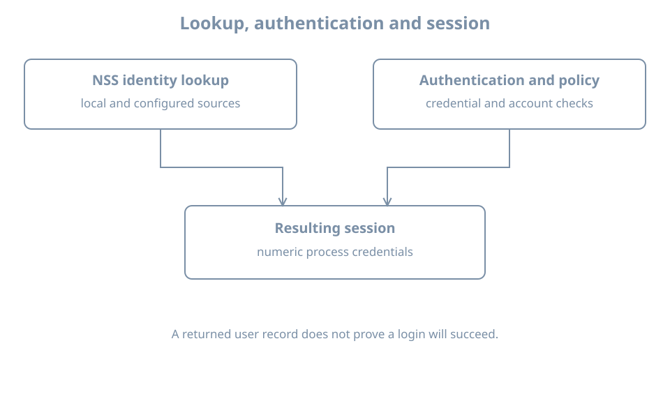

A user is visible to `getent`, but no matching line appears in `/etc/passwd`. That is possible when the configured name service obtains an account from another source. Conversely, finding a local record does not prove that the account can authenticate or access a particular file.

Use `bl02` and the working console account. This chapter only reads local configuration and identity results. It does not connect the lab to a directory service or modify authentication policy.

## Local records have different purposes

`/etc/passwd` contains local account information such as login name, numeric UID, primary GID, home directory and login shell. It is commonly readable by local users because programs need identity metadata. The password field commonly contains a placeholder indicating that password data is stored separately; do not infer that an account has a usable password merely from that placeholder.

`/etc/group` records local groups and may list supplementary members. A user's primary group is specified in the account record and may not appear in the group's member list. Protected `/etc/shadow` holds local password-related data and aging fields. It is sensitive: do not print, copy or publish its hashes for this exercise. Additional mechanisms may provide identity or authentication without a local shadow entry.

Inspect your own local records and the system's configuration:

```bash
getent passwd "$(id -un)"
getent group "$(id -g)"
rg '^passwd:|^group:|^shadow:' /etc/nsswitch.conf
```

If `rg` is unavailable inside the guest, use:

```bash
grep -E '^(passwd|group|shadow):' /etc/nsswitch.conf
```

`getent` uses the Name Service Switch (NSS), the library mechanism that consults configured sources. The [getent manual](https://manpages.ubuntu.com/manpages/resolute/man1/getent.1.html) describes the supported databases. `/etc/nsswitch.conf` controls source order and can include action clauses; its [manual](https://manpages.ubuntu.com/manpages/resolute/man5/nsswitch.conf.5.html) defines those rules. Do not change NSS configuration in this chapter.

A passwd-style result has colon-separated fields:

```text
name:password-field:UID:GID:comment:home:shell
```

Names and values are examples of field roles, not values to paste into account files. The database reports identity metadata; an actual login also involves authentication, account policy, session setup and the availability of the home directory and shell. Those mechanisms are developed later.

## A lookup is not the whole login

{fig-alt="An application requests a user record through NSS, which consults configured local or other sources and returns identity metadata. A separate authentication and account-policy path decides whether a presented credential and login are accepted. The resulting session carries numeric credentials used for access checks."}

A successful `getent passwd learner` establishes that this lookup returned a record. It does not establish which credentials are accepted, whether the account is expired, whether the shell can run, or whether a particular service permits login. Conversely, an authentication failure does not automatically mean that identity lookup failed.

Compare the local source with the effective lookup:

```bash
grep '^learner:' /etc/passwd
getent passwd learner
id learner
```

On this lab's local account, expect a local record and a successful effective lookup. If either is absent, check the selected guest and actual account name before changing anything. A local line and `getent` may be textually equal without proving that no other source contains a duplicate name. Source ordering and status actions matter.

For groups, compare:

```bash
grep '^learner:' /etc/group
getent group "$(id -g)"
id learner
```

The private primary group may have the same name as the user, but that convention is not guaranteed. A group membership list in `getent group` is not a complete substitute for `id learner`, because the latter also accounts for the primary group and lookup behavior.

## Worked diagnosis: a lookup fails

Suppose `getent passwd example` returns no entry. First verify the spelling and guest identity. Then inspect the `passwd:` source order, query the known local file, and record the command's exit status. A remote source, if configured, introduces service and network dependencies; enumeration may be unavailable even when a lookup by key works.

Do not add a duplicate local account or change NSS source order to hide the failure. A reused name or UID can attach existing files to the wrong identity. Determine the authoritative identity source and its health before making a change. Later identity and networking chapters cover directory integration once those dependencies have been introduced.

## Practice and recall

Record the source order for `passwd` and `group`, your own effective lookup and the numeric IDs from `id`. Explain why the primary group need not list the username as a supplementary member and why successful lookup does not prove successful login. Redact account details before sharing the record.

- Local account files hold different kinds of data; shadow hashes are sensitive.
- NSS chooses identity sources; `getent` tests an effective lookup.
- Identity lookup, authentication, account policy and authorization are separate steps.
- A database change does not automatically replace credentials in existing sessions.
