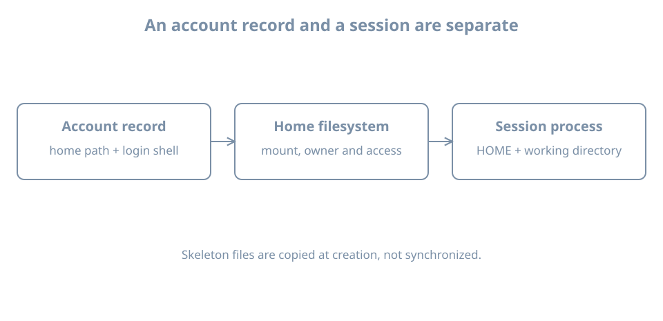

An account exists and its password is accepted, but the user lands in `/` with a warning that the home directory cannot be entered. Identity lookup, authentication and the session environment have succeeded or failed at different boundaries. The home path in an account record is an intention; the directory, its ownership, its mount and the process environment are separate observations.

Use the disposable `bl04-accounts-lab` clone from the previous chapter, with `bl02` powered off and the clone on `blpractice`. Keep the `learner` console and administrative access. If the clone was retired, create a fresh full powered-off clone using the earlier single-disk, separate-NVRAM procedure. The guest hostname may still be `bl02`; verify the manager's clone name and disk path.

## A record, a directory and an environment

The account record contains a home path and login shell. On a conventional system, the home holds a user's persistent files and personal configuration. Its location is not necessarily `/home/NAME`: it may be on another local filesystem or a network mount. `$HOME` is an environment variable inherited or set by session-starting software. It is not itself proof of the account record, a mounted filesystem or correct ownership.

Inspect the current session:

```bash
id
getent passwd "$(id -un)"
printf 'HOME=%s\nSHELL=%s\n' "$HOME" "$SHELL"
pwd
ls -ldn "$HOME"
findmnt --target "$HOME" --output TARGET,SOURCE,FSTYPE,OPTIONS
umask
```

`pwd` is the current working directory, which can differ from `$HOME`. `$SHELL` commonly identifies a configured or inherited shell, but does not prove which executable is running. A containing-filesystem query does not prove home is its own mount. Compare the numeric owner with `id -u` and consider parent directory traversal. The [getent manual](https://manpages.ubuntu.com/manpages/resolute/man1/getent.1.html) describes the effective identity lookup.

Avoid dumping the entire environment into shared notes: it may contain credentials, tokens, private paths or other sensitive values. A user's shell startup files can also change variables after login; a non-login command or service can receive a different environment. This chapter inspects values rather than teaching a separate shell course.

{fig-alt="An account record specifies a home path and login shell; the home filesystem has its own mount and permissions; a session process has HOME and a working directory. Skeleton files are initial copies."}

## Skeletons are initial copies

On Ubuntu, account-creation tools can populate a new home from a skeleton directory, commonly `/etc/skel`. These are initial copies, not a synchronization service: later changes to the skeleton do not automatically update existing users' homes. Tool options, pre-existing destination paths and distribution configuration affect the result. The [Ubuntu adduser manual](https://manpages.ubuntu.com/manpages/resolute/man8/adduser.8.html) describes its account-creation behavior; `useradd` has its own options and defaults.

Inspect the skeleton without changing it:

```bash
ls -la /etc/skel
getent passwd learner
```

A dot-prefixed name is ordinarily hidden by a plain `ls`. Do not copy private credentials into a shared skeleton, and do not assume a skeleton file has the right settings for every user. Existing home contents may have been customized since account creation.

## Lab: create and inspect a fresh home

Use a new lab name `blhome`. Check each condition before creating anything:

```bash
getent passwd blhome
getent group blhome
test ! -e /home/blhome
```

Both lookups should return no record with status 2, and the home-path test must succeed. An existing name, path or lookup error means stop. Consider configured NSS sources too, as in the account-lifecycle chapter.

Create the local user and set a unique disposable password:

```bash
sudo useradd -m -U -s /bin/bash blhome && sudo passwd blhome
```

If either step fails, inspect the partial state before retrying. Do not record the password in notes. Inspect the resulting account and directory:

```bash
getent passwd blhome
id blhome
sudo ls -ldn /home/blhome
sudo ls -la /home/blhome
sudo ls -la /etc/skel
```

Compare filenames and ownership; if a skeleton file is present in both places, compare a specific nonsecret file with `sudo cmp /etc/skel/FILE /home/blhome/FILE` after replacing `FILE` with the actual name. A comparison proves byte equality at that moment, not that the files remain synchronized.

Start a new session from the ordinary `learner` shell:

```bash
su - blhome
```

After authenticating, run `id`, `pwd`, `printf '%s\n' "$HOME"`, and `findmnt --target "$HOME"`. Confirm the account's observed home and process credentials, then `exit`. The login shell may source startup files; output and exact environment vary with configuration.

## Diagnose a missing or inaccessible home

Suppose authentication succeeds but the home is unavailable. Check the account's **actual** home field with `getent passwd`, the mount containing that path with `findmnt`, and the directory plus parents with `ls -ldn`. Compare its numeric owner with the account's UID. A missing network mount, a stale UID, denied traversal and a nonexistent directory require different remedies. Do not recursively `chown` a guessed path, recreate a mountpoint over hidden data, or broaden permissions for all users.

For a real migration, plan the copy method, numeric identities, ACLs, extended attributes, capacity, consistency and the old and new home paths. Verify a fresh login and data access before retirement of the original. Changing the account record alone does not copy files.

For lab cleanup, exit every `blhome` session, record the UID and home, and remove only the account record with `sudo userdel blhome`. The home remains for inspection; it may display a numeric owner. Retain it on this disposable clone until a deliberate cleanup. Do not reuse the UID while its files remain. The original `learner` account must continue to work.

## Recall card

- Account home, mounted filesystem, `$HOME` and current working directory are distinct.
- A skeleton supplies initial files; it does not update existing homes.
- Inspect numeric ownership and parent traversal before changing permissions.
- Test a new login session and preserve existing administrative access.
