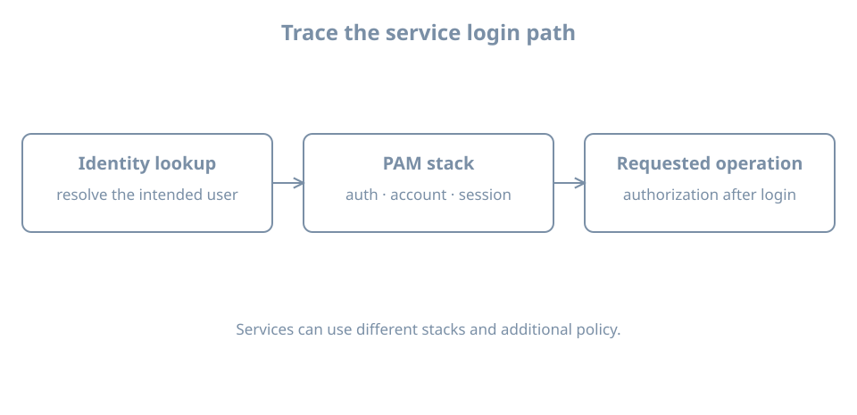

The same user can succeed at one login service and fail at another. Those services may invoke different PAM configurations, use different authentication methods or apply different account and session rules. A diagnosis starts with the actual service and its evidence, not a blanket edit to every login path.

Use the disposable `bl04-accounts-lab` clone and the `blpass` account created in the preceding chapter. Keep the working `learner` administrator console open. The exercise locks and unlocks only `blpass`'s previously working local password; it does not edit the PAM stack.

## What PAM coordinates

Pluggable Authentication Modules (PAM) provide a framework through which a participating application asks configured modules to perform authentication-related work. A PAM **service name** selects its configuration, usually a file under `/etc/pam.d/`. The caller and configured modules determine the actual behavior.

Four common management groups are:

| Group | Question |
|---|---|
| `auth` | Can the presented authentication method establish the claimed identity? |
| `account` | Is this account permitted under applicable account policy now? |
| `password` | How is an authentication token changed? |
| `session` | What setup and cleanup apply to a session? |

The names describe module responsibilities; they do not imply that all applications invoke every group in the same way. Identity lookup can use NSS, and a service can also have non-PAM authorization rules. The [PAM configuration manual](https://manpages.ubuntu.com/manpages/resolute/man5/pam.conf.5.html) defines service files, module types and control syntax.

A stack is ordered policy, not just a list of installed modules. Control fields determine how results affect evaluation; `required`, `requisite`, `sufficient`, `optional` and bracketed controls have different behavior. `include` and distribution-specific include syntax can refer to other files. Do not infer an entire login result from one matching line.

{fig-alt="Identity lookup resolves the intended user; the service runs configured authentication, account and session checks; the resulting identity is then subject to authorization for an operation. The exact flow differs by service."}

## Inspect the relevant service

For the lab's `su` path, inspect the installed files:

```bash
ls -l /etc/pam.d/su /etc/pam.d/common-*
sudo cat /etc/pam.d/su
sudo cat /etc/pam.d/common-auth
sudo cat /etc/pam.d/common-account
```

Files and includes can differ by installed provider and version. The actual `su` command may come from a different package on another system; inspect it with `command -v su` and `dpkg -S "$(command -v su)"` where applicable. A package lookup may not resolve a symlink in the way you expect; inspect the actual path before drawing conclusions.

Ubuntu's `pam-auth-update` manages packaged profiles and the common configuration files. Its [manual](https://manpages.ubuntu.com/manpages/resolute/man8/pam-auth-update.8.html) explains how it treats local modifications. We do not invoke it here: changing a common stack can affect multiple login and privilege paths, and `--force` can overwrite local policy. A known-good console session and recovery method are essential before a real PAM change.

## Lab: observe a bounded failure and recovery

First confirm the test account's known-good login from the ordinary `learner` shell:

```bash
getent passwd blpass
sudo passwd -S blpass
su - blpass
```

Authenticate with the test password, run `id`, then `exit` back to `learner`. Stop if the baseline login does not work. Do not use `sudo su` for the test: root's invocation follows different privilege and authentication circumstances.

Record the current time, then lock only the test password:

```bash
date -Is
sudo passwd -l blpass
sudo passwd -S blpass
```

Confirm the locked status. From the non-root `learner` shell, attempt `su - blpass` once with the known password. Expect failure under this local lab's policy. If it succeeds or behaves unexpectedly, exit the test session if one opened and investigate; do not keep trying passwords. Existing sessions and other authentication mechanisms can behave differently.

Inspect recent evidence without exposing credentials:

```bash
sudo journalctl -b --since '-5 minutes' --no-pager
```

Search the relevant time and service messages in the displayed output. Logging details and identifiers depend on the installed `su`, PAM modules and journal configuration. A message may be absent, and the journal can contain unrelated sensitive data; do not publish it unredacted. A failed attempt, local password status and PAM configuration are complementary observations, not a complete causal proof on their own.

Unlock this test account's previously working password and verify recovery:

```bash
sudo passwd -u blpass
sudo passwd -S blpass
su - blpass
```

Authenticate once, run `id`, and `exit`. Unlocking is justified because this exercise locked a known usable password. If the original status was unknown, do not blindly unlock it. The test demonstrates this service's behavior; it does not prove that SSH, a graphical login or another service has the same policy.

## Follow a failure through the boundaries

For a real report, record the service, user, client, timestamp and exact failure without collecting the secret. Then distinguish:

1. **Identity:** does `getent passwd USER` resolve the intended account from the intended source?
2. **Authentication:** was the applicable credential accepted by the configured method?
3. **Account:** is the account locked, expired or restricted by policy?
4. **Session:** can the service establish the requested session, home and shell?
5. **Authorization:** is the resulting identity permitted to perform the requested operation?

Substitute the actual user in the lookup. A password prompt is not proof that the correct identity source was used; a successful password check is not proof that a session or later authorization succeeded. If the failure affects the administrator path, retain any working privileged console and use the documented recovery plan before editing configuration. Never comment out all PAM checks or paste an unreviewed stack from another distribution.

Leave `blpass` available for the following privilege exercise if needed, or retire it on the disposable clone using the account-lifecycle procedure after all relevant sessions end. Keep its UID and retained files in the record.

## Recall card

- PAM policy is selected by service and evaluated as a stack.
- Authentication, account checks, session setup and authorization are distinct.
- Ubuntu common PAM configuration can affect multiple services.
- Test a reversible failure on a separate account and verify the same path after recovery.
