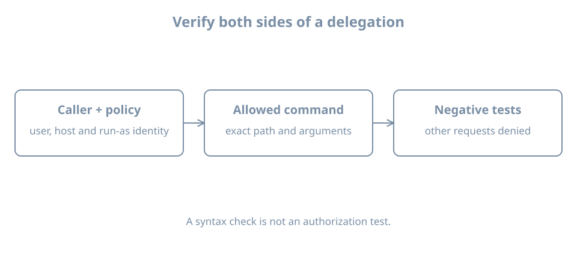

An operator needs to run one diagnostic as root. Giving that operator an unrestricted root shell also grants the ability to change the policy that constrained the diagnostic. A useful delegation specifies the caller, target identity, exact executable and arguments, then tests both an allowed and a denied operation.

This lab uses `bl04-accounts-lab`, the existing `learner` administrator console and a new `bloperator` account. Keep `bl02` shut down while the clone runs. Make a known-good clone/baseline before changing policy. If you cannot establish a separate recovery route and a second working administrator session, do not edit sudo policy.

## Identify the privilege provider and policy

`sudo` runs a command under a target identity subject to its policy and authentication rules. `su` switches identity using a different flow. Neither a locked root password nor a noninteractive root shell prevents a properly authorized administrator from obtaining root through another mechanism; actual policy matters.

Ubuntu 26.04 uses `sudo-rs` as the default provider, while the traditional implementation remains available. Existing installations can differ. Ubuntu's [system utility reference](https://ubuntu.com/server/docs/reference/other-tools/sudo-rs/) explains provider differences. Inspect the current clone:

```bash
command -v sudo
readlink -f "$(command -v sudo)"
sudo --version
sudo -l
sudo id -u
```

The final command should print `0`. `sudo -l` describes policy for the current user; an administrator group is only one possible source of permission. Check the installed provider's `sudo --help` and `man sudoers-rs` or corresponding manual before using provider-specific features. Do not switch providers as part of this lab.

The policy may use `/etc/sudoers`, included files, and in sudo-rs an optional `/etc/sudoers-rs` that takes precedence when present. Inspect the actual configuration and whether it includes `/etc/sudoers.d`:

```bash
sudo ls -l /etc/sudoers /etc/sudoers-rs /etc/sudoers.d
sudo grep -nE '^[[:space:]]*(@includedir|#includedir)' /etc/sudoers
```

An absent optional file can produce an error. If `/etc/sudoers-rs` exists, inspect its include directives too. Do not assume a drop-in is active merely because its file exists. A later matching rule or group membership can broaden a grant, so review the effective policy. The [sudo-rs policy manual](https://manpages.ubuntu.com/manpages/resolute/man5/sudoers-rs.5.html) documents includes and matching.

{fig-alt="A policy defines caller, host and target identity; the intended exact command and arguments are allowed; negative tests check that other commands and arguments are denied."}

## Create a dedicated test operator

Before creating `bloperator`, check the account, same-named group and home path independently:

```bash
getent passwd bloperator
getent group bloperator
test ! -e /home/bloperator
```

Require both lookups to return no record with status 2 and the path test to succeed. Stop for an existing name, path or lookup error. Create a local account with a unique disposable password:

```bash
sudo useradd -m -U -s /bin/bash bloperator && sudo passwd bloperator
```

If a command fails, inspect partial state before retrying. Verify `id bloperator` shows no administrator group, and inspect existing grants for this user from the administrator session:

```bash
id bloperator
sudo -l -U bloperator
```

A denial or absence of grants is expected before the lab rule. If the user already has broad effective privileges, stop and identify their source. Keep the `learner` session available separately throughout.

## Delegate one diagnostic

The example permits only `/usr/bin/id` **without arguments** as root. It demonstrates a policy boundary; running `id` is not a privileged operational task in itself. Confirm the executable is the expected, root-owned system program and that untrusted users cannot modify it or its parent directories:

```bash
command -v id
ls -l /usr/bin/id
ls -ld /usr /usr/bin
```

Confirm that the active policy includes `/etc/sudoers.d`. If it does not, stop; do not modify a different policy file by guesswork. Ensure the lab drop-in is absent:

```bash
sudo test ! -e /etc/sudoers.d/bl04-observe
```

Only after that test succeeds, open it using the provider's checked editor:

```bash
sudo visudo -f /etc/sudoers.d/bl04-observe
```

Enter this single line and save:

```text
bloperator ALL=(root) /usr/bin/id ""
```

The empty quoted argument specification means no command-line arguments; omitting it would allow arbitrary arguments to this executable under sudo-rs policy. `ALL` in the host position matches the host, while `(root)` is the target identity. The [sudoers-rs manual](https://manpages.ubuntu.com/manpages/resolute/man5/sudoers-rs.5.html) describes the rule and no-argument syntax. This rule retains the default authentication requirement; `NOPASSWD` is not needed.

Inspect the installed file and validate the complete active policy:

```bash
sudo ls -l /etc/sudoers.d/bl04-observe
sudo visudo -c
sudo -l -U bloperator
```

The file should be owned by root and not writable by the test user or other untrusted users; use the installed provider's documented ownership and mode requirements. A syntax check is necessary but does not prove the intended permissions or resolve every semantic conflict. If validation fails or the rule is not active, stop and repair from the still-open administrator session or the documented recovery route. Do not close that session and do not use an unchecked editor to bypass a policy error.

## Test allow, deny and rollback

From the ordinary `learner` shell, start `su - bloperator` and authenticate as the test user. In that shell:

```bash
sudo /usr/bin/id
sudo /usr/bin/id -u
sudo /usr/bin/touch /tmp/bl04-should-not-exist
```

Authenticate to sudo with the **operator's** password if prompted. The first command should report root's identity. The second must be denied because it has an argument; the third must be denied because it is a different executable. Stop if either denied test succeeds: another policy rule or group grants more authority than intended. Do not execute additional privileged commands to explore the grant.

A sudo timestamp can allow a later permitted invocation without another prompt; absence of a prompt alone is not proof of `NOPASSWD`. Exit the operator session. From the retained administrator console, remove only this verified lab drop-in and validate:

```bash
sudo rm /etc/sudoers.d/bl04-observe && sudo visudo -c
sudo -l -U bloperator
```

Reopen a fresh `bloperator` session and verify `sudo /usr/bin/id` is denied. If it is still allowed, inspect effective rules and group membership; do not declare the rollback complete. End the test sessions. Retire the test account using the earlier lifecycle procedure or keep it only on the powered-off disposable clone with its UID and home recorded.

For a real delegation, assess what the executable can do with its inputs, environment, configuration and child processes. Editors, shells and commands that execute arbitrary programs can make an apparently narrow rule equivalent to broad root access. Use a controlled, root-owned diagnostic interface and test the negative cases; syntax validation alone cannot establish safety.

## Recall card

- Confirm the actual sudo provider and effective policy before editing.
- A policy specifies caller, host, target identity, executable and arguments.
- `visudo` validation, an allowed test and denied tests provide different evidence.
- Keep a separate administrator and recovery route until rollback is verified.
