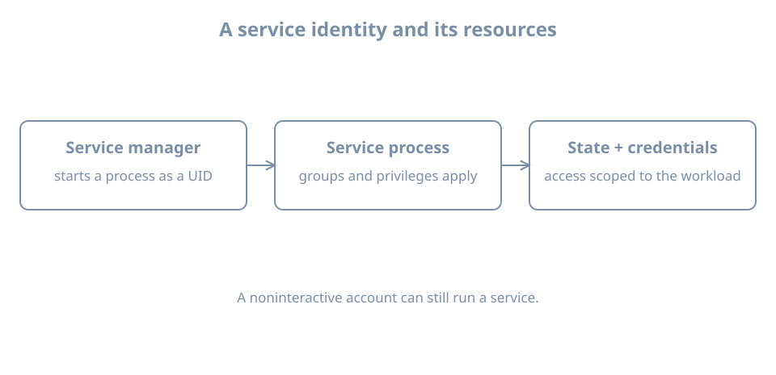

A background service needs to write its own state, but it does not need an administrator's interactive login. A dedicated identity limits which files a compromised or malfunctioning process can access and makes ownership visible. It is only one boundary: privileges, supplementary groups, filesystem policy, secrets and the service manager's configuration also matter.

This chapter creates a disposable local service identity and runs a short transient diagnostic under it. Use the `bl04-accounts-lab` clone on `blpractice`, with `bl02` shut down and the `learner` administrator console available. No network service or real secret is installed.

## A process identity is not a human session

A **service account** is an identity assigned to a workload. It can own files and be selected by a service manager without being used for interactive login. A locked password and a `nologin` shell reduce ordinary password/shell login paths, but neither prevents an authorized manager or root from starting a process with that UID. They do not revoke SSH keys or other access mechanisms automatically.

A persistent service identity has a stable numeric UID/GID and can own persistent state. A dynamically allocated identity can reduce account management for suitable services, but numeric identity and ownership across restarts, backups and migrations require careful design. Do not copy an ephemeral UID into a different host and assume it represents the same principal. Systemd's [execution environment reference](https://manpages.ubuntu.com/manpages/resolute/man5/systemd.exec.5.html) documents `User=`, `Group=` and `DynamicUser=`.

A process can still have supplementary groups or capabilities. Verify the effective process context and the actual allowed operation, not just the account's shell. Service supervision, restart behavior and unit hardening receive their own treatment later.

{fig-alt="The service manager starts a process under a user ID. Its groups and privileges affect access to state and separately managed credentials. A noninteractive account can still run a service."}

## Establish a bounded identity and state directory

Check the proposed user, group and state path individually:

```bash
getent passwd blsvc
getent group blsvc
test ! -e /var/lib/bl04-service-lab
```

Both lookups should return no record with status 2; the path test must succeed. Stop on any collision or lookup error. Confirm the actual noninteractive shell exists:

```bash
command -v nologin
ls -l /usr/sbin/nologin
```

For this lab use `/usr/sbin/nologin` only if that path exists on the clone. Create a system account with a private group and no home directory:

```bash
sudo useradd --system --user-group --no-create-home \
  --home-dir /nonexistent --shell /usr/sbin/nologin blsvc
```

Inspect the resulting identity and password status:

```bash
getent passwd blsvc
id blsvc
sudo passwd -S blsvc
```

Do not set a password or grant sudo membership. An account with no usable password is still a valid process identity. The recorded home path `/nonexistent` is an account-field value; this command does not create that directory. Do not create a home merely to make it resemble a human account.

Create only the new lab state directory, owned by this identity:

```bash
sudo install -d -o blsvc -g blsvc -m 0750 /var/lib/bl04-service-lab
sudo ls -ldn /var/lib/bl04-service-lab
```

Run this only after the earlier absence check succeeds. The mode grants owner access and group read/traversal; other access depends on parent directories and any additional policy. Record the numeric UID/GID, path and intended owner. A separate identity is useful only if the files and operations are scoped to it.

## Run a transient workload and verify ownership

First ask systemd to run `id` as the service identity:

```bash
sudo systemd-run --collect --pipe --uid=blsvc --gid=blsvc /usr/bin/id
```

The output should show the `blsvc` numeric identity and group. `--pipe` connects the command's output and waits for it; `--collect` allows the transient unit to be cleaned up after it finishes. The [systemd-run manual](https://manpages.ubuntu.com/manpages/resolute/man1/systemd-run.1.html) documents these options. This is an administrative test of service execution, not an interactive login as `blsvc`.

Now create a harmless file under the permitted state directory:

```bash
sudo systemd-run --collect --pipe --uid=blsvc --gid=blsvc \
  /usr/bin/touch /var/lib/bl04-service-lab/probe
sudo ls -ln /var/lib/bl04-service-lab/probe
```

Require a successful command and compare the file's numeric owner and group with `id blsvc`. If it fails, inspect the exact error, account lookup and directory traversal/ownership. Do not make the directory world-writable or run the workload as root to hide a permission failure. Check the manager's journal for the transient unit name printed by `systemd-run` if output does not explain the failure.

This test demonstrates creation of one file under one identity. It does not establish isolation from every other path or prove that a future service has correct dependencies, restart policy, resource limits or security configuration.

## Handle credentials as runtime data

A workload may need a database password, private key or API token that is distinct from its UNIX identity. Treat the service account and that credential as separate assets with separate rotation, access, audit and revocation plans. Avoid putting secrets in a unit's command line, publicly readable configuration, logs or a shared environment dump.

Systemd supports service credentials such as `LoadCredential=` and encrypted credential mechanisms; the [systemd-creds reference](https://www.freedesktop.org/software/systemd/man/latest/systemd-creds.html) describes their role. The source file's protection, the service's ability to read the delivered credential, backup handling, rotation and revocation still need design. Passing a credential to a process does not protect it from that process or from a sufficiently privileged administrator. This chapter does not create or print a secret.

## Retirement and diagnosis

Before retiring a real service identity, stop and disable the workload through its owner, verify no processes or timers still use it, inventory files and external credentials, retain or transfer state according to policy, revoke credentials, and only then remove the identity. A numeric UID can outlive its name on disk and later be reused.

For this lab, the transient commands have ended. Record the UID and `/var/lib/bl04-service-lab` ownership; leave the account and directory on the disposable clone until an explicit cleanup decision. Shut down the clone before restarting `bl02`. Do not delete a service account while a real workload is running.

If a service cannot start, distinguish: identity lookup failed; its configured user lacks path traversal; the required state mount is missing; a credential was not delivered; or the program itself exited. Inspect the unit's effective configuration and journal and repeat the intended operation after the narrow fix. Changing its user to root is not a diagnosis.

## Recall card

- A noninteractive account can still run a service process.
- Stable ownership, supplementary groups and privileges determine the practical boundary.
- A successful transient test proves only the operation it performed.
- Runtime credentials have a lifecycle separate from the UNIX identity.
- Stop workloads and account for retained state before removing an identity.
