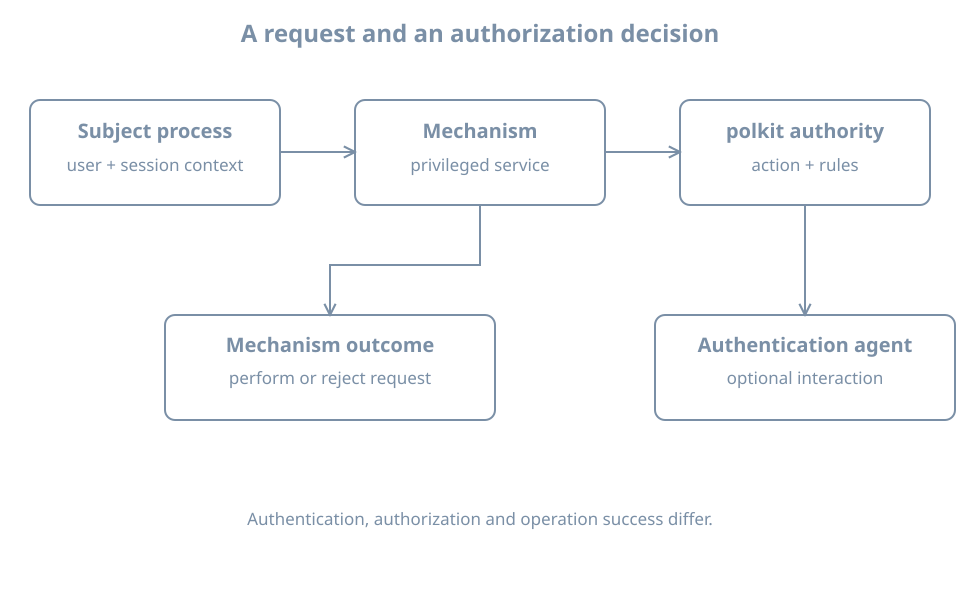

An unprivileged desktop user requests a system operation and sees an authentication prompt. That does not necessarily mean the application ran `sudo`. A privileged service can receive a request over an interprocess channel and ask an authorization authority whether the requesting process may perform a particular action.

This chapter examines sessions and polkit using the existing `bl02` console. The lab is read-only: it lists observed sessions and, if installed, registered authorization actions. It does not terminate sessions, change rules or trigger a privileged operation. A graphical desktop and an authentication agent are optional; a text-only server may expose less session information.

## User, process, session and seat

A **user account** is an identity record. A **process** has current numeric credentials. A **session** is a grouping of activity associated with a login or similar interaction. One user can have more than one session, and a service can run under an account without being an interactive login session. A **seat** represents a set of local interaction devices; a remote session need not have a local seat.

On a system using systemd-logind, the login manager tracks sessions and user activity and coordinates some operations such as power and device access. It does not replace all process credential checks or service-specific authorization. The [loginctl manual](https://www.freedesktop.org/software/systemd/man/latest/loginctl.html) describes the management interface.

Inspect the current host:

```bash
hostnamectl
id
printf 'Session ID: %s\n' "${XDG_SESSION_ID:-not supplied}"
loginctl list-sessions --no-pager
loginctl list-users --no-pager
```

The environment variable is a hint supplied to some sessions, not a universal session detector. `su`, service processes, containers or an installation without an appropriate PAM/logind integration may not yield a distinct registered session. An empty list or inaccessible manager is an observation to explain, not proof that no process exists.

If `list-sessions` shows a session for the console, use its **observed** session ID in the following command, replacing `SESSION_ID`:

```bash
loginctl show-session SESSION_ID \
  -p Id -p User -p Name -p Type -p Class \
  -p Remote -p Active -p State
```

Do not substitute a username for a session ID. Values can be empty or unavailable, and `Active` is a session property, not proof that every process or service belonging to that user is healthy. The session ID is local runtime state; it can change after logout or reboot. Avoid `terminate-session`, `kill-session` and `lock-session` during this inspection.

{fig-alt="A subject process sends a request to a privileged mechanism. The mechanism asks the polkit authority about a named action and subject. Policy and session context can affect the decision; an authentication agent may obtain credentials when interaction is allowed. The mechanism performs or rejects the requested operation."}

## How a polkit request is evaluated

**polkit** supplies an authorization interface for participating privileged services. In a common arrangement, an unprivileged **subject** asks a privileged **mechanism** to perform an action. The mechanism asks the polkit authority for a decision about that subject and named action. A policy can allow, deny or require authentication. When interaction is permitted, an authentication agent may prompt the user or an administrator.

The [polkit reference](https://www.freedesktop.org/software/polkit/docs/latest/polkit.8.html) describes subjects, mechanisms, actions, rules and agents. A policy decision depends on the installed rules, the specific action and subject, and potentially session context. The identity used for authentication can differ from the original requesting subject. Authentication demonstrates a credential check; authorization determines whether the operation is permitted.

`sudo` and polkit are distinct paths. A sudo rule for one command does not automatically authorize a polkit action, and a polkit authorization does not generally grant a root shell. Both can involve PAM or an administrator credential, but their callers, policies and audit evidence differ.

## Inspect actions without exercising one

If the tools and service are present:

```bash
command -v pkaction
systemctl status polkit.service --no-pager
pkaction
```

The unit may be absent, inactive or started on demand; `status` can return nonzero. If `pkaction` or the authority is unavailable, record that limitation and complete the conceptual exercise below. Do not install a desktop or change service policy merely to match an example.

Choose a harmless **registered action identifier** from the output. Assign its exact observed name to `ACTION` in your shell, then inspect its declaration:

```bash
test -n "${ACTION:-}" && pkaction --action-id "$ACTION" --verbose
```

Stop if `ACTION` is empty or the action does not exist. The [pkaction manual](https://www.freedesktop.org/software/polkit/docs/latest/pkaction.1.html) describes the listing. The displayed implicit defaults for active, inactive or other subjects are not a complete prediction of the effective decision: installed authorization rules, subject details, authentication agents and the mechanism's request can alter the result. Listing an action does not execute it.

A server console may have no graphical agent. A denied request, a request requiring authentication without an agent, and a failed credential check are different situations. Do not make an action universally allowed or run a privileged operation simply to see a prompt. Action definitions and local rules can reveal system details; review before sharing.

## Worked diagnosis: a request cannot be authorized

Suppose a user reports “authorization failed” when requesting a device operation:

1. Identify the exact application, action, user, session, time and message. Do not collect the password or token.
2. Confirm the process's current UID and groups and, if tracked, its session's local/remote and active properties.
3. Check that the mechanism and authority are available and identify the requested action from the application or logs.
4. Inspect that action's declaration and the site's applicable rules; distinguish an explicit denial from an authentication challenge or an unavailable agent.
5. Test the **same** operation through an authorized, controlled workflow after a narrowly scoped correction. Verify the actual result and relevant logs.

A successful `sudo -l` is not a substitute for this evidence. Conversely, a polkit authorization does not prove the requested service successfully completed its operation. Do not terminate the user's session or edit rules until the effect and recovery path are understood.

## Practice and recall

Record the current account, any observed session ID and properties, the presence or absence of polkit tools, and one registered action's stated defaults if available. Explain why those defaults cannot alone predict an effective request. On a text-only host with no polkit, use the worked example to identify the missing evidence instead of fabricating a result.

- An account, process, session and seat are distinct objects.
- polkit evaluates a named action for a subject through a participating mechanism.
- Session context and an authentication agent can affect a request.
- Authentication, authorization and successful completion of the operation are separate observations.
