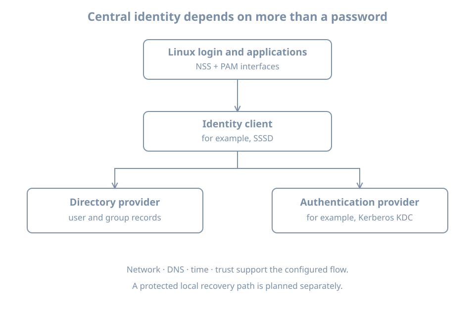

A local account works at the console, but a centrally managed user cannot log in. The problem might be name lookup, directory availability, time, ticket acquisition, account policy, a missing home or service authorization. Central identity adds shared dependencies; it does not eliminate the local access and recovery questions already learned.

This chapter introduces those dependencies and performs a read-only inventory of the existing `bl02` host. It does not join a domain, install a directory server, create a Kerberos realm or change PAM/NSS. The main lab remains usable with no network identity infrastructure. Actual directory integration is revisited after the book develops network services, DNS, time and certificate operation.

## What central identity changes

A local account database is maintained on one host. A central identity service can provide user and group information, authentication or access policy to multiple hosts. The exact architecture varies: a directory may store identities, an authentication service may issue credentials, and a Linux client may cache and translate results.

| Component | Typical role | Distinguish from |
|---|---|---|
| LDAP directory | Search and manage structured directory entries and attributes | A guarantee that a particular login is authorized |
| Kerberos realm and KDC | Authenticate principals and issue time-limited tickets | A complete POSIX UID/GID database or filesystem permission policy |
| SSSD on a Linux client | Integrate supported identity, authentication and access providers with local interfaces | The remote directory or KDC itself |
| NSS and PAM | Expose identity lookup and authentication/account interfaces to applications | The remote source's availability and the application's own policy |

LDAP is a directory access protocol; it can be used in several configurations and is not synonymous with Kerberos. The [LDAP protocol specification](https://www.rfc-editor.org/rfc/rfc4511) describes its directory operations. Protect directory communication with the deployment's verified TLS and trust configuration; an encrypted connection to an unverified endpoint does not establish the intended server's identity.

{fig-alt="A Linux login uses NSS and PAM through an identity client such as SSSD. Depending on configuration, the client obtains identity and group data from a directory and authentication from a Kerberos service. DNS, time, network and trust are shared dependencies. Local recovery access is planned separately."}

## Kerberos in the minimum useful model

A **principal** is a named identity in a Kerberos realm. A **key distribution center** (KDC) provides authentication and ticket-granting services. A client can obtain a ticket-granting ticket and use it to request a ticket for a particular service. The service must have the appropriate identity and key material to validate its ticket. A **keytab** holds long-term principal keys and must be protected like other credentials.

A ticket has a lifetime and is not a replacement for local authorization. DNS and time are operational dependencies: clients must locate the intended service, and unacceptable clock skew can prevent authentication. Realm naming conventions and discovery rules depend on the deployment. Ubuntu's [Kerberos introduction](https://ubuntu.com/server/docs/explanation/intro-to/kerberos/) provides the terminology; its [server guide](https://ubuntu.com/server/docs/how-to/kerberos/install-a-kerberos-server/) identifies DNS and time as prerequisites.

If a client already has the Kerberos utility and a legitimate credential cache, `klist` can display ticket metadata:

```bash
if command -v klist >/dev/null; then
  klist
else
  printf 'klist is not installed; no ticket inspection performed\n'
fi
```

An empty cache or a nonzero result is expected on a local-only lab host. Ticket names, addresses and timestamps can be sensitive; redact before sharing. `klist` does not create a ticket. Do not use options that display key material or run `kinit` with an unknown principal simply to produce output. The [MIT klist reference](https://web.mit.edu/kerberos/krb5-latest/doc/user/user_commands/klist.html) distinguishes ticket-cache and keytab inspection.

## Where SSSD fits

SSSD can provide NSS and PAM integration with supported remote identity and authentication sources. It can also cache information and, when configured and permitted, support some offline logins. What is cached, for whom, for how long and under which policy are deployment-specific. A successful cached lookup or offline login does not prove that the directory or KDC is currently reachable. Canonical's [SSSD overview](https://ubuntu.com/server/docs/service-sssd/) describes these interfaces and common provider combinations.

On a configured host, `/etc/sssd/sssd.conf` and optional snippets describe domains and providers; their ownership and restricted access matter. The [Ubuntu SSSD configuration manual](https://manpages.ubuntu.com/manpages/resolute/man5/sssd.conf.5.html) documents file permissions and snippet precedence. Configuration may contain sensitive topology or credential references. Do not publish it, clear caches, change providers or restart SSSD during the introductory inspection.

Numeric identity is an operational dependency. If two hosts map one central user to different UIDs, shared files can appear to belong to the wrong principal. If a local and central account collide by name or number, source order can change which record an application sees. Choose and verify a consistent mapping policy before migrating ownership or enabling shared storage.

## Read-only local inventory

On `bl02`, establish the existing local baseline:

```bash
hostnamectl
id
getent passwd "$(id -un)"
grep -E '^(passwd|group|shadow):' /etc/nsswitch.conf
timedatectl status
systemctl status sssd.service --no-pager
```

SSSD may not be installed or active; `status` can return nonzero. A source named `sss` in NSS configuration is not by itself proof that an SSSD domain is configured or reachable. The clock display is evidence about local time and reported synchronization, not a guarantee that a particular KDC agrees with it. The current user's successful local lookup does not prove remote identity works.

If this host has **no** central identity configured, record “not configured or not established by this inspection” and continue with the synthetic exercise. Do not install packages, join a realm, alter the local administrator or expose the guest to a real directory to manufacture a result.

## Worked diagnosis: central lookup works but login fails

Consider a fictional user `alex@example.test` on a host configured for a directory and Kerberos. The name is illustrative; do not query a real environment without authorization.

1. `getent passwd 'alex@example.test'` returns a UID and home. This supports a lookup result, potentially from cache; it does not prove a live directory connection.
2. A login attempt fails. Record the actual service, error and time. Check account policy and its PAM path, and distinguish authentication from session/home failure.
3. Inspect configured DNS names and reachability, time synchronization and SSSD status using the site's approved procedure. Compare the actual provider and current state rather than guessing from package names.
4. If Kerberos is in use, inspect ticket metadata for the affected authorized session where appropriate; absence of a ticket, an expired ticket, a KDC error and a service authorization denial require different follow-up.
5. After the targeted correction, repeat the same login and intended operation from the same client context. Verify UID/GID, home access and service authorization, and document whether the result was online or cached.

Do not clear all identity caches as a first diagnostic step. It can discard useful state and affect offline access. Do not create a same-named local user as a shortcut: a collision can change identity resolution and file ownership. For a planned deployment, retain a tested local administrative recovery path that does not depend on the central service, while protecting that path and auditing its use.

## Design exercise and acceptance

Without creating infrastructure, write a one-page dependency plan for two future Linux hosts:

- Identify the authority for user/group records, authentication and access policy; state whether they are the same service.
- Define how names and numeric IDs remain consistent, and how homes and file ownership are provisioned.
- Record DNS, network, time and certificate/trust dependencies and who maintains them.
- State offline-login policy, cache limits, credential/keytab protection and a tested local recovery route.
- Specify a positive login and client-operation test, a denied-access test, and evidence to collect if directory or KDC access fails.

Success for this chapter is a coherent plan and an honest local inventory, not a simulated claim that a central login has been tested. The integrated implementation belongs after its networking and trust prerequisites are available.

## Recall card

- Directory lookup, ticket authentication, account policy and application authorization are separate functions.
- SSSD is a client integration component; cached success may not mean the provider is online.
- DNS, time, trust and consistent numeric IDs are operational dependencies.
- Preserve a protected local recovery path and test the actual login and service operation.
