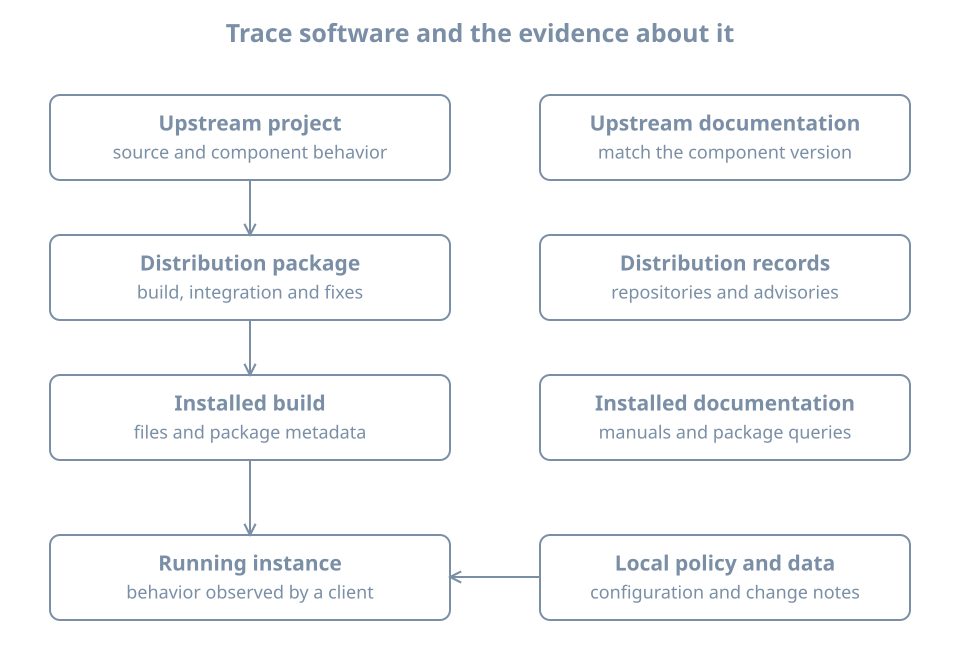

A command works on a host, but the operator does not know which package installed it or whether that package is currently supported by an enabled repository. Those are separate questions. The executable, the package database, repository metadata and the running process each provide different evidence.

This chapter inventories the Ubuntu `bl02` guest without changing packages. You need console access, the first-boot update record and the ability to run a command. Later labs use a disposable clone for changes.

## From software to a running process

A **package** is a distribution artifact containing files and metadata used to install and maintain software. Its metadata can name a version, architecture, dependencies and configuration files. Ubuntu's Debian package system records local package state in dpkg's database. APT uses repository metadata and local state to plan transactions.

{fig-alt="An upstream project becomes a distribution package, which is obtained from a repository and installed. Local configuration and data affect a running instance. Source, package metadata, installed files and runtime state are different evidence."}

An upstream release number and the distribution package version need not be identical. A distribution can backport fixes while retaining an upstream-looking version. A version string alone does not prove whether a specific fix is present; consult the package changelog and the distribution's security information for the exact release and package.

An installed package is not necessarily running, and a running process can continue executing an older mapped executable after files are upgraded. A repository candidate is a proposed available version, not proof that this host installed it.

## Query the installed database

On `bl02`, confirm the host and package architecture:

```bash
hostnamectl
cat /etc/os-release
dpkg --print-architecture
dpkg --print-foreign-architectures
```

A package's architecture may be `all`, the native architecture or another configured architecture. An empty foreign-architecture list is normal.

Use the installed `apt` package as a stable example:

```bash
dpkg-query -l apt
dpkg-query -W -f='${binary:Package} ${Version} ${Architecture} ${db:Status-Abbrev}\n' apt
dpkg-query -s apt
```

In `dpkg-query -l`, the columns represent desired action, current status and error flag. The commonly seen `ii` means selected for installation and currently installed; a package can instead be unpacked, half-configured or have configuration files left after removal. The [dpkg-query manual](https://manpages.ubuntu.com/manpages/resolute/man1/dpkg-query.1.html) defines the states. The formatted query is easier to compare than assuming that every listed package is fully installed.

Inspect a package's recorded files and dependencies:

```bash
dpkg-query -L apt
apt-cache depends apt
apt-cache policy apt
```

`-L` lists paths registered to the package, not necessarily every file created later by a maintainer script or an alternatives mechanism. `apt-cache depends` reads available metadata; `apt-cache policy` compares installed and candidate versions using the current APT cache. That cache can be stale or incomplete. A package may have several architecture-qualified names or multiple packages contributing to a working program.

## Map an executable to its package

Ask the shell what it would execute, then inspect the path and package ownership:

```bash
command -v apt
readlink -f "$(command -v apt)"
dpkg-query -S /usr/bin/apt
```

The query path is the conventional Ubuntu lab path; first confirm that it exists and is the actual path on this host. If it differs, query the observed path instead. Symlinks, alternatives, diversions and the merged `/usr` layout can make the invoked path and the package-recorded path differ. `dpkg-query -S` searches package database records; it is not a full filesystem scan or a proof that the current file contents are authentic. A generated file, local installation, container image or Snap application may have no matching dpkg owner.

For a package file, inspect its installed metadata separately from the file's current bytes. Package verification tools have limits: not all files have recorded checksums, and local configuration is expected to differ. Do not overwrite a suspected file until you know its owner, expected configuration and recovery plan.

## Worked diagnosis: “the package owns the wrong version”

Suppose `apt-cache policy apt` shows installed version A and candidate B, while the command's `--version` reports A. This may simply mean B is available but not installed. Check dpkg status, the active executable path and the cache timestamp. If a daemon reports an older version after a successful upgrade, check when its process started and plan the service restart or reboot required by its owner; do not infer that package installation failed from a long-running process alone.

If `dpkg-query -S` cannot find a path, inspect whether it is a symlink, an alternative, generated state or software installed outside dpkg. Do not delete the file as “unmanaged” without understanding its role.

## Practice and recall

Record the host, architecture, installed `apt` package version and state, candidate version, executable path and package ownership result. Identify one observation that would require a separate runtime check. Redact internal repository details before sharing.

- Package state, candidate version, filesystem path and running process are separate observations.
- `dpkg-query` reports recorded ownership and state, not a complete history of every file.
- APT metadata reflects the most recent successful refresh, not necessarily current remote state.
- Use the distribution's package and security information to interpret versions and fixes.
