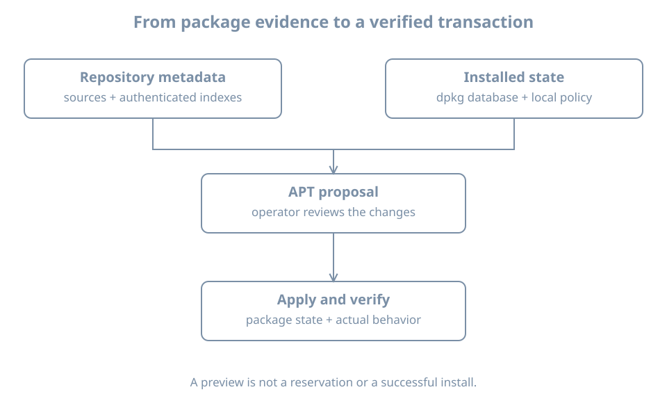

Installing a program can require several other packages and can run configuration scripts. APT plans and obtains a transaction; dpkg manages individual package unpacking and configuration. A preview helps the operator inspect the proposed changes, but the transaction's actual result and the program's behavior still need verification.

This chapter creates `bl05-packages-lab`, a disposable full clone of powered-off `bl02`. It installs the small `tree` package and leaves it installed for a later hold exercise. Use the established single-disk, no-shared-disk, no-backing-chain and no-TPM clone procedure. Confirm the original is shut off, sufficient host space is available, and the destination name and disk path do not exist. On the host:

```bash
sudo virsh --connect qemu:///system domstate bl02
sudo virsh --connect qemu:///system domblklist bl02 --details
sudo virt-clone --connect qemu:///system \
  --original bl02 --name bl05-packages-lab \
  --file /var/lib/libvirt/images/bl05-packages-lab.qcow2
```

Only run the clone command after confirming `shut off` and the expected system disk. Inspect both domain definitions and confirm distinct disk and NVRAM paths. Keep `bl02` off while the clone runs. Attach the clone to the recorded setup NAT network for package access and keep its graphical console open. The copied guest hostname may still be `bl02`; the manager name and disk path identify the clone.

## What each tool knows

A `.deb` package carries files and control metadata. `dpkg` records selections, unpacked files and configuration state. APT reads enabled sources and cached package indexes, considers dependency relationships and proposes a set of packages to install, upgrade or remove; it then invokes package installation machinery. The [Ubuntu package-management guide](https://ubuntu.com/server/docs/how-to/software/package-management/) describes this division.

{fig-alt="Configured sources supply authenticated package metadata to APT. APT combines available metadata with installed dpkg state to propose a transaction. An approved transaction obtains packages and invokes dpkg; afterward the operator verifies package state and the intended program behavior."}

`Depends` expresses a required relationship for package configuration; alternatives and virtual packages can provide multiple ways to satisfy it. `Pre-Depends`, conflicts and version constraints can affect ordering or feasibility. A package manager reasons about declared relationships, not every site-specific application dependency or service health condition.

## Refresh and preview on the clone

Check the clone, console, disk space and network before changing package state:

```bash
hostnamectl
sudo id -u
df -h / /var
ip -brief address
ip route
sudo dpkg --audit
```

An empty audit normally means no reported partially installed package state, not that every application is healthy. Address and route output do not prove repository access. Review the configured sources using the first-boot procedure, then refresh:

```bash
sudo apt update
```

Require a clean result; a partial refresh is not a clean baseline. Preserve errors instead of bypassing signature checks. APT's [manual](https://manpages.ubuntu.com/manpages/resolute/man8/apt.8.html) distinguishes refreshing package indexes from installing upgrades.

Check whether `tree` is already installed or held:

```bash
dpkg-query -W -f='${db:Status-Abbrev} ${binary:Package} ${Version}\n' tree
apt-mark showhold
apt-cache policy tree
```

`dpkg-query` can report no matching package and return nonzero. Proceed only if `tree` is not installed, is not held, and a candidate is available. If it is already installed or held, record the difference and use a newly prepared clone instead of removing or unholding an existing package. Confirm the clone has no production data or service dependency on this test package.

Preview:

```bash
sudo apt-get -s install tree
```

`-s` simulates a transaction and does not apply package changes. Read the complete proposal: new packages, upgrades, removals and errors. A simulation is not a reservation; another package job or a metadata change can alter the eventual transaction. If the proposal is unexpectedly broad or removes packages, stop and investigate. Do not accept a destructive change just because a simulation returned output.

## Install, verify and keep the test package

After reviewing the simulation, run the interactive transaction:

```bash
sudo apt install tree
```

Review the actual confirmation before accepting. If a package manager is already running, identify it and wait; do not delete lock files. Keep the transaction output and investigate any error before proceeding. Installation scripts may run as part of configuration and can have effects outside the package's file list.

Verify the result:

```bash
dpkg-query -l tree
dpkg-query -W -f='${db:Status-Abbrev} ${Version}\n' tree
command -v tree
tree --version
dpkg-query -S /usr/bin/tree
sudo dpkg --audit
```

Expect a fully installed package, a command that runs and a recorded package owner for the observed executable. Confirm the actual path before using the conventional `/usr/bin/tree` query. An empty audit and successful `--version` are useful but do not prove every feature or external dependency.

APT distinguishes `upgrade` from `full-upgrade`: the latter may remove packages to resolve the transaction, while the former does not remove installed packages. The [APT manual](https://manpages.ubuntu.com/manpages/resolute/man8/apt.8.html) documents the distinction. Do not switch to a more disruptive command simply to eliminate a pending count.

## Diagnose an incomplete transaction

If installation stops, record the exact operation, package state and logs before retrying:

```bash
sudo dpkg --audit
dpkg-query -l tree
sudo tail -n 80 /var/log/apt/history.log
sudo tail -n 80 /var/log/apt/term.log
```

An unpacked or half-configured status differs from fully installed. Disk capacity, an interrupted maintainer script, dependency problems and another active package job need different responses. Do not delete lock files, remove package database files or force-install unrelated packages. A later chapter practices recovery of an interrupted transaction with a deliberately bounded fault.

Keep `tree` and the clone for the version and hold exercise. Record the pre-install absence, proposed and actual transaction, installed version, command result and cleanup obligation. A clone on the same host is not an independent backup.

## Recall card

- APT proposes dependency-aware transactions; dpkg records and configures package state.
- Refreshing indexes, simulating, installing and verifying are separate operations.
- A simulation can become stale before the actual transaction.
- A package can be unpacked but not fully configured.
- Preserve errors and inspect state before attempting repair.
