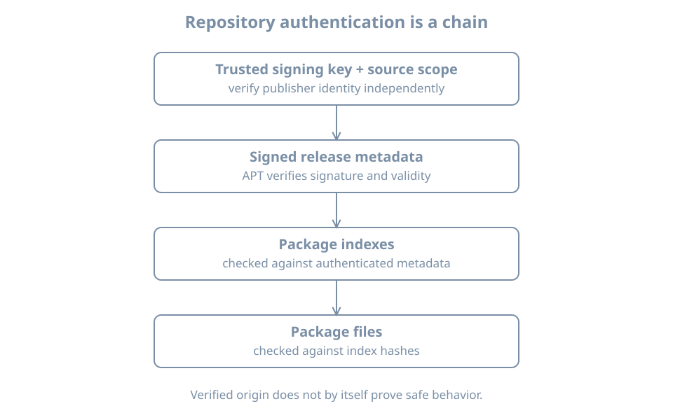

A package name can be available from more than one repository. APT needs to know where metadata comes from, which signing keys are trusted for it, and which versions are candidates. A reachable URL alone does not establish trusted software provenance.

This chapter inspects the Ubuntu `bl05-packages-lab` clone and its configured package sources. It does not add a repository or import a key. Keep the package-lab console open, the original `bl02` off and the setup NAT network attached as in the preceding chapter.

## The authenticated repository chain

A repository publishes release metadata describing package indexes; those indexes describe package files and their checksums. APT verifies repository authentication using the configured trust material and then uses the authenticated metadata chain when retrieving packages. The [APT secure manual](https://manpages.ubuntu.com/manpages/resolute/man8/apt-secure.8.html) describes the archive-authentication model.

{fig-alt="An operator establishes a trusted repository signing key and source scope. APT verifies signed release metadata, which authenticates package indexes, whose hashes identify package files. Installation and runtime verification are later separate steps."}

A signature establishes that metadata was signed by a key accepted by the configured policy; it does not prove that the software is safe, that a key was obtained from the right publisher, or that the running application is uncompromised. A compromised trusted signing key or repository remains a risk. HTTPS protects transport to a validated endpoint, while repository signatures provide a separate metadata-authentication mechanism; neither replaces choosing a trustworthy source and key.

## Read configured sources

APT can read a traditional one-line `.list` file and deb822-style `.sources` files. On a fresh Ubuntu 26.04 installation, `ubuntu.sources` is common, but imported or upgraded systems can differ. Inspect the actual files:

```bash
ls -l /etc/apt/sources.list /etc/apt/sources.list.d
sudo cat /etc/apt/sources.list.d/ubuntu.sources
```

An absent optional file produces an error; list and inspect the files that actually exist. Source entries can contain private mirror names or credentials; restrict and redact before sharing. The [sources.list manual](https://manpages.ubuntu.com/manpages/resolute/man5/sources.list.5.html) defines source formats and options.

A deb822 entry can describe `Types`, `URIs`, `Suites`, `Components`, architectures, an enabled state and `Signed-By`. For this lab, record the observed release suites, components, mirror and any scoped keyring. A source configuration is **intent**. `apt-cache policy` and `apt update` provide additional evidence about loaded indexes and refresh results.

A `Signed-By` value can restrict which keyring or key may authenticate that source. Keyrings, permissions and their contents must be checked according to the installed APT version and publisher instructions; do not assume every source uses the same key. A third-party signing key should be independently verified through a trusted channel and scoped to the intended source. Avoid adding an unverified key to a broad global trust store.

## Connect a package candidate to sources

After the clean metadata refresh in the prior chapter:

```bash
apt-cache policy tree
apt-cache policy
apt-config dump | grep -E 'Dir::Etc::(sourcelist|sourceparts|trusted)'
```

The first command reports the package's installed version, candidate, priorities and available origins as known to APT. The second summarizes configured package origins and priorities. `apt-config dump` exposes selected configuration paths; the filter can return no lines. Interpret all results as the local cache and configuration, not an independent attestation of a remote server's current content.

`Origin`, `Label`, `Suite`, `Codename` and a repository URI answer different questions. An authenticated Release file contains publisher-provided labels; a familiar label alone is not a fingerprint. A candidate can be the same version available from more than one source, and this policy display is not definitive historical proof of which source supplied an already installed package.

## Diagnose a failed refresh

Suppose `apt update` reports a missing key, expired metadata or a failed signature. Preserve the exact error and source. Then:

1. Confirm the guest's time with `timedatectl status` and the intended source definition.
2. Check whether the configured keyring and its access permissions match the trusted publisher's current instructions and your change record.
3. Distinguish a network or mirror failure from a signature or metadata-validity failure; read the complete APT result.
4. Apply a verified, authorized source or key correction using the distribution's documented process, then run `apt update` again and require a clean result.

Do not disable authentication, accept an unknown key, or add an unrelated repository to make an update finish. A key rotation requires a trusted verification channel and an operational plan, not a fingerprint copied from the failing mirror itself. A stale cached candidate can still appear after a failed refresh; record the failure and do not treat that candidate as freshly verified.

## Practice and recall

Record the enabled source files, observed suites and components, any `Signed-By` scope, last clean refresh result, and the `tree` candidate and origins. Explain why a matching package name, reachable mirror and signed metadata each support different claims. Keep private source URLs and credentials out of shared evidence.

- A repository signature authenticates metadata under a configured trust policy.
- Source configuration, cached metadata and installed package history are distinct.
- Scope and independently verify third-party keys.
- Resolve trust errors rather than bypassing them.
