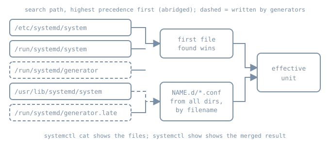

A package installs a unit file. An administrator needs one setting to differ. Editing the packaged file works until the next package update replaces it, and the change leaves no clear record of what was local. systemd avoids this by building each unit from several files: one unit file chosen from a search path, plus drop-in fragments merged on top. Generators can also write units at boot. Whatever the manager actually loaded is the *effective* configuration, and it is the only version that matters during diagnosis.

This chapter keeps using the `bl06-demo.service` unit from the earlier chapters of this part, on the `bl06-service-lab` clone.

## Where unit files come from

The system manager looks for a unit name in an ordered list of directories, and the first file it finds with that name is the unit file. The [systemd.unit manual](https://www.freedesktop.org/software/systemd/man/latest/systemd.unit.html) gives the full list. For an administrator, the important entries, from highest precedence down, are:

| Directory | Owner | Lifetime |
|---|---|---|
| `/etc/systemd/system.control/`, `/run/systemd/system.control/` | `systemctl set-property` and similar API writes | persistent / until reboot |
| `/run/systemd/transient/` | transient units such as `systemd-run` | until reboot |
| `/run/systemd/generator.early/` | generators | regenerated each boot and reload |
| `/etc/systemd/system/` | the local administrator | persistent |
| `/run/systemd/system/` | runtime changes | until reboot |
| `/run/systemd/generator/` | generators | regenerated |
| `/usr/local/lib/systemd/system/` | locally installed software | persistent |
| `/usr/lib/systemd/system/` | distribution packages (vendor units) | replaced by package updates |
| `/run/systemd/generator.late/` | generators | regenerated |

Three consequences follow.

1. A file in `/etc/systemd/system/` with the same name as a vendor unit **replaces** the vendor unit completely. None of the vendor file is read. That is the right tool when nearly everything must change. It is the wrong tool for one setting, because later package fixes to the vendor unit stop reaching the host.
2. `/run` holds runtime state. Anything placed there is gone after the next boot, which makes it the right place for experiments.
3. Generator output sits on both sides of `/etc`. `generator.early` outranks the administrator, `generator` outranks vendor units, and `generator.late` loses to everything.

On Ubuntu, `/lib` is a symbolic link to `/usr/lib`, so older documentation that says `/lib/systemd/system` names the same directory.

{fig-alt="Five search-path directories are listed in precedence order: /etc/systemd/system, /run/systemd/system, /run/systemd/generator, /usr/lib/systemd/system and /run/systemd/generator.late. The first file found with the unit's name is used. Separately, NAME.d/*.conf drop-in files from all of these directories are merged in filename order. Both feed the effective unit. systemctl cat shows the files; systemctl show shows the merged result."}

## Drop-ins: change only what you mean

Next to a unit file `foo.service`, any search-path directory may contain `foo.service.d/`. Every file ending in `.conf` in such a directory is parsed **after** the unit file, so its settings are added to or override the unit's. Each drop-in must include the section header for the settings it contains.

The merge rules that cause surprises:

- **Filename order, not directory order.** Drop-ins with different names are applied in lexicographic order, whatever directory they are in. A drop-in named `90-local.conf` under `/usr/lib` is applied after `50-site.conf` under `/etc`.
- **Same name, higher directory wins.** A drop-in in `/etc` with the same filename as one in `/run` or `/usr/lib` hides the lower one. This is how an administrator disables a single vendor drop-in: create an empty file with the same name in `/etc`.
- **List settings accumulate.** Settings that can appear more than once, such as `Environment=`, `ExecStartPre=` or `After=`, add to the existing list. An empty assignment such as `ExecStart=` clears the list first. This is why replacing a service's command needs two lines:

  ```ini
  [Service]
  ExecStart=
  ExecStart=/usr/bin/python3 -m http.server 18766 --bind 127.0.0.1
  ```

  Without the empty line, a non-oneshot service would end up with two `ExecStart=` commands and fail to load.
- **Wider drop-ins exist.** For a unit named `foo-bar-baz.service`, systemd also reads `foo-bar-.service.d/` and `foo-.service.d/`. A top-level `service.d/` directory applies to every service on the host. Name-specific directories take precedence over these wider ones. Treat a top-level drop-in as a host-wide policy change, not a convenience.
- **Templates and instances.** For `foo@bar.service`, systemd reads `foo@bar.service.d/` and then the template's `foo@.service.d/`.

Two related directories are not drop-ins. `foo.service.wants/` and `foo.service.requires/` contain *symlinks* to other units and add `Wants=` or `Requires=` dependencies. `systemctl enable` creates these symlinks from a unit's `[Install]` section. The manager itself never reads `[Install]` during normal operation.

## Masking

A unit file that is empty, or a symlink to `/dev/null`, makes the unit *masked*. A masked unit cannot be started, even by hand or as a dependency. `systemctl mask NAME` creates the `/dev/null` symlink in `/etc/systemd/system/`, and `systemctl unmask` removes it. Masking is stronger than disabling. Disabling only removes the enablement symlinks, so the unit can still be pulled in by another unit or started manually.

## Generators: units that nobody wrote by hand

A generator is a small executable that systemd runs very early at boot and again at every `systemctl daemon-reload`. It reads some other configuration format and writes unit files and symlinks into the three generator directories. The interface is described in [systemd.generator](https://www.freedesktop.org/software/systemd/man/latest/systemd.generator.html). System generators live in `/usr/lib/systemd/system-generators/` (and `/etc/` and `/run/` equivalents).

Common examples on an Ubuntu server:

- `systemd-fstab-generator` turns each `/etc/fstab` line into a `.mount` or `.swap` unit. This is why editing `/etc/fstab` should be followed by `systemctl daemon-reload`.
- `systemd-getty-generator` creates serial getty instances for consoles named on the kernel command line.
- `systemd-gpt-auto-generator` discovers partitions by GPT type when no explicit configuration exists.
- Packages can ship their own. For example, netplan's generator translates `/etc/netplan/*.yaml` into backend configuration.

Generator output is real configuration, but it is not where you make changes. A hand-edit to `/run/systemd/generator/home.mount` is overwritten at the next reload. Change the generator's input, for example `/etc/fstab`, or add a drop-in in `/etc` for the generated unit, then reload.

Generators run before most of the system exists. They must be fast and must not wait for services, so they do little more than translate files. A generator that fails or reads a malformed input can leave a unit missing, so check the journal for generator messages when an expected mount or getty is absent:

```bash
sudo journalctl -b -o short-monotonic --no-pager | grep -i generator
ls /usr/lib/systemd/system-generators/
```

## Reading the effective configuration

Three views answer three different questions. They are listed in the [systemctl](https://www.freedesktop.org/software/systemd/man/latest/systemctl.html) and [systemd-delta](https://www.freedesktop.org/software/systemd/man/latest/systemd-delta.html) manuals.

| Question | Command |
|---|---|
| Which files built this unit, in order? | `systemctl cat NAME` |
| Which file path and drop-ins did the manager load? | `systemctl show NAME -p FragmentPath -p DropInPaths -p NeedDaemonReload` |
| What value does a setting have after the merge? | `systemctl show NAME -p SETTING` |
| Where does this host differ from vendor files? | `systemd-delta --type=overridden,extended,masked` |

`systemctl cat` prints each file with a `# /path` comment above it, in the order they are applied. Read it from top to bottom to replay the merge. `systemctl show` prints values after defaults, implicit dependencies and drop-ins have been applied. Where the two disagree with your expectation, the difference usually comes from a default or from a drop-in you didn't know about.

`NeedDaemonReload=yes` means the files on disk have changed since the manager loaded them. The running manager is still using the old definition. Many confusing reports of "my change didn't work" come down to this.

`systemd-delta` compares the whole search path and labels each difference: `[OVERRIDDEN]` for a replaced unit file, `[EXTENDED]` for a unit with drop-ins, `[MASKED]`, `[REDIRECTED]` for a symlink to another unit, and `[EQUIVALENT]` for a local copy identical to the vendor file. It is a good first command on an unfamiliar host, because it lists every local customisation in one place.

## `systemctl edit`

`systemctl edit NAME` is the supported way to write a drop-in. It opens an editor on `/etc/systemd/system/NAME.d/override.conf`, shows the current unit contents as comments for reference, and reloads the manager when you save a non-empty file. Useful options:

- `--runtime` writes under `/run/systemd/system/` instead, so the change disappears at reboot.
- `--drop-in=NAME` uses a descriptive filename instead of `override.conf`. Descriptive names make `systemd-delta` and `systemctl cat` output easier to read later.
- `--full` copies the whole unit into `/etc/systemd/system/` for editing. This replaces the vendor unit, so it has the costs described at the start of this chapter. Use it rarely, and record why.
- `--force` creates a new unit when none exists yet.

`systemctl revert NAME` removes the unit's drop-ins in `/etc` and `/run`, unmasks it, and removes a local unit file that shadows a vendor one, returning the unit to the vendor definition. A unit that exists only in `/etc` or `/run` keeps its unit file. Revert is the clean undo, and it is also broad: it removes every local customisation of the unit, not only the last one.

## Lab: a drop-in on the demo service

These commands were not run while writing this chapter. They follow the systemd manuals cited above. Run them on `bl06-service-lab`, not on a host you depend on.

`bl06-demo.service` is a local unit in `/etc/systemd/system/`. The lab adds a runtime drop-in that changes the restart delay and adds an environment variable, then reads the result three ways. First, confirm that there is no existing drop-in:

```bash
systemctl show bl06-demo.service -p FragmentPath -p DropInPaths -p RestartUSec
ls -ld /etc/systemd/system/bl06-demo.service.d /run/systemd/system/bl06-demo.service.d
```

`DropInPaths=` should be empty and both `ls` targets missing. If a drop-in already exists, read it with `systemctl cat` and decide whether to continue on a fresh clone. Write the drop-in under `/run` with a descriptive name:

```bash
sudo mkdir -p /run/systemd/system/bl06-demo.service.d
sudo tee /run/systemd/system/bl06-demo.service.d/50-lab-restart.conf > /dev/null <<'UNIT'
[Service]
RestartSec=7s
Environment=BL06_NOTE=runtime-drop-in
UNIT
systemctl show bl06-demo.service -p NeedDaemonReload
sudo systemctl daemon-reload
systemctl show bl06-demo.service -p NeedDaemonReload -p DropInPaths -p RestartUSec -p Environment
systemctl cat bl06-demo.service
systemd-delta --type=extended
```

Before the reload, the manager should report `NeedDaemonReload=yes` and still show the old restart delay. After it, `DropInPaths=` should name the new file, `RestartUSec=` should report seven seconds, and `systemctl cat` should print the unit file followed by the drop-in. The `Environment=` value applies only to processes started after the change. The process that is already running keeps its environment until the next restart:

```bash
sudo systemctl restart bl06-demo.service
pid=$(systemctl show -p MainPID --value bl06-demo.service)
sudo tr '\0' '\n' < /proc/"$pid"/environ | grep BL06_NOTE
```

Now show that a drop-in with the same filename in `/etc` hides the runtime one. Create an empty file with that name:

```bash
sudo mkdir -p /etc/systemd/system/bl06-demo.service.d
sudo touch /etc/systemd/system/bl06-demo.service.d/50-lab-restart.conf
sudo systemctl daemon-reload
systemctl show bl06-demo.service -p DropInPaths -p RestartUSec
```

`DropInPaths=` now lists the `/etc` file, and the restart delay falls back to the unit file's value, because the empty file has replaced the `/run` file of the same name.

Clean up only what this lab created, then confirm the unit is back to its earlier state:

```bash
sudo rm -- /etc/systemd/system/bl06-demo.service.d/50-lab-restart.conf \
  /run/systemd/system/bl06-demo.service.d/50-lab-restart.conf
sudo rmdir /etc/systemd/system/bl06-demo.service.d \
  /run/systemd/system/bl06-demo.service.d
sudo systemctl daemon-reload
sudo systemctl restart bl06-demo.service
systemctl show bl06-demo.service -p DropInPaths -p RestartUSec -p NeedDaemonReload
```

The lab removes the files by name rather than with `systemctl revert`. Because `bl06-demo.service` has no vendor version under `/usr`, revert would keep its unit file, but it would also remove any other drop-ins for the unit, not only the one this lab added.

## Diagnosis: the setting that will not take effect

When a changed setting has no visible effect, check in this order:

1. **Was the manager reloaded?** `NeedDaemonReload=yes` means it was not.
2. **Was the process restarted?** Most `[Service]` settings apply when a process starts. A reload of the manager does not restart running services.
3. **Did the file load?** Check that `DropInPaths=` includes the file. The usual faults are a name that doesn't end in `.conf`, a directory name that doesn't match the unit name exactly, or a missing section header.
4. **Did a later file win?** Read `systemctl cat` from the bottom up. A drop-in with a higher filename, or a same-named file in `/etc`, may be overriding yours.
5. **Was it parsed?** Run `sudo systemd-analyze verify NAME` and read the journal for `Unknown key` or `Failed to parse` warnings. systemd ignores a setting it cannot parse, logs a warning, and loads the rest of the unit.
6. **Was it generated?** If `FragmentPath=` is under `/run/systemd/generator*`, the input to the generator is the real configuration.

## Operational care

- Prefer named drop-ins in `/etc` over full copies. Record the reason in a comment in the file, because the drop-in outlives the memory of why it exists.
- Run `systemd-delta` before and after upgrades. A full local copy marked `[OVERRIDDEN]` hides vendor fixes and needs a decision.
- Keep experiments in `/run`, so that a reboot restores the known state.
- Back up `/etc/systemd/system/` as configuration. Generator directories and `/run` are not configuration to back up.

## Practice and recall

- Write a drop-in that replaces `bl06-demo`'s `ExecStart=` with a different port. Explain why it needs two lines, and predict what `systemd-analyze verify` reports if you omit the empty assignment.
- Given `10-a.conf` in `/usr/lib/systemd/system/x.service.d/` and `20-b.conf` in `/etc/systemd/system/x.service.d/`, both setting `RestartSec=`, state which value wins and why. Then repeat the question with both files named `10-a.conf`.
- Name the command that shows where a host differs from its vendor units, and the command that shows the merged value of one setting.

**Recall card**

| Need | Do |
|---|---|
| Change one setting durably | `systemctl edit --drop-in=NAME unit` (in `/etc`) |
| Try a change until reboot | `systemctl edit --runtime unit` |
| Replace a list setting | empty assignment, then new value |
| Disable a vendor drop-in | same-named empty file in `/etc` |
| See the files | `systemctl cat unit` |
| See the merged values | `systemctl show unit -p ...` |
| See all local changes | `systemd-delta` |
| Change a generated unit | edit the generator's input, then `daemon-reload` |
