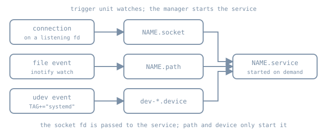

So far every service in this part was started because a target wanted it or an administrator asked. Systemd can also start a service *because something happened*: a client connected to a port, a file appeared, or the kernel announced a device. The unit that watches is a separate unit (`.socket`, `.path` or `.device`), and the unit that does the work is an ordinary `.service`. Keeping the watcher apart from the worker changes what "stopped" means, what to check when the worker never runs, and how a fault can turn into a loop.

{fig-alt="Three rows: a connection on a listening fd goes to NAME.socket, a file event watched by inotify goes to NAME.path, and a udev event tagged systemd becomes a dev-*.device unit. All three arrows lead to NAME.service, started on demand."}

## The trigger and the triggered

Each trigger unit names the unit it activates. By default that is the service with the same name: `bl06-echo.socket` activates `bl06-echo.service`, and `bl06-drop.path` activates `bl06-drop.service`. A socket can choose another service with `Service=`, and a path unit with `Unit=`. `systemctl show -p Triggers NAME.socket` and `-p TriggeredBy NAME.service` read the link from either end, and `systemctl status` prints a `TriggeredBy:` line for an activated service.

Two consequences follow from this split:

- **Stopping the service does not stop the trigger.** If the socket is still listening, the next connection starts the service again, and `systemctl stop NAME.service` prints a warning saying so. To take an activated service out of use, stop (and if needed disable) the trigger unit as well.
- **Enabling is per unit.** A socket-activated daemon usually installs only its `.socket` into `sockets.target`. The service has no `[Install]` section, or a deliberately unused one, because it is meant to start on demand. `systemctl is-enabled NAME.service` reporting `static` or `indirect` is normal here.

## Socket activation

A `.socket` unit asks the manager to create and own a listening socket: `ListenStream=` for TCP or a stream `AF_UNIX` socket, `ListenDatagram=` for UDP, `ListenFIFO=` and others for less common types. The manager binds it early (at `sockets.target` during boot) and waits. When the first client arrives, it starts the service and hands it the socket.

`Accept=` selects one of two models, documented in [systemd.socket(5)](https://www.freedesktop.org/software/systemd/man/latest/systemd.socket.html):

| | `Accept=no` (default) | `Accept=yes` |
|---|---|---|
| Service unit | `NAME.service` | template `NAME@.service`, one instance per connection |
| What the service receives | the *listening* socket(s), from fd 3 onwards | one *connected* socket, usually as stdin/stdout |
| How the service finds them | `LISTEN_FDS`, `LISTEN_PID`, `LISTEN_FDNAMES` environment (`sd_listen_fds(3)`) | `StandardInput=socket` |
| Who calls `accept()` | the daemon | the manager |
| Fits | real daemons that support socket activation | small inetd-style tools, low connection rates |

Three properties make socket activation useful beyond saving memory:

1. **Ordering is relaxed.** The socket exists before the service starts, so clients can connect and queue in the kernel's listen backlog while the daemon is still starting. Socket units gain an implicit `Before=` on the service they activate, but clients of the service need ordering only on the socket.
2. **Restarts don't drop the listener.** With `Accept=no`, the manager keeps holding the listening socket while the service restarts, so new connections queue instead of being refused. Connections the old process had already accepted are still lost.
3. **The daemon must support it.** Passing fd 3 to a program that ignores it does nothing useful: the program opens its own socket, collides with the manager's on the same port, and fails with "Address already in use". Python's `http.server`, used by `bl06-demo`, does not read `LISTEN_FDS`, so the lab below uses the `Accept=yes` model with a program that just reads stdin.

The socket unit does not make the service depend on it. A service can still be started directly, in which case it must open its own socket. Add an explicit `Requires=NAME.socket` to the service if that must not happen.

Rate limiting has two layers. `TriggerLimitIntervalSec=` and `TriggerLimitBurst=` (default 20 activations per 2 s, or 200 with `Accept=yes`) put the socket into a **failed** state when exceeded, and it stops listening until it is restarted. `PollLimitIntervalSec=`/`PollLimitBurst=` only slow polling down temporarily. A socket that "stopped answering" after a burst of traffic is worth checking for `Result=trigger-limit-hit`.

## Path activation

A `.path` unit watches the file system with inotify and starts its unit when a condition holds. The conditions, from [systemd.path(5)](https://www.freedesktop.org/software/systemd/man/latest/systemd.path.html):

| Setting | Activates when |
|---|---|
| `PathExists=` | the path exists |
| `PathExistsGlob=` | at least one file matches the glob |
| `PathChanged=` | the watched file or directory changes; for a write, only when the file opened for writing is closed |
| `PathModified=` | as `PathChanged=`, and also on each plain write |
| `DirectoryNotEmpty=` | the directory contains at least one file |

`MakeDirectory=yes` creates the watched directory first. Prefer `PathChanged=` for files that are written and then closed, such as configuration dropped by a tool. `PathModified=` can fire repeatedly in the middle of one large write.

Two limits catch people out:

- **inotify sees only local changes.** A path unit cannot see files changed by another machine on NFS or most network file systems.
- **The condition is re-checked when the service exits.** Whether the triggered service succeeded or failed, the manager checks the watched paths again immediately and starts it again if the condition still holds. A `DirectoryNotEmpty=` service that doesn't empty the directory runs back to back until the service's start-rate limit (`StartLimitIntervalSec=`, `StartLimitBurst=` in `systemd.unit(5)`) is hit. Then, unusually, the failure also propagates to the path unit, which fails and stops watching. The work the service does must remove the condition that triggered it.

## Device activation

The manager does not watch devices itself. udev processes kernel events, and a device tagged `TAG+="systemd"` in the udev database appears as a `.device` unit. Many devices are tagged by default rules: block devices, network interfaces and TTYs. Unit names come from the device path, escaped: `/dev/sdb` becomes `dev-sdb.device`, and network interface `enp1s0` appears as `sys-subsystem-net-devices-enp1s0.device`. `systemd-escape --path --suffix=device /dev/disk/by-label/data` prints the name for any path, and saves guessing at the `\x2d` escapes for dashes.

Units use device units in three ways, documented in [systemd.device(5)](https://www.freedesktop.org/software/systemd/man/latest/systemd.device.html):

- Mount, swap and some socket units gain dependencies on their backing device automatically.
- A service can declare `BindsTo=dev-sdb.device` plus `After=dev-sdb.device`, so it starts after the device appears and stops when it goes away.
- A udev rule can set `ENV{SYSTEMD_WANTS}="bl06-ingest.service"` on a tagged device to start a unit when the device first becomes active. Wants added to a device that is already active are not acted on.

Don't run long jobs from a udev `RUN+=` key. udev kills long-running processes from rules and runs them in a restricted context. The supported pattern is to tag the device, let systemd start a service, and do the work in the service.

## Inventory on a running host

```bash
systemctl list-sockets --all
systemctl list-units --type=path --all
systemctl list-units --type=device --no-pager | head -n 20
systemctl show ssh.socket -p Listen -p Triggers -p Accept -p NAccepted -p NConnections
systemctl status ssh.service --no-pager     # look for a TriggeredBy: line
```

Ubuntu has shipped OpenSSH socket-activated by default since 22.10: `ssh.socket` listens on port 22 and starts `ssh.service` on the first connection. Since 24.04, the socket's listen addresses come from `sshd_config` through a generator (the previous chapter), so a port change there needs `systemctl daemon-reload` and a socket restart, not only an `ssh.service` restart. Check which model your release and image use with `systemctl is-enabled ssh.socket ssh.service`. Read the current Ubuntu OpenSSH notes before changing it on a remote host, and keep a second session open.

## Lab: one socket, one path

::: {.callout-note}
**Not run for this chapter.** The authoring environment has no systemd, and these steps need root on the Ubuntu 26.04 `bl06-service-lab` clone used throughout Part 06. They were written from the manuals linked here. Expected results are described in prose rather than pasted output. Run them only on the disposable clone, and leave `bl06-demo.service` untouched.
:::

### An inetd-style echo socket

Create a socket on loopback port 18767 and a template service whose stdin and stdout are the accepted connection:

```bash
sudo tee /etc/systemd/system/bl06-echo.socket >/dev/null <<'UNIT'
[Unit]
Description=Boring Linux lab echo socket

[Socket]
ListenStream=127.0.0.1:18767
Accept=yes

[Install]
WantedBy=sockets.target
UNIT

sudo tee /etc/systemd/system/bl06-echo@.service >/dev/null <<'UNIT'
[Unit]
Description=Boring Linux lab echo connection

[Service]
ExecStart=/usr/bin/cat
StandardInput=socket
StandardOutput=socket
StandardError=journal
DynamicUser=yes
UNIT

sudo systemctl daemon-reload
sudo systemctl start bl06-echo.socket
systemctl status bl06-echo.socket --no-pager
sudo ss -ltnp 'sport = :18767'
```

The socket should be `active (listening)`, and `ss` should show **systemd** (PID 1) as the owner of the listener, not a `cat` process, because no service has run yet.

Connect once, then look for the per-connection instance:

```bash
python3 - <<'PYCODE'
import socket
with socket.create_connection(("127.0.0.1", 18767), timeout=5) as s:
    s.sendall(b"boring\n")
    s.shutdown(socket.SHUT_WR)
    print(s.recv(100))
PYCODE
systemctl show bl06-echo.socket -p NAccepted -p NConnections
journalctl -b --no-pager -n 20 -u 'bl06-echo@*'
```

The client should print `b'boring\n'`. `NAccepted` goes up by one per connection, and `NConnections` returns to 0 after the instance exits. The journal shows an instance named after the connection, such as `bl06-echo@0-127.0.0.1:18767-127.0.0.1:NNNNN.service`, starting and finishing.

### A drop-box path unit

Watch a runtime directory and process whatever lands in it. The service *empties the directory*, which ends the trigger condition:

```bash
sudo tee /etc/systemd/system/bl06-drop.path >/dev/null <<'UNIT'
[Unit]
Description=Boring Linux lab drop box

[Path]
DirectoryNotEmpty=/run/bl06-inbox
MakeDirectory=yes
DirectoryMode=0755
UNIT

sudo tee /etc/systemd/system/bl06-drop.service >/dev/null <<'UNIT'
[Unit]
Description=Boring Linux lab drop box processor

[Service]
Type=oneshot
ExecStart=/usr/bin/find /run/bl06-inbox -mindepth 1 -maxdepth 1 -type f -print -delete
UNIT

sudo systemctl daemon-reload
sudo systemctl start bl06-drop.path
echo hello | sudo tee /run/bl06-inbox/job-1 >/dev/null
sleep 1
ls -A /run/bl06-inbox
journalctl -b --no-pager -n 10 -u bl06-drop.service
```

The directory should be empty again, and the journal should show `/run/bl06-inbox/job-1` printed by `find` followed by the oneshot finishing. The service runs as root with no sandboxing. That is acceptable for a disposable lab, but a real processor needs the sandboxing covered later in this part.

To see the re-check behaviour safely, run a variant that *doesn't* empty the directory. Skip this step if you are unsure about the clone. Create a drop-in with an empty `ExecStart=` followed by `ExecStart=/usr/bin/true`, place a file, and watch `systemctl status bl06-drop.path` go to `failed` with `Result=unit-start-limit-hit` within seconds. Then remove the drop-in, run `sudo systemctl reset-failed bl06-drop.path bl06-drop.service`, and start the path unit again.

### Clean up

```bash
sudo systemctl stop bl06-echo.socket bl06-drop.path
sudo rm -f /etc/systemd/system/bl06-echo.socket /etc/systemd/system/bl06-echo@.service \
           /etc/systemd/system/bl06-drop.path /etc/systemd/system/bl06-drop.service
sudo rm -rf /etc/systemd/system/bl06-drop.service.d /run/bl06-inbox
sudo systemctl daemon-reload
sudo systemctl reset-failed
systemctl list-units --all 'bl06-*' --no-pager
```

Only `bl06-demo.service` should remain.

## Diagnosis: "the service never runs" and "it won't stay stopped"

1. **Is the trigger active?** `systemctl status NAME.socket` or `NAME.path`. A trigger that hit its own trigger limit or its service's start limit is `failed` and no longer watching. Run `systemctl show -p Result`.
2. **Is it linked to the unit you think?** Check `systemctl show -p Triggers`. A typo in the name or in `Service=`/`Unit=` points it at a unit that doesn't exist.
3. **Socket: who owns the port?** If `ss -ltnp` shows the daemon itself and the socket unit failed with "Address already in use", the service was started directly or isn't socket-aware, and the two are competing for the port.
4. **Path: is the change local and of the right kind?** Writes over NFS, or a writer that never closes the file under `PathChanged=`, won't trigger.
5. **Device: does the unit exist?** `systemctl list-units --all --type=device | grep NAME` and `udevadm info /dev/NAME | grep -E 'TAGS|SYSTEMD'`. No `systemd` tag means no device unit.
6. **It keeps coming back:** stop the trigger unit, not only the service. For a path loop, find out why the condition still holds after the service exits.

## Operational care

- Document which units are triggers. Monitoring that alerts on "service inactive" will false-alarm on socket-activated services that are idle by design.
- Treat a trigger unit's `failed` state as an outage. A failed socket refuses connections even though nothing is "down" in the service list.
- Keep path-triggered work idempotent, because the service can run more than once for a single change.
- Before relying on device activation for storage, test hot-unplug as well as hot-plug, together with the `BindsTo=` behaviour.

## Practice

1. Explain why `systemctl stop ssh.service` on a socket-activated host does not prevent new SSH logins.
2. For a daemon whose documentation says nothing about `LISTEN_FDS`, what happens if you add a `.socket` unit for its port, and how would you notice?
3. Rewrite the drop-box unit to use `PathChanged=/etc/bl06/config.ini`. What would the service need to do differently, and why is there no loop risk?
4. Produce the device unit name for `/dev/disk/by-label/bl06-data` with `systemd-escape`, and write the two dependency lines a backup service would need.

## Recall card

- Trigger units watch; services work. Stop the trigger to stop activation.
- `Accept=no`: the daemon gets listening fds from fd 3 and must support `sd_listen_fds`. `Accept=yes`: one template instance per connection.
- Trigger limits fail the socket or path unit. Check `Result=`.
- Path units use inotify (local only), and the condition is re-checked as soon as the service exits.
- Device units exist only for udev devices tagged `systemd`. Start long work with `SYSTEMD_WANTS=`, not `RUN+=`.

## Sources

- [systemd.socket(5)](https://www.freedesktop.org/software/systemd/man/latest/systemd.socket.html)
- [systemd.path(5)](https://www.freedesktop.org/software/systemd/man/latest/systemd.path.html)
- [systemd.device(5)](https://www.freedesktop.org/software/systemd/man/latest/systemd.device.html)
- [sd_listen_fds(3)](https://www.freedesktop.org/software/systemd/man/latest/sd_listen_fds.html)
- [systemd-escape(1)](https://www.freedesktop.org/software/systemd/man/latest/systemd-escape.html)
- [udev(7)](https://www.freedesktop.org/software/systemd/man/latest/udev.html), for `TAG+=`, `RUN+=` and the limits on processes started from rules
