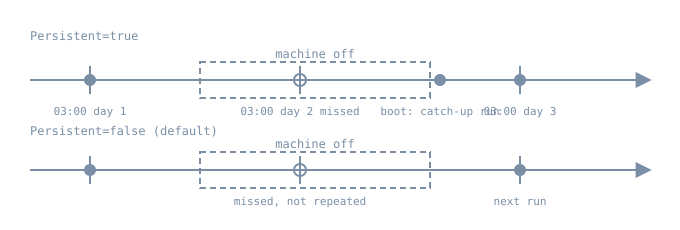

Scheduled work is where small mistakes hide the longest. A backup job that has silently not run for three weeks looks exactly like one that runs every night, until the day you need it. An Ubuntu server can run three schedulers, often side by side: systemd **timers**, the classic **cron** daemon, and **anacron** for machines that are not always on. This chapter covers how each decides *when* to run, what happens to runs missed while the machine was off, how overlap and output are handled, and how to prove that a job ran.

## A timer is a trigger unit for time

A `.timer` unit is the time-based sibling of the socket and path units in the previous chapter. It activates a unit, by default the `.service` with the same name, and the work lives in that service. The service is usually `Type=oneshot` with no `[Install]` section. You enable the **timer**, which by default is ordered before `timers.target` and is normally installed with `WantedBy=timers.target`.

Timers come in two clock families, documented in [systemd.timer(5)](https://www.freedesktop.org/software/systemd/man/latest/systemd.timer.html):

| Family | Settings | Counts from |
|---|---|---|
| Monotonic | `OnBootSec=`, `OnStartupSec=`, `OnActiveSec=`, `OnUnitActiveSec=`, `OnUnitInactiveSec=` | an event: boot, manager start, timer activation, last start or last finish of the unit |
| Realtime | `OnCalendar=` | the wall clock, as a [calendar expression](https://www.freedesktop.org/software/systemd/man/latest/systemd.time.html) |

`OnBootSec=15min` plus `OnUnitActiveSec=1h` means "15 minutes after boot, then hourly after each start". That pattern is immune to clock jumps and is a good fit for housekeeping. `OnCalendar=Mon..Fri *-*-* 03:00` means "weekdays at 03:00 local time". Calendar expressions accept shorthands (`hourly`, `daily`, `weekly`) and an optional time zone after the time (`*-*-* 03:00 UTC`). Check any expression before using it:

```bash
systemd-analyze calendar --iterations=4 'Mon..Fri *-*-* 03:00'
systemd-analyze calendar 'daily'
```

The first command prints the normalized form and the next four elapse times, which is the quickest way to catch an expression that means something other than what you intended.

### When does it actually fire?

- **`AccuracySec=` defaults to 1 minute.** The manager may run the timer anywhere in a one-minute window after the scheduled time, at a host-specific but stable offset, so that wake-ups are coalesced. Set it lower only when the job truly needs it.
- **`RandomizedDelaySec=`** adds a random delay up to the given value, chosen again before each run (unless `FixedRandomDelay=yes`). It exists to stop a fleet of machines hitting the same mirror or API at 03:00:00. `RandomizedOffsetSec=` gives a stable per-host offset for calendar timers.
- **Calendar timers wait for the clock.** Timers with `OnCalendar=` are automatically ordered after `time-set.target` and `time-sync.target`, so a machine that boots with a bad clock does not fire a run based on the wrong time.

### Missed runs: `Persistent=`

{fig-alt="Two timelines. Upper, Persistent=true: runs on day 1, a dashed machine-off box covers day 2's 03:00, a catch-up run happens at boot, then the normal day 3 run. Lower, default: day 2 is missed and not repeated; the next run is day 3."}

With `Persistent=true`, the manager stores the last trigger time on disk (under `/var/lib/systemd/timers/`). If at least one run would have happened while the timer was inactive, for example because the machine was powered off, the service is triggered **once**, soon after the timer starts again, subject to `RandomizedDelaySec=`. It has no effect on monotonic timers. `systemctl clean --what=state NAME.timer` removes the stamp. That is the systemd answer to the problem anacron was written for.

### Overlap

A timer starts a unit; it does not start a *second copy* of a unit that is still running. If last night's backup is still going at 03:00, the start request for an already-active `oneshot` service changes nothing. That gives you the "never overlap" behaviour that cron jobs have to build by hand with `flock`. It also means a hung job blocks every later run, so give the service a `TimeoutStartSec=` (for oneshot, this bounds the whole run) and alert on failures.

### Inventory

```bash
systemctl list-timers --all
systemctl status apt-daily-upgrade.timer --no-pager
systemctl show logrotate.timer -p TimersCalendar -p LastTriggerUSec -p NextElapseUSecRealtime -p Persistent
journalctl -u logrotate.service -b --no-pager -n 20
```

`list-timers` shows, for each timer, the next and last elapse times and which unit it activates. An Ubuntu install already has several vendor timers, including `apt-daily.timer`, `apt-daily-upgrade.timer`, `logrotate.timer`, `fstrim.timer` and `man-db.timer`. Change them with drop-ins, as in chapter 5 of this part, not by editing `/usr/lib`.

## Cron

Cron predates systemd by decades, and most third-party software and administrators still use it. On Ubuntu, the daemon is Debian's cron, as described in [cron(8)](https://manpages.debian.org/trixie/cron/cron.8.en.html) and [crontab(5)](https://manpages.debian.org/trixie/cron/crontab.5.en.html). Check whether it is installed and running on your image with `systemctl status cron`. It reads:

| Location | Format | Notes |
|---|---|---|
| `crontab -e` (spool, per user) | `m h dom mon dow command` | runs as that user, edit only via `crontab` |
| `/etc/crontab` | adds a **user** field before the command | system-wide, owned by the cron package |
| `/etc/cron.d/*` | same as `/etc/crontab`, with a user field | where packages and config management drop jobs |
| `/etc/cron.{hourly,daily,weekly,monthly}/` | executable scripts | run by `run-parts` from `/etc/crontab` |

Cron behaviour that catches people out:

- **A minimal environment.** Jobs get `SHELL` set to `sh`, `HOME` and `LOGNAME` from `/etc/passwd`, a short default `PATH`, and none of your login shell's settings. `/etc/crontab` sets its own longer `PATH` at the top, but user crontabs don't. Use absolute paths, or set `PATH=` at the top of the crontab.
- **`%` means newline** in the command field unless escaped as `\%`, which breaks `date +%F` in crontabs.
- **Output is mailed**, to the owner or to `MAILTO`. On a server without a mail transfer agent, the output is usually just discarded. Redirect explicitly, or pipe to `systemd-cat -t jobname` so it goes to the journal.
- **Overlap is allowed.** If a job runs longer than its interval, cron starts another one. Wrap it: `flock -n /run/lock/jobname.lock /usr/local/sbin/job`.
- **Daylight saving.** Debian cron special-cases clock changes of less than 3 hours. Fixed-time jobs in the skipped hour run soon after the change, and jobs in a repeated hour are not run twice. Jobs with wildcards in the hour or minute fields follow the new time immediately. Servers kept on UTC avoid the question.
- **File names in the `run-parts` directories.** Debian's `run-parts`, and cron for `/etc/cron.d`, accept only names made of letters, digits, `_` and `-`. A script called `backup.sh` in `/etc/cron.daily` is **silently skipped**.

That last point is easy to demonstrate without root, because `run-parts` is an ordinary program. This was run on a Debian box (`run-parts` 5.23.1) in a scratch directory:

```text
$ ls -l | awk 'NR>1{print $1, $NF}'
-rwxr-xr-x 10-rotate
-rw-r--r-- 20-noexec
-rwxr-xr-x app.dpkg-old
-rwxr-xr-x backup.sh
-rwxr-xr-x logrotate_custom
-rwxr-xr-x zz-report~
$ run-parts --test .
./10-rotate
./logrotate_custom
$ run-parts --report .
./10-rotate:
10-rotate ran
./logrotate_custom:
logrotate_custom ran
```

`backup.sh`, the editor backup `zz-report~` and the leftover `app.dpkg-old` all have the execute bit, and none of them run. `20-noexec` is skipped because it is not executable. Run `run-parts --test /etc/cron.daily` on any server you inherit.

## Anacron

Cron assumes the machine is on at the scheduled time. [anacron(8)](https://manpages.debian.org/trixie/anacron/anacron.8.en.html) instead records in `/var/spool/anacron/` when each job last ran. When it is invoked, it runs any job whose period (in days, or `@monthly`) has passed, after a configured delay. Its jobs live in `/etc/anacrontab`.

On Debian and Ubuntu, the stock `/etc/crontab` lines for daily, weekly and monthly jobs start with `test -x /usr/sbin/anacron ||`. When anacron is installed, cron leaves those directories to anacron, so the jobs run at a different time than `/etc/crontab` suggests. The hourly directory stays with cron. Whether anacron is installed varies by image and is common on desktops, so check before reasoning about when `cron.daily` actually runs:

```bash
grep -E 'cron\.(daily|weekly|monthly)' /etc/crontab
command -v anacron && systemctl list-timers anacron.timer --all
```

## Choosing

For new jobs you own on Ubuntu, prefer a timer plus a oneshot service. You get the journal for output, `Persistent=` for catch-up, non-overlap by default, resource limits and sandboxing from the service, dependencies (`After=network-online.target`, `RequiresMountsFor=/srv/backup`), and `systemctl list-timers` as an inventory. Keep cron where software or a team expects it, or for a single user's personal jobs, and use `flock`, explicit logging and `run-parts`-safe names. Don't schedule the same job in both.

## Lab: a persistent timer

::: {.callout-note}
**Not run for this chapter.** The authoring environment has no systemd, and the steps need root on the Ubuntu 26.04 `bl06-service-lab` clone used throughout Part 06. They were written from the manuals linked here. Only the `run-parts` demonstration above was actually run. Expected results are described in prose.
:::

Create a oneshot job and a timer that fires every two minutes on the wall clock, with catch-up:

```bash
sudo tee /etc/systemd/system/bl06-tick.service >/dev/null <<'UNIT'
[Unit]
Description=Boring Linux lab scheduled job

[Service]
Type=oneshot
ExecStart=/bin/sh -c 'echo "tick at $(date -u +%%FT%%TZ)"'
TimeoutStartSec=60
DynamicUser=yes
UNIT

sudo tee /etc/systemd/system/bl06-tick.timer >/dev/null <<'UNIT'
[Unit]
Description=Boring Linux lab timer

[Timer]
OnCalendar=*:0/2
AccuracySec=1s
Persistent=true

[Install]
WantedBy=timers.target
UNIT

systemd-analyze calendar --iterations=3 '*:0/2'
sudo systemctl daemon-reload
sudo systemctl enable --now bl06-tick.timer
systemctl list-timers bl06-tick.timer --all
```

`%%` is how a literal `%` is written in a unit file, because `%` introduces specifiers. Wait a few minutes, then read the evidence from both ends:

```bash
journalctl -u bl06-tick.service --since '-10min' --no-pager
systemctl show bl06-tick.timer -p LastTriggerUSec -p NextElapseUSecRealtime
```

Expect a "tick at …" line every two minutes, each followed by the oneshot finishing. To see catch-up, stop the timer, wait past at least one scheduled time, then start it again. With `Persistent=true` one tick should appear right away, and only one however many were missed. `AccuracySec=1s` is a lab convenience so the ticks land on time; leave the default on real jobs.

A one-off run without writing files uses a transient timer:

```bash
sudo systemd-run --on-active=30s --unit=bl06-once /usr/bin/true
systemctl list-timers bl06-once.timer --all
```

Clean up:

```bash
sudo systemctl disable --now bl06-tick.timer
sudo systemctl clean --what=state bl06-tick.timer
sudo rm -f /etc/systemd/system/bl06-tick.timer /etc/systemd/system/bl06-tick.service
sudo systemctl daemon-reload
sudo systemctl reset-failed
systemctl list-timers --all 'bl06-*'
```

## Diagnosis: "the job didn't run"

1. **Is the scheduler looking at it?** For a timer, check `systemctl list-timers --all`. Look for an empty NEXT column, an `inactive` timer, or a timer that was never enabled. For cron, check that the file is in the right place with the right format (user field or not), and that names in `run-parts` directories pass `run-parts --test`.
2. **Did it fire and fail?** `journalctl -u NAME.service` for timers. For cron, `journalctl -u cron` shows the `CMD` lines, and the job's own output only if you redirected it.
3. **Is it the environment?** A job that works interactively and fails from cron is nearly always `PATH`, the working directory, `HOME`, or a missing `%` escape.
4. **Was the machine off or asleep?** Without `Persistent=` or anacron, a missed time is simply missed.
5. **Is a previous run still going?** For a timer, the service is `activating` with an old start time. For cron, look for several copies in `ps`.
6. **Was the time right?** Check the time zone (`timedatectl`) and the clock source, and whether DST moved a fixed-time cron job.

## Operational care

- Monitor what the job *produces* (a fresh backup file, a metric with a timestamp), not only that the scheduler started it.
- Spread fleet-wide jobs with `RandomizedDelaySec=` or `RandomizedOffsetSec=`.
- Give every job a timeout and a lock, whichever scheduler runs it.
- Keep servers on UTC unless something requires local time, and write the zone into calendar expressions that must follow a local clock.

## Practice

1. Write `OnCalendar=` expressions for "the first Monday of each month at 04:30" and "every 15 minutes during business hours on weekdays". Check both with `systemd-analyze calendar --iterations=5`.
2. Explain why `OnBootSec=10min` plus `OnUnitActiveSec=1d` and `OnCalendar=daily` with `Persistent=true` behave differently on a laptop that suspends every night.
3. Inherited server: `/etc/cron.daily/db-backup.sh` exists and is executable, but no backup has been made for a month. List every cause you would check, in order.
4. Convert a crontab line `*/10 * * * * /usr/local/bin/sync-mirror` into a timer and service pair that cannot overlap and logs to the journal.

## Recall card

- A timer activates a service. Enable the timer; the service is a oneshot without `[Install]`.
- Monotonic timers count from events; `OnCalendar=` follows the wall clock. Test with `systemd-analyze calendar`.
- `AccuracySec=` defaults to 1 min. Use `RandomizedDelaySec=` to spread load.
- `Persistent=true` gives one catch-up run for missed calendar times.
- Cron: minimal environment, `%` is a newline, output is mailed, overlap is allowed, and `run-parts` skips names with dots.
- Anacron runs periodic jobs that were missed. When it is installed, it takes over the daily, weekly and monthly directories.

## Sources

- [systemd.timer(5)](https://www.freedesktop.org/software/systemd/man/latest/systemd.timer.html)
- [systemd.time(7)](https://www.freedesktop.org/software/systemd/man/latest/systemd.time.html), for calendar expressions
- [systemd-analyze(1)](https://www.freedesktop.org/software/systemd/man/latest/systemd-analyze.html) and [systemd-run(1)](https://www.freedesktop.org/software/systemd/man/latest/systemd-run.html)
- Debian [cron(8)](https://manpages.debian.org/trixie/cron/cron.8.en.html), [crontab(5)](https://manpages.debian.org/trixie/cron/crontab.5.en.html), [run-parts(8)](https://manpages.debian.org/trixie/debianutils/run-parts.8.en.html) and [anacron(8)](https://manpages.debian.org/trixie/anacron/anacron.8.en.html)
