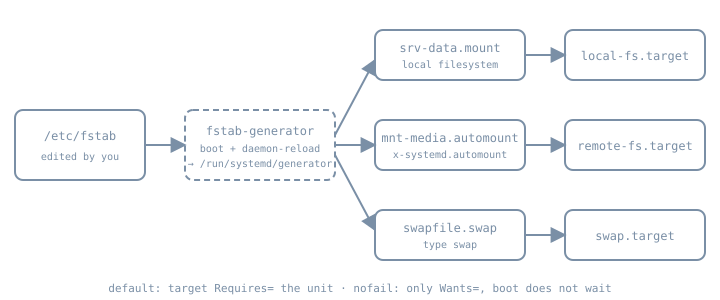

Most administrators never write a `.mount` file, yet every Ubuntu server is full of them. systemd turns each `/etc/fstab` line into a mount, automount or swap unit, and from then on that filesystem is a unit like any service. It has dependencies, a start job that can time out, and a failure that can stop the boot. This chapter covers that lifecycle: how fstab becomes units, which options change whether a missing disk delays boot or drops you to an emergency shell, how automounts defer the mount until first use, and how swap fits the same model. Partitioning, filesystems and fstab fields in depth belong to Part 09. Here the focus is how storage takes part in the service graph.

## Three unit types, one naming rule

| Unit | Configures | Named after | Manual |
|---|---|---|---|
| `.mount` | a mounted filesystem (`What=`, `Where=`, `Type=`, `Options=`) | the mount point | [systemd.mount(5)](https://www.freedesktop.org/software/systemd/man/latest/systemd.mount.html) |
| `.automount` | an autofs trigger at a mount point | the mount point, and must match a `.mount` of the same name | [systemd.automount(5)](https://www.freedesktop.org/software/systemd/man/latest/systemd.automount.html) |
| `.swap` | a swap device or file (`What=`, `Priority=`, `Options=`) | the device or file path | [systemd.swap(5)](https://www.freedesktop.org/software/systemd/man/latest/systemd.swap.html) |

The name isn't a label you choose. It *is* the path, escaped: `/home/lennart` must be `home-lennart.mount`, and `/dev/sda5` must be `dev-sda5.swap`. Slashes become dashes, so a literal dash in a path is escaped as `\x2d`. Use `systemd-escape` rather than guessing:

```bash
systemd-escape --path --suffix=mount /srv/lab-data    # → srv-lab\x2ddata.mount
```

systemd refuses a mount unit whose name doesn't match its `Where=`. This is the most common reason a hand-written mount unit "does nothing".

systemd also creates mount units dynamically for everything already mounted, whoever mounted it, so `systemctl list-units --type=mount` shows `/proc`, `/run` and bind mounts too.

## From fstab to units

{fig-alt="Left to right: /etc/fstab feeds systemd-fstab-generator (run at boot and on daemon-reload, writing to /run/systemd/generator). The generator produces srv-data.mount, mnt-media.automount and swapfile.swap, which point to local-fs.target, remote-fs.target and swap.target. A footer says that by default the target requires the unit, but with nofail it only wants it and boot does not wait."}

[systemd-fstab-generator(8)](https://www.freedesktop.org/software/systemd/man/latest/systemd-fstab-generator.html) is one of the generators from the drop-ins chapter. It runs early at boot and on every `systemctl daemon-reload`, and writes units under `/run/systemd/generator/`. Two consequences follow:

1. **Editing fstab changes nothing until the generator runs again.** util-linux `mount` notices and says so. This string is in the `mount` binary on the authoring box:

   ```text
   mount: (hint) your fstab has been modified, but systemd still uses
          the old version; use 'systemctl daemon-reload' to reload.
   ```

2. **A native unit file in `/etc` wins over fstab.** If a mount point is defined both in fstab and in a unit file, the unit wins if it is in `/etc/systemd/system/`. fstab wins over a vendor unit under `/usr/`. Pick one place per filesystem. fstab is the boring default for local disks.

The generator also treats the fsck `passno` field as a simple yes/no, and ignores the ordering it used to encode. Checks run through `systemd-fsck@.service` instances.

## Options that decide boot behaviour

These fstab options are documented in systemd.mount(5) and are read by the generator, not by the kernel:

| Option | Effect on the unit graph |
|---|---|
| *(default)* | `local-fs.target` (or `remote-fs.target`) **Requires=** the mount and is ordered after it. If the mount fails, the target fails, and boot ends in `emergency.target`. |
| `nofail` | The target only **Wants=** the mount and isn't ordered after it. Boot continues without waiting, whether or not the mount succeeds. |
| `noauto` | Not pulled in by the target at all. Mount it on demand with `systemctl start` or `mount`. |
| `x-systemd.automount` | Creates an `.automount` unit, which the target pulls in instead. `auto` and `noauto` then have no effect. |
| `x-systemd.idle-timeout=` | The automount's `TimeoutIdleSec=`: unmount after this long unused. |
| `x-systemd.device-timeout=` | How long to wait for the device to appear. Valid only in fstab, and ignored in a unit's `Options=`. |
| `x-systemd.mount-timeout=` | How long the `mount` command itself may take (`TimeoutSec=` in a unit). |
| `x-systemd.requires=`, `x-systemd.after=` | Extra dependencies, for example on a unit that unlocks the device |
| `_netdev` | Treat as a network filesystem even if the type looks local, as with iSCSI: order after `network-online.target` and pull it in, and attach to `remote-fs.target` |

The "noncritical required mount" that broke the boot in the Part 03 recovery lab was exactly the default row: a data disk that was absent, with no `nofail`. On a server, ask of every non-root line: *should the machine refuse to boot without this?* For the root filesystem and anything your services cannot run without, the answer is yes, and the default is right. For removable, secondary or network storage, use `nofail` or `x-systemd.automount`. Then make the dependent service say what it needs (below), rather than relying on boot order.

### Services that need a mount

Boot targets are a blunt tool. A service that writes to `/srv/data` should declare that directly:

```ini
# /etc/systemd/system/labapp.service.d/storage.conf
[Unit]
RequiresMountsFor=/srv/data
```

`RequiresMountsFor=` adds `Requires=` and `After=` on every mount unit needed to reach that path, including parents. If the data disk is `nofail` and missing, the machine still boots, and `labapp` fails visibly with a dependency error instead of silently writing into the empty directory underneath the mount point.

## Automount: mount on first access

An automount unit makes the kernel's autofs place a trigger at the mount point. The first process to touch the path blocks briefly while systemd starts the matching `.mount`. After `TimeoutIdleSec=` with nothing using it, systemd tries to unmount it again. This suits network shares and slow or rarely used disks:

```text
nas.example.org:/export/media  /mnt/media  nfs  _netdev,x-systemd.automount,x-systemd.idle-timeout=10min  0 0
```

The boot doesn't wait for the NAS. Only the process that accesses `/mnt/media` waits, and it gets an error if the mount fails. Prefer this to the NFS `bg` option. systemd.mount(5) notes that the generator must rewrite `bg` into `x-systemd.mount-timeout=infinity,retry=10000` plus `fg,nofail` to make it fit job control, and suggests `x-systemd.automount` instead.

## Swap units

Swap entries in fstab become `.swap` units pulled in by `swap.target`, or by `remote-fs.target` for network swap. A swapfile `/swapfile` becomes `swapfile.swap`. A device listed by UUID becomes a long escaped name under `dev-disk-by\x2duuid-…`, so list them rather than typing them:

```bash
systemctl list-units --type=swap
swapon --show
```

`Priority=` (fstab `pri=`) chooses between several swap areas. Higher is used first. Sizing swap and choosing between disk swap, zram and zswap is a memory question, covered in Part 07.

## Check fstab before you reboot

`findmnt --verify` parses an fstab and checks each line against the running system: whether sources and targets exist, whether the filesystem type is supported, and which options are user-space options. It was run on the authoring box (util-linux 2.41.5) against this deliberately mixed lab file. None of these disks exist on that box, which is the point. Output is verbatim:

```text
$ cat /tmp/fstab.lab
# lab fstab
UUID=0a1b2c3d-1111-2222-3333-444455556666 /srv/data ext4 defaults,nofail,x-systemd.device-timeout=10s 0 2
UUID=0a1b2c3d-1111-2222-3333-777788889999 /srv/archive ext4 noauto,x-systemd.automount,x-systemd.idle-timeout=5min 0 2
nas.example.org:/export/media /mnt/media nfs _netdev,x-systemd.automount 0 0
/swapfile none swap defaults,pri=10 0 0
/dev/sdz9 /broken ext9 defaults 0 2

$ findmnt --verify --tab-file /tmp/fstab.lab --verbose; echo "exit=$?"

0 parse errors, 4 errors, 7 warnings
/srv/data
   [E] unreachable on boot required target: No such file or directory
   [ ] userspace options: nofail,x-systemd.device-timeout=10s
   [E] unreachable on boot required source: UUID=0a1b2c3d-1111-2222-3333-444455556666
/srv/archive
   [W] unreachable target: No such file or directory
   [ ] userspace options: noauto,x-systemd.automount,x-systemd.idle-timeout=5min
   [W] unreachable: UUID=0a1b2c3d-1111-2222-3333-777788889999
/mnt/media
   [E] unreachable on boot required target: No such file or directory
   [ ] userspace options: _netdev,x-systemd.automount
   [ ] do not check nas.example.org:/export/media source (pseudo/net)
   [ ] do not check nas.example.org:/export/media FS type (pseudo/net)
none
   [W] unreachable source: /swapfile: No such file or directory
   [W] cannot detect on-disk filesystem type (No such file or directory)
/broken
   [E] unreachable on boot required target: No such file or directory
   [W] unreachable source: /dev/sdz9: No such file or directory
   [W] ext9 seems unsupported by the current kernel
   [W] cannot detect on-disk filesystem type (No such file or directory)
exit=1
```

Three lessons from that run:

- **The typo is caught.** `ext9` and the missing `/dev/sdz9` on `/broken` are the kind of mistake that ends in `emergency.target`. findmnt flags both without touching the system.
- **findmnt isn't systemd.** It downgraded the `noauto` line to warnings, but still reported the `nofail` and automount lines as "on boot required" errors. It checks whether lines are reachable; it doesn't model what the generator does with `nofail` or `x-systemd.automount`. Use it for typos and missing devices, and use the generated units to understand boot behaviour.
- **Its exit status is usable.** A non-zero exit lets configuration management refuse to deploy a broken fstab.

## Lab: a data mount that can't stop the boot

::: {.callout-note}
**Not run for this chapter.** The authoring environment has no systemd and no `mkfs`/`mkswap`. The steps need root on the Ubuntu 26.04 `bl06-service-lab` clone used throughout Part 06, and were written from the manuals linked here. Only the `findmnt --verify` run above was actually run. Expected results are described in prose.
:::

1. **Make a disposable filesystem.** Add a small second virtual disk to the clone (for example 1 GiB), then find it and format it:

   ```bash
   lsblk -o NAME,SIZE,TYPE,MOUNTPOINTS
   sudo mkfs.ext4 -L labdata /dev/vdb     # confirm the device name first
   sudo blkid /dev/vdb                    # note the UUID
   sudo mkdir -p /srv/data
   ```

2. **Add it to fstab the boring way**, by UUID, with `nofail` and a short device timeout. Then verify, reload and look at what the generator wrote:

   ```bash
   echo 'UUID=<uuid>  /srv/data  ext4  defaults,nofail,x-systemd.device-timeout=10s  0 2' | sudo tee -a /etc/fstab
   sudo findmnt --verify
   sudo systemctl daemon-reload
   systemctl cat srv-data.mount          # header shows /run/systemd/generator/srv-data.mount
   sudo systemctl start srv-data.mount && findmnt /srv/data
   ```

   Expect `systemctl cat` to show a generated unit with a `[Mount]` section and `What=/dev/disk/by-uuid/…`.

3. **Tie the lab service to it.** Add the `RequiresMountsFor=/srv/data` drop-in shown above to `labapp.service`, then run `daemon-reload` and restart the service. `systemctl list-dependencies labapp.service` should now include `srv-data.mount`.

4. **Remove the disk and reboot.** With the VM off, detach the second disk, then boot. Expect the boot to finish after about the 10 s device timeout. `systemctl status srv-data.mount` should show it inactive, and `labapp` should fail with a dependency error. `journalctl -b` shows the device job timing out.

5. **Contrast without `nofail`.** Remove `nofail` from the line, reload, and reboot with the disk still absent. Expect the boot to wait for the device timeout and then stop in `emergency.target`. Recover as in Part 03: log in at the emergency shell, restore `nofail` (or comment out the line), run `systemctl daemon-reload`, then `systemctl default`.

6. **Convert to an automount.** Replace `nofail` with `x-systemd.automount,x-systemd.idle-timeout=2min`, reattach the disk, reload, and reboot. `systemctl list-units --type=automount` shows `srv-data.automount` active, while `findmnt /srv/data` shows only the `autofs` trigger until something runs `ls /srv/data`. After two idle minutes, the mount unit goes inactive again.

7. **Clean up.** Remove the fstab line and the drop-in, run `daemon-reload`, and detach the disk.

## Diagnosis

| Symptom | Look at |
|---|---|
| Boot stops in emergency mode after a disk change | `journalctl -xb` for the failed `.mount` or `dev-*.device` job. Fix fstab (often missing `nofail`, a wrong UUID or a typo), then `daemon-reload` and `systemctl default`. |
| Boot pauses on "A start job is running for dev-disk-by…" | The device never appeared. Check the UUID with `blkid`, and set `x-systemd.device-timeout=` if the disk is optional. |
| fstab edit has no effect | You didn't run `systemctl daemon-reload`, or a unit file in `/etc` overrides the line. Check with `systemctl cat`. |
| Service wrote into the empty mount point | Missing `RequiresMountsFor=`. Stop the service, move the stray files aside, mount the filesystem, and add the dependency. |
| Shell hangs on `cd` into a network share | An automount is waiting for the server. Check `systemctl status <name>.mount` and `x-systemd.mount-timeout=`. |
| Hand-written mount unit is refused | The unit name doesn't match `Where=`. Regenerate it with `systemd-escape --path --suffix=mount`. |

## Practice

1. For each non-root line in a server's fstab, write down whether the server should refuse to boot without it, and set `nofail` or the default to match.
2. Use `systemd-escape` to predict the unit names for `/var/lib/my-app` and `/mnt/backup 2026`, then confirm them with `systemctl list-units --type=mount` after mounting.
3. Add `findmnt --verify` to the lab's configuration check, and confirm that a deliberately misspelt filesystem type makes it fail.

## Recall card

- Who creates mount units from fstab, and when does it run?
- What does `nofail` change in the dependency graph?
- Why is `RequiresMountsFor=` better than relying on boot order?
- What happens at boot, and on first access, with `x-systemd.automount`?
- Why does `findmnt --verify` still report a `nofail` line as an error?

## Sources

- [systemd.mount(5)](https://www.freedesktop.org/software/systemd/man/latest/systemd.mount.html): naming, implicit dependencies, fstab options, precedence
- [systemd.automount(5)](https://www.freedesktop.org/software/systemd/man/latest/systemd.automount.html): `TimeoutIdleSec=`, naming
- [systemd.swap(5)](https://www.freedesktop.org/software/systemd/man/latest/systemd.swap.html): naming, `swap.target`
- [systemd-fstab-generator(8)](https://www.freedesktop.org/software/systemd/man/latest/systemd-fstab-generator.html)
- [systemd.unit(5)](https://www.freedesktop.org/software/systemd/man/latest/systemd.unit.html): `RequiresMountsFor=`
- [systemd-escape(1)](https://www.freedesktop.org/software/systemd/man/latest/systemd-escape.html)
- [findmnt(8)](https://man7.org/linux/man-pages/man8/findmnt.8.html): `--verify`
