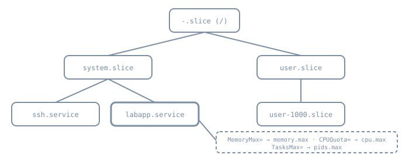

A service that leaks memory, forks without limit or spins a CPU affects every other service on the host. Unless you set boundaries, nothing stops it. systemd gives each service its own control group (cgroup), so you can set those boundaries per service, in a unit file, with the kernel enforcing them. The same unit file can also take filesystem access away from a service, which is the first, cheapest layer of sandboxing. This chapter covers both, at the depth an administrator needs for the lab service. Memory pressure and OOM tuning return in Part 07, and isolation in depth in Part 17.

## Every service is a cgroup

Linux cgroup v2 is a single tree, mounted at `/sys/fs/cgroup`. Each node in the tree is a directory, and its files are the controls. systemd builds the tree from **slices**, documented in [systemd.slice(5)](https://www.freedesktop.org/software/systemd/man/latest/systemd.slice.html):

{fig-alt="A tree. The root -.slice has two children, system.slice and user.slice. system.slice contains ssh.service and labapp.service (highlighted), and user.slice contains user-1000.slice. A dashed note says MemoryMax= becomes memory.max, CPUQuota= becomes cpu.max and TasksMax= becomes pids.max."}

- `system.slice` holds system services: `labapp.service` is the directory `/sys/fs/cgroup/system.slice/labapp.service/`.
- `user.slice` holds login sessions and user managers, one `user-UID.slice` per user.
- `machine.slice` holds VMs and containers when a manager registers them.

Because membership is by cgroup, not by process tree, a daemon that double-forks or spawns helpers can't escape its service. `systemctl stop` kills the whole cgroup, and `systemctl status` lists every process in it.

### Reading the interface directly

The files are plain text, and reading them needs no privileges. This was run on the authoring box. It is a container whose processes live in a cgroup named `agent`, not under systemd, which shows that the interface belongs to the kernel, not to systemd:

```text
$ cat /proc/self/cgroup
0::/agent
$ cat /sys/fs/cgroup/cgroup.controllers
cpuset cpu io memory hugetlb pids
$ cd /sys/fs/cgroup/agent
cgroup.subtree_control   
memory.max               max
memory.high              max
cpu.max                  max 100000
cpu.weight               100
pids.max                 max
$ cat memory.events
low 0
high 0
max 0
oom 0
oom_kill 0
oom_group_kill 0
$ head -3 cpu.stat
usage_usec 100048717396
user_usec 71893045583
system_usec 28155671813
```

(The table rows came from a small loop that printed each file name next to its contents.) The single line in `/proc/self/cgroup`, `0::`, means cgroup v2 only. On Ubuntu the same command run from a service shows `0::/system.slice/<name>.service`. `max` means unlimited. `cpu.max` is *quota period* in microseconds, so `max 100000` is no quota over a 100 ms period. `memory.events` counts how often each limit was hit. Here none were. On a real server it's the first file to read when a service "randomly" dies.

## Resource properties

These are set in the unit (or a drop-in) and documented in [systemd.resource-control(5)](https://www.freedesktop.org/software/systemd/man/latest/systemd.resource-control.html). Each maps to one cgroup file:

| Property | cgroup file | Meaning |
|---|---|---|
| `MemoryHigh=` | `memory.high` | Throttle point. Above it, processes are heavily slowed and memory is reclaimed aggressively. The manual calls this the main mechanism. |
| `MemoryMax=` | `memory.max` | Hard limit. If usage can't be held under it, the OOM killer runs **inside the unit**. The manual recommends it as the last line of defence, above `MemoryHigh=`. |
| `CPUQuota=` | `cpu.max` | Percentage of *one* CPU: `20%` is 20% of one CPU, and values above 100% span several. |
| `CPUWeight=` | `cpu.weight` | Relative share under contention (default 100). It does nothing when the CPU is idle. |
| `TasksMax=` | `pids.max` | Maximum tasks, counting every thread. Stops fork bombs and thread leaks. The system default comes from `DefaultTasksMax=`. |
| `IOWeight=` | `io.weight` | Relative block I/O share under contention |

Sizes take `K`, `M`, `G` or `T` suffixes (base 1024) or a percentage of physical memory. `infinity` removes a limit. The values systemd actually applied are reported as `EffectiveMemoryMax=`, `EffectiveTasksMax=` and similar.

Two rules keep this boring:

- **Set `MemoryHigh=` below `MemoryMax=`.** The service slows down and you see it in `memory.events` (`high` climbing) before anything is killed.
- **Use weights for fairness and quotas for containment.** A weight costs nothing when the host is idle. A quota caps the service even when the other CPUs are idle, which is right for a batch job that must not starve the host, and wrong for a latency-sensitive daemon.

You can also set properties at runtime: `systemctl set-property labapp.service MemoryMax=512M` writes a drop-in. Add `--runtime` to make the change last only until reboot.

### Seeing usage

```bash
systemd-cgls                              # the tree, with processes
systemd-cgtop                             # live CPU, memory, tasks and I/O per cgroup
systemctl status labapp                   # "Memory:", "Tasks:" and "CPU:" lines
systemctl show labapp -p MemoryCurrent -p MemoryMax -p TasksCurrent -p TasksMax
```

## A first sandbox

The same unit can narrow what the service can *see and change*. These [systemd.exec(5)](https://www.freedesktop.org/software/systemd/man/latest/systemd.exec.html) options are close to free and break little, which makes them the right first layer:

| Option | Effect |
|---|---|
| `ProtectSystem=strict` | The entire filesystem becomes read-only for the service, except the API trees `/dev`, `/proc` and `/sys`. (`yes` covers only `/usr` and the boot loader directories, and `full` adds `/etc`.) |
| `ReadWritePaths=` | Exceptions to the above, for the paths the service really writes. `StateDirectory=`, `LogsDirectory=` and the like also create exceptions. |
| `ProtectHome=yes` | `/home`, `/root` and `/run/user` become inaccessible and empty. Use `read-only` or `tmpfs` for softer variants. |
| `PrivateTmp=yes` | Private `/tmp` and `/var/tmp`, which stay writable even under `ProtectSystem=strict` |
| `NoNewPrivileges=yes` | The service and its children can never gain privileges through `execve()`, whether by setuid/setgid bits or file capabilities |

The manual recommends `ProtectSystem=` and `ProtectHome=` for all long-running services that don't manage the OS itself. To score a unit, use [systemd-analyze security](https://www.freedesktop.org/software/systemd/man/latest/systemd-analyze.html): it estimates an "exposure level" from 0.0 to 10.0. The manual is explicit that this is a measure of *applied sandboxing settings*. A high score doesn't mean the service is vulnerable, and a low one doesn't mean it's safe. Use it to compare before and after, not as a grade.

## Lab: boundaries and a sandbox for `labapp`

::: {.callout-note}
**Not run for this chapter.** The authoring environment has no systemd and no root. The steps need root on the Ubuntu 26.04 `bl06-service-lab` clone used throughout Part 06, and were written from the manuals linked here. Only the read-only cgroup inspection above was actually run. Expected results are described in prose.
:::

1. **Look at the service's cgroup as it stands:**

   ```bash
   systemctl show labapp -p ControlGroup
   cat /sys/fs/cgroup/system.slice/labapp.service/{memory.max,cpu.max,pids.max}
   systemd-analyze security labapp.service | tail -1    # note the overall exposure
   ```

   Expect `max`, `max 100000` and a large `pids.max`. That default comes from `DefaultTasksMax=`, a percentage of the kernel limit.

2. **Add boundaries in a drop-in:**

   ```ini
   # /etc/systemd/system/labapp.service.d/limits.conf
   [Service]
   MemoryHigh=192M
   MemoryMax=256M
   CPUQuota=50%
   TasksMax=64
   ```

   Run `sudo systemctl daemon-reload` and restart the service, then read the files again. Expect `memory.max` to show `268435456`, `cpu.max` to show `50000 100000`, and `pids.max` to show `64`.

3. **Prove the memory limit with a throwaway unit**, not the real service:

   ```bash
   sudo systemd-run --unit=hog -p MemoryMax=64M -p MemorySwapMax=0 \
       python3 -c 'b = bytearray(200 * 1024 * 1024)'
   sleep 2; systemctl status hog; journalctl -u hog -n 5
   ```

   Expect the unit to fail with result `oom-kill`, and the journal to name the cgroup. The rest of the host is unaffected.

4. **Add the sandbox** in a second drop-in, allowing writes only where the service needs them. `/srv/data` is the mount from the previous chapter; use your service's real paths:

   ```ini
   # /etc/systemd/system/labapp.service.d/sandbox.conf
   [Service]
   ProtectSystem=strict
   ReadWritePaths=/srv/data
   ProtectHome=yes
   PrivateTmp=yes
   NoNewPrivileges=yes
   ```

   Reload, restart and exercise the service. If it fails, `journalctl -u labapp` shows `Read-only file system` or `Permission denied` for the path it tried to write. Add that path to `ReadWritePaths=` only if the write is legitimate. Run `systemd-analyze security labapp.service` again and expect a lower exposure.

5. **Clean up** the `hog` unit with `systemctl reset-failed hog`. Keep both drop-ins: later parts build on this service.

## Diagnosis

| Symptom | Look at |
|---|---|
| Service killed with no error from the app | `systemctl status` shows `oom-kill`. Read `memory.events` in its cgroup, and raise `MemoryMax=` or fix the leak. |
| Service slow, high `memory.events` `high` count | Working at `MemoryHigh=`: either the limit is too low or this is the early warning. |
| `fork: Resource temporarily unavailable` / `Cannot allocate thread` | `TasksMax=` reached. Compare `pids.current` with `pids.max`. |
| Batch job takes far longer than before | `CPUQuota=` caps it even on an idle host. Consider `CPUWeight=` instead. |
| Service fails after adding the sandbox | A write outside `ReadWritePaths=`, or a file under `/home`. Read the journal for the path. |

## Practice

1. For three services on a lab host, record `MemoryCurrent`, `TasksCurrent` and the overall `systemd-analyze security` exposure. Which has the most headroom, and which is least sandboxed?
2. Explain why `CPUQuota=200%` on a 4-CPU host still lets the service use at most two CPUs' worth of time.
3. Use `systemctl set-property --runtime` to give one service a lower `CPUWeight=`, prove it with `systemd-cgtop` under load, then reboot and confirm the change is gone.

## Recall card

- Where in `/sys/fs/cgroup` does `labapp.service` live, and why can't its children escape it?
- What is the difference between `MemoryHigh=` and `MemoryMax=`, and which should be lower?
- What does `cpu.max` contain for `CPUQuota=50%`?
- Which five sandbox options form the first layer, and what does `ReadWritePaths=` undo?
- What does the `systemd-analyze security` exposure score measure, and what does it not measure?

## Sources

- [systemd.resource-control(5)](https://www.freedesktop.org/software/systemd/man/latest/systemd.resource-control.html)
- [systemd.slice(5)](https://www.freedesktop.org/software/systemd/man/latest/systemd.slice.html)
- [systemd.exec(5)](https://www.freedesktop.org/software/systemd/man/latest/systemd.exec.html): `ProtectSystem=`, `ProtectHome=`, `PrivateTmp=`, `NoNewPrivileges=`, `ReadWritePaths=`
- [systemd-analyze(1)](https://www.freedesktop.org/software/systemd/man/latest/systemd-analyze.html): `security`
- [Control Group v2](https://docs.kernel.org/admin-guide/cgroup-v2.html), Linux kernel documentation
