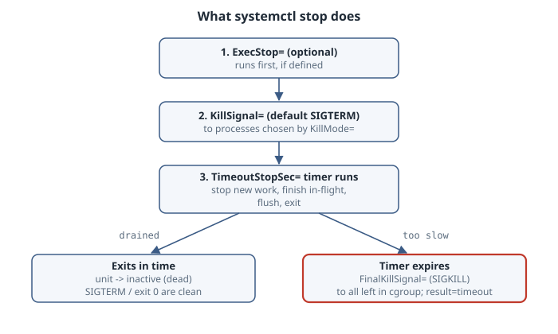
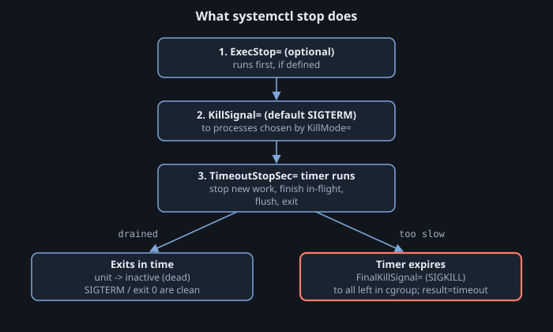

A service running in production cannot be casually restarted every time an operational setting changes. Dropping active network connections, discarding internal caches, and cycling process state introduces latency spikes, breaks client sessions, and invites cascading failure across dependent systems. Modern system administration relies on a clear hierarchy between full service restarts, in-place configuration reloads, and manager-level daemon refreshes. After reading this chapter, you will be able to configure and operate systemd services that validate configuration files before applying them, reload updated settings dynamically without downtime, and drain in-flight work cleanly during maintenance or retirement.

## Restarts, reloads, and daemon-reloads

Operating system services through systemd involves three distinct reload and restart operations. Conflating them is one of the most frequent causes of operational incidents. Each operation operates on a different target, affects different configuration layers, and has distinct implications for process state.

`systemctl restart <unit>` initiates a full cycle: systemd terminates the existing service process according to its termination configuration, tears down its control group environment, and launches a fresh instance. The new process receives a new process identifier (PID), all existing TCP sockets and memory-resident states are dropped, and all in-flight requests abort unless the application has external state coordination. Any modifications made to the unit file on disk that have already been loaded into systemd take effect on this new process.

`systemctl reload <unit>` updates the service without restarting its process. Systemd runs the command or sends the signal defined in the unit's `ExecReload=` directive. The primary process preserves its original PID, keeps open network sockets listening without interrupting connections, maintains internal caches, and re-evaluates its application-level configuration file. A reload touches only application configuration, such as `/etc/nginx/nginx.conf` or `/etc/bl06-reload.toml`; it does not apply edits made to systemd unit files on disk.

`systemctl daemon-reload` operates exclusively on systemd (PID 1) itself. It scans unit directories—including `/etc/systemd/system/`, `/run/systemd/system/`, and `/usr/lib/systemd/system/`—along with all configuration drop-in directories (`*.service.d/*.conf`). It parses new or modified unit files, rebuilds the internal dependency tree, and updates the in-memory state of the manager. Crucially, `systemctl daemon-reload` does not touch running service processes, does not trigger application configuration re-reads, and does not restart services.

| Command | Target | Process PID | Network connections | Applies unit file edits | Applies service config edits |
|---|---|---|---|---|---|
| `systemctl restart` | Service daemon | Changes (new PID) | Reset / dropped | Yes (if loaded) | Yes |
| `systemctl reload` | Service daemon | Preserved (same PID) | Kept alive | No | Yes |
| `systemctl daemon-reload` | systemd manager (PID 1) | Unchanged (PID 1) | Untouched | Yes (loads to manager) | No |

### Conditional restart and reload commands

System operations frequently occur inside automated deploy scripts or package manager triggers where the current operational state of a service is unknown. Systemd provides conditional variants documented in [systemctl(1)](https://www.freedesktop.org/software/systemd/man/latest/systemctl.html) to prevent unintended side effects:

- `systemctl try-restart <unit>`: Restarts the service only if it is already running. If the service is inactive or failed, the command takes no action and returns cleanly. This prevents administrative scripts from accidentally launching services that were intentionally taken offline.
- `systemctl reload-or-restart <unit>`: Queries the unit definition for reload capabilities. If the unit defines `ExecReload=`, systemd issues a reload. If `ExecReload=` is absent, systemd falls back to a full restart.
- `systemctl try-reload-or-restart <unit>`: Combines both guards: if the service is active, it reloads (or restarts if reload is unsupported); if the service is inactive, it does nothing.

### Signaling vs. invoking ExecReload

Administrators sometimes attempt to reload daemons by sending signals directly via the shell, for example using `kill -HUP <PID>` or `systemctl kill -s HUP <unit>`. While `systemctl kill -s HUP` routes through systemd's cgroup tracking to reach the service processes, it acts as an unmanaged signal injection. It completely bypasses the pre-checks, logging, and state tracking configured in `ExecReload=`. Systemd remains unaware that an administrative reload was attempted, cannot report whether the reload succeeded, and cannot run auxiliary validation commands. Always route reload operations through `systemctl reload` so that unit orchestration remains deterministic.

## Configuration validation before application

A reload or restart must never crash a running production system due to a syntax error or semantic typo. If an engineer updates a configuration file and executes a reload, a resilient service rejects the broken configuration, emits a descriptive error message to the journal, and continues executing under its previous valid configuration.

Relying solely on the daemon's runtime error handling is insufficient. If a service must be restarted, or if a service crashes while attempting to load an unvalidated configuration, it enters a `failed` state. Systemd provides declarative hooks to validate configuration files before the service process ever starts.

### Guarding startup with ExecStartPre=

The `ExecStartPre=` directive in [systemd.service(5)](https://www.freedesktop.org/software/systemd/man/latest/systemd.service.html) executes one or more commands synchronously before systemd invokes `ExecStart=`. If any command specified in `ExecStartPre=` exits with a non-zero exit code, systemd immediately aborts the activation sequence:

```ini
[Service]
Type=exec
ExecStartPre=/usr/local/bin/bl06-reload --check /etc/bl06-reload.toml
ExecStart=/usr/local/bin/bl06-reload /etc/bl06-reload.toml
```

When an administrator edits `/etc/bl06-reload.toml` and introduces an invalid parameter, running `systemctl start` or `systemctl restart` triggers the `--check` command first. The check detects the error, prints a diagnostic message, and exits with code 1. Systemd logs the failure, marks the unit as failed, and never starts the main executable. The existing binary is spared from starting in an undefined or half-initialized state.

For conditional execution where failure to meet a prerequisite should quietly skip execution rather than mark the unit as broken, systemd provides `ExecCondition=`. If an `ExecCondition=` command exits with status 0, execution continues to `ExecStartPre=`. If it exits with a code between 1 and 254 inclusive, the remaining start sequence is skipped, the unit is not considered failed, and it returns to the `inactive` state. An exit status of 255 marks the unit as failed.

### Standard validation patterns across Linux

The practice of providing dedicated syntax and semantic verification tools is universal across reliable Unix daemons:

| Utility / Command | Target software | Validation scope |
|---|---|---|
| `sshd -t` | OpenSSH Server | Parses `/etc/ssh/sshd_config`, checks key validity and directives |
| `nginx -t` | Nginx HTTP Server | Verifies configuration syntax and tests whether referenced paths exist |
| `apachectl configtest` | Apache HTTP Server | Tests syntax across all included VirtualHost configurations |
| `visudo -c` | Sudo subsystem | Verifies syntax of `/etc/sudoers` and `/etc/sudoers.d/*` drop-ins |
| `systemd-analyze verify <unit>` | systemd managers | Statically checks unit files and drop-ins for syntax errors and unknown directives |

When designing custom services or writing systemd units, provide an explicit validation flag (such as `--check` or `--test-config`) in the executable, and invoke that validation flag inside `ExecStartPre=` and `ExecReload=`.

## ExecReload and notification protocols

Defining an effective reload mechanism in systemd requires understanding how the service manager synchronizes with the application process.

### The limitation of asynchronous ExecReload

The simplest and most common reload pattern in legacy unit files invokes the standard POSIX hangup signal:

```ini
ExecReload=/bin/kill -HUP $MAINPID
```

While functional, this approach has a severe architectural flaw: it is completely asynchronous. When an administrator or deployment script runs `systemctl reload labapp.service`, systemd executes `/bin/kill -HUP $MAINPID`. As soon as the `kill` command delivers the signal to the process's kernel signal queue, `/bin/kill` exits with code 0. `systemctl` immediately reports success back to the caller.

However, the daemon process itself has not yet processed the signal. It may take hundreds of milliseconds to open the configuration file, parse its contents, and validate its data structures. If the file contains invalid configuration, the daemon will log an error to the journal or reject the update moments after `systemctl reload` has already returned an exit status of 0. Continuous deployment pipelines relying on that exit status will assume the configuration was successfully applied, when in fact the daemon is still running the old configuration or has failed silently.

The systemd reference manual explicitly states that running an asynchronous command like `kill -HUP` under `ExecReload=` is not a good choice when determinism is required.

To mitigate this without native service manager integration, units can chain synchronous validation directly into `ExecReload=`. Because `ExecReload=` accepts multiple command lines executed sequentially, validation can precede signal delivery:

```ini
ExecReload=/usr/local/bin/bl06-reload --check /etc/bl06-reload.toml
ExecReload=/bin/kill -HUP $MAINPID
```

If the validation command fails, systemd aborts the reload sequence immediately, returns a non-zero exit code to `systemctl reload`, and never sends the signal to `$MAINPID`.

### Synchronous reloads with Type=notify-reload

Starting in systemd 253, systemd provides a fully synchronous, state-managed reload protocol via `Type=notify-reload`. This mechanism eliminates the uncertainty of signal-based reloads by extending the `sd_notify` socket interface.

Under `Type=notify-reload`, the service developer configures systemd to signal the application whenever a reload is requested:

```ini
[Service]
Type=notify-reload
ReloadSignal=SIGHUP
ExecStart=/usr/local/bin/bl06-reload-notify /etc/bl06-reload.toml
```

When an administrator runs `systemctl reload`, the coordination proceeds across the notification socket:

1. Systemd sends the signal configured in `ReloadSignal=` (which defaults to `SIGHUP`) directly to the service's main process.
2. The service process catches `SIGHUP`, enters its configuration loading routine, and informs systemd that work is underway by sending a status message across the `NOTIFY_SOCKET`:
   ```c
   sd_notify(0, "RELOADING=1\nMONOTONIC_USEC=...");
   ```
3. Systemd receives `RELOADING=1` and transitions the unit state from `active (running)` to `active (reloading)`. During this window, `systemctl reload` blocks.
4. The service reads the configuration. If the configuration is valid, it applies the new state, completes internal re-initialization, and reports readiness:
   ```c
   sd_notify(0, "READY=1\nSTATUS=Reload completed successfully");
   ```
5. If the new configuration is invalid, a well-behaved service keeps its previous configuration, still sends `READY=1` so the reload job completes, and reports the problem through `STATUS=` and its log:
   ```c
   sd_notify(0, "READY=1\nSTATUS=Reload rejected: invalid worker count");
   ```
6. Systemd transitions the unit back to `active (running)`. `systemctl reload` unblocks and exits.

This protocol makes reloads *synchronous*. When `systemctl reload` returns, the service has really finished processing the request. That is a big improvement over a fire-and-forget `kill -HUP`. It does not by itself tell the caller whether the new configuration was *accepted*. That is why the validation command in `ExecReload=` (or a separate check step in your deploy script) is still worth keeping.

## Graceful shutdown and process lifecycle

Terminating a service cleanly requires draining existing work without accepting new tasks, persisting pending buffers to storage, and releasing network sockets. Abruptly killing a service corrupts application state and causes clients to receive socket reset errors (`ECONNRESET`).

### The systemd termination sequence

When systemd stops a service—whether due to `systemctl stop`, a restart, or a machine shutdown—it executes a strictly timed sequence governed by [systemd.kill(5)](https://www.freedesktop.org/software/systemd/man/latest/systemd.kill.html):

{.light-content fig-alt="The systemd stop sequence. First, an optional ExecStop= command runs. Then KillSignal=, SIGTERM by default, is sent to the processes chosen by KillMode=. The TimeoutStopSec= timer then runs while the service stops taking new work and drains. If the service exits in time, the unit becomes inactive. If the timer expires, FinalKillSignal=, SIGKILL by default, is sent to everything left in the cgroup and the unit is marked failed with result timeout."}

{.dark-content fig-alt="The systemd stop sequence. First, an optional ExecStop= command runs. Then KillSignal=, SIGTERM by default, is sent to the processes chosen by KillMode=. The TimeoutStopSec= timer then runs while the service stops taking new work and drains. If the service exits in time, the unit becomes inactive. If the timer expires, FinalKillSignal=, SIGKILL by default, is sent to everything left in the cgroup and the unit is marked failed with result timeout."}

1. **Optional `ExecStop=` execution**: If defined, systemd executes this command first. This hook is used for applications that require an external administrative CLI to initiate shutdown (such as database shutdown utilities).
2. **Signal delivery via `KillSignal=`**: Systemd transmits the signal specified in `KillSignal=` (which defaults to `SIGTERM`) to the service processes.
3. **Graceful drain interval**: Systemd starts a timer configured by `TimeoutStopSec=`. The application catches `SIGTERM`, closes its listening sockets to stop accepting inbound work, finishes in-flight requests, flushes files to disk, and calls `exit(0)`.
4. **Enforced termination via `FinalKillSignal=`**: If the service processes do not terminate before `TimeoutStopSec=` expires, systemd sends `FinalKillSignal=` (which defaults to `SIGKILL`) to terminate every remaining process ungracefully. This behavior is enabled by `SendSIGKILL=yes` (the default).

### Process containment with KillMode=

The `KillMode=` setting determines which processes receive signals during shutdown:

- `KillMode=control-group` (the default): Systemd sends `KillSignal=` to all processes currently residing in the unit's control group.
- `KillMode=mixed`: Systemd sends `KillSignal=` (SIGTERM) exclusively to the main process (`$MAINPID`), allowing it to coordinate shutdown with its own child processes. If processes remain after `TimeoutStopSec=` elapses, systemd sends `SIGKILL` to all remaining processes in the cgroup.
- `KillMode=process`: Systemd sends signals only to the main process. Any child processes, worker pools, or helpers spawned by the daemon are left running unmanaged. This mode is strongly discouraged; it creates orphaned processes that consume memory, hold network ports open, and prevent subsequent service starts from binding sockets.

### Managing shutdown timeouts and clean exit statuses

The timeout interval is configured with `TimeoutStopSec=`. Unless set, it comes from the manager's `DefaultTimeoutStopSec=` (see [systemd-system.conf(5)](https://www.freedesktop.org/software/systemd/man/latest/systemd-system.conf.html)), which is 90 seconds by default. For microservices or stateless HTTP workers, 90 seconds is often unnecessarily long, delaying machine reboots when a process hangs. For transactional databases or data batch workers, 90 seconds may be too short, causing `SIGKILL` to abort data writes during large batch flushes.

```ini
[Service]
TimeoutStopSec=20s
KillSignal=SIGTERM
SendSIGKILL=yes
```

When a process terminates upon receiving `SIGTERM`, systemd considers the termination successful. If a daemon exits with a non-zero exit code during normal shutdown, or if it terminates via an alternative signal that is considered normal for that software, you can declare those outcomes clean using `SuccessExitStatus=`:

```ini
SuccessExitStatus=143
```

Exit status 0 and the signals `SIGHUP`, `SIGINT`, `SIGTERM` and `SIGPIPE` already count as clean, so you don't need to list them. The example covers runtimes such as the JVM that catch `SIGTERM` and then *exit* with 128+15 = 143, which systemd would otherwise record as a failure.

### Process recovery: Restart= and RestartSec=

Systemd's supervision layer handles unexpected crashes using `Restart=` and `RestartSec=`. When configured with `Restart=on-failure`, systemd restarts the daemon if it exits with an unexpected non-zero return code, is terminated by an unhandled signal (such as `SIGSEGV`), or times out during watchdog checks. Crucially, when an administrator issues `systemctl stop` or the process exits with status 0 during a planned drain, systemd recognizes the shutdown as intentional and does not trigger a restart.

## Common pitfalls

Operational failures around reloads and shutdowns typically stem from false assumptions about process behavior and manager state:

- **Modifying a unit file and running `systemctl reload`**: Edits to `/etc/systemd/system/<unit>.service` are not read when you run `systemctl reload`. The manager only reads service-level configuration files during reload. Unit file adjustments remain dormant until you run `systemctl daemon-reload`.
- **Reloading without prior configuration testing**: Issuing a reload to a service whose configuration contains fatal syntax errors risks destabilizing the daemon or leaving it in a degraded state. Always validate configuration syntax before signaling the daemon.
- **Underestimating `TimeoutStopSec=`**: Setting `TimeoutStopSec=` too low causes systemd to issue `SIGKILL` while long-running jobs are still draining. This abruptly severs client connections and truncates data writes. Set `TimeoutStopSec=` comfortably higher than the longest expected request execution time.
- **Using `KillMode=process`**: Selecting `KillMode=process` abandons child processes when the main daemon terminates. When the service is restarted, the new instance can fail because the orphaned children still hold locks or bind the application port.
- **Treating asynchronous `ExecReload=` as a successful deployment**: Assuming that a successful exit code from `systemctl reload` proves the new configuration is actively serving traffic. If `ExecReload=` uses raw signals without synchronous checks, configuration errors will occur silently after the CLI returns.

## Hands-on: Building a reloadable Python service

To understand configuration validation, dynamic reloading, and graceful shutdown without relying on external packages, review the standalone Python implementation below. It uses Python 3's standard library (`tomllib`, `signal`, `argparse`, and `pathlib`).

The daemon models a batch processing service. It requires two configuration keys:
1. `greeting` (a non-empty string)
2. `workers` (an integer between 1 and 16)

The application implements three core capabilities:
- `--check PATH`: Validates the TOML syntax, confirms the presence of required keys, enforces data types and value boundaries, and exits with code 0 on success or code 1 on failure.
- `SIGHUP` handling: Catches the signal, attempts to load and validate the configuration file, updates the runtime settings in place if valid, and rejects the reload without altering current settings if invalid.
- `SIGTERM` handling: Flips a termination flag, allows any active in-flight task to finish completely, emits a draining message, and exits cleanly with status 0.

<!-- file: bl06_reload.py -->
```python
import argparse
import os
import signal
import sys
import time
import tomllib
from pathlib import Path


def validate_config(path: Path) -> dict:
    if not path.is_file():
        raise ValueError(f"configuration file not found: {path}")

    try:
        with open(path, "rb") as f:
            data = tomllib.load(f)
    except tomllib.TOMLDecodeError as err:
        raise ValueError(f"invalid TOML syntax: {err}") from err

    if "greeting" not in data:
        raise ValueError("missing required key: 'greeting'")
    if not isinstance(data["greeting"], str) or not data["greeting"].strip():
        raise ValueError("key 'greeting' must be a non-empty string")

    if "workers" not in data:
        raise ValueError("missing required key: 'workers'")
    val = data["workers"]
    if isinstance(val, bool) or not isinstance(val, int):
        raise ValueError("key 'workers' must be an integer")
    if not (1 <= val <= 16):
        raise ValueError(f"key 'workers' must be between 1 and 16 (got {val})")

    return {"greeting": data["greeting"], "workers": data["workers"]}


def main() -> None:
    parser = argparse.ArgumentParser(description="Lab reload and graceful shutdown service")
    parser.add_argument("--check", metavar="PATH", help="validate configuration file and exit")
    parser.add_argument("config", nargs="?", help="path to configuration file")
    args = parser.parse_args()

    if args.check:
        try:
            validated = validate_config(Path(args.check))
            print(
                f"configuration valid: {Path(args.check).name} "
                f"(greeting='{validated['greeting']}', workers={validated['workers']})",
                flush=True,
            )
            sys.exit(0)
        except Exception as err:
            print(f"configuration error: {err}", file=sys.stderr, flush=True)
            sys.exit(1)

    if not args.config:
        parser.error("config file path required when not in --check mode")

    config_path = Path(args.config)
    try:
        current_config = validate_config(config_path)
    except Exception as err:
        print(f"startup failed: {err}", file=sys.stderr, flush=True)
        sys.exit(1)

    print(
        f"service started (PID {os.getpid()}), initial config: "
        f"greeting='{current_config['greeting']}', workers={current_config['workers']}",
        flush=True,
    )

    running = True

    def handle_hup(signum, frame):
        nonlocal current_config
        try:
            new_config = validate_config(config_path)
            current_config = new_config
            print(
                f"reloaded configuration: greeting='{current_config['greeting']}', "
                f"workers={current_config['workers']}",
                flush=True,
            )
        except Exception as err:
            print(f"reload rejected: {err}", flush=True)

    def handle_term(signum, frame):
        nonlocal running
        running = False

    signal.signal(signal.SIGHUP, handle_hup)
    signal.signal(signal.SIGTERM, handle_term)

    job_id = 0
    while running:
        time.sleep(0.5)
        job_id += 1
        cfg = current_config
        print(
            f"job {job_id} done (greeting={cfg['greeting']}, workers={cfg['workers']})",
            flush=True,
        )

    print("drained, exiting 0", flush=True)
    sys.exit(0)


if __name__ == "__main__":
    main()
```

The accompanying bash driver script automates the test cycle: validating valid and invalid files, launching the service in the background, updating the configuration cleanly on `SIGHUP`, testing rejection of an out-of-bounds worker value, and finally signaling `SIGTERM` to verify graceful drain.

<!-- file: drive.sh -->
```bash
#!/usr/bin/env bash
set -euo pipefail

# 1. Write valid configuration and test check mode
cat <<'EOF' > good.toml
greeting = "hello"
workers = 4
EOF

echo "--- validating good.toml ---"
python3 bl06_reload.py --check good.toml

# 2. Write invalid configuration and test check mode failure
cat <<'EOF' > bad.toml
greeting = "broken config"
workers = 99
EOF

echo "--- validating bad.toml ---"
python3 bl06_reload.py --check bad.toml || echo "exit $?"

# 3. Start service in background with good configuration
cp good.toml app.toml
echo "--- starting background service ---"
python3 bl06_reload.py app.toml &
SERVICE_PID=$!

sleep 1.2

# 4. Rewrite configuration with new greeting and send SIGHUP
echo "--- updating app.toml with new greeting and sending SIGHUP ---"
cat <<'EOF' > app.toml
greeting = "salut"
workers = 4
EOF
kill -HUP "${SERVICE_PID}"

sleep 1.2

# 5. Write invalid configuration (workers = 99) and send SIGHUP
echo "--- updating app.toml with invalid workers (99) and sending SIGHUP ---"
cat <<'EOF' > app.toml
greeting = "salut"
workers = 99
EOF
kill -HUP "${SERVICE_PID}"

sleep 1.2

# 6. Send SIGTERM to request graceful drain and wait for clean exit
echo "--- sending SIGTERM to request graceful drain ---"
kill -TERM "${SERVICE_PID}"
wait "${SERVICE_PID}"
echo "service exited with status $?"
```

Running `bash drive.sh` exercises configuration checking, valid and invalid reloads, and graceful draining.

```text
--- validating good.toml ---
configuration valid: good.toml (greeting='hello', workers=4)
--- validating bad.toml ---
configuration error: key 'workers' must be between 1 and 16 (got 99)
exit 1
--- starting background service ---
service started (PID 1741082), initial config: greeting='hello', workers=4
job 1 done (greeting=hello, workers=4)
job 2 done (greeting=hello, workers=4)
--- updating app.toml with new greeting and sending SIGHUP ---
reloaded configuration: greeting='salut', workers=4
job 3 done (greeting=salut, workers=4)
job 4 done (greeting=salut, workers=4)
--- updating app.toml with invalid workers (99) and sending SIGHUP ---
reload rejected: key 'workers' must be between 1 and 16 (got 99)
job 5 done (greeting=salut, workers=4)
job 6 done (greeting=salut, workers=4)
job 7 done (greeting=salut, workers=4)
--- sending SIGTERM to request graceful drain ---
job 8 done (greeting=salut, workers=4)
drained, exiting 0
service exited with status 0
```

Review the output from the test execution:
- The check command against `good.toml` reports the configuration is valid and exits cleanly.
- The check command against `bad.toml` catches that `workers = 99` exceeds the maximum threshold of 16, logs the failure message, and exits with status 1.
- When running in the background, the service processes tasks using the initial greeting and worker count.
- Delivering `SIGHUP` after updating `app.toml` causes the daemon to immediately reload its settings; subsequent jobs print the updated greeting string.
- Delivering `SIGHUP` after setting `workers = 99` causes the reload to be rejected. The service logs `reload rejected: key 'workers' must be between 1 and 16 (got 99)`, yet remains fully operational, executing further jobs under the previously loaded settings.
- Finally, when `SIGTERM` arrives, the active job is allowed to complete before the daemon logs `drained, exiting 0` and terminates with exit code 0.

## Deploying to systemd: bl06-reload.service

::: {.callout-note}
**Not run here.** The authoring container does not run systemd as PID 1 and has no root privileges. The steps below apply to the Ubuntu 26.04 LTS `bl06-service-lab` environment used throughout Part 06. Expected outputs and state transitions are derived directly from the systemd reference documentation.
:::

To integrate this service into systemd, create the unit file `/etc/systemd/system/bl06-reload.service`. Because the Python implementation communicates via POSIX signals rather than `sd_notify`, use `Type=exec`. Validation is chained directly into `ExecStartPre=` and `ExecReload=`:

```ini
# /etc/systemd/system/bl06-reload.service
[Unit]
Description=Lab Service with Pre-Validation and Clean Drain
After=network.target

[Service]
Type=exec
ExecStartPre=/usr/bin/python3 /usr/local/bin/bl06_reload.py --check /etc/bl06-reload.toml
ExecStart=/usr/bin/python3 /usr/local/bin/bl06_reload.py /etc/bl06-reload.toml
ExecReload=/usr/bin/python3 /usr/local/bin/bl06_reload.py --check /etc/bl06-reload.toml
ExecReload=/bin/kill -HUP $MAINPID
KillSignal=SIGTERM
TimeoutStopSec=20s
KillMode=mixed
SendSIGKILL=yes

[Install]
WantedBy=multi-user.target
```

### Verifying unit operations

1. **Install files and load unit configuration:**
   Copy the Python script to `/usr/local/bin/bl06_reload.py`, place a valid configuration in `/etc/bl06-reload.toml`, and instruct systemd to read the new unit:
   ```bash
   sudo cp bl06_reload.py /usr/local/bin/bl06_reload.py
   sudo chmod 755 /usr/local/bin/bl06_reload.py
   sudo cp good.toml /etc/bl06-reload.toml
   sudo systemctl daemon-reload
   sudo systemctl start bl06-reload.service
   ```
   Checking status with `systemctl status bl06-reload.service` shows the unit in `active (running)` state, with journal entries showing the startup banner and running job logs.

2. **Test pre-validation failure on reload:**
   Intentionally inject an invalid worker count into `/etc/bl06-reload.toml`:
   ```bash
   sudo sed -i 's/workers = 4/workers = 120/' /etc/bl06-reload.toml
   sudo systemctl reload bl06-reload.service
   ```
   Expect `systemctl reload` to fail with a non-zero exit code. Because `ExecReload=` executes the `--check` command before `/bin/kill -HUP $MAINPID`, the check fails, the signal is never sent, and the running service continues uninterrupted. Inspecting `journalctl -u bl06-reload.service -n 10` confirms that the check returned an error and the daemon's active process was unaffected.

3. **Test successful reload:**
   Restore a valid configuration with an updated greeting:
   ```bash
   sudo sed -i 's/workers = 120/workers = 8/' /etc/bl06-reload.toml
   sudo sed -i 's/greeting = "hello"/greeting = "servus"/' /etc/bl06-reload.toml
   sudo systemctl reload bl06-reload.service
   ```
   The pre-check passes, systemd sends `SIGHUP` to `$MAINPID`, and `systemctl reload` returns status 0. The journal logs confirm `reloaded configuration: greeting='servus', workers=8`.

4. **Verify graceful shutdown:**
   Stop the service:
   ```bash
   sudo systemctl stop bl06-reload.service
   ```
   Systemd issues `SIGTERM`. The journal logs demonstrate that the active job finishes before the service emits `drained, exiting 0` and exits. The service returns cleanly to `inactive (dead)` without reaching the 20-second `TimeoutStopSec=` limit or receiving `SIGKILL`.

## Summary

Managing service state transitions with precision is critical for maintaining high availability:

- `systemctl restart` recycles the process, creates a new PID, and resets connections. `systemctl reload` executes `ExecReload=` in place, allowing the process to keep its PID and sockets while rereading configuration. `systemctl daemon-reload` refreshes PID 1's unit graph from disk without affecting running processes.
- Never signal a service blindly. Use `ExecStartPre=` to validate syntax before a daemon starts, preventing configuration syntax errors from taking a service down.
- Pure signal-based reloads like `ExecReload=kill -HUP $MAINPID` are asynchronous and cannot communicate reload failures back to the administrative shell. Prepend validation commands to `ExecReload=`, or adopt `Type=notify-reload` with `sd_notify` for fully synchronous state coordination.
- Graceful shutdown relies on catching `KillSignal=` (SIGTERM), stopping the ingestion of new tasks, draining existing work, and exiting with status 0 within `TimeoutStopSec=`. Avoid `KillMode=process` to guarantee that process trees are cleaned up completely without leaving orphaned workers behind.

## Sources

- [systemd.service(5)](https://www.freedesktop.org/software/systemd/man/latest/systemd.service.html) — Service unit configuration, ExecStartPre, ExecReload, and notify reload specifications
- [systemd.kill(5)](https://www.freedesktop.org/software/systemd/man/latest/systemd.kill.html) — Process kill modes, signal dispatching, and termination timeouts
- [systemctl(1)](https://www.freedesktop.org/software/systemd/man/latest/systemctl.html) — Controlling the systemd system and service manager
- [sd_notify(3)](https://www.freedesktop.org/software/systemd/man/latest/sd_notify.html) — Service notification protocol and status messages
- [Python signal documentation](https://docs.python.org/3/library/signal.html) — POSIX signal handlers and execution semantics in Python
