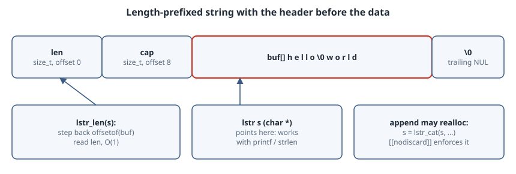

# Length-Prefixed Strings: an sds-Style String Library in Under 60 Lines

## Thesis

A C string is a pointer to bytes that ends at the first `'\0'`. That one decision has three consequences. Finding the length is O(n). Appending in a loop is O(n²), because each `strcat` rescans the whole string. And the string can't contain a NUL byte, so it isn't binary safe.

Pascal took the other route and stored the length in front of the data, originally in a single byte, which capped strings at 255 characters. The modern C version stores a full header in front of the bytes **and** keeps the trailing NUL. Then it hands the caller a pointer to the bytes, not to the header. That is the design of antirez's [SDS](https://github.com/antirez/sds), used by Redis. The result is still a `char *` that works with `printf` and `strlen`, but its length is O(1), appends are amortised O(1), and it can hold any bytes.

This chapter builds a minimal version of that design, measures it, and shows the one rule it makes you follow.

{fig-alt="A single heap block. The first 16 bytes are the header: len (size_t, offset 0) and cap (size_t, offset 8). Then buf, the flexible array member at offset 16, which holds the bytes, possibly including embedded NULs, followed by a trailing NUL. The lstr pointer the caller holds points at buf, not at the start of the block, so it can be passed to printf and strlen. lstr_len steps back by offsetof(struct lstr_hdr, buf) to read len in O(1). Appending may realloc the block to a new address, so the caller must store the returned pointer: s = lstr_cat(s, ...)."}

## The whole library

```c
/* lstr.h - minimal sds-style length-prefixed string (single header) */
#ifndef LSTR_H
#define LSTR_H
#include <stddef.h>
#include <stdlib.h>
#include <string.h>

#if defined(__STDC_VERSION__) && __STDC_VERSION__ > 201710L   /* GCC 14 -std=c23 reports 202000L */
#define LSTR_MUST_USE [[nodiscard]]
#else
#define LSTR_MUST_USE __attribute__((warn_unused_result))   /* GCC/Clang */
#endif

typedef char *lstr;                 /* points at buf[], so it is also a C string */

struct lstr_hdr {
    size_t len;                     /* bytes in use, excluding the trailing NUL */
    size_t cap;                     /* bytes available in buf, excluding the NUL */
    char buf[];                     /* flexible array member */
};

#define LSTR_HDR(s) ((struct lstr_hdr *)((s) - offsetof(struct lstr_hdr, buf)))

static inline size_t lstr_len(const lstr s) { return LSTR_HDR(s)->len; }
static inline size_t lstr_cap(const lstr s) { return LSTR_HDR(s)->cap; }

static inline lstr lstr_newlen(const void *p, size_t n) {
    struct lstr_hdr *h = malloc(sizeof *h + n + 1);
    if (!h) return NULL;
    h->len = h->cap = n;
    if (n) memcpy(h->buf, p, n);
    h->buf[n] = '\0';
    return h->buf;
}
static inline lstr lstr_new(const char *c) { return lstr_newlen(c, strlen(c)); }
static inline void lstr_free(lstr s) { if (s) free(LSTR_HDR(s)); }

/* May move the string: always use the returned pointer (s = lstr_catlen(s, ...)). */
LSTR_MUST_USE static inline lstr lstr_catlen(lstr s, const void *p, size_t n) {
    struct lstr_hdr *h = LSTR_HDR(s);
    if (h->cap - h->len < n) {
        size_t need = h->len + n;
        size_t cap = need < 1024 * 1024 ? need * 2 : need + 1024 * 1024;
        h = realloc(h, sizeof *h + cap + 1);
        if (!h) return NULL;
        h->cap = cap;
    }
    memcpy(h->buf + h->len, p, n);
    h->len += n;
    h->buf[h->len] = '\0';
    return h->buf;
}
LSTR_MUST_USE static inline lstr lstr_cat(lstr s, const char *c) { return lstr_catlen(s, c, strlen(c)); }
#endif
```

Points to notice:

- **`buf[]` is a flexible array member.** The header and the bytes come from a single `malloc`, sized as `sizeof *h + n + 1`.
- **`LSTR_HDR` steps back from the user pointer** by `offsetof(struct lstr_hdr, buf)` to reach the header. That is why `lstr_len` is a single load.
- **Growth doubles up to 1 MiB, then adds 1 MiB at a time.** SDS uses the same policy (`SDS_MAX_PREALLOC`, `1024*1024` in `sds.h`). It keeps appends amortised O(1) without doubling huge buffers.
- **`lstr_catlen` can move the string**, so it returns the new pointer and is marked *must use*. The last section explains why.
- **Failure:** if `realloc` fails, the function returns `NULL` and the old block is still allocated. A caller who writes `s = lstr_cat(s, ...)` leaks it. SDS behaves the same way. Code that has to survive out-of-memory should keep the old pointer and check for `NULL` before overwriting it.

## It is still a C string, and also binary safe

```c
#include <stdio.h>
#include "lstr.h"

int main(void) {
    lstr s = lstr_new("hello");
    printf("as a C string: %s (strlen %zu, lstr_len %zu)\n", s, strlen(s), lstr_len(s));

    s = lstr_catlen(s, "\0world", 6);           /* binary-safe: embedded NUL */
    printf("after binary append: strlen %zu, lstr_len %zu\n", strlen(s), lstr_len(s));
    fwrite(s, 1, lstr_len(s), stdout);
    putchar('\n');

    printf("header %zu bytes, len at offset %zu, buf at offset %zu\n",
           sizeof(struct lstr_hdr), offsetof(struct lstr_hdr, len),
           offsetof(struct lstr_hdr, buf));

    size_t last = lstr_cap(s), grows = 0;
    for (int i = 0; i < 100000; i++) {
        s = lstr_cat(s, "x");
        if (lstr_cap(s) != last) { grows++; last = lstr_cap(s); }
    }
    printf("100000 appends: len %zu, cap %zu, reallocations %zu\n", lstr_len(s), lstr_cap(s), grows);
    lstr_free(s);
}
```

```c
#define _POSIX_C_SOURCE 199309L
#include <stdio.h>
#include <time.h>
#include "lstr.h"

static double now(void) { struct timespec t; clock_gettime(CLOCK_MONOTONIC, &t); return t.tv_sec + t.tv_nsec / 1e9; }

int main(void) {
    enum { N = 200000 };
    char *plain = calloc(N + 1, 1);
    double t = now();
    for (int i = 0; i < N; i++) strcat(plain, "x");   /* rescans the whole string each time */
    double t_strcat = now() - t;

    lstr s = lstr_new("");
    t = now();
    for (int i = 0; i < N; i++) s = lstr_cat(s, "x");  /* O(1) to find the end */
    double t_lstr = now() - t;

    printf("%d one-byte appends: strcat %.1f ms, lstr_cat %.2f ms (same result: %s)\n",
           N, t_strcat * 1e3, t_lstr * 1e3, strcmp(plain, s) == 0 ? "yes" : "no");
    free(plain);
    lstr_free(s);
}
```

```c
#include <stdio.h>
#include "lstr.h"

int main(void) {
    lstr s = lstr_new("short");
    lstr_cat(s, " and now much longer than the capacity");   /* BUG: result ignored */
    printf("%s\n", s);                                       /* s may point at freed memory */
    lstr_free(s);
}
```

```sh
#!/bin/sh
set -x
cd "$(dirname "$0")"
gcc -std=c17 -O2 -Wall -Wextra -Werror demo.c -o demo && ./demo | cat -v
gcc -std=c17 -O2 -Wall -Wextra bench.c -o bench && ./bench
gcc -std=c17 -g -fsanitize=address,undefined -Wall -Wextra demo.c -o demo-asan && ./demo-asan > /dev/null && echo "ASan/UBSan: clean"
gcc -std=c23 -dM -E -x c /dev/null -o macros.txt
grep STDC_VERSION macros.txt
gcc -std=c23 -g -fsanitize=address -Wall -Wextra stale.c -o stale && ./stale 2> asan.txt
grep -E "ERROR|READ of|freed by|previously allocated|#[0-9] .*stale.c" asan.txt
```

All output is from GCC 14.2 and glibc 2.41 on x86-64 Linux. The ASan process ID is masked.

```text
+ dirname ./run.sh
+ cd .
+ gcc -std=c17 -O2 -Wall -Wextra -Werror demo.c -o demo
+ ./demo
+ cat -v
as a C string: hello (strlen 5, lstr_len 5)
after binary append: strlen 5, lstr_len 11
hello^@world
header 16 bytes, len at offset 0, buf at offset 16
100000 appends: len 100011, cap 196606, reallocations 13
+ gcc -std=c17 -O2 -Wall -Wextra bench.c -o bench
+ ./bench
200000 one-byte appends: strcat 165.2 ms, lstr_cat 0.38 ms (same result: yes)
+ gcc -std=c17 -g -fsanitize=address,undefined -Wall -Wextra demo.c -o demo-asan
+ ./demo-asan
+ echo ASan/UBSan: clean
ASan/UBSan: clean
+ gcc -std=c23 -dM -E -x c /dev/null -o macros.txt
+ grep STDC_VERSION macros.txt
#define __STDC_VERSION__ 202000L
+ gcc -std=c23 -g -fsanitize=address -Wall -Wextra stale.c -o stale
stale.c: In function ‘main’:
stale.c:6:5: warning: ignoring return value of ‘lstr_cat’, declared with attribute ‘nodiscard’ [-Wunused-result]
    6 |     lstr_cat(s, " and now much longer than the capacity");   /* BUG: result ignored */
      |     ^~~~~~~~~~~~~~~~~~~~~~~~~~~~~~~~~~~~~~~~~~~~~~~~~~~~~
In file included from stale.c:2:
lstr.h:53:34: note: declared here
   53 | LSTR_MUST_USE static inline lstr lstr_cat(lstr s, const char *c) { return lstr_catlen(s, c, strlen(c)); }
      |                                  ^~~~~~~~
+ ./stale
+ grep -E ERROR|READ of|freed by|previously allocated|#[0-9] .*stale.c asan.txt
==PID==ERROR: AddressSanitizer: heap-use-after-free on address 0x503000000050 at pc 0x7f7171a692ec bp 0x7fffc2cc4280 sp 0x7fffc2cc3a40
READ of size 6 at 0x503000000050 thread T0
    #1 0x557c9b814594 in main /tmp/lab/stale.c:7
freed by thread T0 here:
    #3 0x557c9b814588 in main /tmp/lab/stale.c:6
previously allocated by thread T0 here:
    #3 0x557c9b81456e in main /tmp/lab/stale.c:5
```

What the run shows:

- **`%s` and `strlen` just work**, because `s` points at `buf` and the bytes end in a NUL.
- **Binary safety:** after appending `"\0world"`, `strlen` still says 5, while `lstr_len` correctly says 11. `fwrite(s, 1, lstr_len(s), ...)` writes all 11 bytes, and `cat -v` shows the embedded NUL as `^@`.
- **The header costs 16 bytes** on a 64-bit target: two `size_t`, with `buf` starting at offset 16. SDS goes further and picks among 1-, 3-, 5-, 9- or 17-byte packed headers (`sdshdr5` to `sdshdr64`, each with a `flags` byte) based on the length. That saves memory on millions of short keys, at the cost of a type dispatch on every access.
- **100,000 appends cause only 13 reallocations**, thanks to geometric growth.
- **O(n²) vs O(n):** 200,000 one-byte `strcat` calls took 165.2 ms in the run above, while `lstr_cat` took 0.38 ms and produced the same string. Two earlier runs gave 147.6/0.34 ms and 140.2/0.42 ms.

## The one rule: always keep the returned pointer

Appending may `realloc` the block to a new address. That makes the API look like SDS's `s = sdscat(s, "...")`, and forgetting the assignment leaves `s` pointing at freed memory. `stale.c` makes that mistake. AddressSanitizer reports a `heap-use-after-free`: the block was allocated at line 5, freed by the `realloc` inside `lstr_cat` at line 6, and read by `printf` at line 7.

The compiler can catch this before it runs. Mark the append functions `[[nodiscard]]` (C23), or `__attribute__((warn_unused_result))` on older standards, and the ignored result becomes a `-Wunused-result` warning. Add `-Werror` to make it an error.

There is a portability trap here. **GCC 14 in `-std=c23` mode defines `__STDC_VERSION__` as `202000L`, not C23's final `202311L`**, as the run shows. A `#if __STDC_VERSION__ >= 202311L` check therefore silently falls back to the GCC attribute on GCC 14. That's why `lstr.h` tests for anything newer than C17 (`> 201710L`) instead.

## When to use which

| | NUL-terminated `char *` | length-prefixed (`lstr`/SDS) |
|---|---|---|
| length | O(n) `strlen` | O(1) header load |
| append in a loop | O(n²) with `strcat` | amortised O(1) |
| embedded `\0` | impossible | fine |
| pass to libc / OS APIs | native | native (`s` is a `char *`) |
| string literals, stack buffers | yes | no, heap only, freed with `lstr_free` |
| pointer stable across appends | n/a | **no**, always reassign |

Use length-prefixed strings for owned, growing, possibly binary data: buffers, protocol messages, keys. Keep plain `char *` for literals and borrowed views. Never pass a plain `char *` to `lstr_len` or `lstr_free`: they would read a header that isn't there.

## Takeaways

- Putting the header *before* the bytes and returning a pointer to the bytes gives you O(1) length and binary safety while staying compatible with `printf` and `strlen`.
- Geometric growth turns repeated appends from O(n²) into amortised O(1): 13 reallocations for 100,000 appends.
- Any function that may `realloc` must return the new pointer, and the API should make ignoring it a compile-time warning with `[[nodiscard]]`.
- When feature-testing C23, remember that GCC 14 reports `__STDC_VERSION__ == 202000L`.

## Sources

- [antirez/sds](https://github.com/antirez/sds): README (design, `s = sdscat(s, ...)` usage, binary safety) and `sds.h` (`sdshdr5`…`sdshdr64` packed headers)
- C23 working draft N3220 (the `nodiscard` attribute, flexible array members, `__STDC_VERSION__` = `202311L`): <https://www.open-std.org/jtc1/sc22/wg14/www/docs/n3220.pdf>
- GCC manual: [`warn_unused_result` function attribute](https://gcc.gnu.org/onlinedocs/gcc/Common-Function-Attributes.html)
- [AddressSanitizer](https://github.com/google/sanitizers/wiki/AddressSanitizer)
