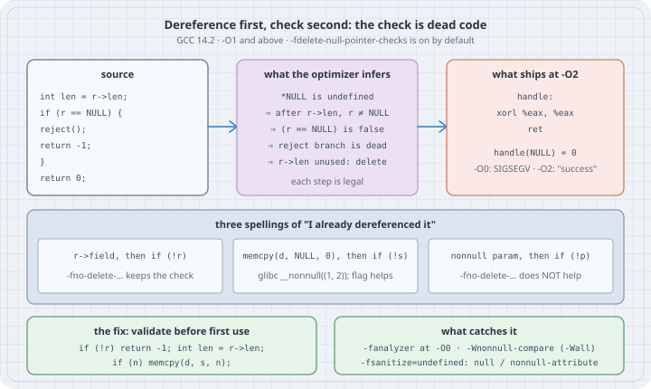

# When the Optimizer Deletes Your NULL Check

## Thesis

Dereferencing a null pointer in C is not "a crash". It is **undefined behaviour** (C17 §6.5.3.2 ¶4). The standard places no requirements on a program that does it, so the compiler may assume it never happens. Once the compiler has seen `r->len`, it concludes that `r` is not NULL, because otherwise the program would already be undefined. A later `if (r == NULL)` is then always false, and dead-code elimination removes it together with the error path it guarded.

Nothing in this chain is a compiler bug. Each step is a legal inference, and GCC documents it as `-fdelete-null-pointer-checks`, which is on by default on most targets. The bug is in the source, but it stays invisible until an optimisation level turns it into a security hole. In 2009 the Linux tun driver read `tun->sk` one line before `if (!tun) return POLLERR;`. GCC deleted the check, and with page zero mapped the result was a local root exploit. The kernel has built with `-fno-delete-null-pointer-checks` ever since.

This chapter reproduces the three ways to write "I already dereferenced it" (an explicit load, a call to a `nonnull`-declared library function, and your own `nonnull` attribute) and shows which tools catch each one. It also shows what `-fno-delete-null-pointer-checks` can and cannot rescue.

## Mental model

{fig-alt="Left: source code that reads r->len before checking r for NULL. Middle: the optimizer's inferences: NULL dereference is undefined, so r is non-null after r->len, the comparison is false, the reject branch is dead, and the unused load is deleted. Right: the -O2 output is xorl eax, eax; ret, so handle(NULL) returns 0; at -O0 it is SIGSEGV. Middle row: three spellings: r->field then if not r, where -fno-delete-null-pointer-checks keeps the check; memcpy with a NULL source and length 0 then a check, where glibc's nonnull attribute triggers it and the flag helps; a nonnull parameter then a check, where the flag does not help. Bottom: the fix is to validate before first use and skip zero-length memcpy; detectors are -fanalyzer at -O0, -Wnonnull-compare, and UBSan."}

The rule the optimizer applies is simple: **a pointer that has been used as if valid is valid from then on**. The surprises come from what counts as "used":

| What the code does first | Why GCC treats `p` as non-null afterwards | Does `-fno-delete-null-pointer-checks` restore the later check? |
|--------------------------|--------------------------------------------|--------------------------------------------------------|
| `x = p->field;` or `*p` | Null dereference is undefined behaviour | yes |
| `memcpy(d, p, n)` (any `n`, even 0) | glibc declares `memcpy` with `__nonnull ((1, 2))` | yes |
| `p` is a parameter of a function you marked `__attribute__((nonnull))` | The attribute is a promise to the compiler | **no**. GCC's manual: "can currently not be disabled other than by removing the `nonnull` attribute" |

The lesson for code review is that the bug is never the `if`. The bug is the use that comes before it.

## Worked examples

Tested on Debian 13 x86_64, **GCC 14.2.0** (`gcc (Debian 14.2.0-19)`) and glibc 2.41, with `-std=c17 -Wall -Wextra`. The current upstream release is GCC 16.2 (2026-08-07). It documents `-fdelete-null-pointer-checks` and the `nonnull` attribute with the same wording quoted below, so the behaviour shown here is the documented behaviour, not a GCC 14 quirk. Clang was not available on the box, so nothing here was run with it.

Every case is driven by one script that builds a file at several levels and reports how each run ended:

```bash
#!/usr/bin/env bash
# run.sh — build one file at several -O levels and report how each run ended
src=$1; shift
for o in -O0 -O1 -O2 "$@"; do
  gcc -std=c17 -Wall -Wextra $o -o prog "$src" 2>/dev/null || exit 1
  out=$(./prog 2>&1); rc=$?
  [ $rc -gt 128 ] && end="killed by SIG$(kill -l $((rc - 128)))" || end="exit $rc"
  printf '%-34s %-36s %s\n' "$o" "${out//$'\n'/ | }" "$end"
done
```

### Case 1: Dereference first, check second

```c
/* handle.c — dereference first, check second */
#include <stdio.h>

struct req { int len; char *buf; };

__attribute__((noinline)) int handle(struct req *r)
{
    int len = r->len;                    /* (1) UB if r == NULL */
    if (r == NULL) {                     /* (2) so r "cannot" be NULL here */
        fputs("handle: NULL request rejected\n", stderr);
        return -1;
    }
    (void)len;
    return 0;
}

int main(void)
{
    printf("handle(NULL) = %d\n", handle(NULL));
    return 0;
}
```

```text
$ ./run.sh handle.c "-O2 -fno-delete-null-pointer-checks"
-O0                                                                     killed by SIGSEGV
-O1                                handle(NULL) = 0                     exit 0
-O2                                handle(NULL) = 0                     exit 0
-O2 -fno-delete-null-pointer-checks handle: NULL request rejected | handle(NULL) = -1 exit 0
```

The same source does three different things:

- At `-O0` the load from address 0 faults. The developer sees a crash and assumes that NULL "crashes".
- At `-O1` and `-O2` the function returns **0, success, for a NULL request**. The reject branch is gone, and so is the load, because `len` was never used. Nothing crashes, nothing is logged, and the caller carries on.
- With `-fno-delete-null-pointer-checks` the check survives. The dead load is still removed, so the function now does what its author meant.

The `-O2` code for `handle` is two instructions:

```text
$ gcc -std=c17 -O2 -S -o - handle.c | sed -n '/^handle:/,/ret$/p' | grep -v cfi
handle:
.LFB3:
	xorl	%eax, %eax
	ret
```

The kernel's tun bug had the same shape, except that the loaded pointer *was* used later:

```c
/* tun_poll.c — the shape of the 2009 Linux tun bug: dereference first, check second */
#include <stddef.h>

struct sock { int flags; };
struct tun_struct { struct sock *sk; int state; };

#define POLLERR 8

int tun_chr_poll(struct tun_struct *tun)
{
    struct sock *sk = tun->sk;      /* (1) dereference: UB if tun == NULL */
    if (!tun)                       /* (2) so the optimizer may assume tun != NULL */
        return POLLERR;
    return sk->flags & 1;
}
```

```text
$ gcc -std=c17 -O0 -S -o - tun_poll.c | sed -n '/^tun_chr_poll:/,/ret$/p' | grep -v cfi
tun_chr_poll:
.LFB0:
	pushq	%rbp
	movq	%rsp, %rbp
	movq	%rdi, -24(%rbp)
	movq	-24(%rbp), %rax
	movq	(%rax), %rax
	movq	%rax, -8(%rbp)
	cmpq	$0, -24(%rbp)
	jne	.L2
	movl	$8, %eax
	jmp	.L3
.L2:
	movq	-8(%rbp), %rax
	movl	(%rax), %eax
	andl	$1, %eax
.L3:
	popq	%rbp
	ret
$ gcc -std=c17 -O2 -S -o - tun_poll.c | sed -n '/^tun_chr_poll:/,/ret$/p' | grep -v cfi
tun_chr_poll:
.LFB0:
	movq	(%rdi), %rax
	movl	(%rax), %eax
	andl	$1, %eax
	ret
$ gcc -std=c17 -O2 -fno-delete-null-pointer-checks -S -o - tun_poll.c | sed -n '/^tun_chr_poll:/,/ret$/p' | grep -v cfi
tun_chr_poll:
.LFB0:
	movq	(%rdi), %rax
	testq	%rdi, %rdi
	je	.L3
	movl	(%rax), %eax
	andl	$1, %eax
	ret
```

At `-O0` there is a `cmpq $0` and a `POLLERR` path. At `-O2` both are gone. In user space the first `movq (%rdi)` faults, because Linux refuses to map low pages (`/proc/sys/vm/mmap_min_addr` is 4096 on this box). In the 2009 kernel an attacker could map page zero and put a fake `struct sock` there. The deleted check let execution continue into attacker-controlled data. The tun fix (commit `3c8a9c63d5fd`, July 2009) moved the dereference below the check. Ten days later, commit `a3ca86aea507` added `-fno-delete-null-pointer-checks` to the kernel's `KBUILD_CFLAGS`, and it is still in the top-level `Makefile` today. The flag keeps the `testq`. With it, the kernel trades a little optimisation for "a check I wrote stays where I wrote it".

### Case 2: A zero-length `memcpy` counts as a dereference

This version never loads through the pointer. It only passes it to `memcpy` with a length of 0, which every C programmer "knows" does nothing:

```c
/* copyz.c — a zero-length memcpy from NULL, then a NULL check on the source */
#include <stdio.h>
#include <string.h>

__attribute__((noinline)) int append(char *dst, const char *src, size_t n)
{
    memcpy(dst, src, n);            /* n == 0 and src == NULL: "harmless"? */
    if (src == NULL) {
        fputs("append: no source\n", stderr);
        return -1;
    }
    return (int)n;
}

int main(void)
{
    char buf[8];
    printf("append(buf, NULL, 0) = %d\n", append(buf, NULL, 0));
    return 0;
}
```

```text
$ ./run.sh copyz.c "-O2 -fno-delete-null-pointer-checks"
-O0                                append: no source | append(buf, NULL, 0) = -1 exit 0
-O1                                append: no source | append(buf, NULL, 0) = -1 exit 0
-O2                                append(buf, NULL, 0) = 0             exit 0
-O2 -fno-delete-null-pointer-checks append: no source | append(buf, NULL, 0) = -1 exit 0
```

This is worse than Case 1, because **no build crashes**. The `-O0` and `-O1` builds take the error path, so a debug-build test of "NULL source is rejected" passes. Only the `-O2` build returns success. Its code calls `memcpy` and returns `n`, and the test and the `fputs` are gone:

```text
$ gcc -std=c17 -O2 -S -o - copyz.c | sed -n '/^append:/,/ret$/p' | grep -v cfi
append:
.LFB3:
	pushq	%rbx
	movq	%rdx, %rbx
	call	memcpy@PLT
	movl	%ebx, %eax
	popq	%rbx
	ret
```

The reason is in the header, not in the C language:

```text
$ grep -n -A1 'extern void \*memcpy' /usr/include/string.h
43:extern void *memcpy (void *__restrict __dest, const void *__restrict __src,
44-		     size_t __n) __THROW __nonnull ((1, 2));
```

`__nonnull ((1, 2))` expands to GCC's `nonnull` attribute. Up to C23, the standard says that when the length is 0 the pointer arguments "shall still have valid values" (C17 §7.24.1 ¶2). GCC treats the call as proof that `src` is not NULL, so the check after it is dead.

This corner of the language is changing. **N3322**, accepted for C2y, makes `memcpy(NULL, NULL, 0)`, `NULL + 0` and similar zero-length operations well defined. GCC 15 added a `nonnull_if_nonzero(ptr, len)` attribute so that libc headers can say exactly that. But headers decide what your compiler assumes, and glibc's development tree (checked 2026-10-19) still declares `memcpy` with `__nonnull ((1, 2))`. Until your libc changes and you compile in a mode that adopts N3322, write code that does not depend on it.

### Case 3: Your own `nonnull` attribute, and the flag that does not help

Adding `nonnull` to a declaration looks like free documentation and free warnings. On a *definition*, it also tells GCC that it may delete the function's own defensive checks:

```c
/* parse_nonnull.c — a nonnull-declared function that still checks its argument */
#include <stdio.h>

__attribute__((nonnull(1), noinline))
int parse(const char *s)
{
    if (s == NULL)
        return -1;                       /* "defensive" check */
    return s[0];
}

int main(int argc, char **argv)
{
    const char *input = argc > 1 ? argv[1] : NULL;
    printf("parse -> %d\n", parse(input));
    return 0;
}
```

```text
$ gcc -std=c17 -Wall -Wextra -O2 -c parse_nonnull.c -o /dev/null
parse_nonnull.c: In function ‘parse’:
parse_nonnull.c:7:8: warning: ‘nonnull’ argument ‘s’ compared to NULL [-Wnonnull-compare]
    7 |     if (s == NULL)
      |        ^
$ ./run.sh parse_nonnull.c "-O2 -fno-delete-null-pointer-checks"
-O0                                parse -> -1                          exit 0
-O1                                                                     killed by SIGSEGV
-O2                                                                     killed by SIGSEGV
-O2 -fno-delete-null-pointer-checks                                      killed by SIGSEGV
$ gcc -std=c17 -O2 -S -o - parse_nonnull.c | sed -n '/^parse:/,/ret$/p' | grep -v cfi
parse:
.LFB3:
	movsbl	(%rdi), %eax
	ret
```

The NULL comes from a runtime value (`argc`), so GCC cannot see it at the call site and gives no `-Wnonnull` warning there. The only warning is `-Wnonnull-compare` on the definition, and it is in `-Wall`. This time **`-fno-delete-null-pointer-checks` changes nothing**. That is documented. For function definitions, the GCC manual says the optimisations based on `nonnull` parameters "can currently not be disabled other than by removing the `nonnull` attribute". If a function must survive NULL, don't mark it `nonnull`. If you mark it `nonnull`, treat `-Wnonnull-compare` as an error, because the check it points at is already gone.

### Case 4: Finding them before the optimizer does

The GCC static analyzer has a dedicated warning, `-Wanalyzer-deref-before-check` (GCC 13 and later). Where you run it matters:

```text
$ gcc -std=c17 -O2 -fanalyzer -c handle.c -o /dev/null && echo "(no warnings)"
(no warnings)
$ gcc -std=c17 -O1 -fanalyzer -c handle.c -o /dev/null && echo "(no warnings)"
(no warnings)
$ gcc -std=c17 -O0 -fanalyzer -fdiagnostics-plain-output -c handle.c -o /dev/null
handle.c: In function ‘handle’:
handle.c:8:9: warning: dereference of NULL ‘r’ [CWE-476] [-Wanalyzer-null-dereference]
handle.c:17:5: note: (1) entry to ‘main’
handle.c:19:5: note: (2) calling ‘handle’ from ‘main’
handle.c:6:31: note: (3) entry to ‘handle’
handle.c:8:9: note: (4) dereference of NULL ‘r’
handle.c:9:8: warning: check of ‘r’ for NULL after already dereferencing it [-Wanalyzer-deref-before-check]
handle.c:8:9: note: (1) pointer ‘r’ is dereferenced here
handle.c:9:8: note: (2) pointer ‘r’ is checked for NULL here but it was already dereferenced at (1)
```

With GCC 14.2 the analyzer finds the bug at `-O0` and says nothing at `-O1` or `-O2`. By the time it runs in an optimised build, the check it would have flagged has already been folded away. Run `-fanalyzer` in a separate `-O0` job. It finds the `memcpy` shape too, and it even names the header attribute:

```text
$ gcc -std=c17 -O0 -fanalyzer -fdiagnostics-plain-output -c copyz.c -o /dev/null
copyz.c: In function ‘append’:
copyz.c:7:5: warning: use of NULL ‘src’ where non-null expected [CWE-476] [-Wanalyzer-null-argument]
copyz.c:15:5: note: (1) entry to ‘main’
copyz.c:18:5: note: (2) calling ‘append’ from ‘main’
copyz.c:5:31: note: (3) entry to ‘append’
copyz.c:7:5: note: (4) argument 2 (‘src’) NULL where non-null expected
<built-in>: note: argument 2 of ‘__builtin_memcpy’ must be non-null
copyz.c:8:8: warning: check of ‘src’ for NULL after already dereferencing it [-Wanalyzer-deref-before-check]
copyz.c:7:5: note: (1) pointer ‘src’ is dereferenced here
copyz.c:8:8: note: (2) pointer ‘src’ is checked for NULL here but it was already dereferenced at (1)
```

UndefinedBehaviorSanitizer finds them at run time, as long as a test passes NULL:

```text
$ gcc -std=c17 -O2 -g -fsanitize=undefined -o handle_ub handle.c && ./handle_ub
handle.c:8:9: runtime error: member access within null pointer of type 'struct req'
handle: NULL request rejected
handle(NULL) = -1
$ gcc -std=c17 -O2 -g -fsanitize=undefined -o copyz_ub copyz.c && ./copyz_ub
copyz.c:7:5: runtime error: null pointer passed as argument 2, which is declared to never be null
append: no source
append(buf, NULL, 0) = -1
```

Look at the last two lines of each run. Under UBSan the `-O2` build takes the *reject* path, because the instrumentation keeps the check alive. That is the opposite of what the plain `-O2` build does. A sanitizer build is a detector, not a preview of what ships. Read the `runtime error:` line, and don't trust the behaviour that follows it.

UBSan also flags code that today's GCC does *not* exploit. Taking the address of a member through NULL, with no load, is still undefined:

```c
/* addr.c — "I only took an address, I never loaded through it" */
#include <stdio.h>

struct req { int len; char body[16]; };

__attribute__((noinline)) int body_first(struct req *r)
{
    char *body = r->body;           /* no load: just r + 4 */
    if (r == NULL) {
        fputs("body_first: NULL request\n", stderr);
        return -1;
    }
    return body[0];
}

int main(void)
{
    printf("body_first(NULL) = %d\n", body_first(NULL));
    return 0;
}
```

```text
$ ./run.sh addr.c
-O0                                body_first: NULL request | body_first(NULL) = -1 exit 0
-O1                                body_first: NULL request | body_first(NULL) = -1 exit 0
-O2                                body_first: NULL request | body_first(NULL) = -1 exit 0
$ gcc -std=c17 -O2 -g -fsanitize=undefined -o addr_ub addr.c && ./addr_ub
addr.c:8:11: runtime error: member access within null pointer of type 'struct req'
body_first: NULL request
body_first(NULL) = -1
```

GCC 14.2 keeps this check at every level, and UBSan still reports it. "My compiler doesn't break it" describes one compiler version. It is not a guarantee in the language, and the next release is allowed to delete the check.

### Case 5: The fix is ordering, not flags

```c
/* handle_fixed.c — check first, dereference second */
#include <stdio.h>

struct req { int len; char *buf; };

__attribute__((noinline)) int handle(struct req *r)
{
    if (r == NULL) {
        fputs("handle: NULL request rejected\n", stderr);
        return -1;
    }
    int len = r->len;
    (void)len;
    return 0;
}

int main(void)
{
    printf("handle(NULL) = %d\n", handle(NULL));
    return 0;
}
```

```c
/* copyz_fixed.c — validate before the call, and skip empty copies */
#include <stdio.h>
#include <string.h>

__attribute__((noinline)) int append(char *dst, const char *src, size_t n)
{
    if (src == NULL) {
        fputs("append: no source\n", stderr);
        return -1;
    }
    if (n != 0)
        memcpy(dst, src, n);
    return (int)n;
}

int main(void)
{
    char buf[8];
    printf("append(buf, NULL, 0) = %d\n", append(buf, NULL, 0));
    return 0;
}
```

```text
$ ./run.sh handle_fixed.c
-O0                                handle: NULL request rejected | handle(NULL) = -1 exit 0
-O1                                handle: NULL request rejected | handle(NULL) = -1 exit 0
-O2                                handle: NULL request rejected | handle(NULL) = -1 exit 0
$ ./run.sh copyz_fixed.c
-O0                                append: no source | append(buf, NULL, 0) = -1 exit 0
-O1                                append: no source | append(buf, NULL, 0) = -1 exit 0
-O2                                append: no source | append(buf, NULL, 0) = -1 exit 0
```

Once the check comes first, every level agrees. `if (n != 0)` around `memcpy` is not micro-optimisation. It keeps an "empty slice" `(NULL, 0)` from ever reaching a `nonnull` parameter. That is the usual way C code represents an empty buffer, and N3322 exists because of it.

## The trap

The trap is testing NULL handling in a debug build and believing the result. In Case 1 the `-O0` build crashed, and a crash looks like "NULL is handled loudly". In Case 2 the `-O0` and `-O1` builds took the error path, so the unit test passed. Both shipped `-O2` builds return **success** for a NULL input, and they log nothing. A sanitizer build makes it worse: it takes the reject path and passes the test too. It also reports the UB on stderr, but only someone reading that log will notice.

The usual reactions miss the point:

- **"Add `-fno-delete-null-pointer-checks`."** It rescues Cases 1 and 2, and it is a reasonable belt-and-braces flag for kernels and firmware. It does nothing for Case 3, and the dereference before the check is still undefined. The next optimisation that reasons from UB (and there are many) is not covered by this flag.
- **"Add `nonnull` so the compiler warns callers."** It warns only when it can see a NULL constant, and it deletes your own checks. Case 3 shows both.
- **"`len` is never used, so the dereference doesn't matter."** That unused dereference is exactly what deleted the check in Case 1.

## The boring rule

> Validate a pointer **before its first use**. A use includes `p->field`, `*p`, `&p->field`, and passing `p` to any function whose header marks it `nonnull`, including `memcpy`, `memset` and `strlen` with a length of 0. Guard zero-length library calls with `if (n != 0)`. Put `nonnull` only on functions that really never accept NULL, and build with `-Werror=nonnull-compare`. Run `-fanalyzer` in a separate `-O0` CI job and the test suite under `-fsanitize=undefined`, and include NULL inputs in the tests. Kernel-style code that may legitimately touch address 0 also gets `-fno-delete-null-pointer-checks`, but that flag is a seatbelt, not a fix.

## Try this

1. Change Case 1 to use `len` after the check (`return len;`). Rerun `run.sh`. What does `-O2` do now, and why does the program crash again even though the check is still missing?
2. In Case 2, change `memcpy` to `memmove`, then to `memset(dst, 0, n)` with a NULL `dst`. Find each declaration in `/usr/include/string.h` and predict the `-O2` behaviour before you run it.
3. Add `-fisolate-erroneous-paths-attribute` to Case 3 and pass a literal `NULL` instead of `input`. What does the call site become? (Read the description of the option in the GCC manual first.)
4. Search a codebase you maintain for `if (!p)` or `if (p == NULL)` that appears *after* a use of `p` in the same function. Run `gcc -O0 -fanalyzer` over it and compare what each approach finds.
5. Write a two-line `container_of`-style macro that computes a struct address from a member pointer. Run it on NULL under `-fsanitize=undefined`. Is the arithmetic itself undefined, and what would N3322 change?

## Sources

- ISO/IEC 9899:2018 (C17) §6.5.3.2 ¶4 (unary `*` on an invalid pointer, such as a null pointer, is undefined) and §7.24.1 ¶2 (when a length argument is zero, pointer arguments "shall still have valid values"); the C17 final draft N2176 is a convenient copy of this text.
- GCC manual, Optimize Options: `-fdelete-null-pointer-checks`, `-fisolate-erroneous-paths-dereference`, `-fisolate-erroneous-paths-attribute`: <https://gcc.gnu.org/onlinedocs/gcc/Optimize-Options.html>
- GCC manual, Common Function Attributes: `nonnull` (including "can currently not be disabled other than by removing the `nonnull` attribute") and `nonnull_if_nonzero`: <https://gcc.gnu.org/onlinedocs/gcc/Common-Attributes.html>
- GCC manual, Static Analyzer Options: `-Wanalyzer-deref-before-check`, `-Wanalyzer-null-argument`: <https://gcc.gnu.org/onlinedocs/gcc/Static-Analyzer-Options.html>
- GCC manual, Instrumentation Options: `-fsanitize=null`, `-fsanitize=nonnull-attribute`: <https://gcc.gnu.org/onlinedocs/gcc/Instrumentation-Options.html>
- WG14 N3322, N. Popov and A. Ballman, "Allow zero length operations on null pointers" (accepted for C2y): <https://www.open-std.org/jtc1/sc22/wg14/www/docs/n3322.pdf>
- glibc `string/string.h` (development tree, `memcpy` declared `__nonnull ((1, 2))`): <https://sourceware.org/git/?p=glibc.git;a=blob;f=string/string.h>
- Linux commit 3c8a9c63d5fd, "tun/tap: Fix crashes if open() /dev/net/tun and then poll() it" (2009-07-05): <https://github.com/torvalds/linux/commit/3c8a9c63d5fd738c261bd0ceece04d9c8357ca13>
- Linux commit a3ca86aea507, "Add '-fno-delete-null-pointer-checks' to gcc CFLAGS" (2009-07-15), still present in the top-level `Makefile`: <https://github.com/torvalds/linux/commit/a3ca86aea507904148870946d599e07a340b39bf>
- GCC releases (GCC 16.2, 2026-08-07): <https://gcc.gnu.org/>
