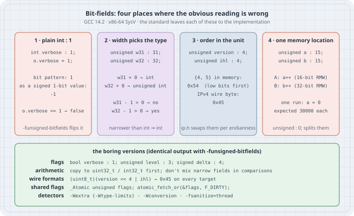

# Bit-Field Traps: Signedness, Promotion, Layout and Shared Words

## Thesis

A bit-field looks like an ordinary struct member that happens to be narrow. It isn't. The C standard gives it its own rules, and leaves most of them to the implementation:

- Whether a **plain `int`** bit-field is signed or unsigned is implementation-defined (C17 §6.7.2 ¶5). C23 keeps that rule. A signed 1-bit field can only hold **0 and −1**, so `flag = 1` stores −1 and `flag == 1` is always false.
- In expressions a bit-field is promoted like a small integer. Whether `unsigned x : N` behaves as `int` or as `unsigned int` depends on **N** (C17 §6.3.1.1 ¶2).
- The order of bit-fields inside their storage unit, whether a field may straddle units, and the alignment of the unit are all implementation-defined or unspecified (C17 §6.7.2.1 ¶11). A bit-field struct is not a description of bytes on a wire.
- Adjacent bit-fields share one **memory location** (C17 §3.14). Two threads that write two *different* fields are in a data race.

The earlier structures chapter shows how to declare bit-fields and pack flags. This chapter runs each trap on GCC, shows the warning that would have caught it (when there is one), and ends with versions of the same code that every compiler reads the same way.

## Mental model

{fig-alt="Four cards. One: int verbose : 1 set to 1 has bit pattern 1, which as a signed 1-bit value is -1, so o.verbose == 1 is false; -funsigned-bitfields flips it. Two: unsigned w31 : 31 promotes to int and unsigned w32 : 32 to unsigned int, so w31 - 1 > 0 is no and w32 - 1 > 0 is yes. Three: unsigned version : 4 and ihl : 4 set to 4 and 5 store 0x54 because low bits come first, while the IPv4 wire byte is 0x45; ip.h swaps them per endianness. Four: a : 15 and b : 15 share a word; thread A does a 16-bit read-modify-write and thread B a 32-bit one; in one run a ended at 0 instead of 30000; unsigned : 0 splits them. Bottom panel: bool and explicitly signed or unsigned fields, copying to fixed-width integers before arithmetic, shifts for wire formats, one atomic word for shared flags, and the detectors -Wextra, -Wconversion and -fsanitize=thread."}

| Question | What C says | What GCC on x86-64 does |
|----------|-------------|-------------------------|
| Is `int f : 1` signed? | implementation-defined | signed (`-funsigned-bitfields` changes it) |
| Type of `unsigned f : N` in `f - 1` | `int` if every value fits in `int`, otherwise `unsigned int` | `int` for N ≤ 31, `unsigned int` for N = 32 |
| Which bits does the first field use? | implementation-defined | the least significant bits of the unit (SysV ABI) |
| May a field straddle a unit? | implementation-defined | no for `unsigned`: `a : 20, b : 20` uses 8 bytes |
| Base types other than `_Bool`, `int`, `signed`/`unsigned int` | implementation-defined | accepted (`uint8_t f : 4` makes a 1-byte struct) |
| Can two threads write two adjacent fields? | no: one memory location, so a data race | each write is a read-modify-write of shared bytes |

## Worked examples

Tested on Debian 13 x86_64 with **GCC 14.2.0** (`gcc (Debian 14.2.0-19)`) and glibc 2.41. The current upstream release is GCC 16.2. Every rule shown here is either fixed by the standard or by the x86-64 SysV ABI, and documented for GCC under `-fsigned-bitfields`, so the newer compiler gives the same answers. Clang was not available on the box.

### Case 1: A 1-bit `int` flag that can't equal 1

```c
/* one_bit.c — a 1-bit "flag" declared with plain int */
#include <stdio.h>

struct opts {
    int verbose : 1;        /* plain int: signedness is implementation-defined */
    int debug   : 1;
};

int main(void)
{
    struct opts o = { 0 };
    o.verbose = 1;
    printf("o.verbose = %d\n", o.verbose);
    if (o.verbose == 1)
        puts("verbose mode on");
    else
        puts("verbose mode OFF (o.verbose != 1)");
    return 0;
}
```

```text
$ gcc -std=c17 -Wall -O2 -o one_bit one_bit.c && ./one_bit
o.verbose = -1
verbose mode OFF (o.verbose != 1)
$ gcc -std=c17 -Wall -O2 -funsigned-bitfields -o one_bit_u one_bit.c && ./one_bit_u
o.verbose = 1
verbose mode on
```

The same source prints opposite answers depending on one implementation-defined choice. GCC's default, documented under `-fsigned-bitfields`, is that a plain `int` bit-field is signed. In two's complement a 1-bit signed value has exactly two patterns: `0` is 0 and `1` is −1. `-Wall` alone printed nothing.

Flags are rarely set from constants, so here is the same field set from a runtime value:

```c
/* one_bit_rt.c — the same flag, set from a runtime value and tested with != 0 vs == 1 */
#include <stdio.h>
#include <string.h>

struct opts {
    int verbose : 1;
};

static int want_verbose(int argc, char **argv)
{
    return argc > 1 && strcmp(argv[1], "-v") == 0;     /* 1 or 0 */
}

int main(int argc, char **argv)
{
    struct opts o = { 0 };
    o.verbose = want_verbose(argc, argv);
    int copy = o.verbose;                              /* widen to int */
    printf("o.verbose = %d, copy = %d\n", o.verbose, copy);
    printf("o.verbose == 1 ? %s\n", o.verbose == 1 ? "yes" : "no");
    printf("o.verbose != 0 ? %s\n", o.verbose != 0 ? "yes" : "no");
    printf("o.verbose * 10 = %d\n", o.verbose * 10);
    return 0;
}
```

```text
$ gcc -std=c17 -Wall -Wextra -O2 -o one_bit_rt one_bit_rt.c
one_bit_rt.c: In function ‘main’:
one_bit_rt.c:20:47: warning: comparison is always false due to limited range of data type [-Wtype-limits]
   20 |     printf("o.verbose == 1 ? %s\n", o.verbose == 1 ? "yes" : "no");
      |                                               ^~
$ ./one_bit_rt -v
o.verbose = -1, copy = -1
o.verbose == 1 ? no
o.verbose != 0 ? yes
o.verbose * 10 = -10
$ gcc -std=c17 -Wall -Wextra -Wconversion -O2 -c one_bit_rt.c -o /dev/null
one_bit_rt.c: In function ‘main’:
one_bit_rt.c:17:17: warning: conversion from ‘int’ to ‘signed char:1’ may change value [-Wconversion]
   17 |     o.verbose = want_verbose(argc, argv);
      |                 ^~~~~~~~~~~~
one_bit_rt.c:20:47: warning: comparison is always false due to limited range of data type [-Wtype-limits]
   20 |     printf("o.verbose == 1 ? %s\n", o.verbose == 1 ? "yes" : "no");
      |                                               ^~
```

Testing with `!= 0` (or plain `if (o.verbose)`) happens to work, so code that is only ever tested that way looks fine. Anything that uses the value as a *number* gets −1: copying it into an `int`, multiplying it, adding it to a counter, or comparing it with `1` or `true`. `-Wtype-limits` (in `-Wextra`) catches the comparison, and `-Wconversion` catches the store. GCC's own name for the type, `signed char:1`, tells you what it decided.

### Case 2: The width of the field picks its type

```c
/* promote.c — a bit-field's type in expressions depends on its width */
#include <stdio.h>

#define TYPE(x) _Generic((x), int: "int", unsigned: "unsigned int", \
                         long: "long", unsigned long: "unsigned long", default: "other")

struct counters {
    unsigned w16 : 16;
    unsigned w31 : 31;
    unsigned w32 : 32;
};

int main(void)
{
    struct counters c = { 0, 0, 0 };
    printf("type of c.w16 + 0: %s\n", TYPE(c.w16 + 0));
    printf("type of c.w31 + 0: %s\n", TYPE(c.w31 + 0));
    printf("type of c.w32 + 0: %s\n", TYPE(c.w32 + 0));
    printf("c.w31 - 1 > 0 ? %s\n", c.w31 - 1 > 0 ? "yes" : "no");
    printf("c.w32 - 1 > 0 ? %s\n", c.w32 - 1 > 0 ? "yes" : "no");
    return 0;
}
```

```text
$ gcc -std=c17 -Wall -Wextra -O2 -o promote promote.c && ./promote
type of c.w16 + 0: int
type of c.w31 + 0: int
type of c.w32 + 0: unsigned int
c.w31 - 1 > 0 ? no
c.w32 - 1 > 0 ? yes
```

The integer promotions (C17 §6.3.1.1 ¶2) apply to "a bit-field of type `_Bool`, `int`, `signed int`, or `unsigned int`": "If an `int` can represent all values of the original type (as restricted by the width, for a bit-field), the value is converted to an `int`." Every value of a 31-bit unsigned field fits in `int`, so `c.w31 - 1` is the `int` −1. A 32-bit field doesn't fit, so `c.w32 - 1` wraps to `UINT_MAX`. Two members that both say `unsigned` behave differently in the same expression. Changing a field's width in a later refactor can silently flip every comparison that uses it. The portable habit is to copy the field into a variable of the type you mean (`uint32_t v = c.w31;`) before doing arithmetic on it.

### Case 3: A bit-field struct is not a byte layout

```c
/* layout.c — what the bytes of a bit-field struct actually look like here */
#include <stdint.h>
#include <stdio.h>
#include <string.h>

struct hdr_u   { unsigned version : 4, ihl : 4; };          /* standard base type     */
struct hdr_u8  { uint8_t  version : 4, ihl : 4; };          /* GCC extension          */
struct straddle{ unsigned a : 20, b : 20; };                /* 40 bits: crosses 32    */
struct split   { unsigned a : 4; unsigned : 0; unsigned b : 4; };

static void dump(const char *name, const void *p, size_t n)
{
    const unsigned char *b = p;
    printf("%-16s sizeof %zu  bytes:", name, n);
    for (size_t i = 0; i < n; i++)
        printf(" %02x", b[i]);
    putchar('\n');
}

int main(void)
{
    struct hdr_u h;  struct hdr_u8 h8;  struct straddle s;  struct split sp;
    memset(&h, 0, sizeof h);   memset(&h8, 0, sizeof h8);    /* padding bits are */
    memset(&s, 0, sizeof s);   memset(&sp, 0, sizeof sp);    /* otherwise unspecified */
    h.version = 4;   h.ihl = 5;
    h8.version = 4;  h8.ihl = 5;
    s.a = 0xFFFFF;   s.b = 0x12345;
    sp.a = 0xA;      sp.b = 0xB;
    dump("hdr_u {4,5}", &h, sizeof h);
    dump("hdr_u8 {4,5}", &h8, sizeof h8);
    dump("straddle", &s, sizeof s);
    dump("split", &sp, sizeof sp);
    return 0;
}
```

```text
$ gcc -std=c17 -Wall -Wextra -O2 -o layout layout.c && ./layout
hdr_u {4,5}      sizeof 4  bytes: 54 00 00 00
hdr_u8 {4,5}     sizeof 1  bytes: 54
straddle         sizeof 8  bytes: ff ff 0f 00 45 23 01 00
split            sizeof 8  bytes: 0a 00 00 00 0b 00 00 00
```

Four implementation-defined choices show up in four lines:

- **Order.** The first declared field (`version`) took the *low* nibble, giving `0x54`. The first byte of an IPv4 header puts version in the *high* nibble: `0x45`. The x86-64 SysV ABI allocates bit-fields from the least significant bit. Big-endian ABIs allocate from the most significant bit, where the same struct would produce `0x45`.
- **Unit size.** With `unsigned` as the base type, the struct is 4 bytes, the size of the declared type. With `uint8_t`, which GCC accepts as an extension, it is 1 byte. Both are legal, and neither is guaranteed by C.
- **Straddling.** `a : 20, b : 20` would fit in 5 bytes. GCC starts `b` in a new 32-bit unit rather than let it cross a 4-byte boundary, so `sizeof` is 8.
- **Zero width.** `unsigned : 0` forces the next field into a new unit, as the standard specifies.

glibc's own header shows the professional response. It refuses to rely on any one order:

```text
$ grep -n -A10 '^struct iphdr' /usr/include/netinet/ip.h
44:struct iphdr
45-  {
46-#if __BYTE_ORDER == __LITTLE_ENDIAN
47-    unsigned int ihl:4;
48-    unsigned int version:4;
49-#elif __BYTE_ORDER == __BIG_ENDIAN
50-    unsigned int version:4;
51-    unsigned int ihl:4;
52-#else
53-# error	"Please fix <bits/endian.h>"
54-#endif
```

That works only because the header knows both of the orders that its supported ABIs use. For your own wire formats and file formats, write the bytes yourself with shifts and masks (Case 5).

### Case 4: Two threads, two fields, one memory location

C11 defines a memory location as "either an object of scalar type, or a maximal sequence of adjacent bit-fields all having nonzero width" (C17 §3.14). Two threads may write two different memory locations without synchronisation. They may not write the same one. Adjacent bit-fields **are** the same one:

```c
/* race.c — two threads, two different bit-fields, one memory location */
#define _POSIX_C_SOURCE 200809L
#include <pthread.h>
#include <stdio.h>

enum { N = 30000 };                 /* fits in 15 bits */

struct shared {
    unsigned a : 15;                /* written only by thread A */
#ifdef SPLIT
    unsigned   : 0;                 /* zero-width bit-field: a new memory location */
#endif
    unsigned b : 15;                /* written only by thread B */
} s;

static pthread_barrier_t go;

/* An empty asm with a "memory" clobber keeps GCC from folding the loop into a
 * single "+= N": every iteration must really load, modify and store. */
#define KEEP_LOOP() __asm__ __volatile__("" ::: "memory")

static void *bump_a(void *arg) { (void)arg; pthread_barrier_wait(&go); for (int i = 0; i < N; i++) { s.a++; KEEP_LOOP(); } return NULL; }
static void *bump_b(void *arg) { (void)arg; pthread_barrier_wait(&go); for (int i = 0; i < N; i++) { s.b++; KEEP_LOOP(); } return NULL; }

int main(void)
{
    pthread_t ta, tb;
    pthread_barrier_init(&go, NULL, 2);
    pthread_create(&ta, NULL, bump_a, NULL);
    pthread_create(&tb, NULL, bump_b, NULL);
    pthread_join(ta, NULL);
    pthread_join(tb, NULL);
    printf("sizeof %zu  a = %5u  b = %5u  (expected %d each)%s\n", sizeof s,
           (unsigned)s.a, (unsigned)s.b, N, s.a == N && s.b == N ? "" : "  <- lost updates");
    return 0;
}
```

```text
$ gcc -std=c17 -Wall -Wextra -O2 -pthread -o race race.c && for i in 1 2 3 4 5; do ./race; done
sizeof 4  a =     0  b = 30000  (expected 30000 each)  <- lost updates
sizeof 4  a =     0  b = 30000  (expected 30000 each)  <- lost updates
sizeof 4  a =   159  b = 30000  (expected 30000 each)  <- lost updates
sizeof 4  a = 20065  b = 29995  (expected 30000 each)  <- lost updates
sizeof 4  a = 20372  b = 30059  (expected 30000 each)  <- lost updates
$ gcc -std=c17 -Wall -Wextra -O2 -pthread -DSPLIT -o race_split race.c && for i in 1 2 3 4 5; do ./race_split; done
sizeof 8  a = 30000  b = 30000  (expected 30000 each)
sizeof 8  a = 30000  b = 30000  (expected 30000 each)
sizeof 8  a = 30000  b = 30000  (expected 30000 each)
sizeof 8  a = 30000  b = 30000  (expected 30000 each)
sizeof 8  a = 30000  b = 30000  (expected 30000 each)
```

Each thread touches only its own field, yet thread A's updates are mostly or entirely lost. The stores show why:

```text
$ gcc -std=c17 -O2 -S -o - race.c | grep -E '^bump_[ab]:|movw|movl	%edx, s'
bump_b:
	movl	%edx, s(%rip)
bump_a:
	movw	%ax, (%rsi)
```

`s.b++` is compiled as "load 32 bits, change bits 15–29, store 32 bits". Every one of thread B's stores writes back whatever value of `a` it loaded, which is usually stale. `s.a++` is a 16-bit store, and bits 0–15 include **bit 15, the lowest bit of `b`**. So thread A can corrupt `b` as well, which is what the last two runs show (`b = 29995` and `b = 30059`, from a counter that only ever counts to 30000). The exact numbers change on every run, and a run can even come out right. ThreadSanitizer reports the race either way:

```text
$ gcc -std=c17 -O1 -g -pthread -fsanitize=thread -o race_tsan race.c
$ ./race_tsan 2>&1 | grep -E 'WARNING|Write of size|Previous write|SUMMARY|^sizeof'
WARNING: ThreadSanitizer: data race (pid=249490)
  Previous write of size 4 at 0x555d0e6150a0 by thread T2:
SUMMARY: ThreadSanitizer: data race race.c:22 in bump_a
WARNING: ThreadSanitizer: data race (pid=249490)
  Write of size 4 at 0x555d0e6150a0 by thread T1:
  Previous write of size 4 at 0x555d0e6150a0 by thread T2:
SUMMARY: ThreadSanitizer: data race race.c:22 in bump_a
sizeof 4  a = 30000  b = 30000  (expected 30000 each)
```

In that TSan run the counts happened to come out right, but TSan still reported the race. The `-DSPLIT` build is clean, because a zero-width bit-field ends the memory location (C17 §3.14 note 2). There GCC uses two independent 16-bit stores:

```text
$ gcc -std=c17 -O2 -DSPLIT -S -o - race.c | grep -E '^bump_[ab]:|movw|movl	%edx, s'
bump_b:
	movw	%ax, (%rsi)
bump_a:
	movw	%ax, (%rsi)
```

A separate non-bit-field member or a nested struct also splits the location. The `KEEP_LOOP()` barrier exists only to stop GCC from turning each loop into a single `+= 30000`, which would make the race window too small to see. It doesn't create the race. The race is in the struct definition.

### Case 5: The boring versions

```c
/* fixed.c — the boring versions: explicit signedness, shifts for wire formats, atomics for sharing */
#include <stdatomic.h>
#include <stdbool.h>
#include <stdint.h>
#include <stdio.h>

struct opts {
    bool     verbose : 1;    /* _Bool bit-field: holds 0 or 1, converts like bool */
    unsigned level   : 3;    /* explicitly unsigned: 0..7 on every compiler */
    signed   delta   : 4;    /* explicitly signed: -8..7 on every compiler */
};

/* Wire formats: compute the byte, never memcpy a bit-field struct. */
static inline uint8_t ipv4_vihl(unsigned version, unsigned ihl)
{
    return (uint8_t)((version & 0xFu) << 4 | (ihl & 0xFu));
}

/* Flags shared between threads: one atomic word, masks instead of bit-fields. */
enum { F_DIRTY = 1u << 0, F_CLOSED = 1u << 1 };
static _Atomic unsigned flags;

int main(void)
{
    struct opts o = { 0 };
    o.verbose = 1;
    o.level = 5;
    o.delta = -3;
    printf("verbose = %d, level = %u, delta = %d\n", o.verbose, (unsigned)o.level, o.delta);
    printf("o.verbose == 1 ? %s\n", o.verbose == 1 ? "yes" : "no");
    printf("ipv4_vihl(4, 5) = 0x%02x\n", ipv4_vihl(4, 5));
    atomic_fetch_or(&flags, F_DIRTY);
    atomic_fetch_or(&flags, F_CLOSED);
    printf("flags = 0x%x\n", atomic_load(&flags));
    return 0;
}
```

```text
$ gcc -std=c17 -Wall -Wextra -Wconversion -O2 -o fixed fixed.c && ./fixed
verbose = 1, level = 5, delta = -3
o.verbose == 1 ? yes
ipv4_vihl(4, 5) = 0x45
flags = 0x3
$ gcc -std=c17 -Wall -Wextra -Wconversion -O2 -funsigned-bitfields -o fixed_u fixed.c && ./fixed_u
verbose = 1, level = 5, delta = -3
o.verbose == 1 ? yes
ipv4_vihl(4, 5) = 0x45
flags = 0x3
```

The build is clean even with `-Wconversion`, and flipping the implementation-defined default changes nothing:

- `bool verbose : 1` converts like `bool`: any nonzero value stores 1, and it reads back as 1.
- `unsigned` and `signed` are spelled out, so the range doesn't depend on the compiler.
- The IPv4 byte is computed, so it is `0x45` on every target, whatever the endianness or ABI.
- Flags shared between threads live in one `_Atomic unsigned` and change through `atomic_fetch_or`. Two threads setting different flags can't lose each other's bits.

## The trap

The trap is reading a bit-field declaration as if it were a portable specification. `int verbose : 1` reads as "one bit that means on", and on GCC it means "0 or −1". `unsigned seq : 31` reads as "an unsigned counter", and in arithmetic it is an `int`. `unsigned version : 4, ihl : 4` reads as "a header byte", and the bytes depend on the ABI. `a : 15; b : 15` reads as two independent fields, and to the memory model they are one location. None of this crashes. Each one passes tests on the platform where the code was written. The flag works with `if (flag)`, the counter works until it hits 0, the header round-trips through the same struct, and the race needs two threads at the same moment.

Packing with `#pragma pack` or `__attribute__((packed))` does not help. It changes padding, not signedness, promotion, order or memory locations.

## The boring rule

> Write `bool`, `unsigned` or `signed` for every bit-field, never plain `int`. Copy a field into a fixed-width variable before you do arithmetic or comparisons with it. Never `memcpy`, cast or `fwrite` a bit-field struct to get bytes for a wire format or a file format. Build the bytes with shifts and masks. Never let two threads write fields of the same bit-field run. Put shared flags in one atomic word, or separate the fields with `unsigned : 0` or a non-bit-field member. Build with `-Wextra -Wconversion`, and run threaded tests under `-fsanitize=thread`.

## Try this

1. Change `int verbose : 1` to `int verbose : 2` in `one_bit.c`. Does `== 1` work now? What values can the field hold, and which ones would still surprise you?
2. In `promote.c`, add `unsigned long long w40 : 40;` (a GCC extension). Predict the type of `c.w40 + 0` before you print it, and explain the answer with §6.3.1.1.
3. Rewrite `layout.c`'s `hdr_u` as `struct { unsigned ihl : 4, version : 4; }` and confirm you get `0x45`. Then explain why this "fix" is worse than `ipv4_vihl()`.
4. In `race.c`, make the fields `unsigned a : 16; unsigned b : 16;` and look at the stores with `-S`. Does the race still happen at `-O2`? Does TSan still report it, and is the program still racy according to the standard?
5. Find a bit-field struct in a codebase you use. Is it ever written to a file or socket, or written from two threads? Which of this chapter's rules does it break?

## Sources

- ISO/IEC 9899:2018 (C17): §3.14 *memory location* (and note 2 on zero-width bit-fields); §6.3.1.1 ¶2 (integer promotions of bit-fields); §6.7.2 ¶5 (plain `int` bit-field signedness is implementation-defined); §6.7.2.1 ¶¶4–12 (bit-field types, allocation, straddling, order, zero width). The C17 final draft N2176 is a convenient copy of this text.
- cppreference, *Bit-fields* (C, including the C23 additions such as `_BitInt` bit-fields and the list of implementation-defined properties): <https://en.cppreference.com/w/c/language/bit_field>
- WG14 N2958, J. Myers, "Bit-fields, expressions and types" (C23-era analysis of bit-field types in expressions): <https://www.open-std.org/jtc1/sc22/wg14/www/docs/n2958.htm>
- GCC manual, C Dialect Options: `-fsigned-bitfields`, `-funsigned-bitfields`: <https://gcc.gnu.org/onlinedocs/gcc/C-Dialect-Options.html>
- GCC manual, Warning Options: `-Wtype-limits`, `-Wconversion`, `-Woverflow`: <https://gcc.gnu.org/onlinedocs/gcc/Warning-Options.html>
- GCC manual, Structures, Unions, Enumerations and Bit-Fields implementation (implementation-defined behaviour for C): <https://gcc.gnu.org/onlinedocs/gcc/Structures-unions-enumerations-and-bit-fields-implementation.html>
- System V Application Binary Interface, AMD64 Architecture Processor Supplement, §3.1.2 "Bit-Fields": <https://gitlab.com/x86-psABIs/x86-64-ABI>
- SEI CERT C, INT12-C, "Do not make assumptions about the type of a plain int bit-field when used in an expression": <https://wiki.sei.cmu.edu/confluence/display/c/INT12-C.+Do+not+make+assumptions+about+the+type+of+a+plain+int+bit-field+when+used+in+an+expression>
- glibc `<netinet/ip.h>` (`struct iphdr`, endian-dependent field order)
- GCC releases (GCC 16.2, 2026-08-07): <https://gcc.gnu.org/>
