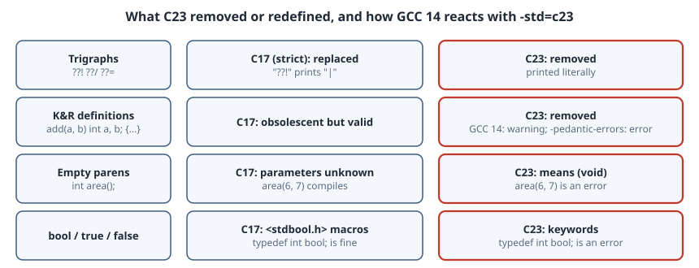

# What C23 Removed: Trigraphs, K&R Definitions and `()` Meaning "Anything"

## Thesis

Most of what is written about C23 lists the additions: `nullptr`, `constexpr`, `#embed`, `typeof`. Old code is more likely to be affected by the **removals**. C23 deletes features that had been in the language since 1989 or earlier:

- trigraphs
- function definitions with identifier lists (K&R style)
- function declarators without prototypes, so `int f();` now means `int f(void);`
- `bool`, `true` and `false` as macros: they are now keywords

C23 also makes two's complement mandatory and turns `realloc(p, 0)` into undefined behaviour. GCC 15 changed its default C dialect from `gnu17` to `gnu23` ([GCC 15 porting guide](https://gcc.gnu.org/gcc-15/porting_to.html)), so these changes now reach code that never asked for C23. This chapter compiles each one as C17 and as C23 so you can see exactly what changes.

{fig-alt="Four rows. Trigraphs: in strict C17 ??! becomes | and ??/ becomes backslash; in C23 they are removed and printed literally. K&R identifier-list definitions: valid in C17; removed in C23, GCC 14 still accepts them with a warning unless -pedantic-errors makes it an error. Empty parentheses int f(): unknown parameters in C17; means (void) in C23, so calls with arguments fail to compile. bool, true, false: macros in C17; keywords in C23, so typedef int bool fails."}

The box has GCC 14.2.0, which supports `-std=c23` but still defaults to `gnu17`. Every result below uses an explicit `-std=` flag, so it matches what GCC 15's new default does for the C23 changes. GCC 15 was not run here.

## The test files

```c
/* trigraph.c */
#include <stdio.h>
int main(void) {
    printf("Really??! (and a path: C:??/temp)\n");
    return 0;
}
```

```c
/* knr.c */
#include <stdio.h>
int add(a, b)
    int a, b;
{
    return a + b;
}
int main(void) { printf("%d\n", add(2, 3)); return 0; }
```

```c
/* emptyparens.c */
#include <stdio.h>
int area();                       /* "unknown parameters" before C23 */
int main(void) {
    printf("%d\n", area(6, 7));
    return 0;
}
int area(int w, int h) { return w * h; }
```

```c
/* booltypedef.c */
#include <stdio.h>
typedef int bool;
#define true 1
#define false 0
int main(void) { bool ok = true; printf("ok=%d\n", ok); return 0; }
```

(The filename comment above each listing isn't part of the compiled file. Line numbers in the diagnostics count from the `#include`.)

```sh
#!/bin/sh
# compile each file as strict C17 and as C23 with GCC 14
for f in trigraph knr emptyparens booltypedef; do
  for std in c17 c23; do
    echo "\$ gcc -std=$std -pedantic -Wall $f.c -o $f && ./$f"
    gcc -std=$std -pedantic -Wall $f.c -o $f 2>&1 && ./$f
    echo "[exit $?]"
  done
done
```

```text
$ gcc -std=c17 -pedantic -Wall trigraph.c -o trigraph && ./trigraph
trigraph.c: In function ‘main’:
trigraph.c:3:19: warning: trigraph ??! converted to | [-Wtrigraphs]
    3 |     printf("Really??! (and a path: C:??/temp)\n");
trigraph.c:3:36: warning: trigraph ??/ converted to \ [-Wtrigraphs]
Really| (and a path: C:	emp)
[exit 0]
$ gcc -std=c23 -pedantic -Wall trigraph.c -o trigraph && ./trigraph
trigraph.c: In function ‘main’:
trigraph.c:3:19: warning: trigraph ??! ignored, use -trigraphs to enable [-Wtrigraphs]
    3 |     printf("Really??! (and a path: C:??/temp)\n");
trigraph.c:3:38: warning: trigraph ??/ ignored, use -trigraphs to enable [-Wtrigraphs]
Really??! (and a path: C:??/temp)
[exit 0]
$ gcc -std=c17 -pedantic -Wall knr.c -o knr && ./knr
5
[exit 0]
$ gcc -std=c23 -pedantic -Wall knr.c -o knr && ./knr
knr.c: In function ‘add’:
knr.c:2:5: warning: old-style function definition [-Wold-style-definition]
    2 | int add(a, b)
      |     ^~~
5
[exit 0]
$ gcc -std=c17 -pedantic -Wall emptyparens.c -o emptyparens && ./emptyparens
42
[exit 0]
$ gcc -std=c23 -pedantic -Wall emptyparens.c -o emptyparens && ./emptyparens
emptyparens.c: In function ‘main’:
emptyparens.c:4:20: error: too many arguments to function ‘area’
    4 |     printf("%d\n", area(6, 7));
      |                    ^~~~
emptyparens.c:2:5: note: declared here
    2 | int area();                       /* "unknown parameters" before C23 */
      |     ^~~~
emptyparens.c: At top level:
emptyparens.c:7:5: error: conflicting types for ‘area’; have ‘int(int,  int)’
    7 | int area(int w, int h) { return w * h; }
      |     ^~~~
emptyparens.c:2:5: note: previous declaration of ‘area’ with type ‘int(void)’
    2 | int area();                       /* "unknown parameters" before C23 */
      |     ^~~~
[exit 1]
$ gcc -std=c17 -pedantic -Wall booltypedef.c -o booltypedef && ./booltypedef
ok=1
[exit 0]
$ gcc -std=c23 -pedantic -Wall booltypedef.c -o booltypedef && ./booltypedef
booltypedef.c:2:13: error: two or more data types in declaration specifiers
    2 | typedef int bool;
      |             ^~~~
booltypedef.c:2:1: warning: useless type name in empty declaration
    2 | typedef int bool;
      | ^~~~~~~
[exit 1]
```

## 1. Trigraphs are gone ([N2940](https://www.open-std.org/jtc1/sc22/wg14/www/docs/n2940.pdf))

Trigraphs such as `??=`, `??/` and `??!` were added in C89 for keyboards without `#`, `\` and `|`. They are replaced in translation phase 1, *inside string literals too*. In strict C17, `"Really??!"` prints `Really|`, and `C:??/temp` turns into `C:` followed by a **tab** and `emp`, because `??/` became `\` and then `\t` became an escape. In C23 both strings print as written.

GNU dialects have ignored trigraphs all along unless you pass `-trigraphs`:

```sh
#!/bin/sh
# GNU dialects ignore trigraphs; K&R definitions under -pedantic-errors; the C23 fix
echo '$ gcc -std=gnu17 trigraph.c -o trigraph && ./trigraph'
gcc -std=gnu17 trigraph.c -o trigraph 2>&1 && ./trigraph
echo '$ gcc -std=c23 -pedantic-errors knr.c -o knr'
gcc -std=c23 -pedantic-errors knr.c -o knr 2>&1; echo "[exit $?]"
echo '$ gcc -std=c17 -Wstrict-prototypes -c emptyparens.c'
gcc -std=c17 -Wstrict-prototypes -c emptyparens.c 2>&1; echo "[exit $?]"
```

```text
$ gcc -std=gnu17 trigraph.c -o trigraph && ./trigraph
trigraph.c: In function ‘main’:
trigraph.c:3:19: warning: trigraph ??! ignored, use -trigraphs to enable [-Wtrigraphs]
    3 |     printf("Really??! (and a path: C:??/temp)\n");
trigraph.c:3:38: warning: trigraph ??/ ignored, use -trigraphs to enable [-Wtrigraphs]
Really??! (and a path: C:??/temp)
$ gcc -std=c23 -pedantic-errors knr.c -o knr
knr.c: In function ‘add’:
knr.c:2:5: error: old-style function definition [-Wold-style-definition]
    2 | int add(a, b)
      |     ^~~
[exit 1]
$ gcc -std=c17 -Wstrict-prototypes -c emptyparens.c
emptyparens.c:2:1: warning: function declaration isn’t a prototype [-Wstrict-prototypes]
    2 | int area();                       /* "unknown parameters" before C23 */
      | ^~~
[exit 0]
```

Who is affected: code built with strict `-std=c89/c99/c11/c17` that contains `??` followed by one of `=/'()!<>-` in a string or comment. In practice that is usually accidental, like `"what??!"` in a log message, and C23 fixes it rather than breaking it. Code that really relies on trigraphs (EBCDIC-era sources) must keep an older `-std` or pass `-trigraphs`.

## 2. K&R function definitions are removed ([N2432](https://www.open-std.org/jtc1/sc22/wg14/www/docs/n2432.pdf))

`int add(a, b) int a, b; { ... }` is no longer C. **GCC 14 doesn't reject it in C23 mode by default.** It accepts it as an extension and prints `-Wold-style-definition`. It becomes an error only with `-pedantic-errors` (second block above). Other compilers may already reject it, and GCC's leniency is not something to depend on.

The fix is mechanical: move the types into the parameter list, `int add(int a, int b)`. With `-Wold-style-definition` turned on, GCC finds every remaining case.

## 3. `()` now means `(void)` ([N2841](https://www.open-std.org/jtc1/sc22/wg14/www/docs/n2841.htm))

This change has the biggest effect. Before C23, `int area();` declared a function with **unknown** parameters. Calls weren't type-checked and every argument went through default promotions. In C23 it declares a function that takes **no** arguments, so `area(6, 7)` fails with "too many arguments", and the later definition `int area(int w, int h)` fails with "conflicting types … previous declaration … with type `int(void)`".

The GCC 15 porting guide gives two common real-world cases: a `void (*handler)();` holding the return value of `signal()`, and hand-written `void *malloc();` declarations that should be an `#include`. You can find these in C17 code before switching with `-Wstrict-prototypes` (last command above), which flags every non-prototype declaration.

## 4. `bool`, `true`, `false` are keywords ([N2934](https://www.open-std.org/jtc1/sc22/wg14/www/docs/n2934.pdf))

C23 makes `bool`, `true`, `false`, `alignas`, `alignof`, `static_assert` and `thread_local` real keywords, and adds the new keyword `nullptr`. Projects that predate `<stdbool.h>` usually have their own `typedef int bool;`. GCC 14 rejects that with "two or more data types in declaration specifiers", and the porting guide shows GCC 15 adding the note "'bool' is a keyword with '-std=c23' onwards". Delete the typedef and the macros. If the code has to build as both C17 and C23, guard them with `#if __STDC_VERSION__ < 202311L`.

## Also changed: representation and `realloc(p, 0)`

- **Two's complement only** ([N2412](https://www.open-std.org/jtc1/sc22/wg14/www/docs/n2412.pdf)). Ones' complement and sign-magnitude are no longer allowed for signed integers. No real compiler is affected. The point is that code may now *assume* two's complement representation. Signed overflow is **still undefined behaviour**.
- **`realloc(p, 0)` is undefined behaviour** ([N2464](https://www.open-std.org/jtc1/sc22/wg14/www/docs/n2464.pdf)). Before C23 it was implementation-defined, and implementations disagreed about whether it frees `p` and what it returns. Write `free(p); p = NULL;` explicitly.

## A migration checklist

1. Build with your current `-std` plus `-Wstrict-prototypes -Wold-style-definition -Wtrigraphs`, and fix every warning. All of these fixes are valid C17 as well.
2. Search for `typedef .* bool`, `#define true` and `#define false`, and guard them with `__STDC_VERSION__`.
3. Search for `realloc(` calls whose size can be zero.
4. Build with `-std=c23 -pedantic-errors` in CI. If you aren't ready, **pin** `-std=gnu17` in your build files so a GCC 15 upgrade doesn't change the language under you.

## Takeaways

- C23 removes trigraphs and K&R definitions, makes `()` mean `(void)`, and turns `bool`/`true`/`false` into keywords.
- The `()` change and the `bool` keyword break real builds. Trigraph removal usually fixes accidental bugs.
- GCC 14 still accepts K&R definitions in `-std=c23` with only a warning, so use `-pedantic-errors` to enforce the standard.
- GCC 15 defaults to `gnu23`. Either port your code or pin `-std=` explicitly.

## Sources

- WG14 [N2940 *Removing trigraphs??!*](https://www.open-std.org/jtc1/sc22/wg14/www/docs/n2940.pdf), [N2432 *Remove support for function definitions with identifier lists*](https://www.open-std.org/jtc1/sc22/wg14/www/docs/n2432.pdf), [N2841 *No function declarators without prototypes*](https://www.open-std.org/jtc1/sc22/wg14/www/docs/n2841.htm), [N2934 *Revise spelling of keywords*](https://www.open-std.org/jtc1/sc22/wg14/www/docs/n2934.pdf), [N2412 *Two's complement sign representation*](https://www.open-std.org/jtc1/sc22/wg14/www/docs/n2412.pdf), [N2464 *Zero-size Reallocations are Undefined Behavior*](https://www.open-std.org/jtc1/sc22/wg14/www/docs/n2464.pdf)
- C23 working draft [N3220](https://www.open-std.org/jtc1/sc22/wg14/www/docs/n3220.pdf)
- GCC, [Porting to GCC 15](https://gcc.gnu.org/gcc-15/porting_to.html) ("C23 by default") and [GCC 15 changes](https://gcc.gnu.org/gcc-15/changes.html)
