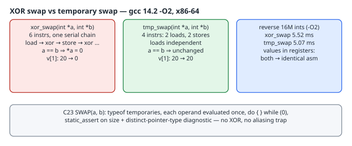

# The XOR-Swap Trap and a Type-Safe C23 `SWAP` Macro

## Thesis

`a ^= b; b ^= a; a ^= b;` swaps two integers without a temporary. It turns up in interview answers, old embedded code and "clever C" threads. On a modern compiler and CPU it has three problems and no benefit:

1. **Aliasing.** If `a` and `b` name the same object, the first XOR sets it to zero, and from then on it stays zero.
2. **Undefined behaviour in the one-liner.** `a ^= b ^= a ^= b` modifies `a` twice without a sequence point between the two modifications.
3. **It isn't faster.** Through pointers it compiles to *more* instructions in a serial dependency chain. With values in registers, the compiler emits the same code for both versions.

A temporary is correct, and C23's standard `typeof` lets you wrap one in a macro that evaluates each operand once and refuses mismatched types. All numbers and diagnostics below come from gcc 14.2.0 (Debian) on x86-64.

{fig-alt="Left: xor_swap through pointers compiles to 6 instructions in one serial load-xor-store chain, and when both pointers name the same object the value becomes 0 (v[1] went from 20 to 0). Middle: tmp_swap compiles to 4 instructions with independent loads, and a self-swap leaves the value unchanged. Right: reversing 16M ints at -O2, xor_swap took 5.52 ms against 5.07 ms for tmp_swap; with values in registers both compile to identical code. Bottom: the C23 SWAP macro uses typeof, evaluates each operand once, and rejects mismatched types."}

## Trap 1: swapping an element with itself

A self-swap happens more often than it sounds. A Fisher–Yates shuffle swaps `v[i]` with `v[j]` where `j` may equal `i`, and a partition step may swap an element with itself.

```c
#include <stdio.h>
static void xor_swap(int *a, int *b) { *a ^= *b; *b ^= *a; *a ^= *b; }
static void tmp_swap(int *a, int *b) { int t = *a; *a = *b; *b = t; }
int main(void) {
    int v[4] = {10, 20, 30, 40};
    int i = 1, j = 1;                       /* e.g. a shuffle that picked the same index */
    tmp_swap(&v[i], &v[j]);  printf("tmp_swap(&v[1], &v[1]) -> v[1] = %d\n", v[1]);
    xor_swap(&v[i], &v[j]);  printf("xor_swap(&v[1], &v[1]) -> v[1] = %d\n", v[1]);
    int x = 3, y = 5;
    xor_swap(&x, &y);        printf("xor_swap(3, 5)         -> %d %d\n", x, y);
    return 0;
}
```

`gcc -std=c23 -O2 -Wall -Wextra alias.c && ./a.out`:

```text
tmp_swap(&v[1], &v[1]) -> v[1] = 20
xor_swap(&v[1], &v[1]) -> v[1] = 0
xor_swap(3, 5)         -> 5 3
```

The compiler gives no warning, and the bug only shows up when two indices happen to collide. With `*a` and `*b` the same object, `*a ^= *b` computes `x ^ x`, which is `0`, and the next two XORs keep it at zero. The usual "fix" is `if (a != b)`, which adds a branch to an idiom whose only selling point was saving a register.

## Trap 2: the one-liner is undefined

```c
#include <stdio.h>
int main(void) { int a = 3, b = 5; a ^= b ^= a ^= b; printf("a=%d b=%d\n", a, b); }
```

```text
oneliner.c: In function ‘main’:
oneliner.c:2:38: warning: operation on ‘a’ may be undefined [-Wsequence-point]
    2 | int main(void) { int a = 3, b = 5; a ^= b ^= a ^= b; printf("a=%d b=%d\n", a, b); }
      |                                      ^~
a=5 b=3
```

It printed the "right" answer on this build, which is what makes it dangerous. The C standard makes it undefined to modify the same scalar twice without the modifications being sequenced ([evaluation order](https://en.cppreference.com/w/c/language/eval_order); C23 [N3220](https://www.open-std.org/jtc1/sc22/wg14/www/docs/n3220.pdf) §6.5). GCC's `-Wsequence-point`, which `-Wall` enables, flags it. Treat that warning as an error.

## Trap 3: it is not faster

```c
void xor_swap(int *a, int *b) { *a ^= *b; *b ^= *a; *a ^= *b; }
void tmp_swap(int *a, int *b) { int t = *a; *a = *b; *b = t; }
int  xor_regs(int a, int b) { a ^= b; b ^= a; a ^= b; return a - b; }
int  tmp_regs(int a, int b) { int t = a; a = b; b = t; return a - b; }
```

`gcc -std=c23 -O2 -S -masm=intel` (directives trimmed):

```text
xor_swap:
	mov	eax, DWORD PTR [rdi]
	xor	eax, DWORD PTR [rsi]
	mov	DWORD PTR [rdi], eax
	xor	eax, DWORD PTR [rsi]
	mov	DWORD PTR [rsi], eax
	xor	DWORD PTR [rdi], eax
	ret
tmp_swap:
	mov	eax, DWORD PTR [rdi]
	mov	edx, DWORD PTR [rsi]
	mov	DWORD PTR [rdi], edx
	mov	DWORD PTR [rsi], eax
	ret
xor_regs:
	mov	eax, esi
	sub	eax, edi
	ret
tmp_regs:
	mov	eax, esi
	sub	eax, edi
	ret
```

Three observations:

- **Through pointers**, `xor_swap` is 6 instructions. Each one depends on the previous result, and the final `xor DWORD PTR [rdi], eax` is a read-modify-write to memory. The compiler *must* keep that shape, because it can't rule out `a == b`, and the XOR version gives a different result (zero) in that case. `tmp_swap` is 4 instructions, with two loads that can issue in parallel followed by two stores.
- **In registers**, both versions compile to the same two instructions. GCC sees through the XOR sequence and just renames registers. A temporary in source code doesn't cost a register in the output.
- The "saves a register" argument comes from machines with very few registers and no register renaming. x86-64 has 16 general-purpose registers plus renaming in hardware.

A micro-benchmark that reverses a 16M-element `int` array in place with each swap (`bench.c`, best of 20 passes, `clock_gettime(CLOCK_MONOTONIC)`, 8-vCPU Intel Xeon VM):

```text
-O2: reverse 16M ints, best of 20: xor_swap 5.52 ms, tmp_swap 5.07 ms (v[0]=0)
-O3: reverse 16M ints, best of 20: xor_swap 5.93 ms, tmp_swap 5.26 ms (v[0]=0)
```

Three more runs of the `-O2` binary gave 8.43/7.58, 7.93/7.27 and 7.42/6.81 ms. Absolute times move around on a shared VM, but `tmp_swap` won every run by about 8–12%. This loop is mostly memory-bound, so the gap is modest. The point is that the XOR version never wins.

## Doing it right: a C23 `SWAP` macro

C23 standardises `typeof`, which GCC and Clang had long supported as an extension ([cppreference](https://en.cppreference.com/w/c/language/typeof)). That makes a type-generic swap possible without passing the type as an argument:

```c
#include <stdio.h>
#include <assert.h>
/* C23: typeof is standard. Same-type check via a pointer assignment, evaluated once. */
#define SWAP(a, b) do {                                           \
        typeof(a) *swap_pa_ = &(a);                                \
        typeof(b) *swap_pb_ = &(b);                                \
        static_assert(sizeof *swap_pa_ == sizeof *swap_pb_,        \
                      "SWAP: operands differ in size");            \
        (void)(swap_pa_ == swap_pb_); /* distinct types -> diagnostic */ \
        typeof(a) swap_t_ = *swap_pa_;                             \
        *swap_pa_ = *swap_pb_;                                     \
        *swap_pb_ = swap_t_;                                       \
    } while (0)
```

Design choices:

- **Each operand is evaluated once.** The macro takes `&(a)` and `&(b)` a single time and works through the pointers, so `SWAP(v[i++], v[2])` increments `i` exactly once. A naive `t = a; a = b; b = t;` macro would evaluate `v[i++]` twice.
- **Self-swap is harmless** because it uses a temporary, not XOR.
- **Type checks.** The `static_assert` catches operands of different sizes at compile time. Comparing the two pointers catches different types of the *same* size (`int` vs `float`), using GCC's `-Wcompare-distinct-pointer-types` ([warning options](https://gcc.gnu.org/onlinedocs/gcc/Warning-Options.html)). Build with `-Werror` to make that a hard error.
- **`do { … } while (0)`** makes the macro a single statement, so `if (x) SWAP(p, q); else …` parses as intended. A GCC [statement expression](https://gcc.gnu.org/onlinedocs/gcc/Statement-Exprs.html) isn't needed, because a swap produces no value.
- The operands must be lvalues. Bit-fields and `register` variables can't have their address taken, so swap those with a plain temporary.

The test driver:

```c
int main(void) {
    int v[3] = {1, 2, 3}; int i = 0;
    SWAP(v[i++], v[2]);           /* i++ evaluated exactly once */
    printf("v = {%d, %d, %d}, i = %d\n", v[0], v[1], v[2], i);
    SWAP(v[1], v[1]);             /* self-swap is harmless */
    printf("self-swap v[1] = %d\n", v[1]);
    double d = 1.5, e = 2.5; SWAP(d, e); printf("d=%.1f e=%.1f\n", d, e);
#ifdef BAD
    int n = 1; long long w = 2; SWAP(n, w);
    float f = 1; SWAP(n, f);
#endif
    return 0;
}
```

```text
v = {3, 2, 1}, i = 1
self-swap v[1] = 2
d=2.5 e=1.5
$ gcc -std=c23 -DBAD -Wall macro.c
macro.c:7:9: error: static assertion failed: "SWAP: operands differ in size"
macro.c:9:25: warning: comparison of distinct pointer types lacks a cast [-Wcompare-distinct-pointer-types]
macro.c:9:25: warning: comparison of distinct pointer types lacks a cast [-Wcompare-distinct-pointer-types]
```

The size assertion fires for `int` vs `long long`, and the distinct-pointer warning fires for `int` vs `float`. GCC also reports that warning on the `long long` line, which is why it appears twice.

## Takeaways

- Never use XOR swap through pointers: it zeroes the value when the pointers alias, and it compiles to a longer dependency chain.
- `a ^= b ^= a ^= b` is undefined behaviour, so keep `-Wall` (which includes `-Wsequence-point`) on and treat it as fatal.
- Write the temporary. The optimiser removes it whenever it can.
- For a reusable swap, use C23 `typeof` with take-the-address-once semantics, plus a size `static_assert` and a pointer-type check.
