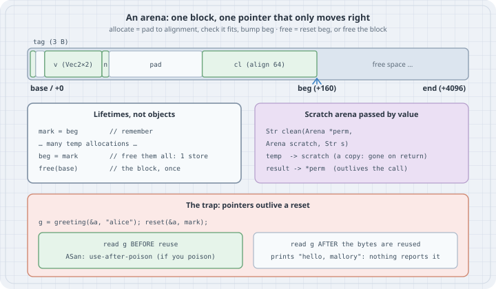

# Arena Allocators: Bump Pointers, Alignment, and Lifetimes Instead of `free()`

## Thesis

Most `malloc`/`free` bugs come from tracking the lifetime of every object one at a time. Many programs don't have a million independent lifetimes, though. They have a few: *this request*, *this frame*, *this parse*, *until exit*. An **arena** (also called a region, bump or linear allocator) matches that shape. It takes one big block and allocates by moving a pointer forward. It frees everything at once by moving the pointer back.

The core is about ten lines. The details that make it correct are:

- **Alignment**: pad before each allocation.
- **Overflow-checked sizes**: never compute `count * size` blindly.
- **An explicit out-of-memory policy.**
- **Honesty about the cost**: a pointer that outlives a reset is a use-after-free that no allocator will catch for you, unless you teach AddressSanitizer about the arena.

## Mental model

{fig-alt="Top: one malloc'd block of 4096 bytes. Allocations are carved left to right: tag (3 bytes) at offset 0, padding, v (two Vec2, 32 bytes) at offset 8, n at offset 40, padding up to 96, cl (64 bytes, aligned to 64), then free space. The beg pointer is at offset 160 and end at 4096. Middle left: lifetimes. Mark saves beg, many temporary allocations follow, setting beg back to mark frees them all with one store, and free(base) releases the block once. Middle right: a scratch arena passed by value to clean(Arena *perm, Arena scratch, Str s); temporaries go to the scratch copy and vanish on return, while the result goes to perm and outlives the call. Bottom: the trap. g is obtained, then the arena is reset. Reading g before the bytes are reused is reported by AddressSanitizer as use-after-poison, if the arena poisons. Reading g after the bytes are reused prints hello, mallory and nothing reports it."}

| | `malloc`/`free` | Arena |
|---|---|---|
| Allocate | general-purpose search of size-class bins | pad + bounds check + pointer add |
| Free one object | `free(p)` | not supported (by design) |
| Free a whole structure | walk it and `free` every node | `beg = mark` or `free(base)`: O(1) |
| Per-object overhead | chunk header (8–16 B on glibc x86-64) plus rounding | only alignment padding |
| Lifetime bugs | per object: double free, leak, UAF | per *region*: pointers that escape the region |
| Tool support | ASan/Valgrind understand it out of the box | ASan only if you add manual poisoning |

## Worked examples

All listings were compiled with **GCC 14.2.0** (Debian), `-std=c17 -Wall -Wextra -O2` (warning-free) against glibc 2.41, and run on an 8-vCPU x86-64 Xeon VM. The current GCC release is **16.2**. Nothing here depends on the compiler version beyond C11 `_Alignof`/`alignas` and the sanitizer interface. Every output block is pasted from a real run.

### The whole allocator

```c
// arena.h — a minimal bump ("linear") arena allocator
#ifndef ARENA_H
#define ARENA_H
#include <stddef.h>
#include <stdint.h>
#include <stdlib.h>
#include <string.h>

#if defined(__has_feature)
#  if __has_feature(address_sanitizer)
#    define ARENA_ASAN 1
#  endif
#endif
#if defined(__SANITIZE_ADDRESS__)
#  define ARENA_ASAN 1
#endif
#ifdef ARENA_ASAN
#  include <sanitizer/asan_interface.h>
// Out-of-line on purpose: GCC 14's -Wmaybe-uninitialized misfires when fresh malloc memory
// is passed straight to the poison call's const volatile void * parameter.
__attribute__((noinline)) static void arena_poison_(void *p, size_t n) { ASAN_POISON_MEMORY_REGION(p, n); }
#  define ARENA_POISON(p, n)   arena_poison_((p), (n))
#  define ARENA_UNPOISON(p, n) ASAN_UNPOISON_MEMORY_REGION((p), (n))
#else
#  define ARENA_POISON(p, n)   ((void)(p), (void)(n))
#  define ARENA_UNPOISON(p, n) ((void)(p), (void)(n))
#endif

typedef struct {
    char *beg;   // next free byte
    char *end;   // one past the last usable byte
} Arena;

// Carve an arena out of one malloc'd block. The caller frees *base once, at the end.
static inline Arena arena_new(size_t cap, void **base)
{
    char *mem = malloc(cap);
    *base = mem;
    Arena a = { mem, mem ? mem + cap : NULL };
    if (mem) ARENA_POISON(a.beg, (size_t)(a.end - a.beg));   // ASan: unallocated bytes are off-limits
    return a;
}

// Allocate count objects of size bytes each, aligned to align (a power of two), zeroed.
// Returns NULL when the arena is exhausted or count*size would overflow.
static inline void *arena_alloc(Arena *a, ptrdiff_t size, ptrdiff_t align, ptrdiff_t count)
{
    ptrdiff_t pad = -(uintptr_t)a->beg & (uintptr_t)(align - 1);
    ptrdiff_t avail = a->end - a->beg - pad;
    if (avail < 0 || count > avail / size) {
        return NULL;                       // checked: no count*size overflow
    }
    char *p = a->beg + pad;
    a->beg = p + count * size;
    ARENA_UNPOISON(p, (size_t)(count * size));
    return memset(p, 0, (size_t)(count * size));
}

#define arena_new_of(a, T, n) ((T *)arena_alloc((a), sizeof(T), _Alignof(T), (n)))

// Scratch lifetimes: remember where we were, and roll back to it later.
static inline char *arena_mark(const Arena *a) { return a->beg; }
static inline void arena_reset(Arena *a, char *mark)
{
    ARENA_POISON(mark, (size_t)(a->beg - mark));
    a->beg = mark;
}
#endif
```

Five decisions in this header deserve a sentence each:

- **Signed sizes** (`ptrdiff_t`). `avail` can go negative when the padding alone doesn't fit. The check `count > avail / size` then rejects any request whose `count * size` would exceed the space left, **without ever computing the overflowing product**.
- **Alignment padding** is `-(uintptr_t)beg & (align - 1)`. That is the distance to the next multiple of a power-of-two `align`. `arena_new_of` feeds it `_Alignof(T)`, so every type gets its own alignment, not a one-size-fits-all 16.
- **Zeroing** in `arena_alloc` makes "zero is a valid initial state" designs free to use and removes a whole class of uninitialised reads. The cost is touching every byte you allocate, so drop the `memset` if you measure it mattering.
- **Out-of-memory returns `NULL`.** Some arenas abort instead, or `longjmp` to a per-request handler. Pick one policy and use it everywhere.
- **ASan poisoning** is compiled in only under `-fsanitize=address`. Case 4 is the reason it exists.

### Case 1: Sizes, padding and the alignment `malloc` doesn't promise

```c
// basics.c — what a bump allocator actually does with sizes and alignment
#include <stdio.h>
#include <stdalign.h>
#include "arena.h"

typedef struct { double x, y; } Vec2;          // alignment 8
typedef struct { alignas(64) char line[64]; } CacheLine;   // alignment 64

int main(void)
{
    void *base;
    Arena a = arena_new(4096, &base);
    char *start = a.beg;

    char     *tag  = arena_new_of(&a, char, 3);
    Vec2     *v    = arena_new_of(&a, Vec2, 2);
    int      *n    = arena_new_of(&a, int, 1);
    CacheLine *cl  = arena_new_of(&a, CacheLine, 1);

    printf("block %% 64 = %zu (malloc only promises %zu)\n",
           (size_t)((uintptr_t)start % 64), alignof(max_align_t));
    printf("tag  at +%-4td size %zu\n", tag - start, 3 * sizeof *tag);
    printf("v    at +%-4td size %zu  (padded to align %zu)\n", (char *)v - start, 2 * sizeof *v, alignof(Vec2));
    printf("n    at +%-4td size %zu\n", (char *)n - start, sizeof *n);
    printf("cl   at +%-4td size %zu  (align %zu: addr %% 64 = %zu)\n", (char *)cl - start, sizeof *cl,
           alignof(CacheLine), (size_t)((uintptr_t)cl % 64));
    printf("used %td of 4096 bytes, 4 allocations, 1 malloc\n", a.beg - start);

    // Overflow-checked: a huge count fails cleanly instead of wrapping.
    void *huge = arena_alloc(&a, sizeof(Vec2), alignof(Vec2), PTRDIFF_MAX / 4);
    printf("huge request -> %s\n", huge ? "non-NULL (BUG)" : "NULL");

    free(base);   // every allocation above is released here, at once
    return 0;
}
```

```text
$ gcc -std=c17 -Wall -Wextra -O2 -o basics basics.c && ./basics
block % 64 = 32 (malloc only promises 16)
tag  at +0    size 3
v    at +8    size 32  (padded to align 8)
n    at +40   size 4
cl   at +96   size 64  (align 64: addr % 64 = 0)
used 160 of 4096 bytes, 4 allocations, 1 malloc
huge request -> NULL
```

Read the offsets. `tag` takes 3 bytes, then 5 bytes of padding, because `Vec2` needs 8-byte alignment. `CacheLine` asks for 64-byte alignment, which is *more* than `malloc` guarantees: C only promises alignment for types with a fundamental alignment, which is `alignof(max_align_t)`, 16 here. The block itself happened to start 32 bytes past a 64-byte boundary. So the arena padded from offset 44 all the way to 96, where the *address* is a multiple of 64. Alignment is about addresses, not offsets: the same code against a different block would pad differently. The last line shows the overflow check working. The request for about 2^61 `Vec2` objects fails cleanly instead of wrapping to a small size.

### Case 2: Two lifetimes, and a scratch arena passed by value

Real programs have at least two lifetimes: results that must survive, and temporaries that only exist while a function runs. Give each one its own arena.

```c
// scratch.c — two lifetimes: a permanent arena for results, a scratch arena passed BY VALUE
#include <ctype.h>
#include <stdio.h>
#include "arena.h"

typedef struct { char *data; ptrdiff_t len; } Str;

// Upper-cased, de-duplicated-spaces copy of s. The temporary work buffer comes from
// `scratch`, a COPY of the caller's arena: anything allocated in it is gone on return.
static Str clean(Arena *perm, Arena scratch, Str s)
{
    char *tmp = arena_new_of(&scratch, char, s.len);      // temporary: dies with this frame
    if (!tmp) return (Str){ NULL, 0 };
    ptrdiff_t n = 0;
    for (ptrdiff_t i = 0; i < s.len; i++) {
        if (s.data[i] == ' ' && (n == 0 || tmp[n - 1] == ' ')) continue;
        tmp[n++] = (char)toupper((unsigned char)s.data[i]);
    }
    while (n > 0 && tmp[n - 1] == ' ') n--;
    Str out = { arena_new_of(perm, char, n + 1), n };     // permanent: outlives the call
    if (!out.data) return (Str){ NULL, 0 };
    memcpy(out.data, tmp, (size_t)n);
    return out;
}

int main(void)
{
    void *pbase, *sbase;
    Arena perm = arena_new(1 << 16, &pbase);
    Arena scratch = arena_new(1 << 16, &sbase);
    char *p0 = perm.beg, *s0 = scratch.beg;

    const char *in[] = { "  hello   arena  ", "bump   pointers are   cheap", " free   it all at once " };
    Str out[3];
    for (int i = 0; i < 3; i++) {
        out[i] = clean(&perm, scratch, (Str){ (char *)in[i], (ptrdiff_t)strlen(in[i]) });
        printf("\"%s\"\n", out[i].data ? out[i].data : "(out of memory)");
    }
    printf("perm used %td bytes, scratch used %td bytes (each call reused the same scratch space)\n",
           perm.beg - p0, scratch.beg - s0);

    // The same thing with explicit mark/reset, for code that holds an Arena * everywhere.
    char *mark = arena_mark(&scratch);
    char *big = arena_new_of(&scratch, char, 4000);
    big[0] = 'x';
    printf("after a 4000-byte temp: scratch used %td\n", scratch.beg - s0);
    arena_reset(&scratch, mark);
    printf("after reset:            scratch used %td\n", scratch.beg - s0);

    free(sbase);
    free(pbase);
    return 0;
}
```

```text
$ gcc -std=c17 -Wall -Wextra -O2 -o scratch scratch.c && ./scratch
"HELLO ARENA"
"BUMP POINTERS ARE CHEAP"
"FREE IT ALL AT ONCE"
perm used 56 bytes, scratch used 0 bytes (each call reused the same scratch space)
after a 4000-byte temp: scratch used 4000
after reset:            scratch used 0
```

`clean` takes `perm` by pointer, because its allocations must persist, and `scratch` **by value**. The callee bumps its *copy* of `beg`, so when it returns, the caller's `scratch` is exactly as it was. Every call reused the same scratch bytes, and `scratch used 0 bytes` at the end. No `free`, no reset call, no way to forget one. For code that already holds an `Arena *` everywhere, `arena_mark`/`arena_reset` gives the same effect explicitly.

### Case 3: What it buys, measured

```c
// bench.c — 1M small nodes: malloc/free per node vs one arena, two workloads
#define _POSIX_C_SOURCE 200809L
#include <stdio.h>
#include <sys/resource.h>
#include <time.h>
#include "arena.h"

typedef struct Node { struct Node *left, *right; uint64_t key; char name[16]; } Node;
enum { N = 1000000, RUNS = 5 };

static double now(void)
{
    struct timespec ts;
    clock_gettime(CLOCK_MONOTONIC, &ts);
    return ts.tv_sec + ts.tv_nsec / 1e9;
}
static long minflt(void)
{
    struct rusage ru;
    getrusage(RUSAGE_SELF, &ru);
    return ru.ru_minflt;
}

static uint64_t rng;
static uint64_t next(void) { rng ^= rng << 13; rng ^= rng >> 7; rng ^= rng << 17; return rng; }

// Workload "list": allocation-dominated (push N nodes on a list).
// Workload "tree": search-dominated (insert N random keys into an unbalanced BST).
static Node *insert(Node *root, Node *n, int tree)
{
    if (!tree) { n->right = root; return n; }
    Node **slot = &root;
    while (*slot) slot = n->key < (*slot)->key ? &(*slot)->left : &(*slot)->right;
    *slot = n;
    return root;
}
static void free_all(Node *n)                       // per-node teardown that malloc forces on you
{
    while (n) { free_all(n->left); Node *r = n->right; free(n); n = r; }
}

static double median(double *v)
{
    for (int i = 1; i < RUNS; i++)
        for (int j = i; j > 0 && v[j] < v[j - 1]; j--) { double t = v[j]; v[j] = v[j - 1]; v[j - 1] = t; }
    return v[RUNS / 2];
}

static void run(int tree, Arena *a)
{
    double bm[RUNS], tm[RUNS], ba[RUNS], ta[RUNS];
    long fm = 0, fa = 0;
    for (int r = 0; r < RUNS; r++) {
        rng = 0x9E3779B97F4A7C15u;
        Node *root = NULL;
        long f0 = minflt();
        double t0 = now();
        for (int i = 0; i < N; i++) {
            Node *n = calloc(1, sizeof *n);
            if (!n) exit(1);
            n->key = next();
            root = insert(root, n, tree);
        }
        double t1 = now();
        free_all(root);
        double t2 = now();
        fm = minflt() - f0;
        bm[r] = t1 - t0; tm[r] = t2 - t1;

        rng = 0x9E3779B97F4A7C15u;
        root = NULL;
        char *mark = arena_mark(a);
        f0 = minflt();
        t0 = now();
        for (int i = 0; i < N; i++) {
            Node *n = arena_new_of(a, Node, 1);
            if (!n) exit(1);
            n->key = next();
            root = insert(root, n, tree);
        }
        t1 = now();
        arena_reset(a, mark);                        // one store releases every node
        t2 = now();
        fa = minflt() - f0;
        ba[r] = t1 - t0; ta[r] = t2 - t1;
    }
    printf("%s workload\n", tree ? "tree (search-dominated)" : "list (allocation-dominated)");
    printf("  malloc  build %7.1f ms  teardown %7.3f ms  minor faults %6ld\n", median(bm) * 1e3, median(tm) * 1e3, fm);
    printf("  arena   build %7.1f ms  teardown %7.3f ms  minor faults %6ld\n", median(ba) * 1e3, median(ta) * 1e3, fa);
}

int main(void)
{
    void *base;                                      // one long-lived arena, reset per run
    Arena a = arena_new((size_t)N * sizeof(Node), &base);
    if (!base) return 1;
    run(0, &a);
    run(1, &a);
    free(base);
    printf("(median of %d runs, %d nodes of %zu bytes; faults from the last run; the arena's first run paid its page faults once)\n", RUNS, N, sizeof(Node));
    return 0;
}
```

```text
$ gcc -std=c17 -Wall -Wextra -O2 -o bench bench.c && ./bench
list (allocation-dominated) workload
  malloc  build     8.1 ms  teardown   6.835 ms  minor faults      0
  arena   build     6.5 ms  teardown   0.000 ms  minor faults      0
tree (search-dominated) workload
  malloc  build   578.1 ms  teardown  59.858 ms  minor faults      0
  arena   build   384.4 ms  teardown   0.000 ms  minor faults      0
(median of 5 runs, 1000000 nodes of 40 bytes; faults from the last run; the arena's first run paid its page faults once)
```

Two results hold up. One doesn't:

- **Teardown is the big, robust win.** Freeing a million nodes one at a time costs roughly 7 ms for a list and roughly 55–60 ms for a tree. The tree walk misses cache on every node. The arena's teardown is a single store, which rounds to 0.000 ms.
- **Allocation itself is somewhat faster** in the allocation-dominated list workload (about 6.5 ms vs 8 ms). Nodes are also denser: 40 bytes each with no 16-byte chunk header in between.
- **Don't trust the tree *build* column.** It is dominated by cache misses during the search, not by the allocator. On this VM it moved by ±40% between variants of the same benchmark. In an earlier variant that `malloc`'d a fresh 40 MB arena block on every run, the arena tree build was about 10% **slower** than `malloc` (≈440–470 ms vs ≈400 ms). That run paid 9,766 minor page faults to first-touch the new block: exactly 40,000,000 / 4096, rounded up. A 40 MB request is far above glibc's `M_MMAP_THRESHOLD`, so unless it can be carved out of heap space `malloc` has just released, it arrives as fresh, untouched pages. The arena wins on build only when the block is reused, and a long-lived, reset-per-request arena is how they're meant to be used anyway.

### Case 4: The trap, a pointer that outlives its reset

```c
// dangling.c — the arena trap: a pointer that outlives its reset
#include <stdio.h>
#include "arena.h"

static const char *greeting(Arena *a, const char *name)
{
    char *s = arena_new_of(a, char, 64);
    if (!s) return "(oom)";
    snprintf(s, 64, "hello, %s", name);
    return s;
}

int main(int argc, char **argv)
{
    int early = argc > 1 && strcmp(argv[1], "early") == 0;  // read the stale pointer before or after reuse?
    void *base;
    Arena a = arena_new(4096, &base);

    char *mark = arena_mark(&a);
    const char *g = greeting(&a, "alice");      // g points into the arena...
    printf("before reset: %s\n", g);
    arena_reset(&a, mark);                      // ...and this just made it dangling
    if (early) printf("stale read:   %s\n", g);  // bytes are poisoned until reused

    const char *h = greeting(&a, "mallory");    // reuses the same bytes
    printf("after reset:  %s   (same address? %s)\n", g, g == h ? "yes" : "no");

    free(base);
    return 0;
}
```

Plain `-O2` build, read after reuse, then read before reuse:

```text
$ ./dangling
before reset: hello, alice
after reset:  hello, mallory   (same address? yes)
$ ./dangling early
before reset: hello, alice
stale read:   hello, alice
after reset:  hello, mallory   (same address? yes)
```

Both runs are bugs: `g` refers to an allocation the program has released. Neither run complains. As far as C and the hardware can tell, the bytes are still part of a live `malloc` block, so there is no crash and nothing to catch. Now build with AddressSanitizer. The arena's `ARENA_POISON`/`ARENA_UNPOISON` hooks switch on, so released bytes are marked unaddressable:

```text
$ gcc -std=c17 -Wall -Wextra -O1 -g -fsanitize=address -fno-omit-frame-pointer -o dangling-asan dangling.c
$ ./dangling-asan early
=================================================================
==309323==ERROR: AddressSanitizer: use-after-poison on address 0x521000000100 at pc 0x7f8175c9c79c bp 0x7ffd1a9226c0 sp 0x7ffd1a921e80
READ of size 13 at 0x521000000100 thread T0
    #0 0x7f8175c9c79b in printf_common ../../../../src/libsanitizer/sanitizer_common/sanitizer_common_interceptors_format.inc:563
    #1 0x7f8175cc849a in vprintf ../../../../src/libsanitizer/sanitizer_common/sanitizer_common_interceptors.inc:1644
    #2 0x7f8175cca08e in printf ../../../../src/libsanitizer/sanitizer_common/sanitizer_common_interceptors.inc:1702
    #3 0x5642669db52c in main /tmp/arena/dangling.c:23
    #4 0x7f8175a35ca7  (/lib/x86_64-linux-gnu/libc.so.6+0x29ca7) (BuildId: 5e5b51f4c39af9ac589408c1dc432ba390a273cc)
    #5 0x7f8175a35d64 in __libc_start_main (/lib/x86_64-linux-gnu/libc.so.6+0x29d64) (BuildId: 5e5b51f4c39af9ac589408c1dc432ba390a273cc)
    #6 0x5642669db150 in _start (/tmp/arena/dangling-asan+0x1150) (BuildId: b7a93a7760343370a47176c7abbe1b9570bfbbc9)

0x521000000100 is located 0 bytes inside of 4096-byte region [0x521000000100,0x521000001100)
allocated by thread T0 here:
    #0 0x7f8175cf4c57 in malloc ../../../../src/libsanitizer/asan/asan_malloc_linux.cpp:69
    #1 0x5642669db398 in arena_new /tmp/arena/arena.h:37
    #2 0x5642669db398 in main /tmp/arena/dangling.c:17
    #3 0x7f8175a35ca7  (/lib/x86_64-linux-gnu/libc.so.6+0x29ca7) (BuildId: 5e5b51f4c39af9ac589408c1dc432ba390a273cc)

SUMMARY: AddressSanitizer: use-after-poison ../../../../src/libsanitizer/sanitizer_common/sanitizer_common_interceptors_format.inc:563 in printf_common
[... shadow-byte map trimmed ...]
```

```text
$ ./dangling-asan
before reset: hello, alice
after reset:  hello, mallory   (same address? yes)
```

That second run is the real lesson. **Poisoning catches a stale read only until the bytes are handed out again.** Once `greeting(&a, "mallory")` re-allocates the same address, `g` is a perfectly valid pointer as far as any tool can tell. It silently reads someone else's data. With `malloc`, ASan holds freed chunks in a quarantine and delays their reuse, so a stale read after `free` is usually still caught. An arena that knows nothing of that reuses the exact address on the very next allocation.

## The trap

The trap is letting a pointer escape the lifetime of its arena. The bug isn't in the allocator. It's in an API that returns arena memory to a caller who doesn't know which arena, or which reset, owns it:

- caching a `const char *` from a per-request arena in a global or long-lived struct;
- keeping an element pointer while "growing" an arena-backed array by copying it to a new allocation (the old pointer still "works" until reuse);
- passing a scratch arena by *pointer* where the code assumed by value (or the reverse), so temporaries outlive, or are freed under, their users;
- resetting a shared arena in one thread while another still reads from it. The ASan interface is explicitly not thread-safe for concurrent poisoning of the same region either.

Two subtler costs are worth knowing:

- ASan's manual poisoning works at 8-byte granularity. `ASAN_UNPOISON_MEMORY_REGION` "may unpoison a super-region" of what you asked for, so tiny overruns into padding can go unreported.
- This arena places allocations back to back, with no redzones, so an overrun from one object into the next is *never* reported. The sanitizer docs suggest leaving poisoned redzones between chunks (see Try this #3).

## The boring rule

> Use an arena when a group of objects shares one lifetime (a request, a frame, a parse, a phase) and free the group, never the member. Size requests with an overflow check, align with `_Alignof(T)`, and choose one out-of-memory policy. Pass scratch arenas **by value** so that temporaries clean themselves up, and keep long-lived results in a separate arena passed by pointer. Never let arena pointers outlive their arena's reset. Make that impossible to miss by keeping arenas out of globals and APIs short-lived. In debug builds, poison on reset under ASan, and keep a build mode where `arena_alloc` calls `malloc`, so the ordinary tools see every object.

## Try this

1. Change `basics.c` to allocate `CacheLine` first. How much padding is left, and why does the answer depend on the address `malloc` returned?
2. Add `void *arena_realloc_last(Arena *a, void *p, ptrdiff_t old, ptrdiff_t new)` that grows in place when `p` was the most recent allocation and copies otherwise. Use it for a growable string builder and count how many copies it makes for 1,000 appends.
3. Give `arena_alloc` a debug-only 16-byte poisoned redzone after every allocation, as the ASan manual-poisoning guide suggests. Write a one-byte overrun from `tag` into `v`, and confirm that ASan reports it now and didn't before.
4. Add `-DARENA_MALLOC` support so that `arena_alloc` calls `calloc` and records each pointer in a list that `arena_reset` frees. Run `dangling.c` under ASan in that mode. What does ASan report for the "late" read now?
5. Rework `bench.c` so that each run uses a fresh arena block created with `arena_new`. Reproduce the page-fault cost from Case 3, then pre-touch the block with `memset` before timing. Which column moves?

## Sources

- ISO C, §6.2.8 Alignment of objects and §7.22.3 Memory management functions ("suitably aligned so that it may be assigned to a pointer to any type of object with a fundamental alignment requirement"; the same section numbers and wording in C11 and C17). Quoted from the public C11 committee draft N1570: <https://www.open-std.org/jtc1/sc22/wg14/www/docs/n1570.pdf>
- GNU C Library manual, "Aligned Memory Blocks" and "Memory Allocation Tunables" (`M_MMAP_THRESHOLD`, `M_TRIM_THRESHOLD`): <https://sourceware.org/glibc/manual/latest/html_node/Aligned-Memory-Blocks.html>, <https://sourceware.org/glibc/manual/latest/html_node/Memory-Allocation-Tunables.html>
- AddressSanitizer manual poisoning (the custom-arena workflow, 8-byte alignment, `allow_user_poisoning`): <https://github.com/google/sanitizers/wiki/AddressSanitizerManualPoisoning>
- Sanitizer interface header `asan_interface.h` (`__asan_poison_memory_region` / `__asan_unpoison_memory_region` semantics and thread-safety note): <https://github.com/llvm/llvm-project/blob/main/compiler-rt/include/sanitizer/asan_interface.h>
- GCC manual, Instrumentation Options (`-fsanitize=address`): <https://gcc.gnu.org/onlinedocs/gcc/Instrumentation-Options.html>
- GCC releases (GCC 16.2 current): <https://gcc.gnu.org/releases.html>
- Linux `getrusage(2)` (`ru_minflt`): <https://man7.org/linux/man-pages/man2/getrusage.2.html>
