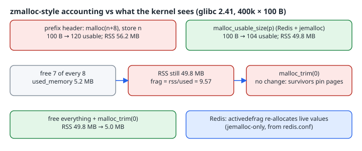

A server that enforces a memory limit needs a number it can trust for "how much am I using?", and plain `malloc` doesn't provide one. Redis solves this with a thin wrapper layer, [`zmalloc.c`](https://github.com/redis/redis/blob/unstable/src/zmalloc.c): every allocation goes through `zmalloc`/`zfree`, which keep a `used_memory` counter. This chapter rebuilds that layer in about 50 lines, uses it to show the gap between `used_memory` and what the kernel reports (RSS), and explains why freeing memory often doesn't lower RSS.

{fig-alt="Prefix header costs 120 usable bytes per 100-byte object and 56.2 MB RSS; malloc_usable_size costs 104 bytes and 49.8 MB. After freeing 7 of every 8, used_memory is 5.2 MB but RSS stays 49.8 MB, ratio 9.57, and malloc_trim(0) cannot help. Freeing everything then trimming returns RSS to 5.0 MB."}

## Two ways to know a block's size

`zfree(p)` has to subtract the size of `p` from the counter, but `free` doesn't tell you what that size was. Redis's source handles both cases:

- **The allocator can report it.** In [`zmalloc.h`](https://github.com/redis/redis/blob/unstable/src/zmalloc.h), jemalloc builds define `HAVE_MALLOC_SIZE` and `zmalloc_size(p)` as `je_malloc_usable_size(p)`; tcmalloc and macOS have their own equivalents. Then `PREFIX_SIZE` is `0`.
- **It can't.** Then `zmalloc.c` sets `PREFIX_SIZE` to `sizeof(size_t)`, allocates `size + PREFIX_SIZE`, stores the size in the header, and returns the pointer just past it.

The real `update_zmalloc_stat_alloc` keeps the count in per-thread entries and only occasionally checks the global total and peak, to avoid contention on a single atomic. The version below uses one atomic counter, which is enough to show the idea:

```c
/* A zmalloc-style accounting wrapper: two strategies, one counter. */
#define _GNU_SOURCE
#include <malloc.h>
#include <stdatomic.h>
#include <stdio.h>
#include <stdlib.h>
#include <string.h>

static _Atomic size_t used_memory;

#ifdef USE_PREFIX
/* No way to ask the allocator for a block's size: store it ourselves. */
#define PREFIX_SIZE sizeof(size_t)
void *zmalloc(size_t n) {
    size_t *p = malloc(n + PREFIX_SIZE);
    if (!p) abort();
    *p = n;
    atomic_fetch_add(&used_memory, n + PREFIX_SIZE);
    return (char *)p + PREFIX_SIZE;
}
void zfree(void *ptr) {
    if (!ptr) return;
    size_t *p = (size_t *)((char *)ptr - PREFIX_SIZE);
    atomic_fetch_sub(&used_memory, *p + PREFIX_SIZE);
    free(p);
}
#define STRATEGY "prefix header"
#else
/* Allocator knows the real block size (what Redis does with jemalloc). */
void *zmalloc(size_t n) {
    void *p = malloc(n);
    if (!p) abort();
    atomic_fetch_add(&used_memory, malloc_usable_size(p));
    return p;
}
void zfree(void *p) {
    if (!p) return;
    atomic_fetch_sub(&used_memory, malloc_usable_size(p));
    free(p);
}
#define STRATEGY "malloc_usable_size"
#endif

static size_t rss_bytes(void) {          /* like zmalloc_get_rss on Linux */
    long pages = 0, rss = 0;
    FILE *f = fopen("/proc/self/statm", "r");
    if (f) { if (fscanf(f, "%ld %ld", &pages, &rss) != 2) rss = 0; fclose(f); }
    return (size_t)rss * 4096;
}

static void report(const char *when, size_t requested) {
    size_t used = atomic_load(&used_memory), rss = rss_bytes();
    printf("%-26s requested=%9zu used_memory=%9zu rss=%9zu frag=%.2f\n",
           when, requested, used, rss, used ? (double)rss / used : 0.0);
}

enum { N = 400000, SZ = 100 };
static void *objs[N];

int main(void) {
    printf("strategy: %s\n", STRATEGY);
    void *one = zmalloc(SZ);
    printf("zmalloc(%d): usable=%zu\n", SZ, malloc_usable_size(
#ifdef USE_PREFIX
        (char *)one - PREFIX_SIZE
#else
        one
#endif
    ));
    zfree(one);
    report("start", 0);
    for (int i = 0; i < N; i++) { objs[i] = zmalloc(SZ); memset(objs[i], 1, SZ); }
    report("after 400k x 100B", (size_t)N * SZ);
    for (int i = 0; i < N; i++) if (i % 8) { zfree(objs[i]); objs[i] = NULL; }
    report("freed 7 of every 8", (size_t)N / 8 * SZ);
    malloc_trim(0);
    report("after malloc_trim(0)", (size_t)N / 8 * SZ);
    for (int i = 0; i < N; i++) zfree(objs[i]);
    report("freed all", 0);
    malloc_trim(0);
    report("freed all + malloc_trim(0)", 0);
    return 0;
}
```

## Real output (gcc 14.2 -O2, glibc 2.41, x86_64)

```text
$ ./zm_usable
strategy: malloc_usable_size
zmalloc(100): usable=104
start                      requested=        0 used_memory=        0 rss=  1675264 frag=0.00
after 400k x 100B          requested= 40000000 used_memory= 41600000 rss= 49778688 frag=1.20
freed 7 of every 8         requested=  5000000 used_memory=  5200000 rss= 49778688 frag=9.57
after malloc_trim(0)       requested=  5000000 used_memory=  5200000 rss= 49774592 frag=9.57
freed all                  requested=        0 used_memory=        0 rss= 49774592 frag=0.00
freed all + malloc_trim(0) requested=        0 used_memory=        0 rss=  4976640 frag=0.00
$ ./zm_prefix
strategy: prefix header
zmalloc(100): usable=120
start                      requested=        0 used_memory=        0 rss=  1572864 frag=0.00
after 400k x 100B          requested= 40000000 used_memory= 43200000 rss= 56160256 frag=1.30
freed 7 of every 8         requested=  5000000 used_memory=  5400000 rss= 56160256 frag=10.40
after malloc_trim(0)       requested=  5000000 used_memory=  5400000 rss= 56160256 frag=10.40
freed all                  requested=        0 used_memory=        0 rss= 56160256 frag=0.00
freed all + malloc_trim(0) requested=        0 used_memory=        0 rss=  4960256 frag=0.00
```

Both builds were also run under `-fsanitize=address` and came out clean.

## What the numbers say

**The allocator rounds up, and the two strategies see it differently.** glibc gave 104 usable bytes for a 100-byte request (a 112-byte chunk). The prefix version asks for 108 bytes and gets 120 usable bytes (a 128-byte chunk), so the 8-byte header really costs 16 bytes per object. Its counter (`n + 8`) still claims 43.2 MB, while the chunks behind it total 51.2 MB. RSS bears this out: 56.2 MB for the prefix build against 49.8 MB for the other. `malloc_usable_size` counts what the allocator actually reserved, which is why Redis prefers it. Note that the [man page](https://man7.org/linux/man-pages/man3/malloc_usable_size.3.html) says it is "intended to only be used for diagnostics and statistics". Accounting is a statistic. Never write into the extra bytes.

**Freeing doesn't give memory back if the survivors are spread out.** After freeing 7 of every 8 objects, `used_memory` fell to 5.2 MB but RSS stayed at 49.8 MB. With 112-byte chunks, each 4 KiB page holds about 36 objects, so about 4 survivors remain on *every* page. No page is empty, and nothing can be returned. [`malloc_trim(0)`](https://man7.org/linux/man-pages/man3/malloc_trim.3.html) also changed nothing. It can only release whole free pages, and there were none. Only after the last objects were freed did the same call bring RSS down to 5.0 MB.

**This is what Redis's ratio measures.** [`INFO memory`](https://redis.io/docs/latest/commands/info/) reports `mem_fragmentation_ratio`, the "Ratio between used_memory_rss and used_memory". The 9.57 above is that ratio for this pathological free pattern. In this toy program the ratio also includes the binary's own pages (about 1.6 MB RSS at start), which is why the docs point to `allocator_frag_ratio` as "the true (external) fragmentation metric".

## What Redis does about it: active defrag

You can't move a C object that other code holds a pointer to, so a general-purpose allocator can't compact the heap. Redis can, because it owns every pointer to its values. [`redis.conf`](https://raw.githubusercontent.com/redis/redis/unstable/redis.conf) describes `activedefrag`: when fragmentation passes a threshold, Redis "will start to create new copies of the values in contiguous memory regions by exploiting certain specific Jemalloc features … and at the same time, will release the old copies". It is "disabled by default, and only works if you compiled Redis to use the copy of Jemalloc we ship". I did not run Redis or jemalloc for this chapter; this section is written from those primary sources.

You can apply the same idea in your own C code without jemalloc. If a structure owns all references to its objects (a hash table of values, say), you can rebuild it after heavy churn: allocate fresh copies, swap them in, then free the old ones. This turns scattered survivors into dense pages and gives `malloc_trim` free pages to return.

## Checklist

- [ ] Route every allocation through one wrapper so the counter means something.
- [ ] Prefer `malloc_usable_size` (or `je_malloc_usable_size`) over a size header: it is more accurate, and the header also costs allocator rounding.
- [ ] Track RSS alongside `used_memory`, and alert on the ratio, not just the counter.
- [ ] Remember that `free` lowers your counter but not necessarily RSS. `malloc_trim` only returns whole free pages.
- [ ] For long-lived, high-churn heaps that own all their pointers, plan compaction (rebuild and swap), as Redis's active defrag does.
