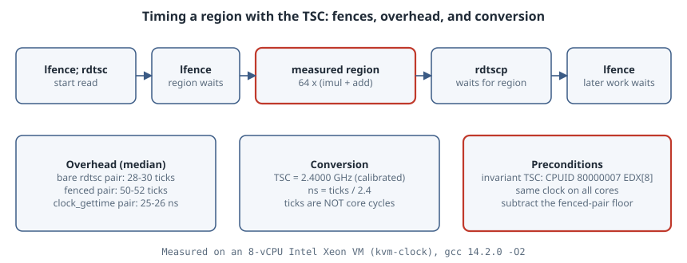

# Timing Code with RDTSC and RDTSCP: Fences, Overhead, and Converting Ticks

## Thesis

The time-stamp counter (TSC) is the cheapest clock on an x86-64 machine: one instruction, no system call, and a resolution well below a nanosecond. That makes it tempting for micro-timing, and it is also why so many TSC measurements are wrong. Used naively, `rdtsc` has three problems:

1. **It is not ordered.** The CPU executes out of order, so a bare `rdtsc` can read the counter before earlier work has finished, or after later work has started.
2. **It has a cost of its own.** A pair of reads costs tens of ticks, which is about the same size as the short regions people try to time with it.
3. **Ticks are not cycles.** On any CPU with an *invariant* TSC, the counter ticks at a fixed reference rate. It does not follow the core clock as it turbos up and down.

This chapter fixes each problem in C, using the GCC/Clang intrinsics `__rdtsc`, `__rdtscp` and `_mm_lfence`, and compares the result with `clock_gettime`. Everything was built with gcc 14.2.0 `-O2 -std=c23` and run on an 8-vCPU Intel Xeon VM whose kernel clocksource is `kvm-clock`.

{fig-alt="Timeline: lfence, rdtsc, lfence, then the measured region, then rdtscp, lfence. Earlier work must retire before the first read, the region cannot start early, and rdtscp waits for the region while later work is fenced off. Measured on this VM: a bare rdtsc pair costs 28 to 30 ticks at the median, a fenced pair 50 to 52 ticks, and a clock_gettime pair 25 to 26 ns. The TSC runs at 2.4 GHz, so ns = ticks / 2.4. Invariant TSC: yes."}

## Step 0: is the TSC usable at all?

The Intel SDM (Vol. 3B, "Time-Stamp Counter") describes the **invariant TSC**: on processors that report it, the counter "will run at a constant rate in all ACPI P-, C-, and T-states". Software detects it with `CPUID.80000007H:EDX[8]`, and `RDTSCP` support with `CPUID.80000001H:EDX[27]`. GCC's `<cpuid.h>` makes that a few lines:

```c
#include <cpuid.h>
#include <stdio.h>
int main(void) {
    unsigned a, b, c, d;
    if (!__get_cpuid(0x80000007, &a, &b, &c, &d)) { puts("leaf 0x80000007 unsupported"); return 1; }
    printf("invariant TSC (CPUID 0x80000007 EDX[8]): %s\n", (d >> 8) & 1 ? "yes" : "no");
    if (__get_cpuid(0x80000001, &a, &b, &c, &d))
        printf("RDTSCP (CPUID 0x80000001 EDX[27]):       %s\n", (d >> 27) & 1 ? "yes" : "no");
    return 0;
}
```

```text
invariant TSC (CPUID 0x80000007 EDX[8]): yes
RDTSCP (CPUID 0x80000001 EDX[27]):       yes
```

On Linux the same facts appear as the `constant_tsc` and `nonstop_tsc` flags in `/proc/cpuinfo`. This VM has both, plus `rdtscp` and `tsc_known_freq`. If the invariant bit is missing, stop here: the counter can change rate with frequency scaling, and you should use `clock_gettime`.

## Step 1: order the reads

The SDM's instruction reference for `RDTSC` is explicit. It is not a serializing instruction and "does not necessarily wait until all previous instructions have been executed before reading the counter". It gives the fix as well: execute `LFENCE` *before* `RDTSC` so that earlier instructions finish first, and `LFENCE` *after* it so that later instructions cannot start before the read.

`RDTSCP` is half-ordered. It "waits until all previous instructions have executed and all previous loads are globally visible", but later instructions may still begin before it reads the counter. So the end of a region needs `rdtscp` followed by `lfence`.

```c
#include <x86intrin.h>   /* __rdtsc, __rdtscp, _mm_lfence */

static inline uint64_t tsc_begin(void) {      /* fence, then read: earlier work must retire first */
    _mm_lfence();
    uint64_t t = __rdtsc();
    _mm_lfence();                              /* keep later loads from starting before the read */
    return t;
}
static inline uint64_t tsc_end(void) {        /* rdtscp waits for earlier instructions */
    unsigned aux;
    uint64_t t = __rdtscp(&aux);
    _mm_lfence();                              /* ...but does not stop later ones running early */
    return t;
}
```

This is the same shape as Intel's benchmarking white paper (Paoloni, *How to Benchmark Code Execution Times on Intel IA-32 and IA-64*), with `lfence` in place of the paper's `cpuid`. `cpuid` fully serializes, but it is far slower and traps to the hypervisor inside a VM. `__rdtscp` also stores `IA32_TSC_AUX` into `aux`. On Linux that holds the CPU number, so you can throw away samples where the thread migrated between the two reads.

## Step 2: measure the measurement

Before timing anything, time *nothing*. Each loop below takes 1,000,001 samples of an empty region and reports min/median/p99. The harness (full listing in the appendix) also calibrates the TSC against `CLOCK_MONOTONIC_RAW` over 200 ms:

```text
TSC frequency: 2.4000 GHz (ticks per ns)

bare rdtsc pair (ticks)      min    24.0  p50    28.0  p99    34.0 ticks
fenced pair (ticks)          min    44.0  p50    52.0  p99    58.0 ticks
clock_gettime pair (ns)      min    21.0  p50    26.0  p99    34.0 ns
64 dep. mul-add, fenced      min    80.0  p50    89.2  p99   105.8 ns
64 dep. mul-add, clock_gettime min    82.0  p50    93.0  p99   107.0 ns
```

How to read this:

- **The TSC runs at 2.4000 GHz here.** That is the nominal frequency of the virtual CPU, so `ns = ticks / 2.4`.
- **A bare pair costs 28–30 ticks** (about 12 ns), and **the fenced pair costs 50–52 ticks** (about 21 ns). That 50-tick floor is part of every fenced number, so subtract it, or keep the region large enough that it doesn't matter.
- **A `clock_gettime` pair costs 25–26 ns.** On Linux, `clock_gettime` runs in the vDSO and does not enter the kernel. With `kvm-clock` it reads the TSC and scales it using parameters the hypervisor shares with the guest. It costs about the same as the fenced TSC pair, and returns nanoseconds you don't need to calibrate.

The last two lines time a real region: 64 iterations of a dependent `x = x * A + C`. The compiler emits a tight `imulq`/`addq` loop (checked with `gcc -S`). Both clocks agree: about 89 ns median, which is roughly 214 ticks.

## Step 3: ticks are not core cycles

On most x86-64 cores, `imul r64, r64` has 3-cycle latency and `add` has 1, so 64 iterations of the dependency chain take about **256 core cycles**. Subtract the fenced-pair floor from the median and you get about 214 − 51 ≈ **163 TSC ticks**. The region took fewer ticks than cycles because this core was running faster than the 2.4 GHz reference clock. The ratio suggests about 1.57 × 2.4 ≈ 3.8 GHz. That figure is an inference from latency tables, not a measurement; to count real core cycles, use the `cycles` event in `perf stat`.

That is the main thing to understand about an invariant TSC: it measures **wall time** at a fixed rate. That makes it a good clock, but it can't tell you how many cycles your code took.

## When to use which

| Need | Use |
|---|---|
| Wall time, portable, nanoseconds | `clock_gettime(CLOCK_MONOTONIC)` (vDSO, ~25 ns per pair here) |
| Smallest possible overhead in a hot loop you will aggregate | bare `__rdtsc()` and many samples. Accept reordering noise |
| One short region, ordered | `lfence; rdtsc; lfence` … `rdtscp; lfence`, minus the fenced-pair floor |
| Core cycles or instructions | `perf stat -e cycles,instructions`, not the TSC |
| No invariant TSC (old or odd hardware) | `clock_gettime` only |

## Pitfalls

- **Forgetting the floor.** A region measured as "52 ticks" with fenced reads is empty.
- **Reporting the mean.** The p99 values above are about 2× the median even on an idle VM. Interrupts and vCPU preemption produce a long tail. Report min and median, and keep the distribution.
- **Assuming the reference rate.** Calibrate, or read it from `tsc_known_freq`/`dmesg`. Don't hard-code a number from the CPU name.
- **Migrating threads.** Pin the thread (`taskset -c 2 ./tsc`) or check `aux` from `rdtscp`. Invariant TSCs are synchronized across cores on modern platforms, but pinning also removes migration noise.
- **Non-x86 targets.** `x86intrin.h` is x86-only. AArch64 has `CNTVCT_EL0`, a fixed-frequency virtual counter with similar semantics. Hide whichever one you use behind a function.

## Takeaways

- Check `CPUID.80000007H:EDX[8]` (or `constant_tsc`/`nonstop_tsc`) before trusting the TSC.
- Fence both ends: `lfence; rdtsc; lfence` to start, `rdtscp; lfence` to finish.
- Measure an empty region first and subtract it.
- Divide by the calibrated TSC frequency to get nanoseconds, and remember that this is wall time, not core cycles.
- If you are not trying to shave the last 10 ns off the probe, `clock_gettime` is just as accurate.

## Sources

- Intel® 64 and IA-32 Architectures Software Developer's Manual, [Vol. 2B instruction reference for RDTSC and RDTSCP](https://www.intel.com/content/www/us/en/developer/articles/technical/intel-sdm.html), and Vol. 3B §"Time-Stamp Counter" (invariant TSC)
- Gabriele Paoloni, [How to Benchmark Code Execution Times on Intel IA-32 and IA-64 Instruction Set Architectures](https://www.intel.com/content/dam/www/public/us/en/documents/white-papers/ia-32-ia-64-benchmark-code-execution-paper.pdf) (Intel white paper)
- Linux man-pages, [clock_gettime(2)](https://man7.org/linux/man-pages/man2/clock_gettime.2.html) and [vdso(7)](https://man7.org/linux/man-pages/man7/vdso.7.html)
- GCC, [x86 built-in functions](https://gcc.gnu.org/onlinedocs/gcc/x86-Built-in-Functions.html)

## Appendix: the full harness

```c
/* tsc.c — timing with RDTSC/RDTSCP vs clock_gettime (x86-64, gcc/clang) */
#define _GNU_SOURCE
#include <stdint.h>
#include <stdio.h>
#include <stdlib.h>
#include <time.h>
#include <x86intrin.h>   /* __rdtsc, __rdtscp, _mm_lfence */

static inline uint64_t tsc_begin(void) {      /* fence, then read: earlier work must retire first */
    _mm_lfence();
    uint64_t t = __rdtsc();
    _mm_lfence();                              /* keep later loads from starting before the read */
    return t;
}
static inline uint64_t tsc_end(void) {        /* rdtscp waits for earlier instructions */
    unsigned aux;
    uint64_t t = __rdtscp(&aux);
    _mm_lfence();                              /* ...but does not stop later ones running early */
    return t;
}
static uint64_t now_ns(void) {
    struct timespec ts;
    clock_gettime(CLOCK_MONOTONIC_RAW, &ts);
    return (uint64_t)ts.tv_sec * 1000000000ull + (uint64_t)ts.tv_nsec;
}
static int cmp_u64(const void *a, const void *b) {
    uint64_t x = *(const uint64_t *)a, y = *(const uint64_t *)b;
    return (x > y) - (x < y);
}
#define N 1000001
static uint64_t s[N];
static void report(const char *name, double scale, const char *unit) {
    qsort(s, N, sizeof s[0], cmp_u64);
    printf("%-28s min %7.1f  p50 %7.1f  p99 %7.1f %s\n", name,
           s[0] * scale, s[N / 2] * scale, s[N / 100 * 99] * scale, unit);
}
volatile uint64_t sink;

int main(void) {
    /* 1. calibrate: TSC ticks per ns against CLOCK_MONOTONIC_RAW over 200 ms */
    uint64_t n0 = now_ns(), t0 = tsc_begin();
    while (now_ns() - n0 < 200000000ull) { }
    uint64_t n1 = now_ns(), t1 = tsc_end();
    double ghz = (double)(t1 - t0) / (double)(n1 - n0);
    printf("TSC frequency: %.4f GHz (ticks per ns)\n\n", ghz);

    /* 2. cost of the measurement itself: empty region */
    for (int i = 0; i < N; i++) { uint64_t a = __rdtsc(); uint64_t b = __rdtsc(); s[i] = b - a; }
    report("bare rdtsc pair (ticks)", 1, "ticks");
    for (int i = 0; i < N; i++) { uint64_t a = tsc_begin(); uint64_t b = tsc_end(); s[i] = b - a; }
    report("fenced pair (ticks)", 1, "ticks");
    for (int i = 0; i < N; i++) { uint64_t a = now_ns(); uint64_t b = now_ns(); s[i] = b - a; }
    report("clock_gettime pair (ns)", 1, "ns");

    /* 3. a real region: 64 dependent multiply-adds (~4 cycles each on most cores) */
    for (int i = 0; i < N; i++) {
        uint64_t x = (uint64_t)i | 1;
        uint64_t a = tsc_begin();
        for (int k = 0; k < 64; k++) x = x * 6364136223846793005ull + 1442695040888963407ull;
        uint64_t b = tsc_end();
        sink = x; s[i] = b - a;
    }
    report("64 dep. mul-add, fenced", 1 / ghz, "ns");
    for (int i = 0; i < N; i++) {
        uint64_t x = (uint64_t)i | 1;
        uint64_t a = now_ns();
        for (int k = 0; k < 64; k++) x = x * 6364136223846793005ull + 1442695040888963407ull;
        uint64_t b = now_ns();
        sink = x; s[i] = b - a;
    }
    report("64 dep. mul-add, clock_gettime", 1, "ns");
    return 0;
}
```

Build and run with `gcc -O2 -std=c23 -Wall -Wextra -o tsc tsc.c && ./tsc`.
