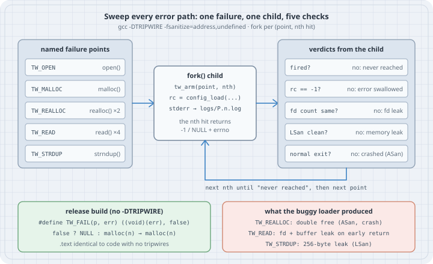

# Testing the Error Paths: Deterministic Failure Injection

## Thesis

The `goto`-cleanup ladder is C's answer to "undo what I did if a later step fails". It is also the code your tests run least. Happy-path tests never take it, sanitizers only watch the paths that actually run, and code review reads it once. The leaks, double frees, and leaked descriptors hiding in error paths surface in production, on the day `malloc` or `read` finally fails.

The fix is mechanical. Put a **named failure point** in front of every fallible call. In a test build, make any one of them fail on its *n*-th hit. Then **sweep** the whole space, every point at every hit, with AddressSanitizer and LeakSanitizer watching. In a release build the failure points compile to a constant `false`, and the object code is byte-for-byte identical to code that never had them.

This is the C version of Mitchell Hashimoto's Tripwire library for Zig's `errdefer`. It also matches the "fail the *n*-th allocation, then increase *n*" loop that SQLite has used for its out-of-memory and I/O-error testing for years.

## Mental model

```text
  int fd = TW_FAIL(TW_OPEN, EMFILE) ? -1   : open(path, O_RDONLY | O_CLOEXEC);
  buf    = TW_FAIL(TW_MALLOC, ENOMEM) ? NULL : malloc(cap);
           \______________________/   \___/   \___________/
            test build: true on the    what the   the real call
            armed point's nth hit,     real call
            and sets errno             returns on failure
            release build: false
```

{fig-alt="Left: five named failure points TW_OPEN, TW_MALLOC, TW_REALLOC hit twice, TW_READ hit four times, TW_STRDUP. Middle: a forked child arms one point at its nth hit and runs config_load with stderr to a log. Right: verdicts: fired or never reached, rc -1 or error swallowed, fd count or fd leak, LSan clean or memory leak, normal exit or crash. A loop arrow says next nth until never reached, then next point. Bottom: release build macro is false and .text is identical; the buggy loader produced a double free, an fd plus buffer leak, and a 256-byte leak."}

Four rules make it work:

| Rule | Why |
|------|-----|
| A failure point returns **exactly what the real call returns on failure**, and sets `errno` | The code under test can't tell an injected failure from a real one |
| Points are **named**, not just counted | A report says `TW_REALLOC hit 2`, not "allocation #7", and adding one allocation elsewhere does not renumber everything |
| Each injection runs in a **fresh child process** | One double free can't abort the sweep, and leak and descriptor counts start clean |
| The harness checks the point **actually fired** | A point your fixture never reaches is untested, and the sweep must say so instead of printing `ok` |

## Worked examples

All listings were run on Debian 13 x86_64 with **GCC 14.2.0** (`gcc (Debian 14.2.0-19)`), glibc 2.41, and Linux 6.12. The current upstream release is GCC 16.2 (2026-08-07). Nothing here depends on a newer compiler: `-Wuse-after-free` has existed since GCC 12, and ASan/LSan long before that. The files live in one directory:

```bash
mkdir -p tripwire/logs && cd tripwire
```

### Case 1: A loader whose happy-path test passes under ASan

`config_load` reads a whole file and duplicates its first line as the name. It is written in the common ladder style, with labels that free "everything allocated so far". Three bugs are planted, all of them in error paths.

```c
/* config.h — load a small config file: first line is the name. */
#ifndef CONFIG_H
#define CONFIG_H
#include <stddef.h>

struct config {
    char *name; /* first line, owned */
    char *body; /* whole file, owned, not NUL-terminated */
    size_t len;
};

int config_load(const char *path, struct config *out); /* 0 or -1 + errno */
void config_free(struct config *c);
#endif
```

```c
/* config.c — a typical goto-ladder loader, with three planted bugs. */
#define _POSIX_C_SOURCE 200809L /* open flags, strndup, ssize_t */
#include "config.h"
#include "tripwire.h"

#include <errno.h>
#include <fcntl.h>
#include <stdlib.h>
#include <string.h>
#include <unistd.h>

int config_load(const char *path, struct config *out)
{
    int fd = TW_FAIL(TW_OPEN, EMFILE) ? -1 : open(path, O_RDONLY | O_CLOEXEC);
    if (fd < 0)
        return -1;

    size_t cap = 64, len = 0;
    char *buf = TW_FAIL(TW_MALLOC, ENOMEM) ? NULL : malloc(cap);
    if (!buf)
        goto out_close;

    for (;;) {
        if (len == cap) {
            char *nbuf = TW_FAIL(TW_REALLOC, ENOMEM) ? NULL : realloc(buf, cap * 2);
            if (!nbuf) {
                free(buf);
                goto out_free; /* BUG 1: out_free frees buf again */
            }
            buf = nbuf;
            cap *= 2;
        }
        ssize_t n = TW_FAIL(TW_READ, EIO) ? -1 : read(fd, buf + len, cap - len);
        if (n < 0)
            return -1; /* BUG 2: leaks buf and fd */
        if (n == 0)
            break;
        len += (size_t)n;
    }

    char *nl = memchr(buf, '\n', len);
    size_t nlen = nl ? (size_t)(nl - buf) : len;
    char *name = TW_FAIL(TW_STRDUP, ENOMEM) ? NULL : strndup(buf, nlen);
    if (!name)
        goto out_close; /* BUG 3: skips free(buf) */

    out->name = name;
    out->body = buf;
    out->len = len;
    close(fd);
    return 0;

out_free:
    free(buf);
out_close:
    close(fd);
    return -1;
}

void config_free(struct config *c)
{
    free(c->name);
    free(c->body);
    *c = (struct config){0};
}
```

`tripwire.h` (shown in full in Case 2) is included, but in this build `TW_FAIL` is the constant `false`, so this is just the plain loader. The test most projects ship:

```c
/* test_happy.c — the test most projects stop at. */
#include "config.h"

#include <stdio.h>

int main(void)
{
    struct config c = {0};
    if (config_load("fixture.conf", &c) != 0) {
        perror("config_load");
        return 1;
    }
    printf("name=%s len=%zu\n", c.name, c.len);
    config_free(&c);
    return 0;
}
```

`fixture.conf` is 183 bytes: a first line `web-frontend` followed by ten `keyNN = value-NN` lines.

```
$ gcc -std=c17 -Wall -Wextra -g -fsanitize=address,undefined -o test_happy test_happy.c config.c
config.c: In function ‘config_load’:
config.c:54:5: warning: pointer ‘buf’ used after ‘free’ [-Wuse-after-free]
   54 |     free(buf);
      |     ^~~~~~~~~
config.c:27:17: note: call to ‘free’ here
   27 |                 free(buf);
      |                 ^~~~~~~~~
$ ./test_happy
name=web-frontend len=183
exit=0
```

GCC's `-Wuse-after-free` (in `-Wall`) catches **bug 1**, because the `free` / `goto` / `free` sequence is visible within one function. Bugs 2 and 3 are invisible to it. Both are legal C that drops a resource on the floor. The test passes, and ASan and LSan stay silent because no error path ran.

### Case 2: The tripwire header and its zero-cost release build

Points are declared once with an X-macro, which gives both the enum and printable names. The test-only implementation is a counter.

```c
/* tripwire.h — named failure points that vanish from release builds. */
#ifndef TRIPWIRE_H
#define TRIPWIRE_H

#include <stdbool.h>

/* Every fallible call site gets a name. Add new points here. */
#define TW_POINTS(X) \
    X(TW_OPEN)       \
    X(TW_MALLOC)     \
    X(TW_REALLOC)    \
    X(TW_READ)       \
    X(TW_STRDUP)

#define TW_ENUM(name) name,
enum tw_point { TW_POINTS(TW_ENUM) TW_NPOINTS };
#undef TW_ENUM

#ifdef TRIPWIRE
/* Test build: a real function that may fail the call. */
bool tw_fail(enum tw_point p, int err);
void tw_arm(enum tw_point p, unsigned nth); /* fail the nth hit of p */
void tw_reset(void);
bool tw_fired(void);                        /* did the armed point trip? */
const char *tw_name(enum tw_point p);
#define TW_FAIL(p, err) tw_fail((p), (err))
#else
/* Release build: a constant the compiler folds away. */
#define TW_FAIL(p, err) ((void)(err), false)
#endif

#endif
```

```c
/* tripwire.c — only compiled into test binaries (-DTRIPWIRE). */
#include "tripwire.h"

#include <errno.h>

static enum tw_point armed = TW_NPOINTS; /* nothing armed */
static unsigned target, hits;
static bool fired;

#define TW_NAME(name) #name,
static const char *const names[] = { TW_POINTS(TW_NAME) };

bool tw_fail(enum tw_point p, int err)
{
    if (p != armed || ++hits != target)
        return false;
    fired = true;
    errno = err; /* look exactly like the real failure */
    return true;
}

void tw_arm(enum tw_point p, unsigned nth) { armed = p; target = nth; hits = 0; fired = false; }
void tw_reset(void) { tw_arm(TW_NPOINTS, 0); }
bool tw_fired(void) { return fired; }
const char *tw_name(enum tw_point p) { return names[p]; }
```

The claim that release builds pay nothing is cheap to check. Strip every `TW_FAIL(...) ? x :` prefix with `sed` to get the loader as if tripwires had never existed, then compare machine code. This uses the fixed loader from Case 4, but the result is the same for any file.

```sh
#!/bin/sh
# zero_cost.sh — is the release build identical to code with no tripwires?
set -e
sed -E 's/TW_FAIL\(TW_[A-Z]+, E[A-Z]+\) \? [^:]+ : //' config_fixed.c \
    | grep -v '#include "tripwire.h"' > config_plain.c
gcc -std=c17 -O2 -c config_fixed.c -o release.o          # no -DTRIPWIRE
gcc -std=c17 -O2 -c config_plain.c -o plain.o
gcc -std=c17 -O2 -DTRIPWIRE -c config_fixed.c -o test.o
size release.o plain.o test.o
echo "tw_ symbols in release.o: $(nm release.o | grep -c tw_ || true)"
echo "tw_ symbols in test.o:    $(nm test.o | grep -c tw_ || true)"
objcopy -O binary --only-section=.text release.o release.text
objcopy -O binary --only-section=.text plain.o plain.text
cmp release.text plain.text && echo ".text of release.o and plain.o: identical"
```

```
$ ./zero_cost.sh
   text	   data	    bss	    dec	    hex	filename
    486	      0	      0	    486	    1e6	release.o
    486	      0	      0	    486	    1e6	plain.o
    598	      0	      0	    598	    256	test.o
tw_ symbols in release.o: 0
tw_ symbols in test.o:    1
.text of release.o and plain.o: identical
```

The release object's `.text` is **identical** to the code with no tripwires, and it has no `tw_` symbols. In the test build the macro becomes a real call to `tw_fail`, which costs 112 bytes in this function and only exists in test binaries.

### Case 3: The sweep finds all three bugs

The harness arms one `(point, nth)` pair per child and runs the loader. It then checks, in order, that the point fired, that the error was reported, that no descriptor leaked, and that LeakSanitizer is clean (`__lsan_do_recoverable_leak_check()`). A crash is caught from the exit status. Sanitizer output goes to a per-injection log, and the sweep prints the last `SUMMARY:` line.

```c
/* test_sweep.c — fail every point at every hit, one child per failure. */
#define _POSIX_C_SOURCE 200809L
#include "config.h"
#include "tripwire.h"

#include <dirent.h>
#include <fcntl.h>
#include <sanitizer/lsan_interface.h>
#include <stdio.h>
#include <stdlib.h>
#include <string.h>
#include <sys/wait.h>
#include <unistd.h>

enum { OK = 0, NOT_REACHED = 10, NOT_REPORTED = 11, FD_LEAK = 12, MEM_LEAK = 13 };

static int count_fds(void)
{
    int n = 0;
    DIR *d = opendir("/proc/self/fd");
    for (struct dirent *e; d && (e = readdir(d));)
        n += e->d_name[0] != '.';
    if (d)
        closedir(d);
    return n - 1; /* the DIR's own descriptor */
}

static int child(const char *fixture, enum tw_point p, unsigned nth)
{
    struct config c = {0};
    int fds = count_fds();
    tw_arm(p, nth);
    int rc = config_load(fixture, &c);
    if (!tw_fired())
        return NOT_REACHED; /* the nth hit never happened */
    if (rc != -1)
        return NOT_REPORTED; /* error swallowed */
    if (count_fds() != fds)
        return FD_LEAK;
    if (__lsan_do_recoverable_leak_check())
        return MEM_LEAK;
    return OK;
}

/* Last "SUMMARY:" line the sanitizer wrote, if any. */
static void summary(const char *log, char *out, size_t n)
{
    char line[512];
    FILE *f = fopen(log, "r");
    out[0] = '\0';
    while (f && fgets(line, sizeof line, f))
        if (strncmp(line, "SUMMARY:", 8) == 0)
            snprintf(out, n, "%.*s", (int)strcspn(line + 9, "\n"), line + 9);
    if (f)
        fclose(f);
}

int main(int argc, char **argv)
{
    const char *fixture = argc > 1 ? argv[1] : "fixture.conf";
    int failures = 0;

    for (int p = 0; p < TW_NPOINTS; p++) {
        for (unsigned nth = 1;; nth++) {
            char log[64];
            snprintf(log, sizeof log, "logs/%s.%u.log", tw_name(p), nth);
            fflush(stdout);
            pid_t pid = fork();
            if (pid == 0) {
                int fd = open(log, O_WRONLY | O_CREAT | O_TRUNC, 0644);
                dup2(fd, STDERR_FILENO);
                close(fd);
                _exit(child(fixture, p, nth));
            }
            int st;
            waitpid(pid, &st, 0);
            int code = WIFEXITED(st) ? WEXITSTATUS(st) : 128 + WTERMSIG(st);
            if (code == NOT_REACHED) {
                if (nth == 1) {
                    printf("%-10s never reached: this fixture cannot test it\n", tw_name(p));
                    failures++;
                }
                break;
            }
            char sum[256];
            summary(log, sum, sizeof sum);
            const char *verdict = code == OK             ? "ok"
                                  : code == NOT_REPORTED ? "FAIL error swallowed"
                                  : code == FD_LEAK      ? "FAIL fd leak"
                                  : code == MEM_LEAK     ? "FAIL memory leak"
                                                         : "FAIL crashed";
            printf("%-10s hit %u: %s%s%s\n", tw_name(p), nth, verdict, *sum ? " | " : "", sum);
            failures += code != OK;
        }
    }
    printf("%d failing injection(s)\n", failures);
    return failures != 0;
}
```

```bash
gcc -std=c17 -Wall -Wextra -g -DTRIPWIRE -fsanitize=address,undefined \
    -o test_sweep test_sweep.c config.c tripwire.c   # same warning as Case 1
```

```
$ ./test_sweep
TW_OPEN    hit 1: ok
TW_MALLOC  hit 1: ok
TW_REALLOC hit 1: FAIL crashed | AddressSanitizer: double-free ../../../../src/libsanitizer/asan/asan_malloc_linux.cpp:52 in free
TW_REALLOC hit 2: FAIL crashed | AddressSanitizer: double-free ../../../../src/libsanitizer/asan/asan_malloc_linux.cpp:52 in free
TW_READ    hit 1: FAIL fd leak
TW_READ    hit 2: FAIL fd leak
TW_READ    hit 3: FAIL fd leak
TW_READ    hit 4: FAIL fd leak
TW_STRDUP  hit 1: FAIL memory leak | AddressSanitizer: 256 byte(s) leaked in 1 allocation(s).
7 failing injection(s)
exit=1
```

```
$ grep -m1 -A3 ERROR logs/TW_REALLOC.1.log
==116016==ERROR: AddressSanitizer: attempting double-free on 0x506000000020 in thread T0:
    #0 0x7f7f722f38f8 in free ../../../../src/libsanitizer/asan/asan_malloc_linux.cpp:52
    #1 0x56374c5752a8 in config_load /tmp/tripwire/config.c:54
    #2 0x56374c5746c5 in child /tmp/tripwire/test_sweep.c:33
```

Every planted bug is pinned to a named point:

- **`TW_REALLOC` → double free (bug 1).** The `realloc` failure path frees `buf`, then jumps to a label that frees it again. ASan aborts the child with the exact line, `config.c:54`.
- **`TW_READ` → fd leak (bug 2).** The early `return -1` skips both `free(buf)` and `close(fd)`. The descriptor check fires first, and LSan would have reported the buffer too. Note that **every** read iteration is a separate test. A bug that only appears on the fourth read would be caught here as well.
- **`TW_STRDUP` → memory leak (bug 3).** `goto out_close` skips `free(buf)`. By then `buf` has been `realloc`ed to 256 bytes, which is exactly what LSan reports.
- `TW_OPEN` and `TW_MALLOC` are `ok`. Those paths really were correct, and now there is evidence for it.

### Case 4: One cleanup block, and a clean sweep

The bugs share a cause: each label encodes a guess about which resources are live at that point, and the guesses rot as the function changes. The robust shape gives every resource an "empty" value (`-1`, `NULL`) up front. There is **one** exit label that releases whatever is non-empty. Success hands ownership to the caller by setting the locals back to empty. `errno` is saved around the cleanup, because `close` may change it.

```c
/* config_fixed.c — one cleanup block, every resource starts "empty". */
#define _POSIX_C_SOURCE 200809L /* open flags, strndup, ssize_t */
#include "config.h"
#include "tripwire.h"

#include <errno.h>
#include <fcntl.h>
#include <stdlib.h>
#include <string.h>
#include <unistd.h>

int config_load(const char *path, struct config *out)
{
    int rc = -1, saved;
    int fd = -1;
    char *buf = NULL, *name = NULL;
    size_t cap = 64, len = 0;

    fd = TW_FAIL(TW_OPEN, EMFILE) ? -1 : open(path, O_RDONLY | O_CLOEXEC);
    if (fd < 0)
        goto out;

    buf = TW_FAIL(TW_MALLOC, ENOMEM) ? NULL : malloc(cap);
    if (!buf)
        goto out;

    for (;;) {
        if (len == cap) {
            char *nbuf = TW_FAIL(TW_REALLOC, ENOMEM) ? NULL : realloc(buf, cap * 2);
            if (!nbuf)
                goto out; /* buf is still valid and still ours */
            buf = nbuf;
            cap *= 2;
        }
        ssize_t n = TW_FAIL(TW_READ, EIO) ? -1 : read(fd, buf + len, cap - len);
        if (n < 0)
            goto out;
        if (n == 0)
            break;
        len += (size_t)n;
    }

    char *nl = memchr(buf, '\n', len);
    name = TW_FAIL(TW_STRDUP, ENOMEM) ? NULL : strndup(buf, nl ? (size_t)(nl - buf) : len);
    if (!name)
        goto out;

    /* Success: hand ownership to the caller, then clean up as usual. */
    *out = (struct config){ .name = name, .body = buf, .len = len };
    name = buf = NULL;
    rc = 0;
out:
    saved = errno; /* close() may overwrite it */
    free(name);
    free(buf);
    if (fd >= 0)
        close(fd);
    errno = saved;
    return rc;
}

void config_free(struct config *c)
{
    free(c->name);
    free(c->body);
    *c = (struct config){0};
}
```

```bash
gcc -std=c17 -Wall -Wextra -g -DTRIPWIRE -fsanitize=address,undefined \
    -o test_sweep_fixed test_sweep.c config_fixed.c tripwire.c
```

```
$ ./test_sweep_fixed
TW_OPEN    hit 1: ok
TW_MALLOC  hit 1: ok
TW_REALLOC hit 1: ok
TW_REALLOC hit 2: ok
TW_READ    hit 1: ok
TW_READ    hit 2: ok
TW_READ    hit 3: ok
TW_READ    hit 4: ok
TW_STRDUP  hit 1: ok
0 failing injection(s)
exit=0
$ ./test_sweep_fixed tiny.conf
TW_OPEN    hit 1: ok
TW_MALLOC  hit 1: ok
TW_REALLOC never reached: this fixture cannot test it
TW_READ    hit 1: ok
TW_READ    hit 2: ok
TW_STRDUP  hit 1: ok
1 failing injection(s)
exit=1
```

The full fixture gives nine injections and nine passes, with no compiler warnings. Keep the second run in mind: it is the trap.

## The trap

**A failure point the fixture never reaches is a test that silently passes.** The bug in Case 3's `realloc` path only exists for files larger than the initial 64-byte buffer. Run the *buggy* loader's sweep against a 13-byte fixture:

```bash
printf 'tiny\nk = v\n' > tiny.conf
```

```
$ ./test_sweep tiny.conf
TW_OPEN    hit 1: ok
TW_MALLOC  hit 1: ok
TW_REALLOC never reached: this fixture cannot test it
TW_READ    hit 1: FAIL fd leak
TW_READ    hit 2: FAIL fd leak
TW_STRDUP  hit 1: FAIL memory leak | AddressSanitizer: 64 byte(s) leaked in 1 allocation(s).
4 failing injection(s)
exit=1
```

The double free is gone from the report. It hasn't been fixed. The code is just never executed. A harness that only checks "returned -1 and no leaks" would count that row as a pass. Checking `tw_fired()` turns "untested" into a visible failure: `never reached: this fixture cannot test it`. The fixed loader's sweep against `tiny.conf` fails for the same reason, which is correct. Coverage of error paths depends on the input as much as on the injection, so keep at least one fixture that drives every point. Treat "never reached" as a red build, not as a skip.

Other ways to fool yourself:

- **Injecting failures the real call can't produce.** `read` can return a short count or fail with `EINTR`. `malloc(0)` may legitimately return `NULL`. Injected behaviour must match the man page, otherwise you test code paths that only exist in your harness.
- **Testing in the same process.** Without `fork`, the first double free aborts the whole sweep, and one leak pollutes every later leak check.
- **Counting instead of naming.** "Fail allocation #7" breaks every time someone adds an allocation upstream. Named points keep the numbering stable.
- **Shipping the test build.** `-DTRIPWIRE` belongs in the test target only. Case 2's `nm` check is a cheap CI assertion that release objects carry no `tw_` symbols.

## The boring rule

Every fallible call in code that owns resources gets a named `TW_FAIL` point. Every such function gets a sweep in CI that forks a child per `(point, nth hit)`, runs under ASan and LSan, checks the return value and the descriptor count, and fails the build on "never reached". Write cleanup as one exit block over resources that start "empty", and verify with `nm` that release objects contain no tripwire code.

## Try this

1. Record the injected `errno` in `tripwire.c` and expose it (say, `tw_errno()`). Make the child assert that `config_load` returns with that exact `errno`. Then delete the `saved = errno` lines from `config_fixed.c` and find a point where `close()` would clobber it. (Hint: it may not on Linux, so check what POSIX promises.)
2. Add a `TW_CLOSE` point and decide what the loader should do when `close` fails on the success path.
3. Add an `errorAfter`-style mode, "fail every hit from *n* on", and rerun the sweep. Which points behave differently from single failures?
4. Port the harness to a function you own that has a ladder of three or more labels. Count the bugs before you start, then count them after.
5. Turn Case 2's `zero_cost.sh` into a CI step that fails if `nm release.o | grep tw_` finds anything.

## Sources

- Mitchell Hashimoto, "Don't Trip[wire] Yourself: Testing Error Recovery in Zig" (2026-01-21): <https://mitchellh.com/writing/tripwire>
- SQLite, "How SQLite Is Tested": Out-Of-Memory Testing and I/O Error Testing: <https://www.sqlite.org/testing.html#oomtesting>
- AddressSanitizer and LeakSanitizer (Google sanitizers wiki): <https://github.com/google/sanitizers/wiki/AddressSanitizer>, <https://github.com/google/sanitizers/wiki/AddressSanitizerLeakSanitizer>
- `__lsan_do_recoverable_leak_check` interface, compiler-rt `sanitizer/lsan_interface.h`: <https://github.com/llvm/llvm-project/blob/main/compiler-rt/include/sanitizer/lsan_interface.h>
- GCC manual, `-Wuse-after-free`: <https://gcc.gnu.org/onlinedocs/gcc/Warning-Options.html#index-Wuse-after-free>
- SEI CERT C, MEM12-C "Consider using a goto chain when leaving a function on error when using and releasing resources": <https://wiki.sei.cmu.edu/confluence/display/c/MEM12-C.+Consider+using+a+goto+chain+when+leaving+a+function+on+error+when+using+and+releasing+resources>
- POSIX.1-2024 `read()`, `close()`, and `malloc()` (error returns and `errno`): <https://pubs.opengroup.org/onlinepubs/9799919799/functions/read.html>, <https://pubs.opengroup.org/onlinepubs/9799919799/functions/close.html>, <https://pubs.opengroup.org/onlinepubs/9799919799/functions/malloc.html>
- GCC releases (GCC 16.2, 2026-08-07): <https://gcc.gnu.org/>
